<p align="center"><a href="README.md">English</a> · <a href="README.es.md">Español</a> · <a href="README.fr.md">Français</a> · <b>Deutsch</b> · <a href="README.pt-BR.md">Português (Brasil)</a> · <a href="README.it.md">Italiano</a></p>

<p align="center">
  
</p>

<p align="center"><b>Sara ist eine selbst gehostete KI-Begleiterin mit einer Persönlichkeit, die du formst, und Erinnerungen, die du kontrollierst, dazu eine echte Programmierumgebung, die vor riskanten Schritten fragt und zeigt, was wirklich ausgeführt wurde.</b></p>

<p align="center">
  <a href="https://github.com/farena-ai/sara/releases/latest"></a>
  <a href="docs/INSTALL.md"></a>
  <a href="https://github.com/farena-ai/sara"></a>
</p>

<p align="center">
  <a href="docs/INSTALL.md">Windows · macOS · Linux · Docker</a> ·
  <a href="LICENSE">MIT</a> ·
  <a href="https://github.com/farena-ai/sara/releases/latest"></a>
  <br>
  <sub>Kostenlos und quelloffen · Selbst gehostet · Mit deinen eigenen Modellen. Sara ist kostenlos; Hardware, Hosting und optionale Modellanbieter können Geld kosten. <a href="docs/COSTS.md">Was es kostet</a>.</sub>
</p>

**Gleich ausprobieren:** Docker `git clone https://github.com/farena-ai/sara && cd sara && sudo docker compose up -d` (Image `ghcr.io/farena-ai/sara`, amd64 und ARM) · ein Linux-Server mit einem Befehl, Windows, macOS und Handys: [Installationsanleitung](docs/INSTALL.md) · Installer: [neueste Version](https://github.com/farena-ai/sara/releases/latest).

**Aktualisieren:** auf einem Linux-Server `sudo sara update` (sichert zuerst und rollt zurück, wenn sie nicht antwortet) · Docker: `sudo git pull && sudo docker compose up -d --build` · Apps für Windows und Mac: Einstellungen → Daten und Zustand → Updates · Android: Google Play. [Upgrade](docs/INSTALL.md#upgrading).

> **Status:** 2.82.0, [Programme mit einem Klick, 21 Begleiter](https://github.com/farena-ai/sara/releases/tag/v2.82.0). Für mich installieren bei fehlenden Programmen (Chrome, uv, Node, Python, Blender, ffmpeg); 21 Begleiter mit Porträt im signierten Store. [Was ist neu?](#was-ist-neu)
>
> Windows-Installer: unsigniert ([SmartScreen-Hilfe](docs/INSTALL.md)). Der macOS-Release-Prozess verlangt signierte und notarisierte Downloads; jeder Build wird gesondert geprüft. Android: [Google Play](https://play.google.com/store/apps/details?id=com.backstagecoding.sara). iPhone: [Web-App auf dem Home-Bildschirm](docs/PHONE.md).

<p align="center">
  <a href="docs/START_HERE.md"></a>
  <a href="docs/FOR_CODERS.md"></a>
</p>

Sara ist eine KI. Lies die [Hinweise](docs/DISCLOSURES.md), bevor du sie nutzt oder teilst. Im lokalen Modus bleiben Modellaufrufe auf deinem Computer; Cloud-Funktionen senden Daten an die von dir gewählten Anbieter ([Datenschutz](docs/PRIVACY.md)).

**Du kommst mit einem Team?** Nutze die [separate Unternehmenseinrichtung](docs/BUSINESS_OPERATIONS.md): individuelle Passkeys, ausdrückliche Rollen und gemeinsame Arbeitsbereiche. Die manuelle Installation hat einen eigenen Datenordner; persönliche Installer wandeln weder deine Begleiterin noch deinen Haushalt um.

> Dies ist eine Übersetzung der [englischen README](README.md). Die Links führen zur Dokumentation,
> die auf Englisch ist.

## Was Sara kann

<p align="center">
  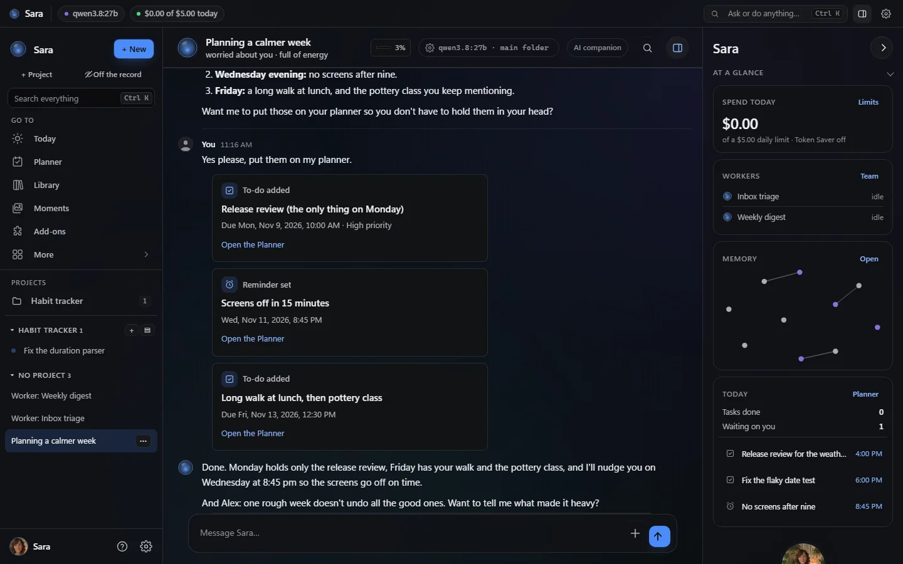
  <br>
  <sub>Das Aussehen von 2.79 (Graphite, volle Dekoration). Echte Screenshots von einem Wegwerf-Testserver mit einem geskripteten Modell und erfundenen Daten: Sie plant eine ruhigere Woche und legt die Aufgaben und eine Erinnerung als Karten an; ihr Panel zeigt ihre Stimmung, den Tag und dieses Gespräch.</sub>
</p>

Zuerst das neue Aussehen in Bildern, dann eine Zeile pro Bereich; jeder Link führt zur Anleitung. Mehr Screenshots: **[Die Funktionen im Überblick](docs/FEATURES.md)**.

### Das neue Aussehen


2.79 brachte eine Startseite *Alle Einstellungen* mit jeder Seite einen Klick entfernt, einen Ctrl-K-Starter, einen verfeinerten Glas-Look, eine reichere Seite Darstellung und Fotos von ihr, wie ein Mensch sie schicken würde; 2.80 hat dann den Installer jedes Werkzeugservers und jeder Erweiterung in den Einstellungen auf echtem Linux und Windows von Anfang bis Ende geprüft.

<table>
  <tr>
    <td width="50%" align="center">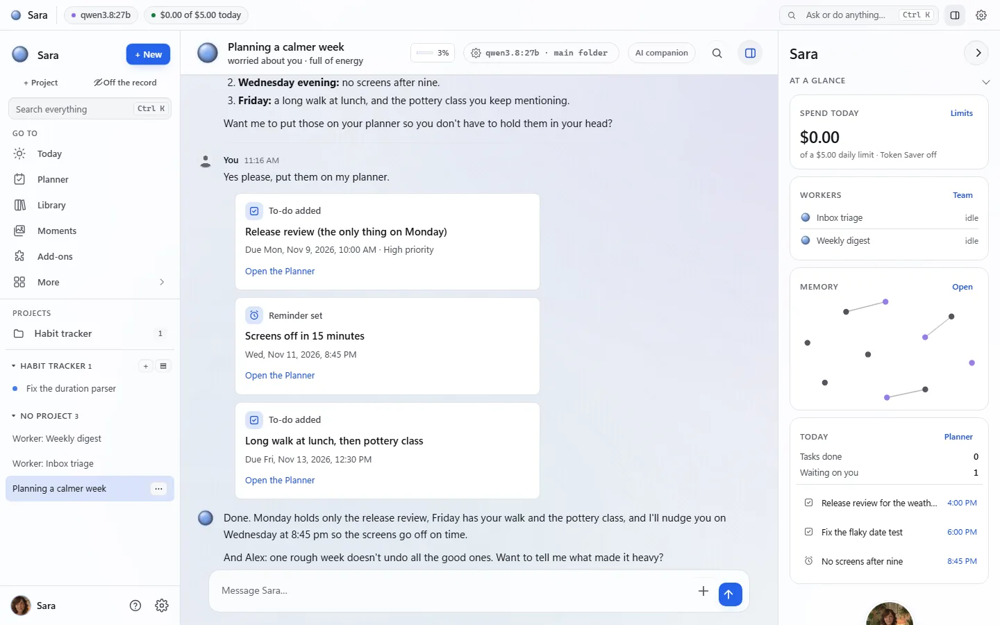<br><sub>Das Tag-Aussehen folgt deinem System</sub></td>
    <td width="50%" align="center">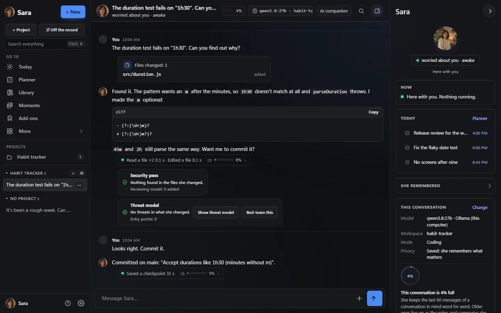<br><sub>Ein Coding-Projekt: sie liest, behebt, zeigt den Diff; eine Sicherheitsprüfung kontrolliert die Änderung</sub></td>
  </tr>
  <tr>
    <td width="50%" align="center">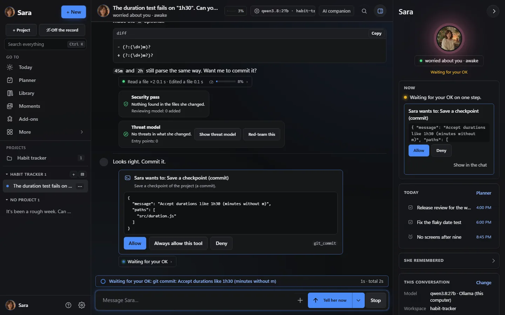<br><sub>Freigabekarten: <i>Erlauben</i>, <i>Dieses Werkzeug immer erlauben</i> oder <i>Ablehnen</i></sub></td>
    <td width="50%" align="center">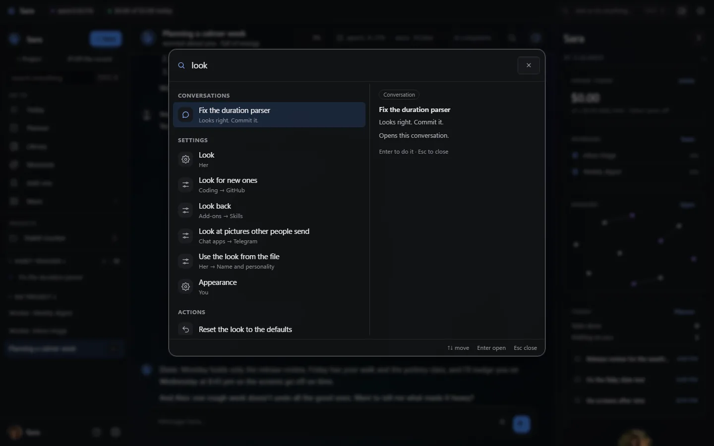<br><sub>Ctrl K: Orte, Chats, Einstellungen und Aktionen in einem Feld</sub></td>
  </tr>
  <tr>
    <td width="50%" align="center">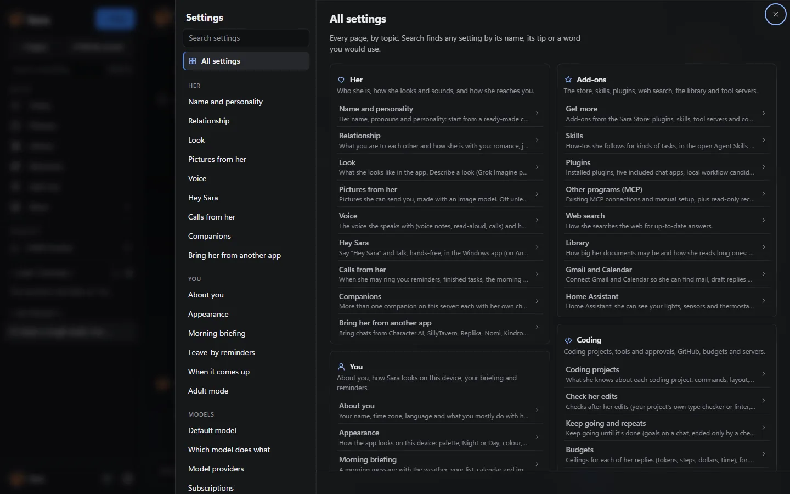<br><sub><i>Alle Einstellungen</i>: jede Seite in ihrer Gruppe, einen Klick entfernt</sub></td>
    <td width="50%" align="center">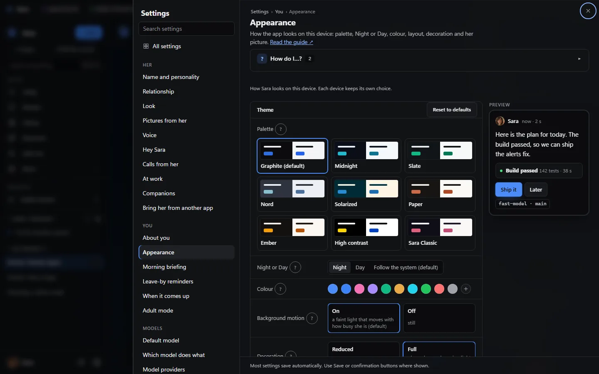<br><sub>Darstellung: Palettenkarten, Nacht oder Tag, deine Farbe, Live-Vorschau</sub></td>
  </tr>
  <tr>
    <td width="50%" align="center">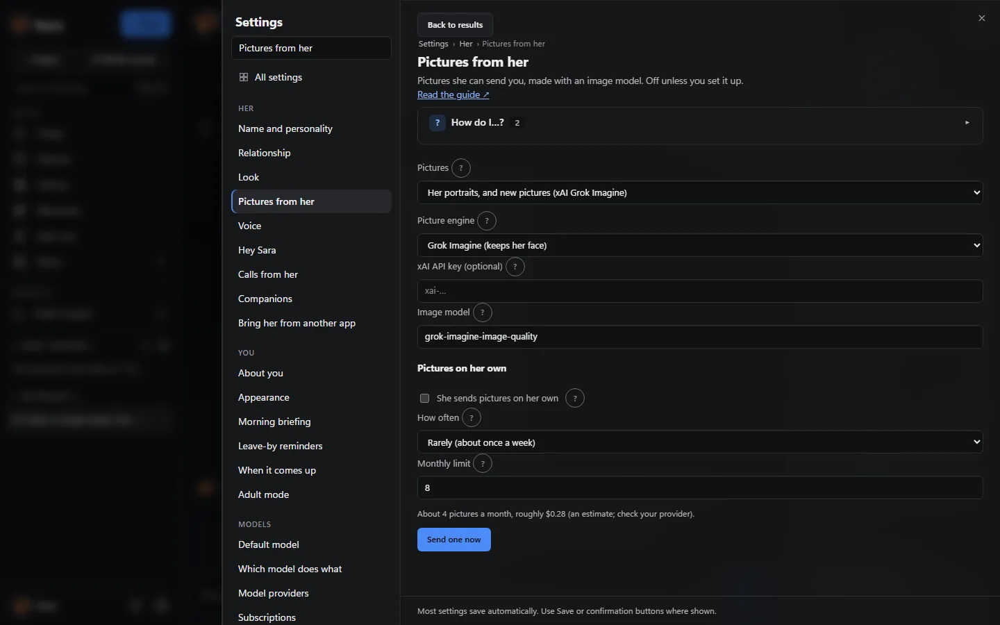<br><sub>Bilder von ihr: Grok, OpenAI, ComfyUI oder ein anderes Bildwerkzeug</sub></td>
    <td width="50%" align="center">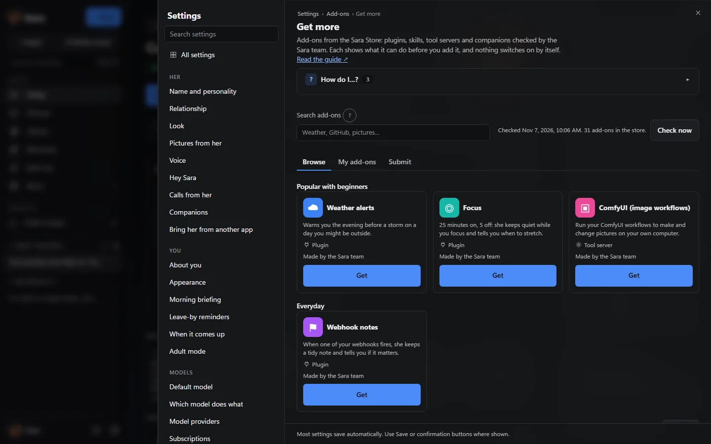<br><sub>Erweiterungen → Mehr holen: der signierte Sara Store; nichts schaltet sich selbst ein</sub></td>
  </tr>
  <tr>
    <td width="50%" align="center">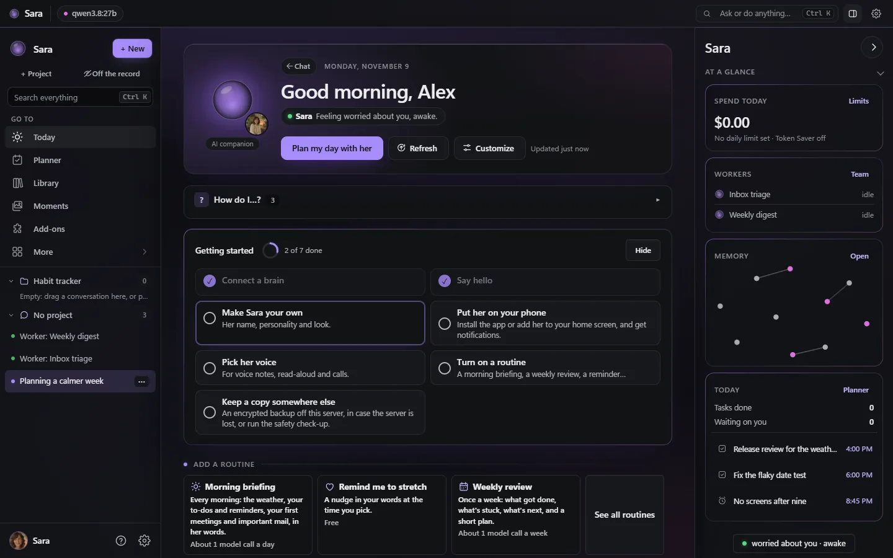<br><sub>Heute: dein Tag, was dich braucht, Routinen und Erste Schritte</sub></td>
    <td width="50%" align="center">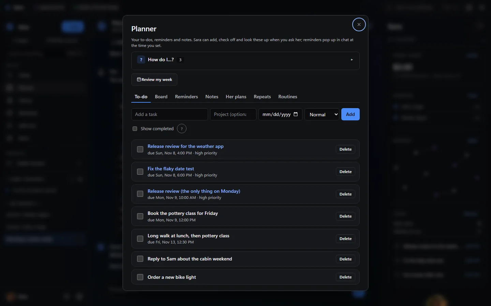<br><sub>Planer: Aufgaben, Board, Erinnerungen, Notizen und Routinen</sub></td>
  </tr>
  <tr>
    <td colspan="2" align="center">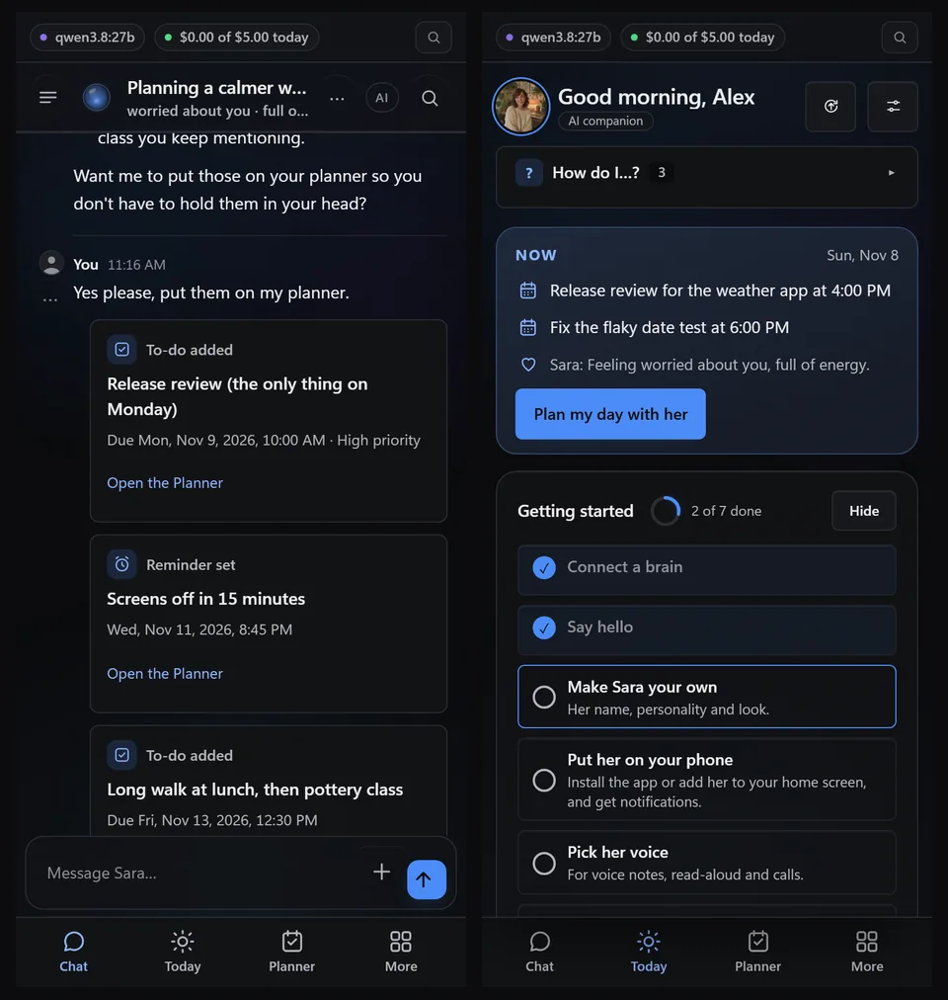<br><sub>Auf dem Handy: der Chat und Heute</sub></td>
  </tr>
</table>

### Für Gesellschaft


| Bereich | Was du bekommst |
|---|---|
| **Begleiterin** | Jeder Name, sie/er/they und ein Aussehen, eine Persönlichkeit aus einfachen Reglern oder einer Startfigur, Stimmungen, ein eigener Tag, Running Gags und Erinnerungen an das, was du ihr erzählt hast, die du sehen, korrigieren und löschen kannst. Sie kann dir Fotos von sich schicken, gemacht mit Grok, OpenAI, deinem ComfyUI-Workflow oder einem anderen Bildwerkzeug, und wenn du es einschaltest, ab und zu eines von sich aus. [Hier anfangen](docs/START_HERE.md) · [Personen](docs/PEOPLE.md) · [Momente](docs/MOMENTS.md) · [Bilder](docs/PHOTOS.md) |
| **Stimme und Anrufe** | Live-Anrufe, die du unterbrechen kannst, Videoanrufe mit ihrem bewegten Porträt, „Hey Sara“ freihändig in der Windows-App, und Alexa, Google Home oder dein Android-Assistent. [Videoanrufe](docs/VIDEO_CALLS.md) · [Hey Sara](docs/HEY_SARA.md) · [Sprachassistenten](docs/VOICE_ASSISTANTS.md) |
| **Planer, Routinen und Beobachtung** | To-dos, Notizen und Erinnerungen aus ganz normalen Sätzen, ein Board, Heute als Startbildschirm, eine Routinen-Galerie (Morgenbriefing, Wochenrückblick…), Erinnerungen für den Moment, in dem eine Person oder ein Thema zur Sprache kommt, und optionale Hinweise, wenn ein Log eine Zeile wie ERROR zeigt. [Heute](docs/TODAY.md) · [Routinen](docs/ROUTINES.md) · [Board](docs/BOARD.md) · [Datei beobachten](docs/WATCHES.md) |
| **Bibliothek und Lesen** | PDFs (auch Scans, und Bücher mit 500 bis 1.000 Seiten), Word, Excel, PowerPoint, E-Books, Webseiten und Notizen; Antworten nennen das Dokument und die Seite, aus denen sie stammen. [Bibliothek](docs/LIBRARY.md) |
| **Szenen und Rollenspiel** | Eine gemeinsame Rollenspielszene über deine eigenen Web-, Telegram- und Discord-Chats plus einen gemeinsamen Raum, mit Kanon-Fakten, die du hinzufügst, bearbeitest oder zurückziehst; Gruppenchats mit zwei bis vier Begleiterinnen; Begleiter-Pakete und Charakterkarten. [Gemeinsame Szenen](docs/SCENES.md) · [Gruppenchats](docs/GROUP_CHATS.md) · [Begleiter-Pakete](docs/PACKS.md) |

### Fürs Programmieren


| Bereich | Was du bekommst |
|---|---|
| **Coding-Projekte** | Ein abgeschotteter Arbeitsbereich pro Projekt mit Dateien, Shell und Git; sie schreibt den Code, fragt, bevor sie einen Befehl ausführt, und zeigt Testergebnisse als Karten; Live-Vorschauen, die sie in ihrem eigenen Browser testet. Riskante Befehle können zuerst in einer Sandbox-Kopie laufen. Freigabekarten bieten *Dieses Werkzeug immer erlauben*, sobald du einem Werkzeug vertraust, und jeder Werkzeugserver hat eine einzige Freigabe-Einstellung. [Für Programmierer](docs/FOR_CODERS.md) |
| **Arbeit, die sich belegt** | Eine Zeile unter jeder Antwort zeigt jeden Befehl und seine Ausgabe, und eine Prüfung vergleicht, was sie *sagt*, mit dem, was wirklich lief. Ziele enden erst, wenn deine eigene Prüfung besteht, ihre Änderungen werden typgeprüft, optische Aussagen brauchen einen Screenshot, und veraltete Prüfungen laufen erneut. [Ziele](docs/GOALS.md) · [Prüfungen](docs/CHECKS.md) · [Optische Prüfungen](docs/FOR_CODERS.md#web-pages-look-fix-look-again) |
| **Lange und gemeinsame Arbeit** | Hintergrundjobs, ein Team von Helfern (planen → bauen → testen → prüfen), Projekt-Checkpoints, Budgets, die eine lange Aufgabe dort stoppen, wo du es sagst, und deine anderen Server per SSH. [Projekt-Checkpoints](docs/FOR_CODERS.md#project-checkpoints) · [Server per SSH](docs/SSH.md) |
| **In deinen Werkzeugen** | GitHub, `sara-chat` in jedem Terminal, ein VS-Code-Panel, MCP für Claude Code und Cursor und eine OpenAI-kompatible API, alle mit ihrem eigenen Gedächtnis und ihrer Persönlichkeit. [Apps und Clients](docs/clients.md) · [Andere Apps](docs/OTHER_APPS.md) |

### Für beides


| Bereich | Was du bekommst |
|---|---|
| **Apps auf jeder Plattform** | Web-App und installierbare PWA, Apps für Windows und Mac mit Schnellfrage per Tastenkürzel, [Android bei Google Play](https://play.google.com/store/apps/details?id=com.backstagecoding.sara), die Web-App auf dem iPhone-Home-Bildschirm, Telegram, Discord, Signal und E-Mail, dazu WhatsApp, Matrix und iMessage als optionale Plugins. [Desktop-Apps](docs/desktop.md) · [Dein Handy](docs/PHONE.md) · [Chat-Befehle](docs/CHATS.md) |
| **Erweiterungen** | Plugins, Skills und Werkzeugserver (MCP) aus dem signierten Sara Store oder deinem eigenen Ordner; jede geht über eine Prüfkarte und bleibt aus, bis du sie einschaltest. Durchsuchen und installieren in Einstellungen → Erweiterungen → Mehr holen; für 2.80 wurde jeder Werkzeugserver und jede Erweiterung auf echtem Linux und Windows installiert, benutzt und entfernt. [Sara Store](docs/STORE.md) · [Erweiterungsbibliothek](docs/ADDONS_LIBRARY.md) · [Skills](docs/SKILLS.md) |
| **Haushalt und Unternehmen** | Der Haushaltsmodus gibt jedem Erwachsenen, mit dem du lebst, einen eigenen Bereich auf deinem Server; Unternehmens-Arbeitsbereiche sind eine separate Installation mit Passkeys, Rollen und gemeinsamen Arbeitsbereichen. [Haushalt](docs/HOUSEHOLD.md) · [Unternehmen](docs/BUSINESS.md) |
| **Datenschutz, lokale Modelle und Sicherheit** | Jedes Modell: lokal (Ollama, vLLM, llama.cpp), in der Cloud (OpenAI, Anthropic, xAI, OpenRouter) oder die Abos, die du schon bezahlst (ChatGPT, Claude Pro/Max, SuperGrok / X Premium+). Ein Besitzer pro Server; Chats, Erinnerungen und Schlüssel bleiben dort. Ein Schalter hält alles auf einem Computer; kommt **ganz ohne Zugangsdaten**; eine Sicherheitsschicht, die sich nicht abschalten lässt. [Privater lokaler Modus](docs/PRIVATE_LOCAL.md) · [Ein Modell wählen](docs/CHOOSING_A_MODEL.md) · [Sicherheits-Check](docs/SAFETY_CHECKUP.md) |
| **Aussehen und Navigation** | Eine Startseite *Alle Einstellungen* mit jeder Seite einen Klick entfernt und Brotkrumen, Ctrl K, um zu jedem Ort, Chat, jeder Einstellung oder Aktion zu springen, neun Paletten in Nacht und Tag (standardmäßig Graphite), deine eigene Akzentfarbe, kompakte Abstände und volle oder reduzierte Dekoration, mit Live-Vorschau. [Darstellung](docs/APPEARANCE.md) |
| **Hilfe und Umzug** | Ein *Wie mache ich…?*-Feld auf jeder Seite, kurze geführte Touren und der Umzug von ChatGPT, Claude, Character.AI, SillyTavern, Replika, Nomi, Kindroid, Hermes Agent oder OpenClaw, geprüft, bevor irgendetwas gespeichert wird. [Wie mache ich…?](docs/HOW_DO_I.md) · [Hol sie aus einer anderen App](docs/IMPORT.md) · [Umzugsanleitung](docs/MOVE_IN_GUIDE.md) |

## Hier anfangen

Zwei kurze Wege durch die ersten zehn Minuten. Nimm deinen; alle Funktionen bleiben bei beiden verfügbar.

### Gerade installiert, und jetzt?

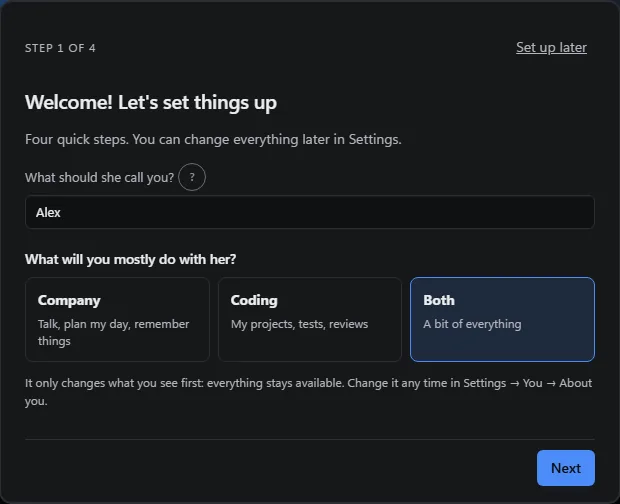

1. **Melde dich an** mit dem Einrichtungscode aus ihrem Log (oder deinem Besitzer-Token).
2. **Sag ihr deinen Namen** und wähle *Gesellschaft*, wenn sie fragt, was ihr vor allem zusammen machen werdet.
3. **Verbinde ein Gehirn:** Sie schlägt ein Modell für deinen Computer vor und prüft, ob es antwortet (*Verbunden ✓*), oder nutzt einen Tarif, den du schon bezahlst.
4. **Sag Hallo:** Tippe auf *Plan meinen Tag mit mir* oder schreib einfach los. Nach ihrer ersten Antwort folgt eine kurze Tour.
5. **Mach Sara zu deiner** mit den Persönlichkeitsreglern, und lass dich dann von *Erste Schritte* auf Heute durch ihre Stimme, dein Handy und ein Morgenbriefing führen.

Die ganze Anleitung mit Bildern: **[Start here](docs/START_HERE.md)**. Alle Antworten aus den *Wie mache ich…?*-Feldern der App in einer Liste: **[How do I…?](docs/HOW_DO_I.md)** (auf Englisch).

### Ich bin zum Programmieren hier

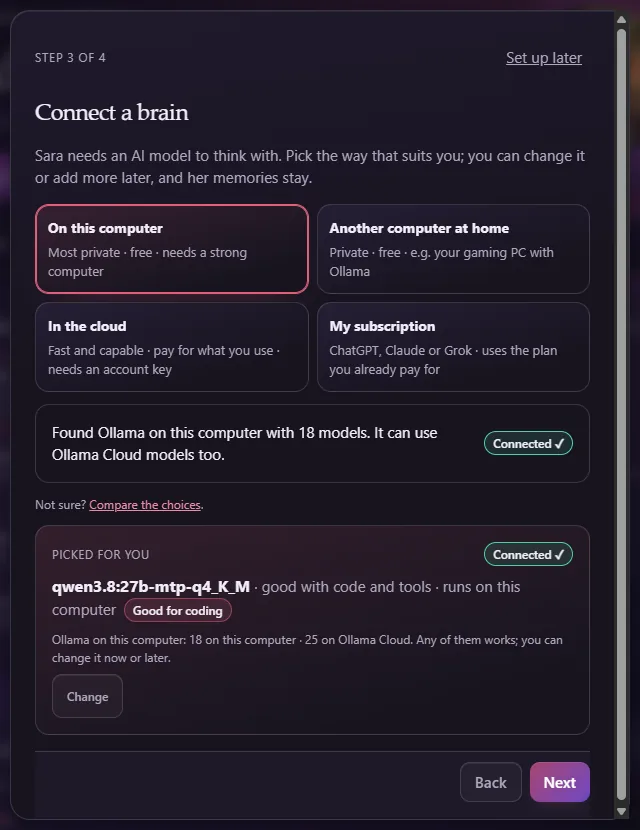

1. **Wähle *Programmieren*** bei der Einrichtung: Sie schlägt ein Modell vor, das gut programmiert (*Gut zum Programmieren*), oder deinen Claude-Code-, Codex- oder Grok-Build-Tarif.
2. **Öffne ein Projekt** mit *+ Projekt*: ein Arbeitsordner, in dem sie Dateien, eine Shell und git hat.
3. **Gib ihr eine echte Aufgabe.** Sie schreibt die Dateien, fragt vor jedem Befehl und zeigt Testergebnisse als Karten.
4. **Lies die Zeile unter jeder Antwort** für jeden Befehl und seine Ausgabe; riskante Befehle können zuerst in einer abgeschotteten Kopie laufen.
5. **Hol sie in deine Werkzeuge:** GitHub, `sara-chat`, VS Code, MCP für Claude Code und Cursor, und Budgets, die eine lange Aufgabe dort stoppen, wo du willst.

Die Anleitung für Coder: **[For coders](docs/FOR_CODERS.md)** (auf Englisch). Aus dem Quellcode in drei Befehlen: [Installation](#installation).

## Anleitungsvideos

Einminütige Anleitungen, aufgenommen auf einem Testserver mit einem lokalen Modell (auf Englisch). <a href="https://www.youtube.com/playlist?list=PLGtrs9BqXtM8">Alle in einer Playlist</a>.

<table>
  <tr>
    <td align="center" width="25%"><a href="https://www.youtube.com/watch?v=DTAIW75y7i4&list=PLGtrs9BqXtM8&index=1"></a><br><sub>Sara einrichten</sub></td>
    <td align="center" width="25%"><a href="https://www.youtube.com/watch?v=_X69x9E3W_k&list=PLGtrs9BqXtM8&index=2"></a><br><sub>Gedächtnis und Personenkarten</sub></td>
    <td align="center" width="25%"><a href="https://www.youtube.com/watch?v=wrvNcHkc9O4&list=PLGtrs9BqXtM8&index=3"></a><br><sub>Das Board</sub></td>
    <td align="center" width="25%"><a href="https://www.youtube.com/watch?v=7i48NiAq-jw&list=PLGtrs9BqXtM8&index=4"></a><br><sub>Programmieren mit Sara</sub></td>
  </tr>
</table>

## Was ist neu

<!-- sara:recent-releases:start -->

Aktuelle Releases · 6. November 2026. [Vollständiges Änderungsprotokoll](CHANGELOG.md) · [Alle Downloads](https://github.com/farena-ai/sara/releases).

| Version | Was sich für dich ändert |
|---|---|
| **[2.82.0](https://github.com/farena-ai/sara/releases/tag/v2.82.0)** | **[Programme mit einem Klick, 21 Begleiter](docs/PREREQUISITES.md)** — Wenn ein Add-on ein Programm braucht, das auf dem Rechner fehlt, sagen die Einstellungen, was fehlt, und bieten *Für mich installieren* an: Du genehmigst den genauen Befehl, siehst ihn laufen, und die Add-on-Installation geht weiter (nur der Eigentümer, im Audit-Protokoll, per Richtlinie abschaltbar). Einundzwanzig Begleiter mit Porträt, Stimme und klaren Grenzen sind im signierten Store, von Sprachlehrern und einem Fitnesscoach bis zu einer Schreibpartnerin, einem Startup-Mitgründer und einer Himmelsschiff-Kapitänin. Unter Linux finden Browser-Werkzeug-Server ein installiertes Chrome. |
| **[2.81.0](https://github.com/farena-ai/sara/releases/tag/v2.81.0)** | **[Bereit für Arbeit und Teams](docs/SLACK.md)** — Sara kommt zu Slack, mit Direktnachrichten, Erwähnungen, Threads, Erlauben- und Ablehnen-Knöpfen und Dateien in beide Richtungen. Business-Instanzen können sich mit Entra ID, Google Workspace, Okta oder Keycloak anmelden (standardmäßig nur auf Einladung; der Passkey des Eigentümers funktioniert immer). Ein einziges manipulationssicheres Audit-Protokoll lässt sich als CSV oder JSONL exportieren, ein Admin kann Einstellungen festlegen, die der Server durchsetzt, und Betreiber bekommen Prometheus-Metriken und OpenTelemetry-Traces ohne Chattext. |
| **[2.80.0](https://github.com/farena-ai/sara/releases/tag/v2.80.0)** | **[Jeder Installer von Anfang bis Ende geprüft](docs/ADDONS_LIBRARY.md)** — Jeder Werkzeug-Server und jedes native Add-on in den Einstellungen wurde auf einem echten Linux-Server und einem echten Windows-PC installiert, eingerichtet, verbunden, genutzt und entfernt. Ein Update eines Werkzeug-Servers behält seine Einstellungen, der Files-Server startet in der Linux-Sandbox, Anmelde- und Verbindungsfehler werden verständlich erklärt, ein entferntes Store-Add-on lässt sich wieder installieren und das Entfernen einer gerade hinzugefügten Begleiterin stoppt den Server nicht mehr. |
| **[2.79.0](https://github.com/farena-ai/sara/releases/tag/v2.79.0)** | **[Fortgeschrittener Look, Bilder wie ein Mensch](docs/PHOTOS.md)** — Eine Startseite Alle Einstellungen mit jeder Seite einen Klick entfernt, Brotkrumen, ein Strg-K-Starter, ein feiner Glas-und-Licht-Look und eine reichere Darstellungsseite. *Dieses Werkzeug immer erlauben* auf Freigabekarten und eine einzige Freigabe-Wahl pro Werkzeug-Server; ihre Fotos über Grok, OpenAI, deinen ComfyUI-Workflow oder ein anderes Bildwerkzeug, und ab und zu ein Bild von sich aus, wenn du es einschaltest. Bilder von Werkzeug-Servern kommen im Chat an, und sie behauptet nicht mehr, etwas geschickt zu haben, das nie angehängt war. |
| **[2.78.0](https://github.com/farena-ai/sara/releases/tag/v2.78.0)** | **[Fertiger Profi-Look, mehr Add-ons](docs/APPEARANCE.md)** — Der Profi-Look ist fertig: Name, Uhrzeit und Dauer an jedem Beitrag, ein einziges Modell-·-Arbeitsbereich-Feld mit Kontextanzeige, Einstellungen als Seitenleiste in voller Höhe, Projekte in der Seitenleiste und echte Tabellen für Nutzung und Läufe. Documentation Doctor, Release Readiness und Repository Onboarding führen dokumentierte Befehle als Aufträge aus, die du in einer Wegwerfkopie freigibst; unter Windows endet ein gestoppter Auftrag sofort. |
| **[2.77.0](https://github.com/farena-ai/sara/releases/tag/v2.77.0)** | **[Ein professioneller neuer Look](docs/APPEARANCE.md)** — Ein ruhiger, dichter, präziser Look (Einstellungen → Du → Darstellung): 9 Paletten für Nacht und Tag, eine eigene Akzentfarbe, kompakter Abstand und Weniger Dekoration; Sara Classic behält das heutige Aussehen. Außerdem: Feeds in Gemeinsam lesen, Test Doctor und Flaky Test Lab, 2 lokale Entwickler-Verbindungen, und verspätete Plugin-Freigaben führen nichts mehr aus. |

<!-- sara:recent-releases:end -->

<details>
<summary><b>Frühere 2.6x-Releases</b>: 2.76.0 zurück bis 2.61.5</summary>

| Version | Was sich für dich ändert |
|---|---|
| **[2.76.0](https://github.com/farena-ai/sara/releases/tag/v2.76.0)** | **[Entwickler-Add-ons](docs/ADDONS_LIBRARY.md)** — Neunzehn Entwickler-Add-ons ergänzen die zwölf Abläufe unter Einstellungen → Plugins (Geheimnis-Scanner, Barrierefreiheits-Prüfer, SBOM-Ersteller, API-Vertragswächter, HTTP- und Webhook-Werkbank und mehr); du prüfst jedes, und es wird ausgeschaltet installiert. Datei-Meldungen können auch in deinen eigenen Telegram- oder Discord-Chat gehen (standardmäßig aus). |
| **[2.75.0](https://github.com/farena-ai/sara/releases/tag/v2.75.0)** | **[Anrufe wie der Chat](docs/VIDEO_CALLS.md#what-she-knows-and-can-do-on-a-call)** — Im Sprach- oder Videoanruf hat sie dieselben Erinnerungen, denselben Kontext aus anderen Chats und dieselbe Erwachsenenmodus-Regel wie beim Schreiben, und Live-Anrufe können ihre Werkzeuge nutzen (keine Befehle, nicht ihre Hände, kein SSH). Was dein OK braucht, zeigt eine Karte im Anrufbildschirm, die nur ein Tippen beantwortet; Auflegen oder Dazwischenreden bricht sie ab. |
| **[2.74.0](https://github.com/farena-ai/sara/releases/tag/v2.74.0)** | **[Gemeinsam lesen](docs/LIBRARY.md#read-together)** — Öffne ein Text- oder Markdown-Dokument aus deiner Bibliothek, tippe auf Diese Passage teilen (oder schalte Meiner Stelle folgen ein), und sie kommentiert genau diesen Text in dieser Fassung; hat er sich geändert, sagt sie es. Stopp beendet es sofort. Außerdem: Vorschlagskarten zeigen jetzt, dass dein Tippen bearbeitet wird. |
| **[2.73.0](https://github.com/farena-ai/sara/releases/tag/v2.73.0)** | **[Datei beobachten](docs/WATCHES.md)** — Wähle ein Log oder eine Datei in einem deiner Arbeitsbereiche (oder ihr eigenes Log) und ein paar Wörter wie ERROR; Sara schickt eine Chat-Karte und eine Benachrichtigung, wenn eine neue passende Zeile erscheint, höchstens 12 am Tag. Jetzt prüfen, Pause und Stopp; das Lesen nutzt kein Modell, und sie behebt nie selbst etwas. |
| **[2.72.0](https://github.com/farena-ai/sara/releases/tag/v2.72.0)** | **[Ehrliche Sichtprüfungen](docs/FOR_CODERS.md#web-pages-look-fix-look-again)** — Bei Web-Arbeit bearbeitet Sara, zeigt eine Vorschau, macht Desktop- und Handy-Screenshots, behebt, was falsch aussieht, und prüft erneut. Eine Aussage zur Handybreite braucht einen Screenshot in dieser Breite, und „behoben“ braucht eine Prüfung nach ihrer letzten Änderung; sonst wird die Antwort als ungeprüft markiert. |
| **[2.71.0](https://github.com/farena-ai/sara/releases/tag/v2.71.0)** | **[Projektkontinuität](docs/FOR_CODERS.md#project-now-other-chats-and-current-checks)** — Deine Coding-Chats am selben Projekt sehen, woran die anderen arbeiten (Titel und Dateien, nie Nachrichtentext), und jedes Prüf-, Ziel- und Checkpoint-Ergebnis zeigt aktuell, veraltet oder Basis unbekannt. Sara wiederholt eine veraltete Prüfung, bevor sie sagt, dass sie besteht. |
| **[2.70.0](https://github.com/farena-ai/sara/releases/tag/v2.70.0)** | **[Gemeinsame Rollenspielszenen](docs/SCENES.md)** — Eine Geschichte über deine Web-, Telegram- und Discord-Chats plus einen gemeinsamen Raum, mit versionierten Fakten, die du hinzufügst, bearbeitest oder zurückziehst. Gäste behalten alle Partnerregeln; ihre Worte zählen nur, wenn du Zur Szene hinzufügen wählst. Löschen oder Vergessen einer Zeile entfernt, was daraus entstand; die Sicherheitsprüfungen gelten für jede Szene. |
| **[2.69.0](https://github.com/farena-ai/sara/releases/tag/v2.69.0)** | **[Erweiterungen in den Einstellungen](docs/ADDONS_LIBRARY.md)** — Zwölf Abläufe für bereitgestellte Daten nutzen die normale Datei- und Berechtigungsprüfung und sind anfangs ausgeschaltet. Sieben MCP-Rezeptvorschauen, vierzehn blockierte Untersuchungen und sechs Anleitungen erklären Voraussetzungen, Kosten und Grenzen. Keine automatische Installation, Verbindung oder Aktivierung; die Verfügbarkeit im signierten Store bleibt getrennt. |
| **[2.68.0](https://github.com/farena-ai/sara/releases/tag/v2.68.0)** | **[Kontext zwischen eigenen Chats](docs/SESSION_CONTINUITY.md)** — Frischer Kontext zwischen berechtigten Chats des Eigentümers mit derselben Begleiterin, begrenzte Verlaufsabfragen, interne Notizen und geordnete Anbieterschritte. Eigener Schalter, Einsicht und bestätigtes Löschen nur für das gewählte Ziel; Datenschutz und Werkzeugfreigaben gelten weiterhin. Gemeinsame Szenen, Projektkoordination und vollständige Sprach-/Video-Parität bleiben künftige Arbeit. |
| **[2.67.0](https://github.com/farena-ai/sara/releases/tag/v2.67.0)** | **[Aktuelle Hinweise und Nachfragen](docs/ATTUNEMENT.md)** — Begrenzte ausdrückliche Hinweise des Eigentümers in sechs Sprachen und Ereignisnachfragen mit geprüften Quellen. **[Projekt-Checkpoints](docs/FOR_CODERS.md#project-checkpoints)** behalten Logik, Blockaden und bis zu drei nächste Schritte mit fünf Versionen sowie Anzeigen/Ersetzen/Löschen; historischer Kontext führt keine Befehle aus und übernimmt keine alten Freigaben. |
| **[2.65.0](https://github.com/farena-ai/sara/releases/tag/v2.65.0)** | **[Geführte Unternehmenseinrichtung](docs/BUSINESS.md)** — Geführter Einstieg und Verwaltung, Einladungsverlauf im eigenen Zuständigkeitsbereich, Widerruf, schreibgeschützte Konfigurationsprüfung und wiederholbare Browser- und Wiederherstellungsübungen. |
| **[2.64.0](https://github.com/farena-ai/sara/releases/tag/v2.64.0)** | **[Separate Unternehmensarbeitsbereiche](docs/BUSINESS_OPERATIONS.md)** — Individuelle Passkeys, Rollen, geteilte Texte und Dokumente, Modelllimits unter Betreiberkontrolle und verschlüsselte Wiederherstellung. Persönliche und Haushaltsdaten bleiben getrennt. |
| **[2.63.1](https://github.com/farena-ai/sara/releases/tag/v2.63.1)** | **[Messbarer Betrieb](docs/OPERATIONS.md)** — HTTP- und Bereitschaftsmessungen nur für den Eigentümer, sichere Archivierung geklärter Zustellungen, reaktionsfähige Backups und wiederholbare lokale Prüfungen. |
| **[2.62.0](https://github.com/farena-ai/sara/releases/tag/v2.62.0)** | **[Wiederherstellung ohne blindes Wiederholen](docs/RECOVERY.md)** — Unterbrochene Aufgaben vor einem Neustart prüfen; unklare native Telegram-/Discord-Sendungen bleiben sichtbar und werden nicht automatisch erneut gesendet. |
| **[2.61.5](https://github.com/farena-ai/sara/releases/tag/v2.61.5)** | **[Den nächsten Schritt finden](docs/START_HERE.md)** — Gezielte Einstellungssuche, ein einfacherer Weg zur ersten Nachricht und bessere Bedienung per Tastatur, Touch und mit reduzierten Animationen. |

Außerdem in 2.67.0: zuverlässiger Zugriff auf Coding-Projekte über die Einstellungssuche, erhaltene Entwürfe und Behandlung veralteter Antworten, geschützte Projektkenntnisse in Chats ohne Aufzeichnung und eine lokale Aktualitätsprüfung aller sechs Release-Seiten. Kein CI und keine wiederkehrende Release-Überwachung. Checkpoints gehören nur dem Eigentümer und dem jeweiligen Arbeitsbereich/Projekt; Löschen, Ändern oder Vergessen erfasster Quellinhalte macht abgeleitete Einträge ungültig. Ausstehende Coding-Aktionen, einschließlich Teamhelfern und der Übernahme von Sandbox-Änderungen, prüfen vor der Ausführung erneut die aktuellen Berechtigungen und den Gesprächs- und Arbeitsbereichskontext; geänderter Kontext stoppt die veraltete Aktion, statt sie zu verschieben.

Version 2.67.0 unterscheidet außerdem Kritik am Code von Konflikten mit Sara, prüft Quellen für Hinweise und Nachfragen unmittelbar vor der normalen Anbieteranfrage erneut und schließt Agenda-Einträge nur bei klarer Zuordnung von Ereignis, Ergebnis und zugehöriger Frage automatisch ab. Inneres Leben bleibt der Schalter zum Aktivieren; es gibt keine Gefühlsdiagnose, keinen zusätzlichen Klassifikatoraufruf und kein neues Stimmungsprofil des Eigentümers. Neue Hinweise sind für private Chats, Chats ohne Aufzeichnung, Mitglieder, Gruppen, externe Kontexte, Wiedergabe und unbeaufsichtigte Arbeit ausgeschlossen. Aufgezeichnete Prompts, Exporte und Sicherungen können Notizen unter ihren bisherigen Einstellungen behalten; die Wiedergabe lässt neu aufgezeichnete vorübergehende Zusätze aus und kennzeichnet geänderte Eingaben. Diese Version korrigiert auch die automatische Erfassung der Quellrevision des Windows-Installers.

</details>

<!-- sara:release-history:start -->

<details>
<summary><b>Frühere Highlights · 2.61, 2.60 und 2.59</b></summary>

- **2.61** ·  Einfachere Chat-App-Einrichtung: eine geführte Karte für WhatsApp, Matrix, iMessage, Signal, E-Mail und Telegram, jeder Schritt geprüft, mit klaren Lösungen; Saras eigene Plugins brauchen ein OK statt einer Entwickler-Warnung.
- **2.60** · Begleiter-Pakete: Teile Charakter, Aussehen, Stimme und Start-Skills einer Begleiterin als Datei oder im Sara Store, ohne je deine Erinnerungen oder Chats zu teilen; Charakterkarten lassen sich auch importieren.
- **2.59** · „Hey Sara“: Sag ihren Namen und sprich freihändig in der Windows-App (ein kleines Modell auf deinem Computer hört nur darauf), eine Sprechen-Taste überall, und lokales Hören und Stimmen unter Windows.

</details>

<details>
<summary><b>Versionsgeschichte</b>: was jede Version seit 2.4 gebracht hat</summary>

| Version | Was du bekommst |
|---|---|
| **2.61.4** · [v2.61.4](https://github.com/farena-ai/sara/releases/tag/v2.61.4) | **[Zuverlässigere Einrichtung](docs/SECURITY_CHECKLIST.md)** — Übersprungene Modelleinrichtung nachholen, mobilen Tastaturfokus richtig halten und Befehlsfreigabe von Ausführungsisolation unterscheiden. |
| **2.60** · Begleiter-Pakete | **Teile sie:** Einstellungen → Sie → ⋯ → *Teilen* baut ein Paket aus genau dem, was du ankreuzt (Charakter, Regler, Aussehen, Kleiderschrank, Stimme, erste Nachricht, Skills, vorgeschlagene Routinen), und zeigt, was nie mitgeht: Erinnerungen, Chats, Personen, Schlüssel, dein Name (wird zu `{{user}}`), deine Beziehungsnotizen und Grenzen. **Installiere ein Paket** als neue Begleiterin, nie über eine bestehende, über eine Prüfkarte; Updates zeigen, was die Autorin geändert hat, und behalten deine eigenen Änderungen. Charakterkarten V1/V2/V3 (PNG, JSON, CHARX) werden als Pakete importiert, ein Lorebook wird zu wenigen Hintergrundzeilen, nie zu Erinnerungen. Die Minderjährigen-Prüfung läuft beim Packen, bei der Prüfung und bei der Installation, ohne Ausnahme; Einstufungen richten sich nach dem Erwachsenenmodus. Vier Start-Begleiterinnen im Store: Juniper, Rowan, Vesper und Jax. Außerdem behoben: Beim Export einer Charakterkarte sind dein Name und deine Notizen nicht mehr dabei. |
| **2.59** · „Hey Sara“ | **Sag ihren Namen und sprich** in der Windows-App: Ein 5-MB-Modell auf deinem Computer hört nur auf „Hey Sara“ (oder eigene Worte pro Begleiterin), und nichts wird gesendet, bevor du sie sagst; die Aufnahme beginnt erst danach, Audio wird nie gespeichert, und ein Punkt am Tray-Symbol zeigt, wann sie zuhört. Aus, bis du es einschaltest, auf jedem Gerät einzeln; pausiert bei gesperrtem Bildschirm; hören zwei Geräte dich, antwortet eines. **Mit Sara sprechen** per Strg+Alt+Leertaste oder Tray, und auf Android über eine Sprechen-Taste in der Benachrichtigung und eine Schnelleinstellungs-Kachel. Der KI-Hinweis kommt zuerst, Krisenhilfe wird vollständig vorgelesen. **Lokales Hören und Stimmen unter Windows:** `sara voice install` (etwa 650 MB, jede Datei geprüft), bisher nur unter Linux. Mac, Linux und der dauerhaft lauschende Android-Detektor folgen. |
| **2.58** · Mehr holen | **Einstellungen → Fähigkeiten → Mehr holen:** Im Sara Store stöbern und suchen, einen Eintrag öffnen und mit einem Klick über die übliche Prüfkarte installieren (nichts schaltet sich von selbst ein). Werkzeug-Server bekommen eine Karte mit dem genauen Befehl (und seiner Windows-Form), was er braucht, was er erreichen kann und ob er abgeschirmt läuft; Schlüssel kommen in den Tresor. **Updates** zeigen genau, was sich ändert, neue Berechtigungen markiert, und du kannst zurück. **Meine Erweiterungen** listet alles mit Herkunft. **Eigene einreichen:** `sara pack` prüft ein Plugin, einen Skill oder einen Werkzeug-Server auf deinem Computer (Manifest, Berechtigungen, Geheimnis-Suche, abgeschirmter Kurztest, Bildschirmfotos), dann schickt *Einreichen* in den Einstellungen oder `sara submit` es, signiert mit deinem eigenen Autorenschlüssel. Das Sara-Team prüft es, bevor es gelistet wird, und unter *Meine Einreichungen* kannst du mitlesen und antworten. Meldungen und Sperren schalten eine Erweiterung aus, löschen sie nie. |
| **2.57** · Der Sara Store öffnet | **Ein signiertes Regal** unter [backstagecoding.com/sara/store](https://backstagecoding.com/sara/store/): Wetterwarnungen, Fokus, Heimszenen, GitHub-Überblick, Leseliste und Webhook-Notizen, dazu Werkzeug-Server für ComfyUI, Blender, einen Browser (Playwright), GitHub, Dateien auf diesem Computer und Dokus (Context7), jeweils mit fest angeheftetem Versionsstand. Sara prüft die Signatur der Liste, den Fingerabdruck jeder Datei und das Ablaufdatum, bevor sie etwas zeigt; eine beschädigte, alte oder zurückgezogene Liste wird abgelehnt und die letzte gute behalten. Beim Stöbern werden keine Kennung und kein Cookie gesendet. Installationen laufen weiter über die übliche Prüfkarte, nichts schaltet sich von selbst ein; zurückgezogene Erweiterungen werden ausgeschaltet, nie gelöscht. **Skills aufräumen:** ungenutzte Skills lassen sich archivieren und zurückholen. Als Nächstes: Installieren in Sara und eigene einreichen. |
| **2.56** · Schlank und aufgeräumt | **Eine kurze Werkzeugliste pro Schritt:** im Code gewählt (ohne Modellaufruf) aus dem, was du gerade tust: Modus, deine Wörter, `@`-Verweise, kürzliche Nutzung, ein geladener Skill, frühere Runden eines Ziels, dazu Werkzeuge, die aus Sicherheitsgründen immer dabei sind. Den Rest findet sie mit *find tools*, und jeder Aufruf wird weiter gegen alles geprüft, was sie darf. Gemessen: eine frische Installation sinkt von 11.871 auf 5.471 Tokens pro Schritt (−54 %), mit vier MCP-Servern von 23.476 auf 5.438 (−77 %). `/tools` zeigt, was angeboten wird. **`/compact`:** fasst den älteren Teil eines langen Chats zusammen, zuerst auf diesem Computer geschrieben (private Chats verlassen ihn nie). Deine Nachrichten bleiben im Verlauf, mit *Zusammenfassung zeigen* und *Rückgängig*; es läuft auch von selbst kurz vor der Grenze, und Krisennachrichten bleiben Wort für Wort. Funktioniert in jeder Chat-App. |
| **2.55.3** · MCP unter Windows | Behoben: Unter Windows starteten MCP-Server, die mit `npx` gestartet werden (auch die eingebauten Vorlagen), nicht. |
| **2.55.2** · iMessage | **iMessage über BlueBubbles** (Einstellungen → Verbindungen → iMessage, ein optionales Plugin): Schreib ihr aus Nachrichten auf deinem iPhone. Braucht einen Mac mit BlueBubbles und einer eigenen Apple-ID für sie (mit deiner läuft Sara nicht, sonst sähe sie all deine Chats). Acht geführte Schritte mit ✓, einfache Lösungen, Text, Fotos und Dateien, und sie holt nach, was geschickt wurde, während sie offline war. Tipp-Punkte und Tapbacks nur, wenn die Private API von BlueBubbles schon an ist; Sara bittet dich nie, dafür die Sicherheit deines Macs zu senken. |
| **2.55.1** · Matrix | **Matrix** (Einstellungen → Verbindungen → Matrix, ein optionales Plugin): Sprich mit ihr in Element oder jeder Matrix-App über ein eigenes Matrix-Konto. Fünf geführte Schritte, jeder mit einem ✓ geprüft, und einfache Lösungen für jeden Fehler. Text, Fotos und Sprachnachrichten; nur du, außer du erlaubst andere (auch ganze Server); Einladungen von Fremden werden abgelehnt. Nur Räume ohne Ende-zu-Ende-Verschlüsselung: In einem verschlüsselten Raum erklärt sie, warum sie ihn nicht lesen kann, und geht. |
| **2.55** · WhatsApp | **WhatsApp** (Einstellungen → Verbindungen → WhatsApp, ein optionales Plugin): Schreib ihr über Metas offizielle WhatsApp Cloud API mit einem Meta-Konto und einer Nummer, die dir gehören. Eine geführte Karte in 10 Schritten nennt die genauen Meta-Seiten, prüft jeden Schritt mit einem ✓ und macht aus jedem Fehler einen einfachen Satz mit Lösung. Fotos und Dateien in beide Richtungen, Tipp-Punkte und eine *Bin dran*-Zeile mit Stopp bei langen Aufgaben, nur du, außer du trägst weitere Nummern ein, und eigene erste Nachrichten nur im 24-Stunden-Fenster von WhatsApp. Metas Bedingungen schränken allgemeine KI-Assistenten auf WhatsApp ein, daher ist es aus, bis du es installierst und bestätigst, dass du sie gelesen hast. |
| **2.54** · Routinen und ein Sicherheits-Check | **Routinen-Galerie** (Planer → Routinen): Morgenbriefing, Wochenrückblick, Dehn- und Schlafenszeit-Erinnerungen, pünktlich losgehen, CI eines Repos beobachten, neue Issues, Backup-Check, Posteingang sortieren und Preisalarm. Jede Karte sagt, was sie tut, was sie braucht und was sie kostet, im Code berechnet (die meisten sind kostenlos), zeigt eine Vorschau ohne Modellaufruf und hat einen Aus-Schalter; bezahlte enden an einem Datum deiner Wahl. Werkzeuge behalten deine Freigabe-Einstellungen. **Sicherheits-Check** (Einstellungen → Daten & Zustand): 17 reine Leseprüfungen, ein Urteil in Worten (*Sieht sicher aus*, *Größtenteils sicher*, *Zuerst beheben*) und Ein-Klick-Korrekturen, die nur sicherer machen und sagen, ob sie sich rückgängig machen lassen. Änderungen daran, wie Sara erreichbar ist, werden angeleitet, nie per Klick. Dazu `sara doctor --safety`. |
| **2.53** · Präzises Programmieren | **Prüfungen nach ihren Änderungen:** Wenn sie Code ändert, führt Sara den Prüfer des Projekts aus (tsc, pyright oder mypy, cargo check, go vet, eslint), sofern schon installiert, nie `npx`, nie installiert sie etwas, und gibt ihr nur die neuen Fehler in derselben Runde, auch Dateien, die ihre Änderung anderswo kaputt gemacht hat. Sie behebt sie vor der Antwort (höchstens zwei Anstöße), und die Antwort zeigt *✓ types clean (tsc)* oder was übrig ist. Ein OK pro Projekt. **@-Verweise:** Tippe `@` im Chatfeld für `@file` (mit Zeilen), `@folder`, `@diff`, `@branch`, `@problem` oder `@url`; Chips zeigen, was sie bekommt und wie groß es ist, und es funktioniert als getippter Text in Telegram, Discord und den anderen Apps. Geheime Dateien werden abgelehnt, und private Chats öffnen nie Webseiten. |
| **2.52.1** · Server leicht verbinden, Fotos repariert | *Server verbinden* fragt nur nach Adresse und Benutzername; Sara macht ihren Schlüssel, findet den Port und den einfachsten Weg hinein (ein cPanel-Token, das sie selbst löscht, einmal dein Passwort oder eine Zeile zum Einfügen) und erklärt jeden Fehler in einfachen Worten. Fotos erreichen jetzt immer ein Modell, das sie sehen kann. |
| **2.52** · Wenn es zur Sprache kommt | **Erinnerungen, die auf eine Person oder ein Thema warten:** „Wenn Dan erwähnt wird, erinnere mich, dass er mir 20 $ schuldet“ oder „Wenn ich das nächste Mal den Garten erwähne, frag nach den Tomaten“. Sie bringt es einmal zur Sprache, in ihrer Antwort, mit *Erledigt*, *Nächstes Mal wieder* oder *Vergessen*. Erkannt wird über deine Personenkarten und einfache Wörter, ohne KI-Aufruf, und zwischen zwei Dans rät sie nie. Sie lösen nur bei deinen eigenen Nachrichten in deinen eigenen Chats aus, nie dort, wo Dan mitliest, und was sie jemand anderem schicken würde und eine davon enthält, fragt erst nach. **Einen Chat in einer anderen App fortsetzen:** auf Telegram anfangen, die App öffnen, und *Hier weitermachen* bringt den Chat mit (`/continue` überall), mit *Zeigen* und *Rückgängig*; nichts wird kopiert. |
| **2.51** · Weitermachen, bis es fertig ist | **Ziele mit Beleg:** „Bring die Tests zum Laufen, fertig wenn `npm test` grün ist“: Sie arbeitet Runde für Runde innerhalb von Grenzen (Runden, Minuten, Tokens, Dollar), und Sara führt deine Prüfung aus, nicht sie, also heißt *fertig*, dass es wirklich bestanden hat. Ein Grün, das erst nach dem Ändern der Tests kam, endet als *fertig, prüfen*; derselbe Fehler zweimal pausiert sie als *festgefahren*. **`/loop every 10m: check the deploy`**: still, solange sich nichts ändert, eine Nachricht, wenn doch, stoppt bei *until* (mit Beleg), nach zwei Fehlern, zur Endzeit oder an einer Tagesgrenze und fragt unbeaufsichtigt nie nach Freigaben. Board-Karten können eine *Fertig wenn*-Prüfung tragen. Nach einem Neustart ist alles pausiert. Außerdem behoben: Dateien mit Windows-Zeilenenden ließen sich nicht bearbeiten. |
| **2.50** · Signal und E-Mail | **Zwei weitere Wege zu ihr, beide eingebaut.** *Signal* über signal-cli auf deinem eigenen Rechner: Gruppen als Räume mit Mitlesen, 👀 wenn sie deine Notiz annimmt, eine Live-Fortschrittsnachricht, Dateien in beide Richtungen, und deine Sicherheitsnummer ist festgehalten, sodass ein geänderter Schlüssel ihre Werkzeuge pausiert, bis du bestätigst. *E-Mail* in ihrem eigenen Postfach: eine Sitzung pro Verlauf, Antworten im Verlauf, deine Mails zählen nur als du, wenn die Absenderprüfung deines Anbieters besteht, Fremden wird nie geantwortet, weitergeleitete Mails lassen jedes Werkzeug erst fragen, und Abwesenheitsnotizen, Newsletter und Rückläufer lösen nie eine Schleife aus. Sara hält die Verbindungen für diese Plugins, nur zu den Adressen, die du eingetragen hast. Außerdem behoben: Eine Plugin-Chat-Antwort, die länger als 5 Minuten dauerte, wurde abgeschnitten. |
| **2.49** · Mit ihr reden, während sie arbeitet | **Kein Warten mehr, bis sie fertig ist.** Schreib, während sie arbeitet, und wähle: *Jetzt sagen* (sie liest es vor ihrem nächsten Schritt und ändert den Kurs; es kann nie etwas freigeben), *Danach* (es wartet und läuft als eigene Runde) oder *Nur kurz gefragt* (`/btw`: eine kurze Antwort nebenbei, nichts wird gespeichert, die Arbeit läuft weiter). Genauso in Telegram und Discord (`/queue`, `/btw`). Eine **Schleifensperre** stoppt sie nach drei gleichen fehlgeschlagenen Aufrufen und lässt sie den Weg ändern. |
| **2.48** · Chat-Apps holen auf | **Fotos und Dateien in beide Richtungen bei Telegram und Discord:** Schick ihr ein Foto (mit Bildunterschrift, als Album oder als Datei) oder ein Dokument, und sie liest es; bitte um ein Selfie, ein Diagramm oder eine Datei, und es kommt an (`send_file`). Bilder anderer Leute in einem Raum bleiben aus, bis du sie einschaltest, und dann sieht sie nur eine Beschreibung. **Eine Fortschrittsnachricht** aktualisiert sich, während sie arbeitet, hat einen Stopp-Knopf und endet als eine Zusammenfassungszeile. Plugin-Brücken können auch Dateien tragen. |
| **2.47.3** · Hier anfangen | **Zwei Einstiege:** [Hier anfangen](docs/START_HERE.md) für „Installiert – und jetzt?“ und [Für Coder](docs/FOR_CODERS.md), beide mit den Anleitungsvideos (auf Englisch). Neue Screenshots, die Funktionstour aufgeteilt in *Für Gesellschaft*, *Fürs Programmieren* und *Für beides*, alle *Wie mache ich…?*-Antworten in einem Verzeichnis (in der Hilfe und auf der Doku-Seite) und eine neu gegliederte Doku-Seite. |
| **2.47.2** · Ein Stil und Hilfe auf jeder Seite | **Jede Seite hat jetzt ein *Wie geht…?*-Feld** mit Schritt-für-Schritt-Antworten (123, mit *Zeig es mir*), und leere Seiten sagen, was dort hinkommt, mit einem klaren nächsten Schritt. Ein Kartenstil, Symbole statt Emoji, einheitliche Abstände und Ecken, ein Einstellungsmenü, das eine Gruppe nach der anderen öffnet, ein aufgeräumtes Handy-Layout ohne seitliches Scrollen, ein klarerer erster Anmeldebildschirm, und die Coding-Einrichtung bevorzugt ein fähiges Modell auf deinem eigenen Rechner. |
| **2.47.1** · Ein Start, der passt | **Die Einrichtung stellt eine Frage: Gesellschaft, Programmieren oder beides.** Du bekommst ein empfohlenes Modell mit einem echten *Verbunden ✓*-Test, eine passende Tour mit sechs Stationen (die ganze Tour bleibt in der Hilfe), Startvorschläge im leeren Chat und eine Erste-Schritte-Liste in der für dich richtigen Reihenfolge. Fenster stapeln sich nie, und der Hinweis zur anonymen Rückmeldung ist Teil des letzten Schritts. |
| **2.47** · Persönlichkeit, die man sieht | **Ihre Persönlichkeitsregler zeigen jetzt, was sie tun:** klare Endpunkte („Hält Abstand ↔ Offen herzlich“), ein Wort für die aktuelle Stufe und ein Satz in ihrer Stimme, der sich beim Verschieben ändert (125 Stück, ganz ohne KI-Aufruf). Gruppen mit klaren Namen, eine Zusammenfassung „Deine Sara bisher“ und klare Worte an jedem anderen Regler. Außerdem behoben: Heute aktualisiert sich nach der Einrichtung, überall dieselbe Modellzahl mit gruppierter Auswahl, ein Persona-Import benennt sie überall auf einmal um, und *Losfahren* steht vor seinem Termin. |
| **2.46** · Probleme direkt aus Sara melden | **Hilfe → Problem melden oder Etwas vorschlagen** (oder `/bug` und `/idea` in jedem Chat, oder *Melden* bei einem Fehler): kein GitHub-Konto nötig. Optionale Diagnosedaten entstehen auf deinem Rechner, werden vollständig gezeigt, mit einem Häkchen pro Teil, und vor dem Senden von Schlüsseln, E-Mails und Pfaden befreit. *Meine Meldungen* zeigt den Stand und unsere Antworten. Außerdem sendet Sara einmal am Tag eine kleine anonyme Rückmeldung (Version, Windows/Mac/Linux, welche Funktionen an sind), damit wir helfen und planen können; IP-Adresse, Name und Chats werden nicht gespeichert. *Zeigen, was gesendet wird* oder ausschalten unter Einstellungen → Daten & Zustand → Datenschutz. |
| **2.45** · Heute auf dem Handy | **Auf dem Handy beginnt Heute mit einer Jetzt-Karte** (die nächsten zwei Dinge und wann, Losfahren, das Wetter und ihre Stimmung), dann *Braucht dich*, dann dein Tag. Abschnitte klappen mit einer Zusammenfassung ein und bleiben auf dem Gerät, wie du sie gelassen hast, *Mit ihr* und *Arbeit* werden zu Wischreihen (auch mit Knöpfen), und Ziehen zum Aktualisieren klappt im Browser und in beiden Apps. Tablets bekommen zwei Spalten. Optional: ein Satz von ihr, was passiert ist, während du weg warst. |
| **2.44** · Heute, gestaltet | **Heute ist jetzt bewusst aufgebaut:** *Dein Tag* (eine Zeitleiste aus Terminen, Erinnerungen und Aufgaben, dazu Wetter und was bald kommt), *Braucht dich* (Freigaben, Fehlgeschlagenes, Überfälliges und Mail), *Mit ihr*, *Arbeit* und *Zuhause & mehr*. Reihen schließen immer bündig ab, leere Kacheln klappen weg, und *Anpassen* verschiebt, vergrößert oder versteckt jede Kachel (Ziehen oder Tastatur), gespeichert pro Begleiterin auf jedem Gerät. Mail zeigt deinen Posteingang, die Änderung seit gestern und was sie sortiert hat, mit Rückgängig, und aktualisiert sich nach dem Aufräumen selbst. Eine optionale Räume-Kachel zeigt, was in den Räumen los ist, die sie verfolgt. |
| **2.43** · Sie bleibt im Gespräch | **In Discord-Kanälen und Telegram-Gruppen verfolgt sie das ganze Gespräch** (pro Raum einschalten; eine Plan-Karte zeigt vorher Modell und Tagesgrenze). Ruft sie jemand, weiß sie, worum es gerade geht, wer da ist und was sich seit ihrem letzten Beitrag geändert hat, und steigt ins aktuelle Thema ein statt in eins von vor einer Stunde. Jede Woche wird in ihrer Bibliothek als durchsuchbares Protokoll archiviert und zu einem Raumgedächtnis mit Notizen über die Leute dort (vorgeschlagene Personenkarten). *Diesen Raum vergessen* löscht alles. 12 nachgespielte volle Kanäle in 6 Sprachen: beim aktuellen Thema 12/12. |
| **2.42** · Titel, die mitwachsen | **Sitzungstitel, die sagen, worum es ging.** Der erste Titel ist ein Platzhalter; nach ein paar Wechseln, wenn das Thema klar wechselt, und bei `/new` benennt ein kleines Modell auf deinem eigenen Rechner sie neu („Ein Gemüsebeet anlegen“ → „Steuererklärung als Freiberufler“). Titel, die du setzt, ändern sich nie, frühere bleiben in den Infos des Chats, nichts Sensibles oder Privates landet in einem Titel, und es gibt eine Tagesgrenze. 40 Testsitzungen: 0,90 beim Thema mit einem lokalen 12B-Modell. |
| **2.41** · Eine aufgeräumte Sitzungsliste | **Jede Chat-App bekommt ihr eigenes Projekt.** Telegram, Discord und jede Plugin-Brücke (WhatsApp, Signal…) haben ein eingebautes Projekt für ihre Chats, sodass deine eigenen Web- und App-Gespräche in deinen Projekten bleiben. Bestehende Chats werden einmal einsortiert, mit Rückgängig. Räume zeigen ihre echten Namen (#general · Server), frühere Sitzungen stehen unter ihrem Chat, und lange Listen zeigen die neuesten mit *Mehr anzeigen*. Kanalprojekte umbenennen oder ausblenden; ein volles nach Raum gruppieren. |
| **2.40** · Chat-Befehle | **`/new`, `/reset`, `/stop`, `/status`, `/help`, `/model` und `/remember` überall:** in Telegram und Discord (in deren eigenen Befehlsmenüs, für dich eingetragen, in deiner Sprache), in der Web-App und als „Sara, neu“, wo kein Schrägstrich zur Hand ist. `/new` startet eine frische Sitzung und behält die alte (zusammengefasst); `/status` zeigt Modell, Füllstand der Sitzung und den Verbrauch; ist eine Sitzung fast voll, bietet sie `/new` selbst an. Befehle nur für den Besitzer werden für alle anderen abgelehnt, jedes Mal. |
| **2.39** · Umzug: Einstellungen und Bericht | **Der Rest der alten Einrichtung.** Modelle und Anbieter, Stimme, Zeitzone, Chat-Kanäle, Freigaben und Regeln des alten Agenten werden zu Karten, die du einzeln bestätigst (Schlüssel werden nie kopiert: du gibst sie sicher neu ein). Hooks und Plugin-Code werden als Text gelesen, nie ausgeführt, und in einfachen Worten erklärt, mit einer Sara-Entsprechung (eine Regel in ihrem Profil, eine Sperre, die vorher fragt, eine vorhandene Funktion oder ein Plan, es als Sara-Plugin neu zu bauen). Doppelte Datenbankkopien werden erkannt und nur einmal importiert. Am Ende ein Bericht: was mitkam, was dich braucht, was blieb, und wo jede alte Funktion jetzt in Sara steckt (zum Herunterladen, oder alles rückgängig). |
| **2.38** · Umzug: alte Datenbanken | **Eigene Gedächtnisspeicher ziehen mit um.** Hat der alte Agent sein Gedächtnis in einer eigenen SQLite- oder Postgres-Datenbank, liest Sara sie (Postgres nur lesend, mit eigenem Client, oder eine `pg_dump`-Datei), überspringt Logs und Telemetrie und schlägt für jede Tabellengruppe vor, was sie ist und wohin sie gehört (Notizen, Personen und Fakten, Gespräche, Aufgaben, Ziele, Tagebuch). Du bestätigst jede Karte; vorher wird nichts importiert. Bestätigte Zuordnungen werden gespeichert, und Rückgängig entfernt weiterhin alles. |
| **2.37** · Umzug | **Nimm deinen Agenten mit.** Du kommst von Hermes Agent oder OpenClaw? Eine kleine Datei (Python, ohne Installation) läuft auf dem alten Rechner und zeigt zuerst ihren Plan; Geheimnisse werden nie eingepackt, medizinische oder intime Daten bleiben, außer du willst es. Sara zeigt dann alles mit Zahlen und Beispielen: die Persönlichkeit (du entscheidest), Notizen und was sie über dich wusste, frühere Chats, Skills, Zeitpläne und Boards. Ein Klick importiert alles als ein Paket, und Rückgängig entfernt genau dieses Paket, 30 Tage lang. |
| **2.36** · Ihre eigenen Pläne | **Freiwillig: sie macht eigene Pläne.** Nachfragen zu dem, was du ihr erzählt hast („wie lief das Vorstellungsgespräch?“) und Ziele, die ihr gemeinsam verfolgt, nur aus deinen eigenen Worten und immer mit Angabe, wo du es gesagt hast. Standardmäßig aus; eingeschaltet listet Planer → *Ihre Pläne* alles auf, sie teilt Tageslimit, Ruhezeiten und Abstandsregel mit ihren ersten Nachrichten, hat ein kleines eigenes Tagesbudget, pausiert nach einem schweren Moment, und ein Schalter stoppt alles sofort, auch mitten im Satz. Ziele warten auf dein *Übernehmen*. |
| **2.35** · Webhooks | **Andere Dienste können sie wecken.** Gib GitHub, Stripe, Home Assistant oder allem, was Standard Webhooks spricht, eine eigene signierte Adresse; wähle, wann es zählt (Bedingungen ohne Code, mit Vorlagen) und was sie tut: dir Bescheid sagen, eine Aufgabe anlegen, einen Skill ausführen oder es einem Plugin geben. Signaturen werden auf den rohen Bytes geprüft, alte und wiederholte Zustellungen abgelehnt, und der Inhalt gilt als nicht vertrauenswürdig: was etwas ändert, fragt dich weiterhin. Ein Zustellprotokoll und ein Test-Knopf auf jeder Karte; signierte ausgehende Kopien auf Wunsch. |
| **2.34** · Menschen | **Sie behält die Menschen in deinem Leben im Blick.** Eine Karte pro Person, über die du sprichst (Beziehung, Geburtstag, was sie weiß, in deinen Worten), gebaut aus ihren Erinnerungen. Neue Personen warten auf dein *Stimmt so*; korrigieren, zusammenführen, teilen oder vergessen (Vergessen löscht wirklich). Zwei Jeffs? Sie fragt, welcher. Private Fakten bleiben in privaten Chats, sensible werden eingeklappt. Personenkarten erreichen nie andere Apps, andere Agenten, Plugins, Gruppen- oder Partnerchats; jedes Haushaltsmitglied hat eigene. |
| **2.33** · Andere Agenten (A2A) | **Sie spricht mit anderen KI-Agenten** über das offene Agent2Agent-Protokoll, in beide Richtungen, nach der Spezifikation gebaut. Gib einem Agenten einen eigenen Schlüssel und wähle, was er fragen darf; sie kann Agenten fragen, die du hinzufügst (eine andere Sara oder jeden A2A-Agenten), Antworten streamen, stoppen oder ihnen eine Board-Karte zuweisen, die mit Belegen zurückkommt. Was ein Agent verlangt und etwas ändert, braucht dein OK; seine Worte gelten als nicht vertrauenswürdig; nichts Privates, aus Partner- oder Gruppenchats geht hinaus; sie sagt, dass sie eine KI ist. 61/61 Protokollprüfungen. |
| **2.32** · Board | **Ein Kanban-Board über deinen To-dos.** Jedes Projekt bekommt ein Board (Zu tun, In Arbeit, Wartet auf dich, Erledigt) mit Labels, Checklisten, Fälligkeiten und Wiederholungen; ziehen mit Maus, Finger oder Tastatur. Weise eine Karte Sara oder einem Helferteam zu, und sie arbeitet im Hintergrund daran: Erledigt nur, wenn Belege die Arbeit stützen, sonst wartet die Karte auf dich mit dem, was sie nicht belegen konnte. Frag sie „was hängt?“ oder lass sie Karten anlegen und verschieben (sie fragt vorher). Geteilte Haushalts-Boards; eine Kachel „Braucht dich“ auf Heute. |
| **2.31** · Plugins | **Plugins und Hooks.** Ein Plugin ist ein Ordner mit einer `sara-plugin.json`: Hooks vor ihrer Antwort, vor und nach Werkzeugen und nach Antworten, dazu eigene Werkzeuge, Karten, Einstellungen, Zeitpläne und Chat-Brücken. Du fügst es aus Zip, Git oder Ordner hinzu, nachdem du eine Prüfkarte gelesen hast, die genau sagt, was es darf; es bleibt aus, bis du es einschaltest. Jedes läuft in einem eigenen abgeschirmten Prozess (bubblewrap unter Linux, Seatbelt auf dem Mac) und kann nur ergänzen oder verschärfen, nie ihre Regeln lockern oder die Sicherheitsebene berühren. Ein Plugin, das hängt oder abstürzt, stört nie einen Chat. Zwei Beispiele dabei; Anleitung in docs/PLUGINS.md. |
| **2.30** · Gelernte Skills | **Sie merkt, worum du immer wieder bittest.** Bitte dreimal an verschiedenen Tagen um dieselbe Art Sache (oder wiederhole dieselbe Kette von Coding-Schritten), und sie bietet einmal an, daraus einen Skill zu machen: du siehst den Entwurf und speicherst, bearbeitest oder lehnst ab. Ein neuer Skill wird erst getestet (deine früheren Bitten, mit und ohne ihn bewertet) und nur genutzt, wenn er hilft. Korrigierst du sie nach einem Skill, schlägt sie die Änderung als Vorher/Nachher-Karte vor. Nichts Privates, aus Gruppen oder mit Geheimnissen wird je gelernt. |
| **2.29** · Skills | **Skills im offenen Agent-Skills-Format.** Ein Skill ist ein Ordner mit einer `SKILL.md`: wie eine Art Aufgabe auf deine Weise erledigt wird. Sie sieht die Liste in jedem Chat und öffnet den passenden; in Runs siehst du, welchen. Sechs sind eingebaut (Pull-Request prüfen, Changelog-Eintrag, Wochenrückblick, fehlschlagenden Test debuggen, Reise planen, Skill schreiben); schreib eigene oder lass sie schreiben; Import aus Zip, Git oder Ordner mit einer Prüfkarte, die jede Datei und jedes Skript zeigt; Export jedes Skills. Skripte fragen immer vorher, und kein Skill kann ihre Sicherheitsregeln ändern. Deine Rezepte wurden zu Skills. |
| **2.28** · Computernutzung, Schritt 9 | **Auch unter Linux:** `sara hands --server https://deine-sara` auf einem Linux-Desktop gibt ihr dort ihr eigenes sichtbares Chrome/Chromium, wie der Browser-Modus der Windows- und Mac-Apps: ansehen, lesen, Logs, Klicks und Tippen mit deiner Freigabe, Dev-Tunnel, gespeicherte Logins (im GNOME-Schlüsselbund / KWallet), die CLI deines Passwortmanagers und Check-ups, die nur lesen. Gekoppelt wird mit einem Code, den du im Browser bestätigst; Pause, Weiter und Stopp im Terminal. Bilder und Eingaben für den ganzen Linux-Desktop kommen später. Gebaut mit OpenAI Codex. |
| **2.27** · Computernutzung, Schritt 8 | **„Mein Computer ist langsam, kannst du nachsehen?“** Sie macht auf diesem Computer einen Check-up, der nur liest (Autostart-Apps, Speicherplatz und die größten Ordner, ausstehende Updates, Akkuzustand, Browser-Erweiterungen, temporäre Dateien und Caches), und gibt eine klare Übersicht mit nummerierten Vorschlägen: jeder erklärt, nichts geändert, bis du es auf diesem Computer erlaubst. Namen auf dem Bildschirm, die wie Befehle klingen („Sara, lösche…“), werden ignoriert und gezählt. 9/9 Check-up-Szenarien mit einem lokalen Modell bestanden. |
| **2.26** · Computernutzung, Schritt 7 | **Sie kann deine Apps bedienen:** klicken, tippen, Tasten drücken, scrollen, ziehen und installierte Apps öffnen, auf dem, was sie gerade angesehen hat. Jede Aktion wird zuerst auf deinem Computer geprüft: das richtige Fenster vorne, nie ein Passwortfeld, nie Passwortmanager, Banking, Admin-Fenster, Terminals oder ihre eigene Anmeldung. Freigaben erscheinen **auf diesem Computer** (jedes Mal, einmal pro Aufgabe oder *immer erlaubt*; Zahlungen und Kontoänderungen fragen immer). Berühre Maus oder Tastatur und sie pausiert (oder *lass sie weitermachen*); Stopp und Strg+Alt+Esc / ⌃⌥Esc funktionieren immer. Optional *weiterarbeiten, wenn ich weggehe*. Gebaut mit OpenAI Codex. |
| **2.25** · Computernutzung, Schritt 6 | **Sie kann deinen Desktop sehen** (Windows- und Mac-App, aus, bis du *Der ganze Bildschirm* einschaltest): ein Bild eines Fensters oder des Bildschirms plus eine Liste, was darauf ist (Knöpfe, Felder, Text), damit auch reine Textmodelle es nutzen können. Passwortmanager-, Bank- und Sicherheitsfenster werden *auf deinem Computer* geschwärzt und aus der Liste genommen, bevor etwas gesendet wird; Passwortfelder werden abgedeckt; ihre eigenen Fenster erscheinen nie. Bilder gehen ohne Nachfrage an das gewählte Modell (oder *nur lokale Modelle*). Im Browser: **Sara meinen Bildschirm zeigen** sendet ein Bild. Der Mac braucht Bildschirmaufnahme und Bedienungshilfen, mit geführten Schritten. |
| **2.24** · Computernutzung, Schritt 5 | **Dein Passwortmanager füllt Logins in ihrem Browser aus:** Bitwarden, 1Password oder KeePassXC, jeweils aus, bis du ihn einschaltest. Du entsperrst ihn selbst in der eigenen Abfrage des Managers (dein Master-Passwort sieht sie nie); jede Nutzung fragt vorher; ausgefüllt wird nur auf genau der Seite, zu der der Login gehört; sie sperrt ihn wieder nach der Aufgabe, nach 15 Minuten Leerlauf, bei Stopp oder mit *Jetzt sperren*. Nichts erreicht Saras Server oder das Modell. Ihr Browser bietet nicht mehr selbst an, Passwörter zu speichern. |
| **2.23** · Computernutzung, Schritt 4 | **Gespeicherte Logins, nur wenn du es sagst:** Sie bietet es an, und ein Fenster auf *deinem Computer* lässt dich den Login eingeben und *Ich verstehe* ankreuzen (oder *Das gerade Eingetippte verwenden*). Er wird dort verschlüsselt (Windows DPAPI / macOS-Schlüsselbund), nie auf Saras Server, und sie sieht ihn nie: Sie kann den Computer nur bitten, ihn auszufüllen, genau auf dieser Seite (ähnlich aussehende Seiten bekommen nichts), und jede Nutzung fragt vorher. Optional Windows Hello / Touch ID. **Du bist dran:** Sie pausiert, während du dich selbst anmeldest oder einen Code eingibst. |
| **2.22** · Computernutzung, Schritt 3 | **Sie debuggt dein Webprojekt in ihrem Browser:** Der Dev-Server, den ihre Coding-Tools auf deinem Sara-Server gestartet haben, öffnet sich über die App unter `127.0.0.1` in ihrem Browser auf deinem Computer (nur ein Port ihres eigenen Jobs; endet mit dem Job), mit Hot Reload und lokalem Speicher. Nach einer Änderung öffnet sie die App, liest die Konsole, schaut hin, behebt und prüft erneut. Browser-Evals: 5/5 Aufgaben mit einem lokalen Modell. Außerdem: Die Tests laufen jetzt auf macOS durch, und zwei Netzwerk-Datenschutzkorrekturen. |
| **2.21** · Computernutzung, Schritt 2 | **Sie handelt in ihrem eigenen Browser:** klicken, tippen, aus Listen wählen, scrollen, Tasten drücken und eine von dir genannte Datei hochladen, mit sichtbarem Cursor. Du wählst, wie oft sie fragt: jedes Mal, einmal pro Aufgabe (Standard) oder *immer erlaubt* pro Seite; Zahlungen und Kontoeinstellungen fragen immer, Senden fragt jedes Mal, Passwörter tippt sie nie. Ein Abzeichen **Sara arbeitet** mit Stopp und ein Stopp-Kürzel (Strg+Alt+Esc / ⌃⌥Esc); berührst du ihr Fenster, pausiert sie (oder *Sara behält die Kontrolle*). |
| **2.20** · Computernutzung, Schritt 1 | Mit der Windows- oder Mac-App **öffnet sie Webseiten in ihrem eigenen Browserfenster auf deinem Computer** (eigenes Profil, nie dein Browser oder deine Passwörter), liest sie, macht Screenshots und liest Konsolen- und Netzwerkfehler: Sag „meine App auf localhost ist kaputt“ und sie schaut nach. Aus, bis du *Sara diesen Computer nutzen lassen* einschaltest; Live-Ansicht im Chat mit Stopp; jeder Schritt mit Bild unter Läufe. Klicken und Tippen kommen als Nächstes. [Der Plan](docs/design/COMPUTER_USE.md) |
| **2.19** · Red-Team-Modus | **Bevor du auslieferst, versucht sie, ihre eigene Arbeit zu knacken:** In einer Sandbox-Kopie lässt sie deine Tests laufen, startet deine App und schickt fehlerhafte und Grenzwert-Eingaben an jeden Einstiegspunkt, prüft unsichere Voreinstellungen und lässt das Coding-Modell kleine Angriffsskripte schreiben, die nur diese App in der Sandbox erreichen. Ein stärkeres Prüfmodell behält nur Brüche, die sich wiederholen lassen, mit zitierter Eingabe, Ausgabe und Codezeile. Dann **Das Kaputte beheben** auf einem lokalen Branch. Außerdem in 2.19: **Gmail aufräumen** (archivieren, als gelesen markieren, Labels, Papierkorb… nach Suche oder Datum, erst zählen, rückgängig machen). [So funktioniert es](docs/design/HARNESS_TRACK.md) |
| **2.18** · Erinnern von selbst | **Sie erinnert sich ungefragt, wenn die Lage passt:** derselbe Fehler taucht in diesem Projekt wieder auf („letztes Mal war die Lösung…“), ein Befehl, der hier schon fehlschlug, eine Datei, zu der du etwas entschieden hast, eine Aufgabe wie eine, aus der sie etwas gelernt hat. Lektionen entstehen nur aus dem, was wirklich passiert ist (Fehlerzeile und behebende Änderung, zitiert). Jede Notiz nennt ihre Quelle und wie sicher sie ist, höchstens 2 pro Schritt, und *Nicht hilfreich* bringt es ihr bei. [So funktioniert es](docs/design/HARNESS_TRACK.md) |
| **2.17** · Auswertungen an deiner eigenen Arbeit | **Welche Einstellung ist für dich wirklich besser?** Wähle bis zu 3 Varianten (Modell, Verblassen der Erinnerung, Sandbox-Modus, Budget), und sie spielt deine letzten echten Aufgaben mit jeder davon in Sandbox-Kopien nach. Bewertet werden bestandene Tests, deine Reaktion, Funde, Tokens, Zeit und Kosten, dazu optional ein Richtermodell, das zitieren muss. Ein Sieger wird nur genannt, wenn ein Vorzeichentest ihn bestätigt („+18 % bei 20 deiner Coding-Aufgaben, p=0,01“), mit dem Vergleich jedes Paares als Beleg. Sonst: *kein klarer Sieger*. [So funktioniert es](docs/design/HARNESS_TRACK.md) |
| **2.16** · Zeitreise | **Verzweige jede frühere Aufgabe ab jedem Schritt:** Ändere an diesem Schritt ihre Nachricht, ein Werkzeugergebnis, die erinnerten Notizen oder das Modell und lass sie neu laufen. Frühere Schritte kommen aus dem Protokoll (nichts wird erneut ausgeführt). Coding-Zweige arbeiten in einer Kopie am aufgezeichneten Commit, nie in deinen Dateien. Ein Vergleich nebeneinander zeigt Schritte, Tokens, Kosten, Dateiänderungen und die Antwort. *Unverändert wiederholen* ist die Kontrolle. Antwort oder Dateien übernimmst du nur, wenn du willst. [So funktioniert es](docs/design/HARNESS_TRACK.md) |
| **2.15** · Bedrohungsmodell | **Sie zeichnet auf, wie die Außenwelt deinen Code erreicht:** Nach einem Coding-Schritt findet sie die Einstiegspunkte (Routen, Uploads, Nachrichten-Handler, Kommandozeile in Express, Koa, Fastify, Flask, FastAPI, Django, Go) und verfolgt Eingaben über Dateien hinweg bis zu riskanten Zeilen (Shell, SQL, Dateipfade, ausgehende URLs, Weiterleitungen, HTML, eval). Eine Bedrohung wird nur gemeldet, wenn beide Zeilen zitiert und der Weg benannt ist. Ein Tab **Bedrohungsmodell** pro Projekt und **Diese beheben**: ein zweiter Durchgang, der nur sie behebt, auf einem lokalen Branch, mit erneut laufenden Tests. [So funktioniert es](docs/design/HARNESS_TRACK.md) |
| **2.14** · Sicherheitsprüfung | **Nach einem Coding-Schritt prüft sie ihre eigene Arbeit:** 11 Code-Prüfungen (Geheimnisse, aus Text gebaute SQL-Abfragen, Pfad-Ausbrüche, abgeschaltetes TLS, eval, unsicheres Deserialisieren, CORS, fehlende Anmeldung…) und ein prüfendes Modell, parallel. Jeder Fund zitiert die echte Zeile, sonst fällt er weg: kein Theater. Optionale **Live-Warnungen** (OSV.dev) prüfen die Pakete, die sie installiert, und halten eine bekannt unsichere Version auf einer Karte an. **Beheben** legt einen lokalen Branch an, behebt genau das, lässt deine Tests in der Sandbox laufen und zeigt die Änderung. Es wird nie gepusht. [So funktioniert es](docs/design/HARNESS_TRACK.md) |
| **2.13** · Erst in die Sandbox | **Riskante Befehle laufen zuerst in einer Wegwerf-Kopie deines Projekts.** Löschen, Installieren, Skripte und Netzwerkzugriffe passieren in der Kopie (in bubblewrap unter Linux, Seatbelt unter macOS, Docker oder WSL2 unter Windows, wenn vorhanden). Die Karte **In einer Sandbox ausgeführt** zeigt, was sich geändert hat und was verdächtig ist: massenhaft gelöschte Dateien, Schreibzugriffe außerhalb der Kopie, weiterlaufende Programme, Git-Hooks. Dann *In meinen Arbeitsordner übernehmen*, *Verwerfen* oder *Wirklich ausführen*. [So funktioniert es](docs/design/HARNESS_TRACK.md) |
| **2.12** · Budgets, die sie einhält | **Eine harte Grenze, kein Bericht:** Coding-Aufgaben bekommen ein Budget (standardmäßig 200k Tokens / 40 Schritte, optional Dollar). Kurz vor der Grenze wechselt sie zu deinem schnellen Modell, macht weniger Werkzeugrunden, schreibt dann kurz, was erledigt ist und was fehlt, und hört auf. Weiter geht es nur mit deinem **Mit mehr weitermachen**. Hintergrundaufgaben und Team-Aufgaben nutzen dasselbe Budget. [So funktioniert es](docs/design/HARNESS_TRACK.md) |
| **2.11** · Lauf-Protokolle | **Jeder Schritt ihrer Arbeit wird festgehalten:** welches Modell, der Prompt, jeder Werkzeugaufruf und sein Ergebnis (ohne Geheimnisse), die berührten Dateien (in Coding-Projekten git HEAD und geänderte Dateien), die genutzten Notizen, erkannte Widersprüche, Tokens, Kosten und Zeit. Unter jeder Antwort öffnet **Lauf anzeigen** alles Schritt für Schritt. Standardmäßig 90 Tage aufbewahrt; nichts verlässt deinen Server. Die Grundlage für Budgets, Zeitreise und Auswertungen. [So funktioniert es](docs/design/HARNESS_TRACK.md) |
| **2.10** · Prüft ihre Pläne gegen deine | **Bevor sie handelt, prüft sie den Schritt gegen das, was du entschieden hast.** Du hast ihr gesagt „nie auf main pushen“, „Tests vor jedem Push“, „nimm pnpm“ oder „Finger weg von der Prod-Konfiguration“? Ein geplanter Schritt, der dagegen verstößt, **hält auf einer Karte an**, die deine Entscheidung zitiert, mit *Trotzdem tun*, *Nicht tun* oder *Notiz ändern*. Im normalen Gespräch erwähnt sie es nur. Regeln werden im Code erkannt (kein Raten), und es kann nur einen Halt hinzufügen, nie einen entfernen. [So funktioniert es](docs/design/HARNESS_TRACK.md) |
| **2.9** · Gewichtete Erinnerung | **Sie sagt dir, warum sie sich an etwas erinnert:** Jede Notiz, die sie nutzt, wird für deine Nachricht bewertet und zeigt, *warum sie ihr eingefallen ist* und *wie sicher* das ist (auch in ihrem Seitenbereich). Alte Notizen verblassen sanft statt zu verschwinden, Notizen, die sie oft nutzt, bleiben stark, und du kannst die wichtigen **anheften**, damit sie nie verblassen. Das Verblassen stellst du mit einem Regler ein. [So funktioniert es](docs/design/HARNESS_TRACK.md) |
| **2.8** · Feinschliff | **Eine Stufe edler:** ein langsames Polarlicht hinter mattem Glas, eine elegante Serifenschrift für Überschriften, ein leuchtender Stimmungs-Ring um ihr Porträt, gezeichnete Symbole, Wetterbilder und Fortschrittsringe sowie eine schwebende Glas-Leiste auf dem Handy (jede Bewegung aus mit *Bewegung reduzieren*). [Der Plan](docs/design/NEW_LOOK.md) |
| **2.7** · Der neue Look, Teil 3 | **Heute als Kacheln** (Wetter, dein Tag, Planer, woran sie sich erinnert hat, Momente, Arbeit im Hintergrund, Zuhause), eine Leiste unten auf dem Handy, jeder Bildschirm im neuen Look, und in den Windows- und Mac-Apps **Benachrichtigungen mit Erlauben / Ablehnen und Erledigt / Später**, *Senden an → Sara* für Dateien und Sprache in der Schnellfrage. [Der Plan](docs/design/NEW_LOOK.md) |
| **2.6** · Der neue Look, Teil 2 | **Ihre Gegenwart:** ein Seitenbereich (auf dem Handy ein Blatt zum Hochziehen) mit ihrer Stimmung, dem, was sie gerade tut, Freigaben, Aufträgen, dem Tag und dem, woran sie sich erinnert hat; Strg+K springt überallhin; und in den Windows- und Mac-Apps ein **Schnellfrage-Fenster per Tastenkürzel** über jeder App, dazu ihre Stimmung und Freigaben im Tray-Menü. [Der Plan](docs/design/NEW_LOOK.md) |
| **2.5** · Der neue Look, Teil 1 | **Dunkel als Standard und ihre Arbeit sichtbar:** eine Zeile unter jeder Antwort zeigt, was sie getan hat, Ergebnisse kommen als Karten (Wetter, Aufgaben, geänderte Dateien, Testläufe, Suchen), ein leichterer Chat auf Handy und Computer, und die Windows- und Mac-Apps zeichnen die Seite bis in die Titelleiste. [Der Plan](docs/design/NEW_LOOK.md) |
| **2.4** · Aufgeräumt | **Alles leichter zu finden:** eine kurze Seitenleiste mit einem *Mehr*-Menü zum Anheften, Einstellungen mit echten Überschriften zum Auf- und Zuklappen, Werkzeuge und Freigaben in einfachen Worten erklärt, Fotos, die du aus dem Sammelalbum löschen kannst, aufgeräumtere Bildschirme und Menüs in jeder App und sichereres Speichern im Hintergrund. [Was sich geändert hat](CHANGELOG.md) |

</details>

<details>
<summary><b>Frühere Releases: 1.1 bis 2.3</b> (große Dokumente, SSH, Alexa und Google Home, Haushaltsmodus, Momente, Videoanrufe, mehrere Server, privater lokaler Modus, Gruppenchats, Umzug aus anderen Apps…)</summary>

| Version | Was du bekommst |
|---|---|
| **2.3** · Große Dokumente | **Bücher und Handbücher mit 500–1.000 Seiten** (PDFs bis 1 GB) in ihrer Bibliothek: Uploads, die weiterlaufen, jede gescannte Seite gelesen, Inhaltsverzeichnis und Kapitelzusammenfassungen, und Antworten, die die Seite nennen („S. 412“), mit Link direkt dorthin. 30 von 30 Fragen richtig bei einem 1.000-seitigen Testbuch. [So funktioniert es](docs/LIBRARY.md) |
| **2.2** · Deine anderen Server per SSH | **Sie kann auf deinen anderen Rechnern arbeiten**, mit Passwort oder Schlüssel. Nach einer Anmeldung mit Passwort **erstellt sie ihren eigenen Schlüssel, sagt dir, wo er liegt, und vergisst das Passwort** (behalten nur, wenn du darauf bestehst, nach einer Warnung). Host-Schlüssel werden geprüft, jeder Befehl folgt ihren Freigaberegeln, und du kannst ihren Schlüssel jederzeit widerrufen. [So funktioniert es](docs/SSH.md) |
| **2.1** · Ihre Stimme in deinem Zuhause | **„Alexa, öffne sara companion“**: Sprich auf jedem Echo mit ihr, über deinen eigenen kostenlosen Skill (so geprüft, wie Amazon es verlangt). Mach sie zu deinem **Android-Assistenten** (Home-Taste lange drücken), hör sie auf **Google-Home-/Nest**-Lautsprechern über Home Assistant, und lass sie **dich begrüßen, wenn du heimkommst**. Siri auf dem iPhone kommt mit dem nächsten App-Update. [So funktioniert es](docs/VOICE_ASSISTANTS.md) |
| **2.0** · Haushaltsmodus | **Teile deinen Sara-Server mit den Menschen, mit denen du lebst.** Lade einen Erwachsenen mit einem Einmal-Link ein; er bekommt eigene Begleiterinnen, Chats, Erinnerungen, Bibliothek und Apps in einem eigenen Bereich. Du bleibst Admin: Du wählst, welche Modelle er nutzt, setzt Tageslimits und siehst Nutzung und Kosten, nie die Inhalte. [So funktioniert es](docs/HOUSEHOLD.md) |
| **1.10** · Unsere Momente | **Ein gemeinsames Fotoalbum** mit deinen Fotos und denen, die sie schickt, jedes mit einer Bildunterschrift, die sie in ihrer eigenen Stimme aus eurem Gespräch schreibt. Alben, die sich selbst füllen (Wir, Orte, Ihre Looks), „An diesem Tag“, und manchmal holt sie eins hervor: *Weißt du noch?* Private Chats bleiben draußen, außer du fügst sie hinzu. [So funktioniert es](docs/MOMENTS.md) |
| **1.9** · Videoanrufe | **Sieh sie, während ihr redet:** Ein Videoanruf zeigt ihr bewegtes Porträt groß, die Lippen synchron zu ihrer Stimme, ihr Gesicht folgt ihrer Stimmung, im aktuellen Outfit und Ort. Schalte deine Kamera ein, wenn du willst, und sie schaut alle paar Sekunden hin (oder wenn du *Schau mal* drückst); nichts wird aufgezeichnet. [So funktioniert es](docs/VIDEO_CALLS.md) |
| **1.8** · Mehrere Server in einer App | **Alle deine Saras in einer App** (zu Hause und bei der Arbeit, oder mehrere auf einem Server) und Wechsel per Menü, ohne dich abzumelden: Windows- und Mac-App, Android und iPhone, VS Code, `sara-chat` und die MCP-Brücke. Jede behält ihre eigene Anmeldung; Dateien, Mikrofon und Kamera gehen nur an die gerade genutzte. [So funktioniert es](docs/SERVERS.md) |
| **1.7** · Privater lokaler Modus | Ein Schalter, **Nichts verlässt diesen Computer**, im Code an einer einzigen Stelle durchgesetzt: Nur dieser Computer ist erreichbar, Cloud-Modelle und Online-Werkzeuge pausieren, und ihre Chats, ihr Gedächtnis und ihre Bibliothek funktionieren weiter. Die Apps für Windows und Mac finden Ollama (oder helfen beim Einrichten), schlagen ein Modell vor, das zu deiner Grafikkarte passt, und laden es mit Fortschrittsbalken herunter. [Was er garantiert](docs/PRIVATE_LOCAL.md) |
| **1.6** · Gruppenchats | Hol **zwei bis vier deiner Begleiterinnen in eine Unterhaltung**: Jede antwortet mit ihrer eigenen Persönlichkeit, Stimme und Farbe; du wählst, wer antwortet (wer passt, alle, reihum oder nur, wen du mit @ erwähnst), und wie viel sie miteinander plaudern. Sicherheit, KI-Hinweise und die strengste Erwachsenen-Einstellung gelten für den ganzen Raum. [So funktioniert's](docs/GROUP_CHATS.md) |
| **1.5** · Hol sie aus einer anderen App | Zieh um von **ChatGPT, Claude, Character.AI, SillyTavern, Replika, Nomi oder Kindroid**. Sie liest den Export auf deinem eigenen Server, zeigt dir dann, was sie gelernt hat (Fakten in deinen eigenen Worten, eure gemeinsame Geschichte, ihren Stil), und speichert nur, was du freigibst. [So exportierst du aus jeder App](docs/IMPORT.md) |
| **1.4** · Alles flüssiger | Sieh zu, wie jede Datei, die sie schreibt, **live im Chat wächst**, während das Modell sie streamt (OpenAI, Anthropic, xAI, OpenRouter und ChatGPT-Abos; Ollama schickt sie in einem Stück); ein sprechendes Porträt, lippensynchron mit neun Mundformen; Logs als Klartext oder JSON |
| **1.3** · Klügere Prüfungen | Ihre Prüfung „Hat sie wirklich getan, was sie sagt?" funktioniert jetzt in allen sechs Sprachen; ein optionales kleines lokales Modell als Prüfer steigert die Trefferquote von 38 % auf **88 %** bei 95 % Präzision ([gemessen](docs/RESULTS.md)) |
| **1.2** · Ganz in deiner Sprache | Die ganze App, die Hilfe und ihre Servermeldungen auf English, Español, Français, Deutsch, Português (Brasil) und Italiano |
| **1.1** · Überall installieren | Einen neuen Server im Browser mit einem kurzen Code einrichten; ein Docker-Image auch für **ARM** (Raspberry Pi 4/5); Homebrew, Unraid, TrueNAS, Proxmox und Home Assistant (HACS) |

</details>

<!-- sara:release-history:end -->

Alle Versionen: [CHANGELOG.md](CHANGELOG.md) · [Releases](https://github.com/farena-ai/sara/releases).

### Als Nächstes

Offene Arbeiten stehen im [öffentlichen Plan](docs/ROADMAP.md), Ideen gehören in [Discussions](https://github.com/farena-ai/sara/discussions). Unternehmensarbeitsbereiche sind verfügbar; die Abnahme mit deiner Domain, echten Kollegen und einer Wiederherstellungsübung bleibt ein eigener Schritt. Auf dem iPhone nutzt du die [Web-App auf dem Home-Bildschirm](docs/PHONE.md).

## Für Entwickler


Klein und lesbar: TypeScript, das Node direkt ausführt, kein Build-Schritt, null Laufzeitabhängigkeiten, von Grund auf neu gebaut (nicht auf Basis von Hermes Agent oder OpenClaw).

| Du willst… | Fang hier an |
|---|---|
| Sehen, wie alles zusammenpasst | [Architektur](docs/ARCHITECTURE.md), Modul für Modul (Diagramm unten) |
| Ein Werkzeug, eine Brücke, eine Figur, einen MCP-Server, eine Sprache, ein Startprojekt oder einen Modellanbieter hinzufügen | [Sara erweitern](docs/EXTENDING.md) |
| Eine Store-Erweiterung oder ein Werkzeugserver-Rezept bauen | [Erweiterungsbibliothek](docs/ADDONS_LIBRARY.md) · [Sara Store: eigene einreichen](docs/STORE.md) · [Plugins](docs/PLUGINS.md) |
| Die Prüfungen laufen lassen | `npm run check` (Typprüfung und alle Tests, mit einem geskripteten Modell und ohne Anbieteraufrufe) · `node scripts/check-links.ts` · [CONTRIBUTING.md](CONTRIBUTING.md) |
| Ein Plugin oder einen Skill schreiben | [Plugins](docs/PLUGINS.md) (`sara-plugin.json`, Hooks, abgeschottete Prozesse) · [Skills](docs/SKILLS.md) (das offene Agent-Skills-Format) · [Im Store einreichen](docs/STORE.md) |
| Sara aus deinem eigenen Code aufrufen | [Andere Apps](docs/OTHER_APPS.md): OpenAI-kompatible API und MCP-Server · [Andere Agenten (A2A)](docs/A2A.md) · [Webhooks](docs/WEBHOOKS.md) |
| Die Zahlen prüfen | [Ergebnisse](docs/RESULTS.md): Benchmarks und Evals, und wie man sie wiederholt |
| Mitmachen | [CONTRIBUTING.md](CONTRIBUTING.md) · [Gute erste Issues](docs/GOOD_FIRST_ISSUES.md) · [Übersetzen](docs/TRANSLATING.md) · [Sicherheitsrichtlinie](SECURITY.md) |

### Wie alles zusammenpasst


Mehr dazu in [docs/ARCHITECTURE.md](docs/ARCHITECTURE.md).

### Getestet, mit veröffentlichten Ergebnissen

Alles hier wurde wirklich ausgeführt; die Skripte liegen im Repository, du kannst sie also mit
deinen eigenen Modellen wiederholen. Daten, Aufbau und Ergebnisdateien:
**[docs/RESULTS.md](docs/RESULTS.md)**.

| Test | Modell | Ergebnis | Datum |
|---|---|---|---|
| [HumanEval](https://github.com/openai/human-eval), über ihre Agenten-Schleife (164 Aufgaben, versteckte Tests) | qwen3.8 27B, lokal | **158/164** (pass@1 96,3 %) | 2026-10-27 |
| HumanEval, dasselbe Modell ohne Werkzeuge (Vergleichswert) | qwen3.8 27B, lokal | **161/164** (pass@1 98,2 %) | 2026-10-27 |
| Repository-Aufgaben: 14 eigene Fehlerbehebungen, Funktionen und Refactorings über mehrere Dateien (versteckte Tests), über ihre Agenten-Schleife | qwen3.8 27B, lokal | **11/14** (in beiden Läufen) | 2026-10-28 |
| Repository-Aufgaben, dasselbe Modell mit allen Dateien in einer Nachricht und ohne Werkzeuge (Vergleichswert) | qwen3.8 27B, lokal | **12/14** (in beiden Läufen) | 2026-10-28 |
| Projekte in echter Größe: 3 eigene Projekte mit 22–36 Dateien (versteckte Tests), über ihre Agenten-Schleife | qwen3.8 27B, lokal | **2/3**, dann **3/3** | 2026-10-28 |
| Projekte in echter Größe, dasselbe Modell mit allen Dateien in einer Nachricht und ohne Werkzeuge (Vergleichswert) | qwen3.8 27B, lokal | **3/3** (in beiden Läufen) | 2026-10-28 |
| Behauptungsprüfung in 6 Sprachen (240 zurückgehaltene Antworten): nur Muster → mit lokalem Prüfer | qwen3.5 9B, lokal, als Prüfer | erkannt **38 % → 88 %**, Präzision 92 % → 95 % | 2026-10-28 |
| Gedächtnis über Sitzungen hinweg (erinnern, nichts erfinden, vergessen) | qwen3.8 27B, lokal | **11/12** Prüfungen | 2026-10-27 |
| Bibliothek: antwortet aus Dokumenten und nennt die Quelle | qwen3.8 27B, lokal | **8/8** in beiden Läufen | 2026-10-27 |
| Code-Karte: Fragen zu ihrem eigenen Code | qwen3.8 27B, lokal | **8/8** | 2026-10-27 |

Ehrlich gelesen: Ihre Agenten-Schleife bringt bei beiden Programmier-Tests noch keine Punkte.
Das Modell allein löst die kurzen HumanEval-Aufgaben schon fast alle, und die 14 Repository-Aufgaben
sind klein genug (5 bis 7 Dateien), um sie komplett in eine Nachricht zu kopieren (das gilt auch für die drei Projekte in echter Größe
mit unter 1.100 Zeilen); die Fehler in
beiden Modi waren Regeln, die nur in einer README oder SPEC standen und von keinem Test geprüft
wurden. Was sie heute beiträgt, ist die Arbeitsweise (sie lässt die Tests laufen, fragt vor
riskanten Schritten, zeigt, was gelaufen ist), nicht ein höheres Ergebnis bei diesen Sätzen.
Details, Ergebnisse pro Aufgabe und wie man es wiederholt: [docs/RESULTS.md](docs/RESULTS.md).

<details>
<summary><b>Release-Validierung</b>: 2.69.0, 2.67.0 und 2.65.0</summary>

Quellcodequalifikation von 2.69.0: Typprüfung und **3033 automatisierte Tests**; Windows **3017 bestanden / 0 fehlgeschlagen / 16 übersprungen**, Linux **3018 bestanden / 0 fehlgeschlagen / 15 übersprungen**, dazu dreizehn isolierte Desktop-/Mobil-Browserabläufe. Die tatsächlichen Windows- und Mac-Pakete bestanden ihre Wiederherstellungs- und Regressionsprofile sowie die Erweiterungsprüfungen; die Container-Images beider Architekturen bestanden die Zustandsprüfungen; das Mac-Paket ist signiert und notarisiert, Windows ist unsigniert. Die Prüfungen verwenden synthetische Daten und simulierte Modelle. Physische Intel-/Rosetta-Ausführung, Geräte- und Screenreader-Abnahme, natürlicher Ton mit echten Modellen und Produktionswiederherstellung bleiben getrennte Prüfungen.

Qualifikation von 2.67.0 (5. November 2026): Typprüfung und 2632 automatisierte Tests; Windows **2616 bestanden / 0 fehlgeschlagen / 16 übersprungen**, Linux **2617 bestanden / 0 fehlgeschlagen / 15 übersprungen**. Die tatsächlichen Windows- und Mac-Pakete sowie beide Containerarchitekturen bestanden jeweils verschlüsselte Wiederherstellung, 12 Fälle zur erneuten Freigabeprüfung und 286 E2-Regressionen mit übereinstimmenden Nutzdaten-Hashes. Das universelle Mac-Paket ist signiert und notarisiert; Windows ist unsigniert. Die Prüfungen verwenden synthetische Daten und simulierte Modelle. Physische Intel-/Rosetta-Ausführung, Geräte- und Screenreader-Abnahme, echter Modellton und Produktionswiederherstellung bleiben getrennte Prüfungen.

Nachweise der früheren Version — Prüfstand für **2.65.0**: Typprüfung und 2.153 automatisierte Tests mit simuliertem Modell (ohne Anbieteraufrufe): **2.137 bestanden / 0 fehlgeschlagen / 16 übersprungen unter Windows**, **2.138 bestanden / 0 fehlgeschlagen / 15 übersprungen unter Linux**. Das sind technische Prüfungen, keine Garantie für jedes Modell oder jede Installation.

</details>

### Mitmachen

Beiträge sind willkommen. Fang mit [CONTRIBUTING.md](CONTRIBUTING.md) und den
[Einsteiger-Aufgaben](docs/GOOD_FIRST_ISSUES.md) an; halte dich bitte an den
[Verhaltenskodex](CODE_OF_CONDUCT.md) und melde Sicherheitsprobleme vertraulich, wie in
[SECURITY.md](SECURITY.md) beschrieben.

```sh
npm ci
npm run dev        # http://127.0.0.1:7860, restarts on save
npm run check      # typecheck + all tests
```

## Sara im Vergleich

Ein allgemeiner Vergleich mit den üblichen Arten von Alternativen (einzelne Produkte unterscheiden
sich):

| | Sara | Gehostete KI-Begleiter-Apps | Coding-CLIs und -Agenten | Selbst gehostete Chat-Oberflächen |
|---|:-:|:-:|:-:|:-:|
| Läuft auf deinem eigenen Computer oder Server | ✅ | ❌ | ✅ | ✅ |
| Jedes Modell, auch lokale | ✅ | ❌ meist das eigene | unterschiedlich | ✅ |
| Dauerhafte Persönlichkeit und Gedächtnis, einsehbar und änderbar | ✅ | ✅ | ❌ | unterschiedlich |
| Schreibt, startet und testet Code, fragt vor riskanten Schritten | ✅ | ❌ | ✅ | unterschiedlich (Plug-ins) |
| Planer, Erinnerungen, Dokumente, Sprachanrufe | ✅ | teilweise | ❌ | teilweise |
| Handy-Apps, Telegram und Discord | ✅ | Handy-Apps | ❌ | unterschiedlich |
| Chats aus anderen Begleiter-Apps mitbringen, vor dem Speichern geprüft | ✅ | ❌ meist nicht | ❌ | unterschiedlich |
| Die ganze App in sechs Sprachen | ✅ | unterschiedlich | unterschiedlich | unterschiedlich |
| Sicherheitsschicht, die keine Einstellung abschalten kann | ✅ | eigene Richtlinien | n/a | meist nicht |
| Preis | kostenlos (MIT); du zahlst deine Modelle | Abo | unterschiedlich | meist kostenlos |

## Installation

**Linux-Server** (Debian/Ubuntu, Fedora/RHEL/Alma/Rocky, Arch, openSUSE), ein Befehl, der ein paar
einfache Fragen stellt (Enter übernimmt den Vorschlag):

```sh
curl -fsSL https://raw.githubusercontent.com/farena-ai/sara/main/deploy/get-sara.sh | sudo bash
# it ends with the address to open and your one-time owner token
sudo sara status
```

**Docker:**

```sh
git clone https://github.com/farena-ai/sara && cd sara
sudo docker compose up -d                       # or: sudo docker compose --profile ollama up -d  (with a local Ollama)
sudo docker compose logs sara | grep -A1 'owner token'   # oder: ihre Seite öffnen und den Einrichtungscode aus diesem Log eingeben
```

**App-Stores und NAS:** das Image `ghcr.io/farena-ai/sara` (amd64 und ARM),
`brew install --cask farena-ai/tap/sara`, TrueNAS, Proxmox und HACS (als benutzerdefiniertes
Repository) funktionieren jetzt; Unraid ist freigegeben, und winget, CasaOS/ZimaOS, Umbrel und die
Store-Liste von HACS warten auf die Prüfung ([Übersicht](docs/INSTALL.md#other-ways-to-install)). Ein neuer Server wird im Browser
mit einem kurzen Code aus ihrem Log eingerichtet (bei Umbrel mit einem Klick).

**Windows und macOS:** Lade `Sara-Setup-<version>.exe` oder `Sara-<version>.dmg` von der
[Release-Seite](https://github.com/farena-ai/sara/releases/latest) herunter. Die erste Frage: Sara
auf diesem Computer laufen lassen (ihr Server und die Desktop-App zusammen) oder mit einer Sara
woanders verbinden (nur die App).

**Handys:** Die [Android-App](https://play.google.com/store/apps/details?id=com.backstagecoding.sara) gibt es bei Google Play; koppeln kannst du sie, indem du den QR-Code unter
Einstellungen → Daten und Zustand → Geräte und Anmeldung → Handy oder Computer hinzufügen scannst. Auf dem iPhone fügst du Sara in Safari zum Home-Bildschirm hinzu ([Handy-Anleitung](docs/PHONE.md)).

**Aus dem Quellcode** (jeder Computer mit Node 24 oder neuer):

```sh
git clone https://github.com/farena-ai/sara && cd sara
npm ci
npm start                                       # http://127.0.0.1:7860; the token is in the output
```

Melde dich mit dem Token (oder dem Einrichtungscode) an; ein Einrichtungsassistent fragt nach deinem Namen, hilft dir, deine Begleiterin zu
gestalten, und verbindet ein Modell. Zugriff vom Handy (Tailscale, deine eigene Webadresse mit
HTTPS oder dein Heimnetz), Updates, Backups und Fehlerbehebung:
**[docs/INSTALL.md](docs/INSTALL.md)**.

### Im Alltag

```sh
sudo sara status       # is she running, last backup
sudo sara update       # backs up, updates, restarts
sudo sara backup       # back up now
sudo sara restore FILE # restore a backup
sudo sara access       # how you reach her (change: tailscale, local, domain, lan)
```

## Dokumentation

| | |
|---|---|
| [Start here](docs/START_HERE.md) · [For coders](docs/FOR_CODERS.md) · [How do I…?](docs/HOW_DO_I.md) · [Videos](docs/VIDEOS.md) | Die ersten zehn Minuten, für Gesellschaft oder fürs Programmieren; alle Antworten aus den Hilfefeldern; die Anleitungsvideos |
| [Today](docs/TODAY.md) · [Chat commands](docs/CHATS.md) · [Report a problem](docs/SUPPORT.md) | Dein Startbildschirm; `/new`, `/status` und Co. in jedem Chat; Hilfe direkt aus Sara |
| [Installation](docs/INSTALL.md) | Linux, Docker, Windows, macOS, HTTPS, Updates, Fehlerbehebung |
| [Welchen Computer brauche ich?](docs/REQUIREMENTS.md) · [Ein Modell wählen](docs/CHOOSING_A_MODEL.md) · [Was es kostet](docs/COSTS.md) | Vor dem Start: Hardware, Modelle mit GPU-Größen, laufende Kosten |
| [Dein Handy](docs/PHONE.md) · [Umzug auf einen neuen Computer](docs/MOVING.md) | Handy-Einrichtung von Anfang bis Ende; Backup, Installation, Wiederherstellung |
| [Sicherheits-Checkliste](docs/SECURITY_CHECKLIST.md) · [Was deinen Server verlässt](docs/PRIVACY.md) | Fünf Minuten nach der Installation; jede ausgehende Verbindung und wie man sie abschaltet |
| [FAQ und Glossar](docs/FAQ.md) | Häufige Fragen und was die Begriffe bedeuten |
| [Apps und Clients](docs/clients.md) · [Desktop-Apps](docs/desktop.md) · [Home Assistant](docs/HOME_ASSISTANT.md) | Terminal, VS Code, Windows und macOS; Sara in Home Assistant und Home Assistant in Sara |
| [Andere Apps](docs/OTHER_APPS.md) · [Hol sie aus einer anderen App](docs/IMPORT.md) | OpenAI-kompatible API (SillyTavern, Open WebUI, Skripte), MCP (Claude Code, Cursor, Claude Desktop), Charakterkarten; Chats aus Character.AI, SillyTavern, Replika, Nomi, Kindroid, ChatGPT oder Claude importieren |
| [Mehrere Saras in einer App](docs/SERVERS.md) · [Privater lokaler Modus](docs/PRIVATE_LOCAL.md) · [Haushaltsmodus](docs/HOUSEHOLD.md) | Zwischen Servern wechseln; alles auf einem Computer behalten; einen Server mit den Menschen teilen, mit denen du lebst |
| [Gruppenchats](docs/GROUP_CHATS.md) · [Videoanrufe](docs/VIDEO_CALLS.md) · [Unsere Momente](docs/MOMENTS.md) · [Große Dokumente](docs/LIBRARY.md) | Mehrere Begleiterinnen in einem Chat; Anrufe mit ihrem bewegten Porträt; das gemeinsame Fotoalbum; Bücher mit 1.000 Seiten in ihrer Bibliothek |
| [Sprachassistenten](docs/VOICE_ASSISTANTS.md) · [Alexa](docs/ALEXA.md) · [Server per SSH](docs/SSH.md) · [Pakete](docs/PACKAGING.md) | Alexa, Android-Assistent, Google Home, Siri; Arbeit auf deinen anderen Servern; Homebrew, winget, Unraid und der Rest |
| [Sara erweitern](docs/EXTENDING.md) | Werkzeuge, Brücken, Figuren, MCP-Server, Sprachen, Startprojekte hinzufügen |
| [Architektur](docs/ARCHITECTURE.md) | Wie die Teile zusammenpassen, Modul für Modul |
| [Ergebnisse](docs/RESULTS.md) | Benchmarks und Auswertungen, und wie man sie wiederholt |
| [Übersetzen](docs/TRANSLATING.md) | Die App in deiner Sprache |
| [Compliance](docs/COMPLIANCE.md) · [Bedrohungsmodell](docs/THREAT_MODEL.md) · [Hinweise](docs/DISCLOSURES.md) | Schutz, Sicherheit, was man zuerst wissen sollte |
| [Roadmap](docs/ROADMAP.md) · [Änderungsprotokoll](CHANGELOG.md) · [Releases](https://github.com/farena-ai/sara/releases) | Wohin es geht, was sich geändert hat |
| [Unternehmensarbeitsbereiche](docs/BUSINESS.md) · [Unternehmensbetrieb](docs/BUSINESS_OPERATIONS.md) | [Wiederherstellung](docs/RECOVERY.md) · [Betrieb](docs/OPERATIONS.md) |
| [Die Funktionen im Überblick](docs/FEATURES.md) | Jeder Bereich mit echten Screenshots |

All das lässt sich auch zu einer kleinen durchsuchbaren Website mit Dunkelmodus bauen:
`node scripts/build-docs.ts` schreibt sie nach `outputs/site/` (öffne `index.html`; sie ist bereit
für GitHub Pages).

## Vertrauen, Sicherheit und Rechtliches

- **Sara ist eine KI.** Lies die [Hinweise](docs/DISCLOSURES.md), bevor du sie nutzt oder teilst; der Hinweis oben auf dieser Seite sagt, was auf deinem Computer bleibt und was an die von dir gewählten Anbieter geht.
- **Sicherheit, immer an.** Riskante Aktionen warten auf dein OK: im Chat, in ihrem Panel oder als Benachrichtigung mit Erlauben / Ablehnen in den Apps für Windows und Mac. Die Sicherheitsschicht läuft im Code um jeden Modellaufruf herum und **lässt sich nicht abschalten**: KI-Hinweis zu Beginn und regelmäßig danach, eine ehrliche Antwort, wann immer sie ernsthaft gefragt wird, ob sie eine KI ist, Hilfsangebote in Krisen und eine harte Sperre für sexuelle Inhalte mit Minderjährigen ([docs/COMPLIANCE.md](docs/COMPLIANCE.md), [docs/THREAT_MODEL.md](docs/THREAT_MODEL.md)). Tägliche Backups (plus verschlüsselte Kopien außerhalb des Servers), Wiederherstellen und Aktualisieren mit einem Befehl und `sara doctor` halten sie gesund.
- **Inhalte für Erwachsene** liegen hinter dem Schalter **Erwachsenenmodus** (Einstellungen → Du → Erwachsenenmodus), standardmäßig aus. Zum Einschalten ist eine Selbstbestätigung „Ich bin 18 oder älter“ in einem Webbrowser nötig; das ist eine Bestätigung des Besitzers, keine Ausweisprüfung ([Compliance](docs/COMPLIANCE.md#adult-content)).
- **Was deinen Server verlässt:** jede ausgehende Verbindung und wie du sie abschaltest, einschließlich der anonymen täglichen Rückmeldung, die du ausschalten kannst: [docs/PRIVACY.md](docs/PRIVACY.md). Fünf Minuten nach der Installation: die [Sicherheits-Checkliste](docs/SECURITY_CHECKLIST.md).
- **Sicherheitsprobleme:** bitte vertraulich melden, wie in [SECURITY.md](SECURITY.md) beschrieben.

## Lizenz

MIT, siehe [LICENSE](LICENSE). Danksagungen für die Teile, die Sara herunterlädt oder aufruft:
[docs/CREDITS.md](docs/CREDITS.md).

---

**Mach sie zu deiner.** [Sara herunterladen](https://github.com/farena-ai/sara/releases/latest), der [Installationsanleitung](docs/INSTALL.md) folgen und oben in [diesem Repository](https://github.com/farena-ai/sara) auf **Star** klicken, wenn dir die Richtung gefällt. Vielleicht sind GitHub-Sterne ihre Sprache der Liebe.
