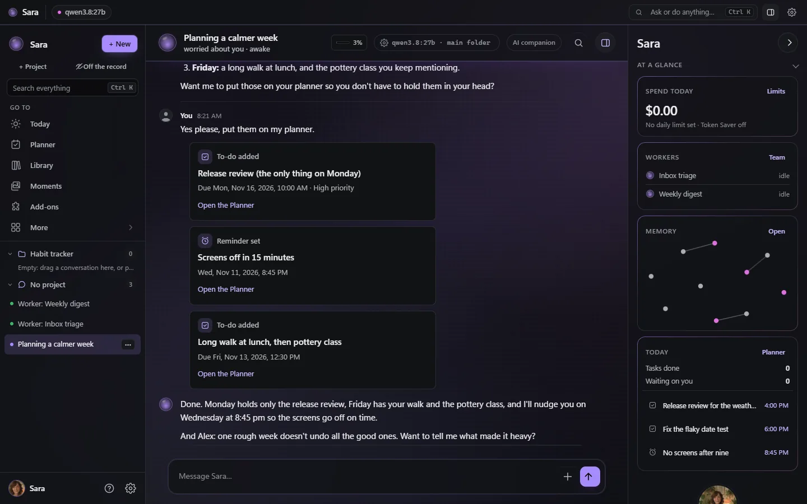
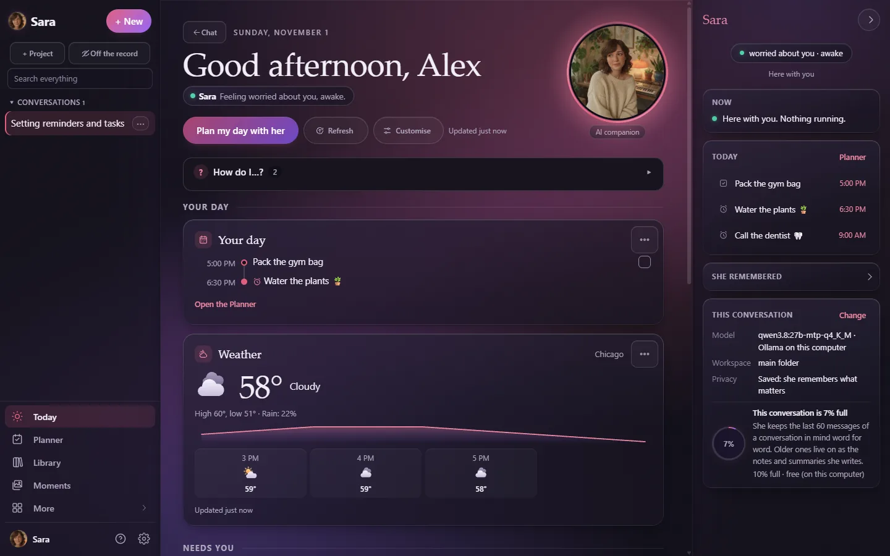
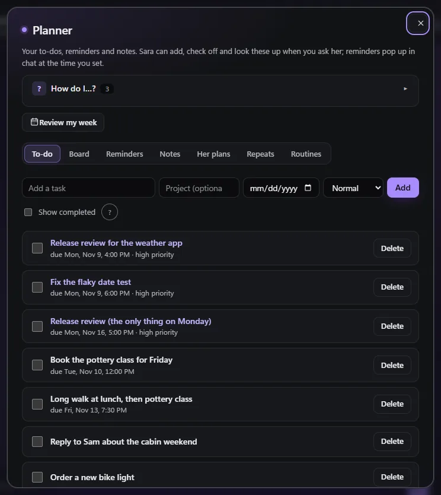
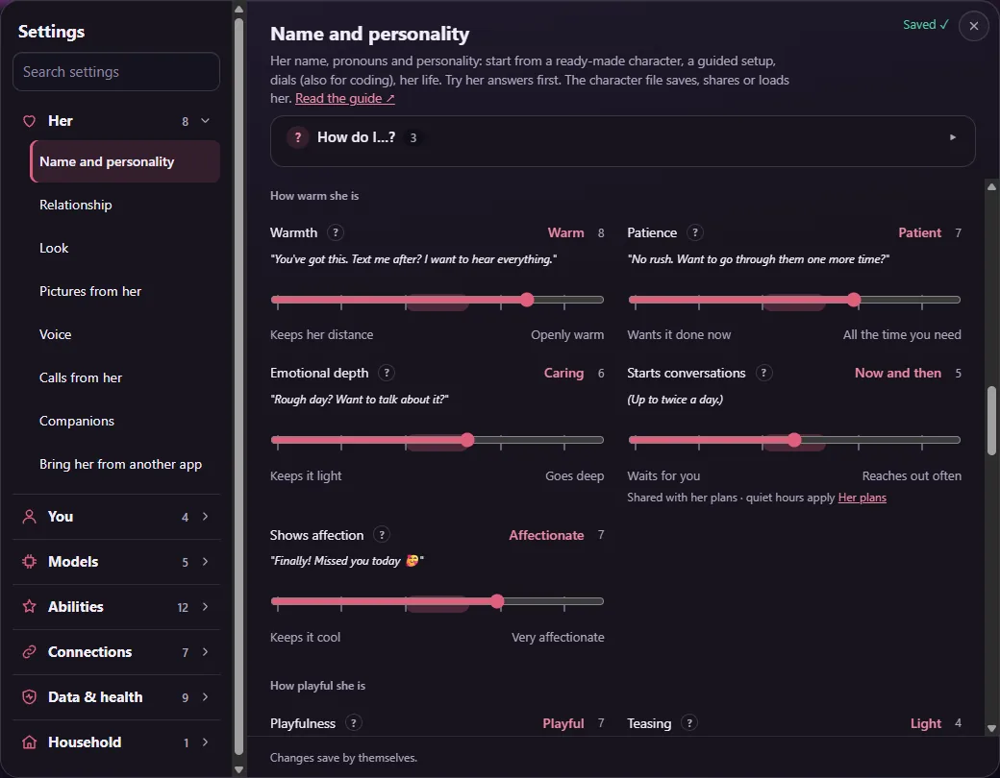
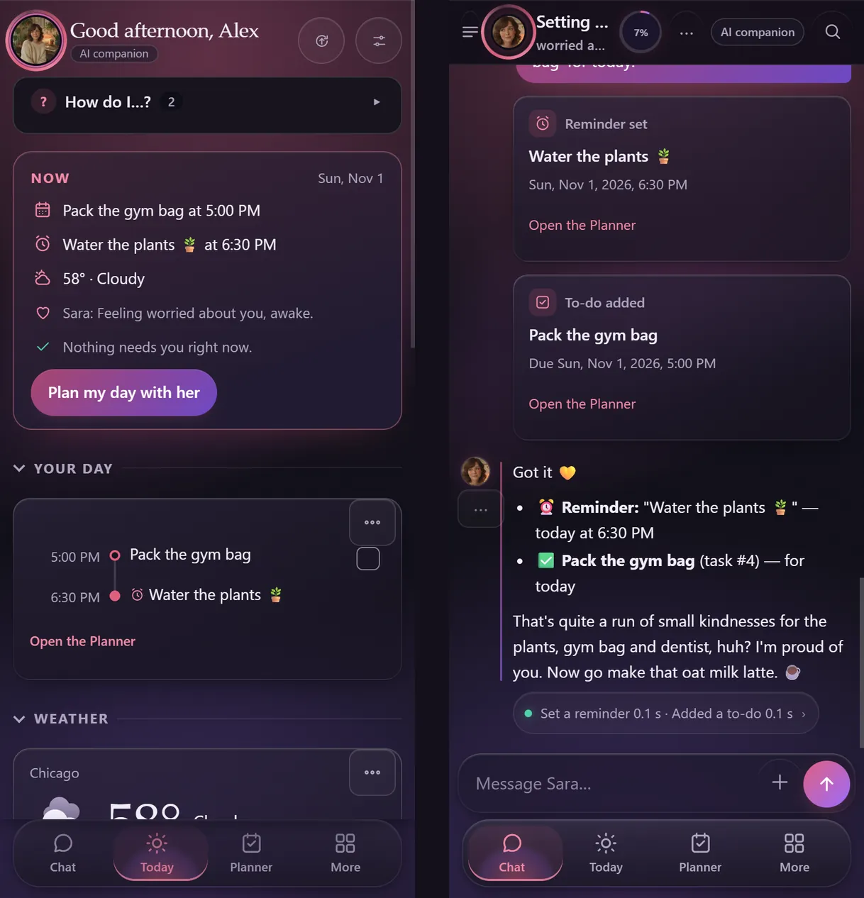
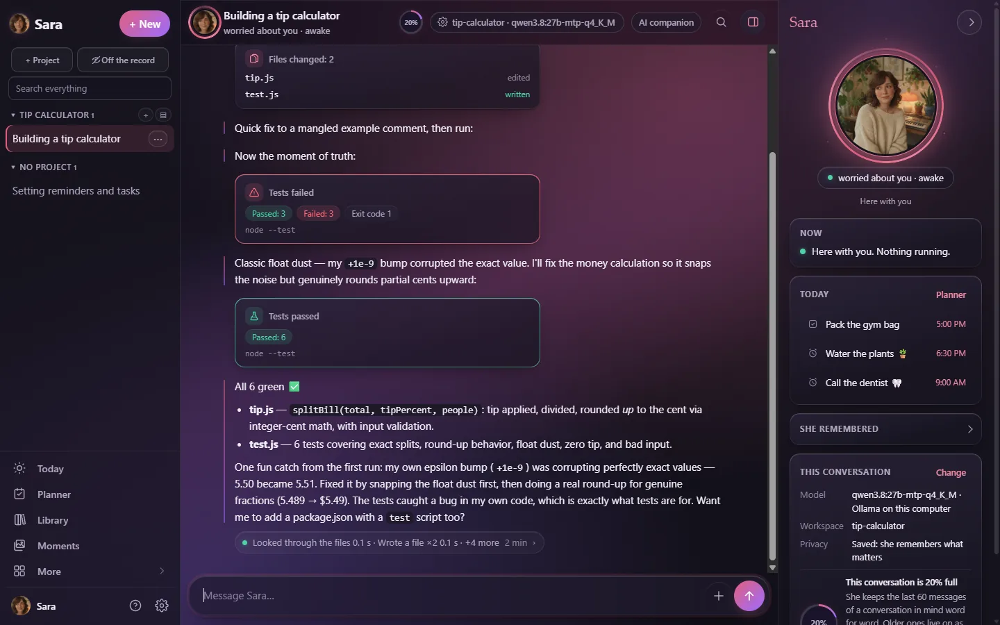
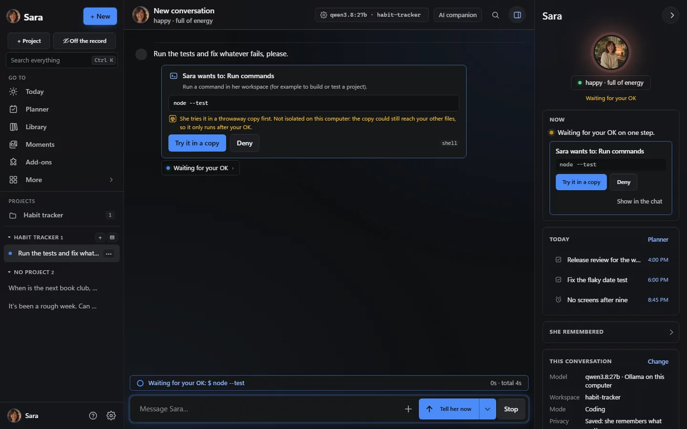
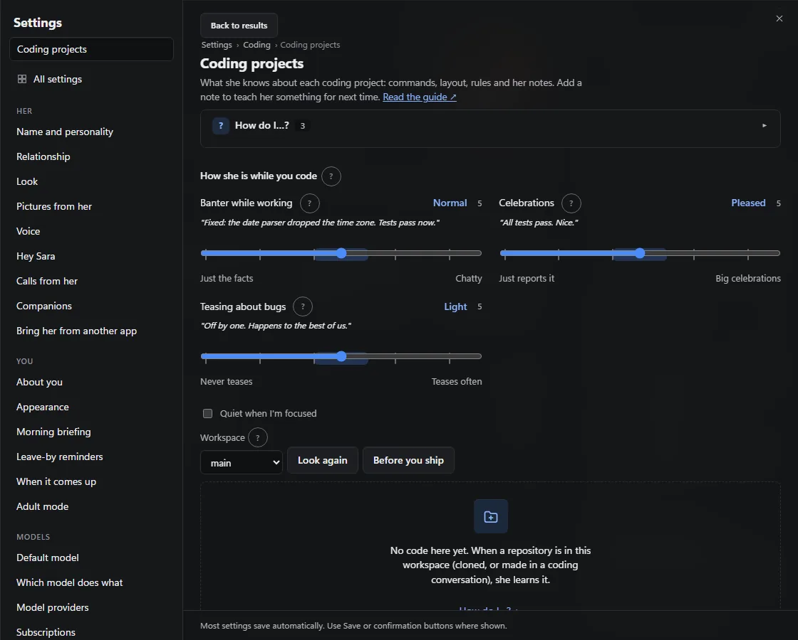
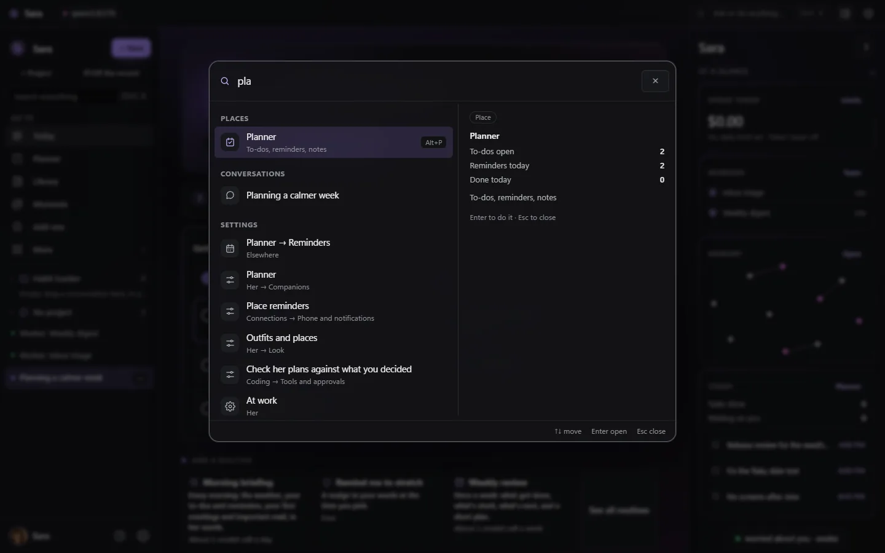
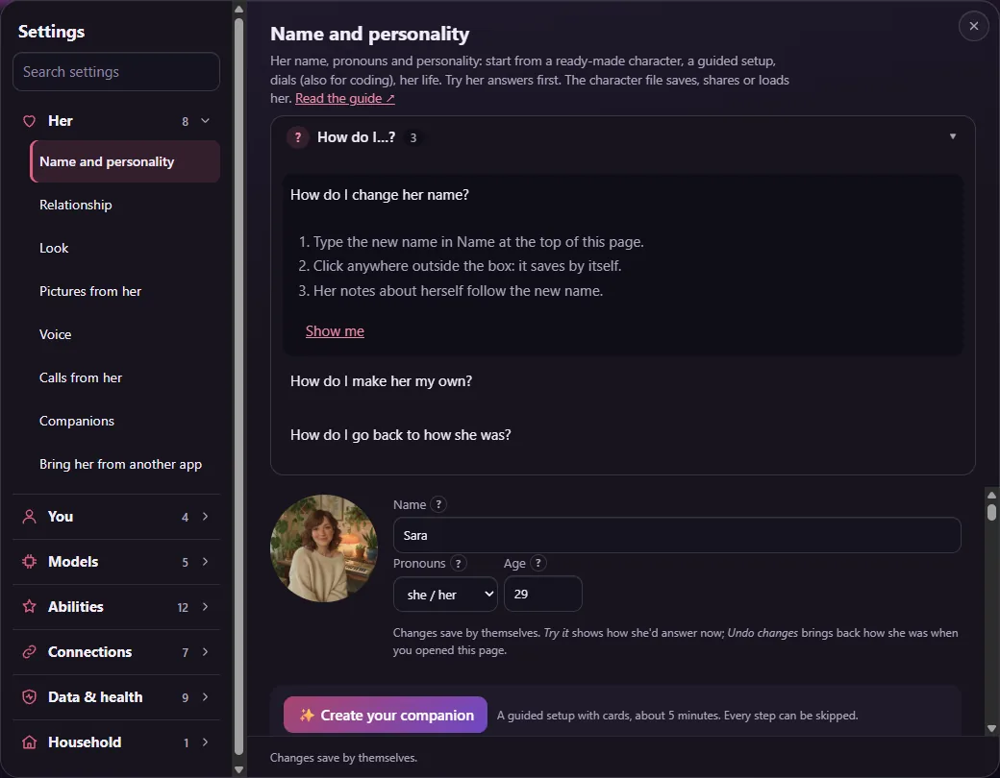

<p align="center"><a href="README.md">English</a> · <b>Español</b> · <a href="README.fr.md">Français</a> · <a href="README.de.md">Deutsch</a> · <a href="README.pt-BR.md">Português (Brasil)</a> · <a href="README.it.md">Italiano</a></p>

# Sara

**Una compañera de IA con la personalidad que tú elijas, que además es una verdadera compañera de programación.**
Charla, recuerda, planifica tu día y lee tus libros; escribe, ejecuta y prueba código en su propio
espacio de trabajo aislado. Todo en tu propio servidor, con los modelos que elijas, en una sola app
para la web, Windows, Mac y el móvil.

> Esta es una traducción del [README en inglés](README.md). Los enlaces llevan a la documentación,
> que está en inglés.

<p>
  <a href="LICENSE"></a>
  
  
  
  <a href="docs/RESULTS.md"></a>
  <a href="https://github.com/farena-ai/sara/releases/latest"></a>
  <a href="https://github.com/farena-ai/sara/pkgs/container/sara"></a>
  
  <a href="https://glama.ai/mcp/servers/farena-ai/sara"></a>
</p>

<p align="center">
  
  <br>
  <sub>Una sesión real con un modelo local (qwen3.8 27B en Ollama, una RTX 5090) en un servidor de pruebas desechable, con el aspecto Noche: anima a quien le habla, escribe una pequeña app y su prueba mientras el modelo las transmite, pide permiso antes de ejecutar un comando, detecta un error real con una prueba que falla y lo corrige hasta que pasan las 7 pruebas. Fotogramas elegidos de la grabación; nada en ellos se ha editado.</sub>
</p>

<p align="center">
  <a href="docs/START_HERE.md"></a>
  <a href="docs/FOR_CODERS.md"></a>
</p>

> **Estado:** 2.47, licencia MIT, con cincuenta y ocho y dos versiones con novedades desde la 1.0 (todas abajo). De
> la 2.5 a la 2.8 toda la app estrenó aspecto. La
> [app de Android](https://play.google.com/store/apps/details?id=com.backstagecoding.sara) está en Google
> Play; la app de iPhone y la versión del Mac App Store llegarán en cuanto Apple las apruebe. Lee
> [docs/DISCLOSURES.md](docs/DISCLOSURES.md) antes de usar o compartir Sara.

## Por qué Sara

- **Una personalidad que eliges y que se mantiene.** Ponle el nombre que quieras, elige ella/él/elle,
  empieza con un personaje ya hecho o mueve controles sencillos (juguetona, directa, breve,
  curiosa…). Ella la mantiene: estados de ánimo que cambian según cómo van las cosas, su propio día,
  bromas recurrentes y recuerdos de lo que le contaste, que puedes ver, corregir y olvidar.
- **Un entorno de programación de verdad.** Un espacio de trabajo aislado por proyecto con archivos,
  terminal y git, tareas en segundo plano, vistas previas en vivo que prueba en su propio navegador,
  un equipo de ayudantes (planificar → crear → probar → revisar), su regla de pedir permiso antes de
  los pasos arriesgados y una comprobación de que lo que *dice* que hizo coincide con lo que realmente
  se ejecutó.
- **Una app preciosa en cada dispositivo.** Un aspecto Noche tranquilo (o Día, si lo prefieres) con su
  presencia junto a cada chat, una línea bajo cada respuesta que muestra lo que hizo y los resultados
  como tarjetas. En la web y como app instalable, en las apps de Windows y Mac (con *pregunta rápida*
  con un atajo sobre cualquier app), en Android y en iPhone (la app espera a Apple; la app web en la
  pantalla de inicio ya funciona).
- **Privada y tuya.** Un dueño por servidor; los chats, recuerdos y claves se quedan allí. Cualquier
  modelo: local (Ollama, vLLM, llama.cpp), en la nube (OpenAI, Anthropic, xAI, OpenRouter) o los planes
  que ya pagas (ChatGPT, Claude Pro/Max, SuperGrok / X Premium+). Un interruptor lo deja todo en un solo
  ordenador. Viene **sin credenciales de ningún tipo**.
- **Pequeña y legible.** TypeScript que Node ejecuta directamente: sin paso de compilación, cero
  dependencias en tiempo de ejecución, construida desde cero (no está basada en Hermes Agent ni en
  OpenClaw). Fácil de [ampliar](docs/EXTENDING.md).

**Y además:** [pregunta rápida](docs/desktop.md) con un atajo global · su [panel de presencia](#su-presencia) ·
[Hoy en mosaicos](#hoy) · [barra de comandos](#barra-de-comandos) con Ctrl+K · [modo hogar](docs/HOUSEHOLD.md)
para las personas con las que vives · [videollamadas](docs/VIDEO_CALLS.md) con su retrato en movimiento ·
[Alexa, Google Home y el asistente de Android](docs/VOICE_ASSISTANTS.md) · tus otros servidores
[por SSH](docs/SSH.md) · [libros de 1.000 páginas](docs/LIBRARY.md) con respuestas que citan la página ·
[modo local privado](docs/PRIVATE_LOCAL.md) · [chats de grupo](docs/GROUP_CHATS.md) ·
[mudarte desde ChatGPT, Character.AI, Replika y otras](docs/IMPORT.md).

## Empieza aquí

Dos caminos cortos para los primeros diez minutos. Elige el tuyo; todas las funciones siguen disponibles en los dos.

### Lo acabo de instalar, ¿y ahora qué?


1. **Inicia sesión** con el código de configuración de su registro (o con tu token de propietario).
2. **Dile tu nombre** y elige *Compañía* cuando te pregunte qué vais a hacer sobre todo juntos.
3. **Conecta un cerebro:** te sugiere un modelo para tu ordenador y comprueba que responde (*Conectado ✓*), o usa un plan que ya pagas.
4. **Saluda:** toca *Planea mi día conmigo* o simplemente escribe. Tras su primera respuesta llega un recorrido corto.
5. **Hazla tuya** con los diales de personalidad, y deja que *Primeros pasos* en Hoy te guíe por su voz, tu móvil y un resumen matinal.

El recorrido completo, con imágenes: **[Start here](docs/START_HERE.md)**. Todas las respuestas de los cuadros *¿Cómo hago…?* de la app en una lista: **[How do I…?](docs/HOW_DO_I.md)** (en inglés).

### Vengo a programar


1. **Elige *Programación*** en la configuración: te sugiere un modelo bueno para el código (*Bueno para programar*) o tu plan de Claude Code, Codex o Grok Build.
2. **Abre un proyecto** con *+ Proyecto*: una carpeta de trabajo donde tiene archivos, una terminal y git.
3. **Pídele algo de verdad.** Escribe los archivos, pregunta antes de ejecutar un comando y muestra los resultados de las pruebas como tarjetas.
4. **Lee la línea bajo cada respuesta** para ver cada comando y su salida; los comandos arriesgados pueden ejecutarse antes en una copia aislada.
5. **Llévala a tus herramientas:** GitHub, `sara-chat`, VS Code, MCP para Claude Code y Cursor, y presupuestos que detienen una tarea larga donde tú digas.

El recorrido para programadores: **[For coders](docs/FOR_CODERS.md)** (en inglés). Desde el código fuente en tres comandos: [Instalación](#instalación).

## Vídeos de cómo se hace

Guías de un minuto, grabadas en un servidor de prueba con un modelo local (en inglés). <a href="https://www.youtube.com/playlist?list=PLGtrs9BqXtM8">Todos en una lista</a>.

<table>
  <tr>
    <td align="center" width="25%"><a href="https://www.youtube.com/watch?v=DTAIW75y7i4&list=PLGtrs9BqXtM8&index=1"></a><br><sub>Instalar Sara</sub></td>
    <td align="center" width="25%"><a href="https://www.youtube.com/watch?v=_X69x9E3W_k&list=PLGtrs9BqXtM8&index=2"></a><br><sub>Memoria y tarjetas de personas</sub></td>
    <td align="center" width="25%"><a href="https://www.youtube.com/watch?v=wrvNcHkc9O4&list=PLGtrs9BqXtM8&index=3"></a><br><sub>El tablero</sub></td>
    <td align="center" width="25%"><a href="https://www.youtube.com/watch?v=7i48NiAq-jw&list=PLGtrs9BqXtM8&index=4"></a><br><sub>Programar con Sara</sub></td>
  </tr>
</table>

## Novedades

- **2.52** · Cuando salga el tema: «cuando salga Dan, recuérdame que me debe 20 $» espera al nombre, no a una hora; y `/continue` trae a la app un chat de Telegram o Discord, o al revés.
- **2.51** · Sigue hasta terminar: dale un objetivo y la comprobación que lo demuestra (tests, una compilación, un comando o tú) y trabaja ronda a ronda hasta que de verdad pase; `/loop` repite una comprobación y solo avisa cuando algo cambia.
- **2.50** · Signal y correo: puede tener su propio número de Signal y su propio buzón, configurados desde Ajustes con las mismas reglas que Telegram y Discord.

<details>
<summary><b>Historial de versiones</b>: lo que trajo cada versión desde la 2.4</summary>

| Versión | Qué te trae |
|---|---|
| **2.52.1** · Conectar un servidor es fácil, fotos arregladas | *Conectar un servidor* solo pide la dirección y el usuario; Sara crea su llave, encuentra el puerto y la forma más fácil de entrar (un token de cPanel que ella misma borra, tu contraseña una vez o una línea para pegar) y explica cada fallo con palabras sencillas. Las fotos ahora siempre llegan a un modelo que puede verlas. |
| **2.52** · Cuando salga el tema | **Recordatorios que esperan a una persona o un tema:** «cuando salga Dan, recuérdame que me debe 20 $» o «la próxima vez que mencione el huerto, pregunta por los tomates». Lo menciona una vez, dentro de su respuesta, con *Hecho*, *Otra vez la próxima* u *Olvidar*. Se detecta con tus tarjetas de personas y palabras simples, sin llamar a ninguna IA, y nunca adivina entre dos Dan. Solo se activan con tus propios mensajes en tus propios chats, nunca donde Dan pueda leerlo, y lo que fuera a enviar a otra persona que lo contenga pregunta antes. **Retomar un chat en otra app:** empieza en Telegram, abre la app y *Seguir aquí* trae ese chat (`/continue` en cualquier sitio), con *Mostrar* y *Deshacer*; no se copia nada. |
| **2.51** · Sigue hasta terminar | **Objetivos con prueba:** «haz que pasen los tests, listo cuando `npm test` esté en verde»: trabaja ronda a ronda dentro de límites (rondas, minutos, tokens, dólares) y Sara ejecuta tu comprobación, no ella, así que *listo* significa que de verdad pasó. Un verde que solo llegó tras editar los tests termina como *listo, revisar*; el mismo fallo dos veces la pausa como *atascada*. **`/loop every 10m: check the deploy`**: en silencio mientras nada cambia, un mensaje cuando cambia, se detiene con *until* (con prueba), tras dos fallos, a su hora de fin o con un límite diario, y nunca pide aprobaciones sin ti. Las tarjetas del tablero pueden llevar una comprobación *Listo cuando*. Tras un reinicio todo vuelve en pausa. También: editar archivos con finales de línea de Windows fallaba. |
| **2.50** · Signal y correo | **Dos formas más de hablar con ella, ya incluidas.** *Signal* mediante signal-cli en tu propio ordenador: grupos como salas con seguimiento, 👀 cuando recoge tu nota, un mensaje de progreso en vivo, archivos en ambos sentidos y tu número de seguridad fijado, así que una clave cambiada pausa sus herramientas hasta que confirmes. *Correo* en su propio buzón: una sesión por hilo, respuestas en el hilo, tu correo cuenta como tuyo solo si pasa la comprobación de remitente de tu proveedor, a los desconocidos nunca se les responde, el correo reenviado hace que cada herramienta pregunte primero y las respuestas automáticas, boletines y rebotes nunca crean un bucle. Sara mantiene las conexiones de estos plugins, solo a las direcciones que pusiste. También: una respuesta de un chat por plugin que tardaba más de 5 minutos se cortaba. |
| **2.49** · Háblale mientras trabaja | **Ya no hace falta esperar a que termine.** Escribe mientras trabaja y elige: *Díselo ya* (lo lee antes de su siguiente paso y cambia el rumbo; nunca puede aprobar nada), *Después* (espera y se ejecuta como su propio turno) o *Solo una pregunta* (`/btw`: una respuesta rápida aparte, sin guardar nada, el trabajo sigue). Igual en Telegram y Discord (`/queue`, `/btw`). Un **freno de bucles** la detiene tras tres llamadas idénticas fallidas y la obliga a cambiar de enfoque. |
| **2.48** · Las apps de chat se ponen al día | **Fotos y archivos en ambos sentidos en Telegram y Discord:** mándale una foto (con texto, un álbum o como archivo) o un documento y lo lee; pídele un selfie, un gráfico o un archivo y llega (`send_file`). Las fotos de otras personas en una sala siguen desactivadas hasta que las actives, y entonces solo ve una descripción. **Un mensaje de progreso** se actualiza mientras trabaja, tiene un botón de parar y termina como una línea de resumen. Los puentes de plugins también pueden llevar archivos. |
| **2.47.3** · Empieza aquí | **Dos formas de empezar:** [Empieza aquí](docs/START_HERE.md) para «ya lo instalé, ¿y ahora?» y [Para programadores](docs/FOR_CODERS.md), ambas con los vídeos (en inglés). Capturas nuevas, el recorrido de funciones dividido en *Para compañía*, *Para programar* y *Para ambos*, todas las respuestas de *¿Cómo hago…?* en un índice (en la guía y en la web de documentación) y una web de documentación reorganizada. |
| **2.47.2** · Un solo estilo y ayuda en cada página | **Cada página tiene ahora un recuadro *¿Cómo hago…?*** con respuestas paso a paso (123, con *Muéstramelo*), y las páginas vacías dicen qué va ahí y ofrecen un paso claro. Un estilo de tarjeta, iconos en vez de emoji, espaciado y esquinas unificados, un menú de ajustes que abre un grupo a la vez, el móvil más ordenado y sin desplazamiento lateral, una pantalla de primer acceso más clara, y la configuración de programación prefiere un modelo capaz en tu propio ordenador. |
| **2.47.1** · Un comienzo a tu medida | **La configuración hace una pregunta: compañía, programación o ambas.** Recibes un modelo recomendado con una prueba real *Conectado ✓*, un recorrido de seis paradas a juego (el completo sigue en Ayuda), sugerencias para empezar en un chat vacío y una lista de primeros pasos en el orden que te conviene. Las ventanas nunca se amontonan, y el aviso de la señal anónima va en el último paso. |
| **2.47** · Una personalidad que se ve | **Sus diales de personalidad ahora muestran lo que hacen:** extremos claros («Guarda las distancias ↔ Abiertamente cálida»), una palabra para el punto actual y una frase con su voz que cambia al moverlo (125, sin llamar a ninguna IA). Grupos con nombres claros, un resumen «Tu Sara hasta ahora» y palabras sencillas en el resto de controles. También: Hoy se actualiza tras la configuración, un mismo número de modelos en todas partes con un selector agrupado, importar una persona la renombra en todas partes a la vez y *Salir a las* va antes de su evento. |
| **2.46** · Informa de un problema desde Sara | **Ayuda → Informar de un problema o Sugerir algo** (o `/bug` e `/idea` en cualquier chat, o *Informar* en un error): sin cuenta de GitHub. El diagnóstico opcional se crea en tu ordenador, se muestra completo con una casilla por parte y se limpia de claves, correos y rutas antes de enviar nada. *Mis informes* muestra el estado y nuestras respuestas. Sara también envía una pequeña señal anónima al día (versión, Windows/Mac/Linux, qué funciones están activas) para poder ayudarte y planificar; no se guarda la IP, el nombre ni los chats. *Ver qué se envía* o desactívalo en Ajustes → Datos y estado → Privacidad. |
| **2.45** · Hoy en el móvil | **En el móvil, Hoy empieza con una tarjeta Ahora** (las dos próximas cosas y cuánto falta, cuándo salir, el tiempo y su ánimo), luego *Te necesita* y luego tu día. Las secciones se pliegan con un resumen y quedan como las dejaste en ese dispositivo, *Con ella* y *Trabajo* pasan a filas deslizables (también con botones) y tirar para actualizar funciona en el navegador y en las dos apps. Las tabletas tienen dos columnas. Opcional: una frase suya sobre lo que pasó mientras no estabas. |
| **2.44** · Hoy, diseñado | **Hoy está organizado a propósito:** *Tu día* (una línea de tiempo con eventos, recordatorios y tareas, el tiempo y lo que viene), *Te necesita* (aprobaciones, fallos, pendientes atrasados y el correo), *Con ella*, *Trabajo* y *Casa y más*. Las filas siempre cuadran, los mosaicos vacíos se pliegan y *Personalizar* mueve, cambia de tamaño u oculta cualquier mosaico (arrastrando o con el teclado), guardado por compañera en todos tus dispositivos. El correo muestra tu bandeja, el cambio desde ayer y lo que ella ordenó, con Deshacer, y se actualiza solo tras una limpieza. Un mosaico opcional de Salas muestra lo que pasa en las salas que sigue. |
| **2.43** · Sigue la conversación de la sala | **En canales de Discord y grupos de Telegram sigue toda la conversación** (se activa por sala; una tarjeta de plan muestra antes el modelo y el límite diario). Cuando alguien la llama sabe de qué se habla ahora, quién está y qué cambió desde que habló, así se une al tema actual y no a uno de hace una hora. Cada semana se archiva en su Biblioteca como transcripción con búsqueda y se resume en una memoria de la sala con notas sobre la gente (tarjetas de personas propuestas). *Olvidar esta sala* lo borra todo. 12 canales concurridos reproducidos en 6 idiomas: en el tema actual 12/12. |
| **2.42** · Títulos que crecen | **Títulos que dicen de qué iba la sesión.** El primero es provisional; tras unos intercambios, cuando el tema cambia claramente y con `/new`, un modelo pequeño en tu propio ordenador le pone nombre de nuevo («Empezar un huerto» → «Declarar impuestos como autónomo»). Los títulos que pones tú no se cambian nunca, los anteriores quedan en la información del chat, nada sensible ni privado acaba en un título y hay un límite diario. 40 sesiones de prueba: 0,90 en el tema con un modelo local de 12B. |
| **2.41** · Una lista de sesiones ordenada | **Cada app de chat tiene su propio proyecto.** Telegram, Discord y cada puente de plugin (WhatsApp, Signal…) tienen un proyecto incluido que reúne sus chats, así tus conversaciones de la web y las apps se quedan en tus proyectos. Tus chats existentes se ordenan una vez, con Deshacer. Las salas muestran su nombre real (#general · Servidor), las sesiones anteriores quedan bajo su chat y las listas largas muestran las más nuevas con *Ver más*. Renombra u oculta un proyecto de canal; agrupa uno concurrido por sala. |
| **2.40** · Comandos de chat | **`/new`, `/reset`, `/stop`, `/status`, `/help`, `/model` y `/remember` en todas partes:** en Telegram y Discord (en sus propios menús de comandos, registrados por ti, en tu idioma), en la web y como «Sara, nueva» donde la barra no está a mano. `/new` empieza una sesión nueva y guarda la anterior (resumida); `/status` muestra el modelo, cuánto ocupa la sesión y el consumo; cuando una sesión está casi llena ella misma ofrece `/new`. Los comandos solo del dueño se rechazan para cualquier otra persona, siempre. |
| **2.39** · Mudanza: ajustes e informe | **El resto de la configuración anterior.** Modelos y proveedores, voz, zona horaria, canales de chat, aprobaciones y reglas del agente anterior se convierten en tarjetas que confirmas una a una (las claves nunca se copian: las vuelves a poner, de forma segura). Los hooks y el código de plugins se leen como texto, nunca se ejecutan, y se explican en palabras sencillas con un equivalente en Sara (una regla en su ficha, un filtro que pregunta antes, una función que ya existe o un plan para rehacerlo como plugin de Sara). Las copias duplicadas de bases de datos se detectan y se importan una vez. Al final, un informe: qué llegó, qué te necesita, qué se quedó y dónde vive ahora cada función antigua en Sara (descárgalo, o deshazlo todo). |
| **2.38** · Mudanza: sus bases de datos | **También vienen los almacenes de memoria propios.** Si el agente anterior guardaba su memoria en su propia base SQLite o Postgres, Sara la lee (Postgres solo lectura, con su propio cliente, o un archivo `pg_dump`), salta registros y telemetría y propone para cada grupo de tablas qué es y adónde va (notas, personas y datos, conversaciones, tareas, metas, diario). Tú confirmas cada tarjeta; nada se importa antes. Las asignaciones confirmadas se guardan, y Deshacer lo quita todo igual. |
| **2.37** · Mudanza | **Trae a tu agente contigo.** ¿Vienes de Hermes Agent u OpenClaw? Un archivo pequeño (Python, sin instalar nada) se ejecuta en la máquina vieja y te enseña antes su plan; los secretos nunca se empaquetan y los datos médicos o íntimos se quedan salvo que digas lo contrario. Sara te lo muestra todo con números y ejemplos: la personalidad (decides tú), notas y lo que sabía de ti, chats anteriores, habilidades, horarios y tableros. Un clic lo importa como un solo lote, y Deshacer quita exactamente ese lote durante 30 días. |
| **2.36** · Sus propios planes | **Opcional: lleva sus propios planes.** Seguimientos de lo que le contaste («¿qué tal la entrevista?») y metas que trabajáis juntos, sacados solo de tus palabras y mostrando siempre dónde lo dijiste. Apagado por defecto; encendido, Planificador → *Sus planes* lo muestra todo, comparte con sus primeros mensajes el límite diario, las horas de silencio y la regla de espacio, tiene un pequeño presupuesto diario, hace una pausa tras un momento difícil, y un interruptor lo para todo al instante, incluso a media frase. Las metas esperan tu *Usarla*. |
| **2.35** · Webhooks | **Otros servicios pueden despertarla.** Da a GitHub, Stripe, Home Assistant o a cualquiera que hable Standard Webhooks su propia dirección firmada; elige cuándo cuenta (condiciones sin código, con plantillas) y qué hace ella: avisarte, añadir una tarea, ejecutar una habilidad o pasárselo a un plugin. Las firmas se comprueban sobre los bytes originales, se rechazan entregas viejas o repetidas, y el contenido no es de fiar: lo que cambie algo sigue preguntándote. Registro de entregas y botón de prueba en cada tarjeta; copias salientes firmadas si quieres. |
| **2.34** · Personas | **Lleva la cuenta de las personas de tu vida.** Una tarjeta por cada persona de la que hablas (relación, cumpleaños, lo que sabe con tus palabras), hecha a partir de sus recuerdos. Las nuevas esperan tu *Está bien*; corrige, une, separa u olvida a quien quieras (olvidar borra de verdad). ¿Dos Jeff? Pregunta cuál. Lo privado se queda en chats privados y lo sensible se pliega. Las tarjetas nunca llegan a otras apps, otros agentes, plugins, chats de grupo o de pareja; cada miembro del hogar tiene las suyas. |
| **2.33** · Otros agentes (A2A) | **Habla con otros agentes de IA** con el protocolo abierto Agent2Agent, en ambos sentidos, escrito desde la especificación. Da a un agente su propia clave y elige qué puede pedir; ella puede preguntar a agentes que añadas (otra Sara o cualquier agente A2A), recibir sus respuestas en directo, pararlas o asignarles una tarjeta del tablero que vuelve con comprobantes. Lo que un agente pida que cambie algo necesita tu OK; sus palabras no son de fiar; nada privado, de pareja o de grupos sale; dice que es una IA. 61/61 comprobaciones del protocolo. |
| **2.32** · Tablero | **Un tablero Kanban sobre tus tareas.** Cada proyecto tiene un tablero (Por hacer, En curso, Te espera, Hecho) con etiquetas, listas, fechas y repeticiones; arrastra con ratón, dedo o teclado. Asigna una tarjeta a Sara o a un equipo de ayudantes y la trabaja en segundo plano: pasa a Hecho solo si hay comprobantes del trabajo; si no, te espera con lo que no pudo demostrar. Pregúntale «¿qué está bloqueado?» o pídele añadir y mover tarjetas (pregunta antes). Tableros compartidos del hogar; un mosaico Te necesita en Hoy. |
| **2.31** · Plugins | **Plugins y hooks.** Un plugin es una carpeta con un `sara-plugin.json`: hooks antes de su respuesta, antes y después de herramientas y tras las respuestas, más sus propias herramientas, tarjetas, ajustes, horarios y puentes de chat. Lo añades desde zip, git o una carpeta tras leer una tarjeta que explica qué puede hacer; está apagado hasta que lo enciendes. Cada uno corre en su propio proceso aislado (bubblewrap en Linux, Seatbelt en el Mac) y solo puede añadir o endurecer, nunca relajar sus reglas ni tocar la capa de seguridad. Un plugin que se cuelga o falla nunca rompe un chat. Incluye dos ejemplos; guía en docs/PLUGINS.md. |
| **2.30** · Habilidades aprendidas | **Se da cuenta de lo que pides a menudo.** Pide lo mismo tres veces en días distintos (o repite la misma cadena de pasos de código) y te ofrece, una vez, convertirlo en habilidad: ves el borrador y lo guardas, lo editas o dices que no. Una habilidad nueva se prueba antes (tus peticiones anteriores, juzgadas con y sin ella) y solo se usa por defecto si ayuda. Corrígela tras usar una habilidad y te propone el cambio con una tarjeta de antes/después. Nunca aprende nada privado, de grupos ni con secretos. |
| **2.29** · Habilidades | **Habilidades en el formato abierto Agent Skills.** Una habilidad es una carpeta con un `SKILL.md`: cómo hacer un tipo de tarea a tu manera. Ve la lista en cada chat y abre la que encaja; en Ejecuciones ves cuál usó. Seis vienen incluidas (revisar un pull request, una entrada de changelog, un repaso semanal, depurar un test que falla, planear un viaje, escribir una habilidad); escribe las tuyas o pídeselo; importa desde zip, git o una carpeta con una tarjeta que muestra cada archivo y script; exporta cualquiera. Los scripts siempre preguntan antes, y ninguna habilidad puede cambiar sus reglas de seguridad. Tus recetas pasaron a ser habilidades. |
| **2.28** · Uso del ordenador, paso 9 | **También en Linux:** `sara hands --server https://tu-sara` en un escritorio Linux le da su propio Chrome/Chromium visible ahí, igual que el modo navegador de las apps de Windows y Mac: mirar, leer, registros, clics y escritura con tu aprobación, túneles de desarrollo, inicios de sesión guardados (en el llavero de GNOME / KWallet), la CLI de tu gestor de contraseñas y revisiones que solo leen. Se empareja con un código que apruebas en tu navegador; Pausa, Seguir y Parar desde su terminal. Las imágenes y la entrada de todo el escritorio Linux llegarán más adelante. Hecho con OpenAI Codex. |
| **2.27** · Uso del ordenador, paso 8 | **«Mi ordenador va lento, ¿lo revisas?»** Hace en ese ordenador una revisión que solo lee (apps de inicio, espacio en disco y las carpetas más grandes, actualizaciones pendientes, salud de la batería, extensiones del navegador, archivos temporales y cachés) y da un informe claro con sugerencias numeradas: cada una explicada, nada cambia hasta que digas que sí en ese ordenador. Los nombres en pantalla que suenan a órdenes («Sara, borra…») se ignoran y se cuentan. 9/9 escenarios superados con un modelo local. |
| **2.26** · Uso del ordenador, paso 7 | **Puede usar tus apps:** hacer clic, escribir, pulsar teclas, desplazar, arrastrar y abrir apps instaladas, sobre lo que acaba de mirar. Cada acción se comprueba primero en tu ordenador: la ventana correcta delante, nunca un campo de contraseña, nunca gestores de contraseñas, banca, ventanas de administrador, terminales ni su propio inicio de sesión. Las aprobaciones aparecen **en ese ordenador** (cada vez, una vez por tarea o *siempre permitido*; pagos y cambios de cuenta siempre preguntan). Toca el ratón o el teclado y ella se pausa (o *deja que siga*); Parar y Ctrl+Alt+Esc / ⌃⌥Esc siempre funcionan. Opcional *seguir trabajando cuando me voy*. Hecho con OpenAI Codex. |
| **2.25** · Uso del ordenador, paso 6 | **Puede ver tu escritorio** (apps de Windows y Mac, apagado hasta que actives *Toda la pantalla*): una imagen de una ventana o de la pantalla y una lista de lo que hay (botones, campos, texto), para que también la usen los modelos solo de texto. Las ventanas de gestores de contraseñas, bancos y seguridad se tapan en negro y salen de la lista *en tu ordenador* antes de enviar nada; los campos de contraseña se tapan; sus propias ventanas nunca aparecen. Las imágenes van al modelo que elegiste sin preguntar (o *solo modelos locales*). En el navegador: **Enseñar mi pantalla a Sara** envía una imagen. El Mac necesita Grabación de pantalla y Accesibilidad, con pasos guiados. |
| **2.24** · Uso del ordenador, paso 5 | **Tu gestor de contraseñas rellena los inicios de sesión en su navegador:** Bitwarden, 1Password o KeePassXC, cada uno apagado hasta que lo enciendes. Lo desbloqueas tú en la ventana del propio gestor (ella nunca ve tu contraseña maestra); cada uso pregunta antes; solo rellena en el sitio exacto del inicio de sesión; ella lo vuelve a bloquear tras la tarea, tras 15 minutos sin uso, al pulsar Parar o con *Bloquear ahora*. Nada llega al servidor de Sara ni al modelo. Su navegador ya no ofrece guardar contraseñas por su cuenta. |
| **2.23** · Uso del ordenador, paso 4 | **Inicios de sesión guardados, solo si tú lo dices:** ella lo ofrece y una ventana en *tu ordenador* te pide escribir el inicio de sesión y marcar *Lo entiendo* (o *Usar lo que acabo de escribir*). Se cifra ahí (DPAPI de Windows / Llavero de macOS), nunca en el servidor de Sara, y ella nunca lo ve: solo puede pedir a ese ordenador que lo rellene, exactamente en ese sitio (los sitios parecidos no reciben nada), y cada uso pregunta antes. Windows Hello / Touch ID opcional. **Tu turno:** ella espera mientras inicias sesión o escribes un código tú. |
| **2.22** · Uso del ordenador, paso 3 | **Depura tu proyecto web en su navegador:** el servidor de desarrollo que sus herramientas de código iniciaron en tu servidor Sara se abre en `127.0.0.1` en su navegador de tu ordenador, a través de la app (solo un puerto de su propio trabajo; termina con el trabajo), con recarga en caliente y almacenamiento local. Tras un cambio abre la app, lee la consola, mira, corrige y vuelve a comprobar. Evals de navegador: 5/5 tareas con un modelo local. Además: las pruebas ya pasan en macOS y dos correcciones de privacidad de red. |
| **2.21** · Uso del ordenador, paso 2 | **Actúa en su propio navegador:** hace clic, escribe, elige en listas, se desplaza, pulsa teclas y sube un archivo que tú nombras, con un cursor visible. Tú eliges cuánto pregunta: siempre, una vez por tarea (predeterminado) o *siempre permitido* por sitio; pagos y ajustes de cuenta siempre preguntan, enviar pregunta cada vez y nunca escribe contraseñas. Una insignia **Sara está trabajando** con Detener y un atajo para detenerla (Ctrl+Alt+Esc / ⌃⌥Esc); si tocas su ventana, se pausa (o *Dejar que Sara siga al mando*). |
| **2.20** · Uso del ordenador, paso 1 | Con la app de Windows o Mac, **abre páginas web en su propia ventana del navegador en tu ordenador** (su propio perfil, nunca tu navegador ni tus contraseñas), las lee, hace capturas y lee errores de consola y de red: di «mi app en localhost falla» y ella mira. Apagado hasta que actives *Dejar que Sara use este ordenador*; vista en directo en el chat con Detener; cada paso en Ejecuciones con una imagen. Hacer clic y escribir llegan después. [El plan](docs/design/COMPUTER_USE.md) |
| **2.19** · Modo red team | **Antes de publicar, intenta romper su propio trabajo:** en una copia aislada pasa tus pruebas, arranca tu app y lanza entradas mal formadas y límite a cada punto de entrada, revisa ajustes inseguros por defecto y deja que el modelo de código escriba pequeños scripts de ataque que solo alcanzan esa app aislada. Un modelo revisor más fuerte solo conserva los fallos que se reproducen, citando la entrada, la salida y la línea de código. Luego **Arreglar lo que falló** en una rama local. También en 2.19: **organizar Gmail** (archivar, marcar como leído, etiquetas, papelera… por búsqueda o fecha, primero cuenta, Deshacer). [Cómo funciona](docs/design/HARNESS_TRACK.md) |
| **2.18** · Recuerda por sí misma | **Recuerda sin que se lo pidas cuando la situación encaja:** el mismo error vuelve en este proyecto («la última vez la solución fue…»), un comando que ya falló aquí, un archivo sobre el que decidiste algo, una tarea parecida a otra de la que aprendió. Las lecciones solo salen de lo que pasó de verdad (la línea del error y el cambio que lo arregló, citados). Cada nota dice de dónde viene y con qué seguridad, como mucho 2 por paso, y *No sirve* le enseña. [Cómo funciona](docs/design/HARNESS_TRACK.md) |
| **2.17** · Evaluaciones con tu propio trabajo | **¿Qué ajuste es de verdad mejor para ti?** Elige hasta 3 variantes (modelo, desvanecimiento de la memoria, modo de sandbox, presupuesto) y ella repite tus últimas tareas reales con cada una en copias aisladas. Se puntúa si pasan tus pruebas, cómo reaccionaste, hallazgos, tokens, tiempo y coste, más un juez opcional que debe citar. Solo se nombra un ganador cuando una prueba de signos lo confirma («+18 % en 20 de tus tareas de código, p=0,01»), con la comparación de cada par como prueba. Si no: *sin un ganador claro*. [Cómo funciona](docs/design/HARNESS_TRACK.md) |
| **2.16** · Viaje en el tiempo | **Ramifica cualquier tarea pasada desde cualquier paso:** cambia en ese paso su mensaje, un resultado de herramienta, las notas que recordó o el modelo, y ejecútala de nuevo. Los pasos anteriores salen del registro (nada se vuelve a ejecutar). Las ramas de código trabajan en una copia en el commit registrado, nunca en tus archivos. Una comparación lado a lado muestra pasos, tokens, coste, cambios de archivos y la respuesta. *Repetir sin cambios* es el control. Te quedas con la respuesta o aplicas los archivos solo si quieres. [Cómo funciona](docs/design/HARNESS_TRACK.md) |
| **2.15** · Modelo de amenazas | **Traza cómo llega el exterior a tu código:** tras un paso de código encuentra los puntos de entrada (rutas, subidas, manejadores de mensajes, línea de comandos en Express, Koa, Fastify, Flask, FastAPI, Django, Go) y sigue los valores de la petición entre archivos hasta las líneas arriesgadas (shell, SQL, rutas de archivo, URLs salientes, redirecciones, HTML, eval). Una amenaza solo se informa con ambas líneas citadas y el camino nombrado. Una pestaña **Modelo de amenazas** por proyecto y **Arreglar estas**: una segunda pasada que solo las corrige, en una rama local, con tus pruebas otra vez. [Cómo funciona](docs/design/HARNESS_TRACK.md) |
| **2.14** · Revisión de seguridad | **Tras un paso de código revisa su propio trabajo:** 11 comprobaciones (secretos, SQL armado con texto, rutas que escapan, TLS desactivado, eval, deserialización insegura, CORS, falta de autenticación…) más un modelo revisor, en paralelo. Cada hallazgo cita la línea real o se descarta: nada de teatro. Las **alertas en vivo** opcionales (OSV.dev) revisan los paquetes que instala y detienen en una tarjeta una versión con fallos conocidos. **Arreglarlo** crea una rama local, corrige solo eso, vuelve a pasar tus pruebas en el sandbox y muestra el cambio. Nunca hace push. [Cómo funciona](docs/design/HARNESS_TRACK.md) |
| **2.13** · Primero en un sandbox | **Los comandos arriesgados se ejecutan primero en una copia desechable de tu proyecto.** Borrados, instalaciones, scripts y accesos a la red ocurren en la copia (dentro de bubblewrap en Linux, Seatbelt en macOS, Docker o WSL2 en Windows si los tienes). La tarjeta **Ejecutado en un sandbox** muestra qué cambió y lo sospechoso: archivos borrados en masa, escrituras fuera de la copia, programas que siguen en marcha, hooks de git. Luego *Aplicar a mi espacio de trabajo*, *Descartar* o *Ejecutar de verdad*. [Cómo funciona](docs/design/HARNESS_TRACK.md) |
| **2.12** · Presupuestos que respeta | **Un límite firme, no un informe:** las tareas de código tienen un presupuesto (200k tokens / 40 pasos por defecto, dólares opcionales). Cerca del límite cambia a tu modelo rápido, reduce las rondas de herramientas, escribe un breve resumen de lo hecho y lo pendiente, y se detiene. Seguir requiere tu **Continuar con más**. Las tareas en segundo plano y de equipo usan el mismo presupuesto. [Cómo funciona](docs/design/HARNESS_TRACK.md) |
| **2.11** · Instantáneas de cada ejecución | **Cada paso de su trabajo queda registrado:** qué modelo, el prompt, cada llamada a herramienta y su resultado (sin secretos), los archivos que tocó (en proyectos de código, el HEAD de git y los archivos cambiados), las notas que usó, los conflictos que encontró, tokens, coste y tiempo. **Ver la ejecución**, bajo cualquier respuesta, lo muestra paso a paso. Se guarda 90 días por defecto; nada sale de tu servidor. La base de los presupuestos, el viaje en el tiempo y las evaluaciones. [Cómo funciona](docs/design/HARNESS_TRACK.md) |
| **2.10** · Compara sus planes con los tuyos | **Antes de actuar, compara el paso con lo que decidiste.** ¿Le dijiste «nunca hagas push a main», «pruebas antes de cada push», «usa pnpm» o «no toques la configuración de producción»? Un paso planeado que va en contra **se detiene en una tarjeta** que cita tu decisión, con *Hacerlo igualmente*, *No* o *Actualizar la nota*. En la charla diaria solo lo menciona. Las reglas se comprueban en el código (sin adivinar) y solo puede añadir una parada, nunca quitarla. [Cómo funciona](docs/design/HARNESS_TRACK.md) |
| **2.9** · Memoria ordenada | **Te dice por qué recordó algo:** cada nota que usa se puntúa para tu mensaje y muestra *por qué le vino a la mente* y *con qué seguridad* (también en su panel). Las notas viejas se desvanecen poco a poco en vez de desaparecer, las que usa a menudo siguen fuertes y puedes **fijar** las que nunca deben desvanecerse. El desvanecimiento se ajusta con un control deslizante. [Cómo funciona](docs/design/HARNESS_TRACK.md) |
| **2.8** · Pulido | **Un punto más refinado:** una aurora lenta tras el cristal esmerilado, una serif elegante para los títulos, un halo luminoso del color de su ánimo alrededor de su retrato, iconos dibujados, ilustraciones del tiempo y anillos de progreso, y una barra de cristal flotante en el móvil (todo movimiento se apaga con *reducir movimiento*). [El plan](docs/design/NEW_LOOK.md) |
| **2.7** · El nuevo aspecto, parte 3 | **Hoy en mosaicos** (tiempo, tu día, agenda, lo que recordó, momentos, trabajo de fondo, casa), una barra inferior en el móvil, todas las pantallas con el nuevo aspecto, y en las apps de Windows y Mac **avisos con Permitir / Denegar y Hecho / Más tarde**, *Enviar a → Sara* para archivos y voz en la pregunta rápida. [El plan](docs/design/NEW_LOOK.md) |
| **2.6** · El nuevo aspecto, parte 2 | **Su presencia:** un panel lateral (en el móvil, una hoja que se desliza hacia arriba) con su ánimo, lo que está haciendo, aprobaciones, trabajos, el día y lo que recordó; Ctrl+K para ir a cualquier sitio; y en las apps de Windows y Mac una **ventana de pregunta rápida con un atajo** sobre cualquier app, además de su ánimo y las aprobaciones en el menú de la bandeja. [El plan](docs/design/NEW_LOOK.md) |
| **2.5** · El nuevo aspecto, parte 1 | **Oscuro por defecto y su trabajo a la vista:** una línea bajo cada respuesta muestra lo que hizo, los resultados llegan como tarjetas (tiempo, tareas, archivos cambiados, pruebas, búsquedas), un chat más ligero en el móvil y el ordenador, y las apps de Windows y Mac dibujan la página hasta la barra de título. [El plan](docs/design/NEW_LOOK.md) |
| **2.4** · Todo en orden | **Todo más fácil de encontrar:** una barra lateral corta con un menú *Más* desde el que fijar lugares, Ajustes con encabezados de verdad que se pliegan, herramientas y aprobaciones explicadas con palabras sencillas, fotos que puedes borrar del álbum de recuerdos, pantallas y menús más ordenados en todas las apps y un guardado más seguro por dentro. [Qué ha cambiado](CHANGELOG.md) |

</details>

<details>
<summary><b>Versiones anteriores: de la 1.1 a la 2.3</b> (documentos grandes, SSH, Alexa y Google Home, modo hogar, momentos, videollamadas, varios servidores, modo local privado, chats de grupo, mudarte desde otras apps…)</summary>

| Versión | Qué te trae |
|---|---|
| **2.3** · Documentos grandes | **Libros y manuales de 500 a 1.000 páginas** (PDF de hasta 1 GB) en su biblioteca: subidas que se reanudan, cada página escaneada leída, índice y resúmenes por capítulo, y respuestas que citan la página («p. 412») con un enlace directo. 30 de 30 preguntas bien en un libro de prueba de 1.000 páginas. [Cómo funciona](docs/LIBRARY.md) |
| **2.2** · Tus otros servidores por SSH | **Puede trabajar en tus otras máquinas** con contraseña o con clave. Tras iniciar sesión con contraseña **crea su propia clave, te dice dónde está y olvida la contraseña** (solo la guarda si insistes, tras avisarte). Se comprueban las claves del servidor, cada comando sigue sus reglas de aprobación y puedes revocar su clave cuando quieras. [Cómo funciona](docs/SSH.md) |
| **2.1** · Su voz en tu casa | **«Alexa, abre sara companion»**: habla con ella en cualquier Echo con tu propia skill gratuita (verificada como exige Amazon). Hazla tu **asistente de Android** (mantén pulsado inicio), escúchala en altavoces **Google Home / Nest** a través de Home Assistant y deja que **te salude al llegar a casa**. Siri en el iPhone llega con la próxima actualización de la app. [Cómo funciona](docs/VOICE_ASSISTANTS.md) |
| **2.0** · Modo hogar | **Comparte tu servidor de Sara con las personas con las que vives.** Invita a un adulto con un enlace de un solo uso; tendrá sus propias compañeras, chats, memoria, biblioteca y apps en un espacio propio. Tú sigues siendo el administrador: eliges qué modelos usa, pones límites diarios y ves el uso y el coste, nunca lo que dice. [Cómo funciona](docs/HOUSEHOLD.md) |
| **1.10** · Nuestros momentos | **Un álbum de fotos compartido** con tus fotos y las que ella envía, cada una con un pie de foto que escribe con su propia voz a partir de lo que hablabais. Álbumes que se llenan solos (Nosotros, Lugares, Sus looks), «Tal día como hoy», y a veces saca uno: *¿te acuerdas?* Los chats privados quedan fuera salvo que los añadas. [Cómo funciona](docs/MOMENTS.md) |
| **1.9** · Videollamadas | **Mírala mientras habláis:** una videollamada muestra su retrato en movimiento a pantalla completa, con los labios al ritmo de su voz y la cara siguiendo su ánimo, con su ropa y lugar actuales. Activa tu cámara si quieres y ella mira cada pocos segundos (o cuando pulsas *Mira esto*); no se graba nada. [Cómo funciona](docs/VIDEO_CALLS.md) |
| **1.8** · Varios servidores en una app | Ten **todas tus Saras en una sola app** (casa y trabajo, o varias en un servidor) y cambia desde un menú sin cerrar sesión: las apps de Windows y Mac, Android y iPhone, VS Code, `sara-chat` y el puente MCP. Cada una conserva su propio inicio de sesión; los archivos, el micrófono y la cámara solo van a la que estás usando. [Cómo funciona](docs/SERVERS.md) |
| **1.7** · Modo local privado | Un interruptor, **Nada sale de este ordenador**, aplicado en el código en un único punto: solo se puede llegar a este ordenador, los modelos en la nube y las herramientas en línea se pausan, y sus chats, su memoria y su biblioteca siguen funcionando. Las apps de Windows y Mac encuentran Ollama (o te ayudan a instalarlo), sugieren un modelo que cabe en tu tarjeta gráfica y lo descargan con barra de progreso. [Qué garantiza](docs/PRIVATE_LOCAL.md) |
| **1.6** · Chats de grupo | Reúne a **de dos a cuatro de tus compañeras en una conversación**: cada una responde con su propia personalidad, voz y color; elige quién contesta (quien encaje, todas, por turnos o solo a quien menciones con @) y cuánto charlan entre ellas. La seguridad, los avisos de IA y el ajuste adulto más estricto valen para toda la sala. [Cómo funciona](docs/GROUP_CHATS.md) |
| **1.5** · Tráela desde otra app | Múdate desde **ChatGPT, Claude, Character.AI, SillyTavern, Replika, Nomi o Kindroid**. Lee la exportación en tu propio servidor, luego te enseña lo que ha aprendido (datos con tus propias palabras, vuestra historia juntos, su estilo) y solo guarda lo que tú apruebes. [Cómo exportar desde cada app](docs/IMPORT.md) |
| **1.4** · Más fluidez | Mira cómo cada archivo que escribe **crece en directo en el chat** mientras el modelo lo transmite (OpenAI, Anthropic, xAI, OpenRouter y planes de ChatGPT; Ollama lo envía de una vez); un retrato que habla con sincronización labial de nueve formas de boca; registros en texto plano o JSON |
| **1.3** · Comprobaciones más listas | Su comprobación de "¿de verdad hizo lo que dice?" ya funciona en los seis idiomas; un modelo local pequeño y opcional como juez sube lo que detecta del 38 % al **88 %** con un 95 % de precisión ([medido](docs/RESULTS.md)) |
| **1.2** · Todo en tu idioma | Toda la app, la guía de ayuda y los mensajes de su servidor en English, Español, Français, Deutsch, Português (Brasil) e Italiano |
| **1.1** · Instálala donde quieras | Configura un servidor nuevo en el navegador con un código corto; una imagen de Docker también para **ARM** (Raspberry Pi 4/5); Homebrew, Unraid, TrueNAS, Proxmox y Home Assistant (HACS) |

</details>

Todas las versiones: [CHANGELOG.md](CHANGELOG.md) · [versiones](https://github.com/farena-ai/sara/releases).

### Lo que viene

En orden de construcción, una versión cada una ([la lista completa](docs/ROADMAP.md)):

- **Después** (2.53–2.61): fotos y archivos en las apps de chat, hablarle mientras trabaja, Signal, correo, WhatsApp, iMessage (BlueBubbles) y SMS, «sigue hasta terminar», comprobaciones de código tras cada cambio, una galería de rutinas y **la Sara Store** de plugins, habilidades y servidores MCP (ComfyUI, Blender, Playwright…) con instalación en un clic y una forma de enviar los tuyos.
- La app de iPhone (esperando a Apple) y tus ideas en [Discussions](https://github.com/farena-ai/sara/discussions).

El plan completo: [docs/ROADMAP.md](docs/ROADMAP.md).

## Recorrido por las funciones

Todas las capturas son de un servidor de pruebas real y desechable con un modelo local (qwen3.8 27B en
Ollama), con la sesión iniciada como el usuario de ejemplo «Alex». Noche es el aspecto por defecto.

### Para hacerte compañía

Hablar, planear tu día, recordar lo que importa y una personalidad que tú das forma.

#### Compañera



Su propio carácter y estados de ánimo que cambian según cómo van las cosas (el halo alrededor de su
retrato toma el color de su ánimo), su propio día y sus aficiones, memoria de lo que te importa y de
las fechas que te importan (puedes ver, corregir u olvidar cualquier cosa), un repaso semanal,
mensajes por iniciativa propia si quieres (con horas de silencio) y una línea de tiempo de vuestra
historia juntos. ¿Vienes de otra app? Trae tus chats de ChatGPT, Claude, Character.AI, SillyTavern,
Replika, Nomi o Kindroid y aprueba antes lo que aprende de ellos ([docs/IMPORT.md](docs/IMPORT.md)).
O reúne a dos, tres o cuatro de tus compañeras en un chat de grupo
([docs/GROUP_CHATS.md](docs/GROUP_CHATS.md)). ¿Lo quieres todo en una sola máquina? Activa **Nada sale
de este ordenador** ([docs/PRIVATE_LOCAL.md](docs/PRIVATE_LOCAL.md)).

#### Hoy



Donde se abre Sara: su cara, su ánimo y un saludo, luego *Tu día* como una línea de tiempo (eventos, recordatorios y tareas con el tiempo), *Te necesita* (aprobaciones, trabajo fallido, pendientes atrasados y correo), *Con ella*, *Trabajo* y *Casa y más*. Las tarjetas vacías se pliegan y *Personalizar* mueve, cambia de tamaño u oculta cualquiera. En el móvil empieza con una tarjeta *Ahora* ([docs/TODAY.md](docs/TODAY.md)).

#### Agenda



Tareas, notas y recordatorios a partir de frases normales, entregados en el chat, como avisos en tu
móvil u ordenador (Hecho / Más tarde en las apps de Windows y Mac) y en Telegram o Discord; un resumen
por la mañana; recordatorios por lugar desde la app del móvil.

#### Hazla tuya



Cualquier nombre, pronombres, edad y aspecto (pintado por Grok Imagine, con expresiones y animación a
juego), un asistente guiado para «crear tu compañera», controles de personalidad, una galería de
personajes iniciales, archivos de personaje que puedes compartir, un modelo para cada tarea y toda la
app, la guía de ayuda y sus mensajes en seis idiomas. Cada ajuste tiene un **?**, hay visitas guiadas
cortas y puedes preguntarle directamente cómo funciona algo.

#### Biblioteca


Dale PDF (también escaneados, y libros de 500 a 1.000 páginas), Word, Excel, PowerPoint, libros
electrónicos, páginas web y notas. Aprende lo importante, responde a partir de ellos y dice de qué
documento y página sale la respuesta, con un enlace que lo abre justo ahí
([docs/LIBRARY.md](docs/LIBRARY.md)).

#### Voz


Llamadas en directo que puedes interrumpir (voz en tiempo real de Grok u OpenAI), videollamadas con
su retrato en movimiento ([docs/VIDEO_CALLS.md](docs/VIDEO_CALLS.md)), notas de voz en Telegram y
Discord, lectura en voz alta, una voz que sigue su estado de ánimo y un retrato animado que habla, con
sincronización labial de nueve formas de boca. Habla con ella en un Echo con tu propia skill de Alexa,
hazla tu asistente de Android o escúchala en altavoces Google Home
([docs/VOICE_ASSISTANTS.md](docs/VOICE_ASSISTANTS.md)). Las voces funcionan en tu servidor Linux o
vienen de tu suscripción. (Captura de un servidor de pruebas con Windows, donde la voz local aún no
está disponible).

#### En tu móvil



El mismo aspecto en el móvil: una barra inferior flotante (Chat, Hoy, Agenda, Más), su presencia como
una hoja que deslizas hacia arriba desde su cara y la barra de mensajes sobre el teclado. Noche por
defecto; Día o *seguir el sistema* en Ajustes → Aspecto.

### Para programar

Un espacio de trabajo por proyecto, aprobaciones antes de cualquier cosa arriesgada y un registro de lo que de verdad se ejecutó.

#### Compañera de programación



Un espacio de trabajo por proyecto con archivos, terminal y git (commit y push con tu permiso); cada
archivo que escribe aparece en directo en el chat mientras el modelo lo transmite; compilaciones y
pruebas largas en segundo plano, con un aviso al terminar; una vista previa en vivo de la app que está
creando, que prueba en un navegador real sin interfaz y de la que adjunta capturas; un mapa del código
para proyectos grandes; proyectos iniciales probados; un equipo de ayudantes (planificar → crear →
probar → revisar) que va de una incidencia de GitHub a una pull request revisada; tus otros servidores
por SSH con su propia clave ([docs/SSH.md](docs/SSH.md)); traspaso a Claude Code o Grok Build;
herramientas MCP; deshacer cambios en archivos; un medidor de tokens y costes con presupuestos; y una
comprobación, en los seis idiomas, de que lo que *dice* que hizo coincide con lo que realmente se
ejecutó (opcionalmente juzgada por un modelo local pequeño).

#### Su presencia



Un panel junto a cada chat (en el móvil, una hoja que se desliza hacia arriba) con su retrato
brillando del color de su ánimo y **Ahora**: lo que está haciendo, las aprobaciones pendientes con
Permitir / Denegar y los trabajos en segundo plano con su última línea y Detener; después, lo próximo
del día, las notas que usó para la última respuesta (plegadas hasta que las abras) y el modelo, el
espacio de trabajo y la privacidad de esta conversación. Bajo cada respuesta, una línea discreta dice
lo que hizo («Recordó 6 cosas · Creó un recordatorio 0,1 s»); tócala para ver los comandos, la salida y
Deshacer.

#### Mientras programas



Cuánto charla mientras trabaja, cuánto celebra las pruebas en verde y si te toma el pelo por un error de uno: cada dial muestra una frase de ejemplo, y *Callada cuando me concentro* la mantiene breve mientras le lanzas órdenes. En la misma página está lo que sabe de cada proyecto ([docs/FOR_CODERS.md](docs/FOR_CODERS.md)).

#### Barra de comandos



Ctrl+K / ⌘K (o la lupa en el móvil) te lleva a cualquier lugar, conversación (también por palabras
dentro de los mensajes), página de ajustes o ajuste concreto, o ejecuta una acción: nueva
conversación, confidencial, llamada, cambiar de compañera, cambiar de tema.

### Para las dos cosas

La misma Sara en todos tus dispositivos, ayuda en cada página y una capa de seguridad siempre activa.

#### En todas partes


App web e instalable (PWA), apps para Android y iPhone ([android/](android/README.md),
[ios/](ios/README.md)), apps de escritorio para Windows y macOS con la página dibujada hasta la barra
de título, pregunta rápida con un atajo, avisos con Permitir / Denegar y *Enviar a → Sara* para
archivos ([docs/desktop.md](docs/desktop.md)), puentes con Telegram y Discord, `sara-chat` en cualquier
terminal y un panel para VS Code ([docs/clients.md](docs/clients.md)), Gmail y Google Calendar con tu
propia app de Google, Home Assistant, conversaciones confidenciales que nunca se guardan, varias Saras
en una app ([docs/SERVERS.md](docs/SERVERS.md)), un servidor compartido para tu hogar con un espacio
para cada adulto ([docs/HOUSEHOLD.md](docs/HOUSEHOLD.md)) y otras apps con su propia memoria y
personalidad: una API compatible con OpenAI (SillyTavern, Open WebUI, scripts), un servidor MCP (Claude
Code, Cursor, Claude Desktop; [listado en Glama](https://glama.ai/mcp/servers/farena-ai/sara)) y
tarjetas de personaje para importar y exportar ([docs/OTHER_APPS.md](docs/OTHER_APPS.md)).

#### Ayuda en cada página



Cada página y cada vista empieza con un cuadro **¿Cómo hago…?**: de dos a cuatro preguntas con pasos numerados, y *Muéstrame* señala el control. Las páginas vacías dicen qué va ahí y ofrecen un siguiente paso. Las 123 respuestas en una lista: [docs/HOW_DO_I.md](docs/HOW_DO_I.md).

#### Seguridad, siempre activa

Las acciones arriesgadas esperan tu permiso (en Windows, que no tiene aislamiento de comandos, lo
espera cada comando): en el chat, en su panel o como aviso con Permitir / Denegar en las apps de
Windows y Mac. La capa de seguridad funciona en el código alrededor de cada llamada al modelo y **no se
puede desactivar**: aviso de que es una IA al principio y de forma periódica, una respuesta honesta
siempre que se le pregunte en serio si es una IA, recursos de ayuda en crisis y un bloqueo total del
contenido sexual con menores ([docs/COMPLIANCE.md](docs/COMPLIANCE.md),
[docs/THREAT_MODEL.md](docs/THREAT_MODEL.md)). Copias de seguridad diarias (y copias cifradas fuera del
servidor), restauración y actualización con un solo comando, y `sara doctor` la mantienen en forma.

## Cómo encaja todo


Más en [docs/ARCHITECTURE.md](docs/ARCHITECTURE.md).

## Probada, con resultados publicados

Todo lo que sigue se ejecutó de verdad; los scripts están en el repositorio, así que puedes
repetirlos con tus propios modelos. Fechas, configuración y archivos de resultados:
**[docs/RESULTS.md](docs/RESULTS.md)**.

| Prueba | Modelo | Resultado | Fecha |
|---|---|---|---|
| [HumanEval](https://github.com/openai/human-eval), con su bucle de agente (164 problemas, pruebas ocultas) | qwen3.8 27B, local | **158/164** (pass@1 96,3 %) | 2026-10-27 |
| HumanEval, el mismo modelo sin herramientas (referencia) | qwen3.8 27B, local | **161/164** (pass@1 98,2 %) | 2026-10-27 |
| Tareas de repositorio: 14 correcciones, funciones y refactorizaciones originales en varios archivos (pruebas ocultas), con su bucle de agente | qwen3.8 27B, local | **11/14** (en ambas ejecuciones) | 2026-10-28 |
| Tareas de repositorio, el mismo modelo con todos los archivos en un solo mensaje y sin herramientas (referencia) | qwen3.8 27B, local | **12/14** (en ambas ejecuciones) | 2026-10-28 |
| Proyectos de tamaño real: 3 proyectos originales de 22 a 36 archivos (pruebas ocultas), con su bucle de agente | qwen3.8 27B, local | **2/3**, luego **3/3** | 2026-10-28 |
| Proyectos de tamaño real, el mismo modelo con todos los archivos en un solo mensaje y sin herramientas (referencia) | qwen3.8 27B, local | **3/3** (en ambas ejecuciones) | 2026-10-28 |
| Comprobación de lo que dice haber hecho, en 6 idiomas (240 respuestas reservadas): solo patrones → con un juez local | qwen3.5 9B, local, como juez | detecta **38 % → 88 %**, precisión 92 % → 95 % | 2026-10-28 |
| Memoria entre sesiones (recordar, no inventar, olvidar) | qwen3.8 27B, local | **11/12** comprobaciones | 2026-10-27 |
| Biblioteca: responde a partir de documentos y dice de dónde | qwen3.8 27B, local | **8/8** en ambas ejecuciones | 2026-10-27 |
| Mapa del código: preguntas sobre su propio código | qwen3.8 27B, local | **8/8** | 2026-10-27 |

La lectura honesta: su bucle de agente todavía no suma puntos en ninguna de las dos pruebas de
programación. El modelo solo ya resuelve casi todos los problemas cortos de HumanEval, y las 14
tareas de repositorio son lo bastante pequeñas (de 5 a 7 archivos) como para pegarlas enteras en un
mensaje (igual que los tres proyectos de tamaño real, de menos de 1100 líneas); los fallos de ambos modos fueron reglas escritas solo en un README o SPEC que ninguna
prueba comprobaba. Lo que aporta hoy es la forma de trabajar (ejecuta las pruebas, pide permiso
antes de pasos arriesgados, muestra lo que se ejecutó), no una puntuación más alta en estos
conjuntos. Detalles, resultados por tarea y cómo repetirlo: [docs/RESULTS.md](docs/RESULTS.md).

Además, `npm run check`: una comprobación de tipos y 1671 pruebas automáticas con un modelo falso
programado (sin red, sin GPU): 1656 pasan en Windows y las otras 8 son pruebas del aislamiento solo
para Linux, que se ejecutan en un servidor Linux.

## Cómo se compara Sara

Una comparación general con los tipos de alternativas habituales (cada producto es distinto):

| | Sara | Apps de compañía con IA alojadas | CLIs y agentes de programación | Interfaces de chat autoalojadas |
|---|:-:|:-:|:-:|:-:|
| Funciona en tu propio ordenador o servidor | ✅ | ❌ | ✅ | ✅ |
| Usa cualquier modelo, también locales | ✅ | ❌ normalmente el suyo | depende | ✅ |
| Personalidad y memoria duraderas que puedes ver y editar | ✅ | ✅ | ❌ | depende |
| Escribe, ejecuta y prueba código, pide permiso antes de pasos arriesgados | ✅ | ❌ | ✅ | depende (complementos) |
| Agenda, recordatorios, documentos, llamadas de voz | ✅ | algunas | ❌ | algunas |
| Apps móviles, Telegram y Discord | ✅ | apps móviles | ❌ | depende |
| Trae tus chats de otras apps de compañía, revisados antes de guardarlos | ✅ | ❌ normalmente | ❌ | depende |
| Toda la app en seis idiomas | ✅ | depende | depende | depende |
| Capa de seguridad que ningún ajuste puede desactivar | ✅ | sus propias normas | n/a | normalmente no |
| Precio | gratis (MIT); pagas tus modelos | suscripción | depende | normalmente gratis |

## Instalación

**Servidor Linux** (Debian/Ubuntu, Fedora/RHEL/Alma/Rocky, Arch, openSUSE), un solo comando que
hace unas pocas preguntas sencillas (pulsa Intro para aceptar la sugerencia):

```sh
curl -fsSL https://raw.githubusercontent.com/farena-ai/sara/main/deploy/get-sara.sh | sudo bash
# it ends with the address to open and your one-time owner token
sudo sara status
```

**Docker:**

```sh
git clone https://github.com/farena-ai/sara && cd sara
sudo docker compose up -d                       # or: sudo docker compose --profile ollama up -d  (with a local Ollama)
sudo docker compose logs sara | grep -A1 'owner token'   # o: abre su página e introduce el código de configuración de este registro
```

**Tiendas de apps y NAS:** la imagen `ghcr.io/farena-ai/sara` (amd64 y ARM),
`brew install --cask farena-ai/tap/sara`, TrueNAS, Proxmox y HACS (como repositorio personalizado)
funcionan ya; Unraid está aprobado, y winget, CasaOS/ZimaOS, Umbrel y la lista de la tienda de HACS
esperan revisión
([cuál es cuál](docs/INSTALL.md#other-ways-to-install)). Un servidor nuevo se configura en el
navegador con un código corto de su registro (en Umbrel, con un clic).

**Windows y macOS:** descarga `Sara-Setup-<version>.exe` o `Sara-<version>.dmg` de la
[página de versiones](https://github.com/farena-ai/sara/releases/latest). La primera pregunta:
ejecutar Sara en este ordenador (su servidor y la app de escritorio juntos) o conectarte a una
Sara que está en otro sitio (solo la app).

**Desde el código fuente** (cualquier ordenador con Node 24 o superior):

```sh
git clone https://github.com/farena-ai/sara && cd sara
npm ci
npm start                                       # http://127.0.0.1:7860; the token is in the output
```

Entra con el token (o el código de configuración) y una
guía de configuración te pregunta tu nombre, te ayuda a dar forma a tu compañera y conecta un
modelo. Cómo llegar a ella desde el móvil (Tailscale, tu propia dirección web con HTTPS o tu red
de casa), actualizaciones, copias de seguridad y solución de problemas:
**[docs/INSTALL.md](docs/INSTALL.md)**.

## El día a día

```sh
sudo sara status       # is she running, last backup
sudo sara update       # backs up, updates, restarts
sudo sara backup       # back up now
sudo sara restore FILE # restore a backup
sudo sara access       # how you reach her (change: tailscale, local, domain, lan)
```

## Documentación

| | |
|---|---|
| [Start here](docs/START_HERE.md) · [For coders](docs/FOR_CODERS.md) · [How do I…?](docs/HOW_DO_I.md) · [Videos](docs/VIDEOS.md) | Los primeros diez minutos, para compañía o para programar; todas las respuestas de los cuadros de ayuda; los vídeos |
| [Today](docs/TODAY.md) · [Chat commands](docs/CHATS.md) · [Report a problem](docs/SUPPORT.md) | Tu pantalla de inicio; `/new`, `/status` y compañía en cada chat; ayuda desde dentro de Sara |
| [Instalación](docs/INSTALL.md) | Linux, Docker, Windows, macOS, HTTPS, actualizaciones, solución de problemas |
| [¿Qué ordenador necesito?](docs/REQUIREMENTS.md) · [Elegir un modelo](docs/CHOOSING_A_MODEL.md) · [Lo que cuesta](docs/COSTS.md) | Antes de empezar: hardware, modelos con tamaños de GPU, costes de uso |
| [Tu móvil](docs/PHONE.md) · [Mudarse a otro ordenador](docs/MOVING.md) | Configurar el móvil de principio a fin; copia, instalación y restauración |
| [Lista de seguridad](docs/SECURITY_CHECKLIST.md) · [Qué sale de tu servidor](docs/PRIVACY.md) | Cinco minutos después de instalar; cada conexión saliente y cómo desactivarla |
| [Preguntas frecuentes y glosario](docs/FAQ.md) | Preguntas habituales y qué significan las palabras |
| [Apps y clientes](docs/clients.md) · [Apps de escritorio](docs/desktop.md) · [Home Assistant](docs/HOME_ASSISTANT.md) | Terminal, VS Code, Windows y macOS; Sara en Home Assistant y Home Assistant en Sara |
| [Otras apps](docs/OTHER_APPS.md) | API compatible con OpenAI (SillyTavern, Open WebUI, scripts), MCP (Claude Code, Cursor, Claude Desktop), tarjetas de personaje |
| [Varias Saras en una app](docs/SERVERS.md) · [Modo local privado](docs/PRIVATE_LOCAL.md) · [Modo hogar](docs/HOUSEHOLD.md) | Cambiar de servidor; tenerlo todo en un ordenador; compartir un servidor con las personas con las que vives |
| [Chats en grupo](docs/GROUP_CHATS.md) · [Videollamadas](docs/VIDEO_CALLS.md) · [Nuestros momentos](docs/MOMENTS.md) · [Documentos grandes](docs/LIBRARY.md) | Varias compañeras en un chat; llamadas con su retrato en movimiento; el álbum compartido; libros de 1.000 páginas en su biblioteca |
| [Asistentes de voz](docs/VOICE_ASSISTANTS.md) · [Alexa](docs/ALEXA.md) · [Servidores por SSH](docs/SSH.md) · [Paquetes](docs/PACKAGING.md) | Alexa, asistente de Android, Google Home, Siri; trabajar en tus otros servidores; Homebrew, winget, Unraid y los demás |
| [Ampliar Sara](docs/EXTENDING.md) | Añadir herramientas, puentes, personajes, servidores MCP, idiomas, proyectos iniciales |
| [Arquitectura](docs/ARCHITECTURE.md) | Cómo encajan las piezas, módulo a módulo |
| [Resultados](docs/RESULTS.md) | Pruebas y evaluaciones, y cómo repetirlas |
| [Traducir](docs/TRANSLATING.md) | La app en tu idioma |
| [Cumplimiento](docs/COMPLIANCE.md) · [Modelo de amenazas](docs/THREAT_MODEL.md) · [Avisos](docs/DISCLOSURES.md) | Seguridad, protección y lo que hay que saber primero |
| [Hoja de ruta](docs/ROADMAP.md) · [Registro de cambios](CHANGELOG.md) · [Versiones](https://github.com/farena-ai/sara/releases) | Hacia dónde va y qué ha cambiado |

Todo esto también se convierte en un pequeño sitio web con búsqueda y modo oscuro:
`node scripts/build-docs.ts` lo escribe en `outputs/site/` (abre `index.html`; está listo para
GitHub Pages).

## Contribuir

Las contribuciones son bienvenidas. Empieza por [CONTRIBUTING.md](CONTRIBUTING.md) y las
[incidencias para empezar](docs/GOOD_FIRST_ISSUES.md); sigue el
[código de conducta](CODE_OF_CONDUCT.md) e informa de los problemas de seguridad en privado, como
se explica en [SECURITY.md](SECURITY.md).

```sh
npm ci
npm run dev        # http://127.0.0.1:7860, restarts on save
npm run check      # typecheck + all tests
```

## Licencia

MIT, consulta [LICENSE](LICENSE). Créditos de las piezas que Sara descarga o usa:
[docs/CREDITS.md](docs/CREDITS.md).
