<p align="center"><a href="README.md">English</a> · <a href="README.es.md">Español</a> · <b>Français</b> · <a href="README.de.md">Deutsch</a> · <a href="README.pt-BR.md">Português (Brasil)</a> · <a href="README.it.md">Italiano</a></p>

<p align="center">
  
</p>

<p align="center"><b>Sara est une compagne IA auto-hébergée, avec une personnalité que vous façonnez et une mémoire que vous contrôlez, et un vrai environnement de programmation qui demande avant les étapes risquées et montre ce qui a vraiment été exécuté.</b></p>

<p align="center">
  <a href="https://github.com/farena-ai/sara/releases/latest"></a>
  <a href="docs/INSTALL.md"></a>
  <a href="https://github.com/farena-ai/sara"></a>
</p>

<p align="center">
  <a href="docs/INSTALL.md">Windows · macOS · Linux · Docker</a> ·
  <a href="LICENSE">MIT</a> ·
  <a href="https://github.com/farena-ai/sara/releases/latest"></a>
  <br>
  <sub>Gratuit et open source · Auto-hébergé · Vos propres modèles. Sara est gratuite ; votre matériel, l’hébergement et les fournisseurs de modèles facultatifs peuvent être payants. <a href="docs/COSTS.md">Les coûts</a>.</sub>
</p>

**Lancez-la maintenant :** Docker `git clone https://github.com/farena-ai/sara && cd sara && sudo docker compose up -d` (image `ghcr.io/farena-ai/sara`, amd64 et ARM) · un serveur Linux en une commande, Windows, macOS et téléphones : [guide d’installation](docs/INSTALL.md) · installateurs : [dernière version](https://github.com/farena-ai/sara/releases/latest).

**Mettre à jour :** sur un serveur Linux, `sudo sara update` (sauvegarde d’abord, revient en arrière si elle ne répond pas) · Docker : `sudo git pull && sudo docker compose up -d --build` · apps Windows et Mac : Réglages → Données et santé → Mises à jour · Android : Google Play. [Mettre à niveau](docs/INSTALL.md#upgrading).

> **État :** 3.4.4, [Interrompez-la et dites-le tout de suite](https://github.com/farena-ai/sara/releases/tag/v3.4.4). Intervenez pendant qu’elle travaille : elle s’arrête d’écrire aussitôt et repart de votre message ; modifications et commandes ne sont jamais coupées en plein milieu. [Voir les nouveautés](#quoi-de-neuf)
>
> Installateur Windows : non signé ([aide SmartScreen](docs/INSTALL.md)). Le processus de publication macOS exige des téléchargements signés et notariés ; chaque compilation est vérifiée séparément. Android : [Google Play](https://play.google.com/store/apps/details?id=com.backstagecoding.sara). iPhone : [app web sur l’écran d’accueil](docs/PHONE.md).

<p align="center">
  <a href="docs/START_HERE.md"></a>
  <a href="docs/FOR_CODERS.md"></a>
</p>

Sara est une IA. Lisez les [informations à connaître](docs/DISCLOSURES.md) avant de l’utiliser ou de la partager. Le mode local garde les appels au modèle sur votre ordinateur ; les fonctions cloud envoient des données aux fournisseurs choisis ([confidentialité](docs/PRIVACY.md)).

**Vous venez en équipe ?** Utilisez l’[installation professionnelle séparée](docs/BUSINESS_OPERATIONS.md) : clés d’accès individuelles, rôles explicites et espaces partagés. Cette installation manuelle possède son propre dossier de données ; les installateurs personnels ne convertissent ni votre compagne ni votre foyer.

> Ceci est une traduction du [README en anglais](README.md). Les liens mènent à la documentation,
> qui est en anglais.

## Ce que fait Sara

<p align="center">
  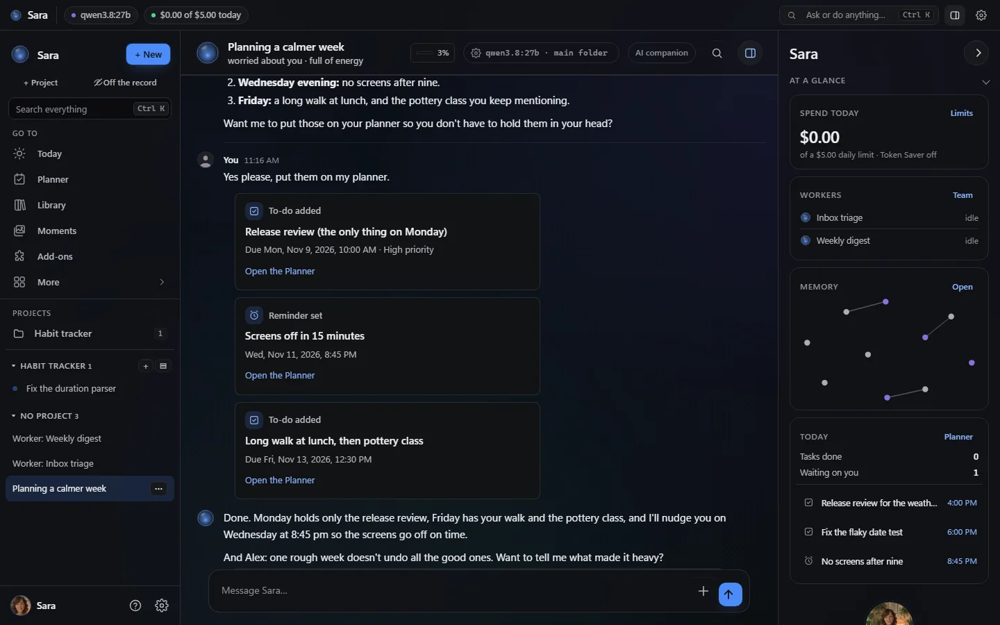
  <br>
  <sub>Le look de la 3.0 : graphite avec une couleur d’accent de votre choix (ici le Bleu par défaut). De vraies captures d’un serveur de test jetable avec un modèle scripté et des données inventées : elle prévoit une semaine plus calme et ajoute les tâches et un rappel sous forme de cartes ; la barre d’état montre ce qui tourne, et <i>En un coup d’œil</i> montre les dépenses, les travailleurs, sa carte de la mémoire et la journée.</sub>
</p>

D’abord le nouveau look en images, puis une ligne par domaine ; chaque lien mène au guide. Plus de captures : **[Tour des fonctionnalités](docs/FEATURES.md)**.

### Le nouveau look


La 3.0 donne à Sara l’allure d’un système vivant, par-dessus tout ce qui existait (aucune page, aucun réglage, projet ou type de discussion n’a disparu) : une barre d’état en direct (travailleurs, exécutions, déclencheurs, le modèle qui répond, les dépenses du jour ; une pastille seulement quand c’est réel), son orbe de présence qui écoute, réfléchit et parle avec elle, une frise en direct sous ses réponses avec la carte d’approbation dans l’exécution et *vérifié* seulement quand un essai en bac à sable ou des vérifications propres l’ont prouvé, une carte de ce dont elle se souvient, et *En un coup d’œil* à côté de la discussion. Une seule couleur d’accent (six au choix ou n’importe laquelle, toujours lisible), le nom que vous lui avez donné partout, un mouvement d’arrière-plan que vous pouvez couper, et Sara Classique reste comme avant. L’accueil *Tous les réglages* et le lanceur Ctrl K de la 2.79 sont toujours à une touche.

<table>
  <tr>
    <td width="50%" align="center">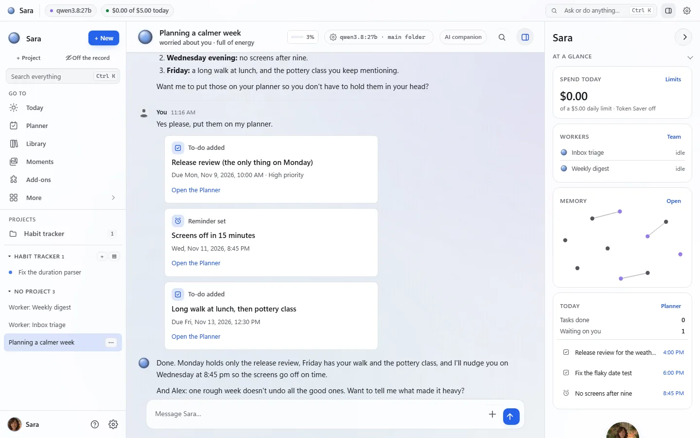<br><sub>Le look Jour suit votre système</sub></td>
    <td width="50%" align="center">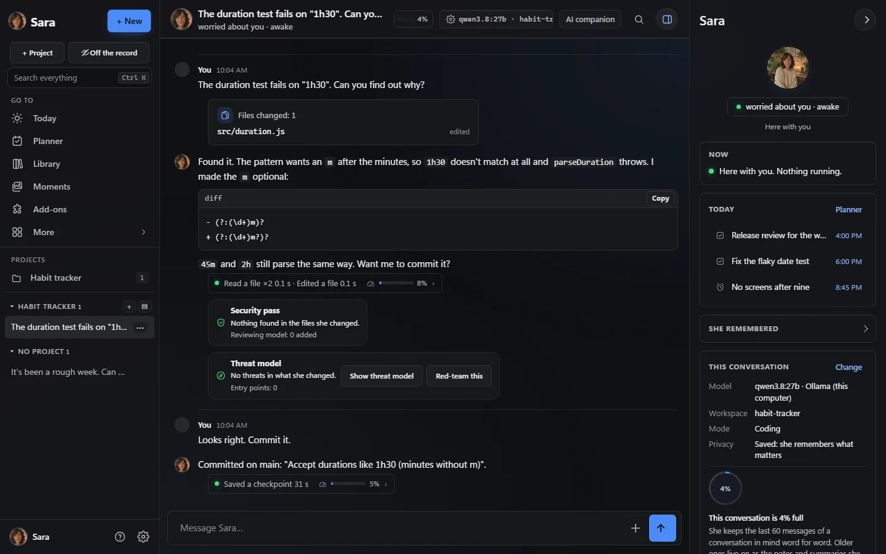<br><sub>Un projet de code : elle lit, corrige, montre le diff ; une passe de sécurité vérifie la modification</sub></td>
  </tr>
  <tr>
    <td width="50%" align="center">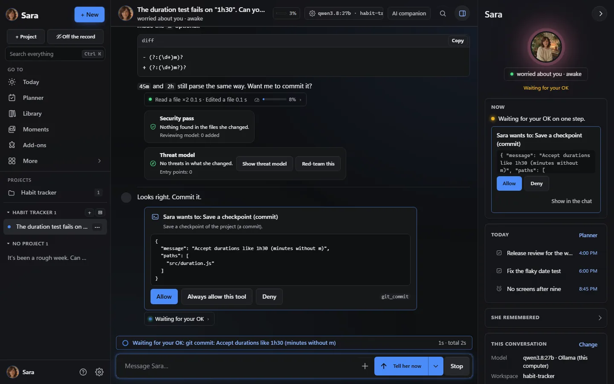<br><sub>Cartes d’approbation : <i>Autoriser</i>, <i>Toujours autoriser cet outil</i> ou <i>Refuser</i></sub></td>
    <td width="50%" align="center">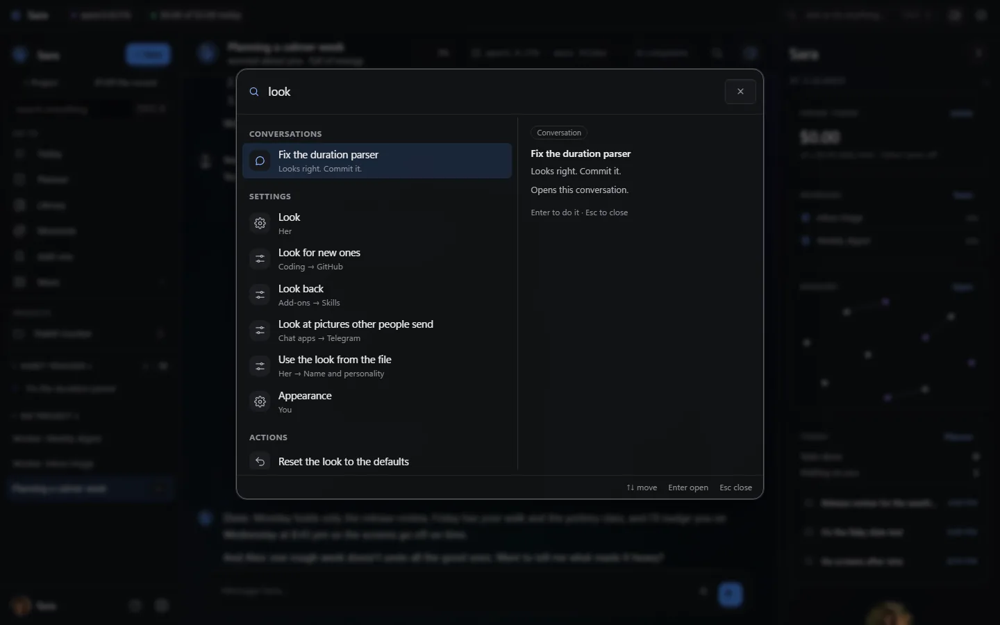<br><sub>Ctrl K : lieux, discussions, réglages et actions dans une seule boîte</sub></td>
  </tr>
  <tr>
    <td width="50%" align="center">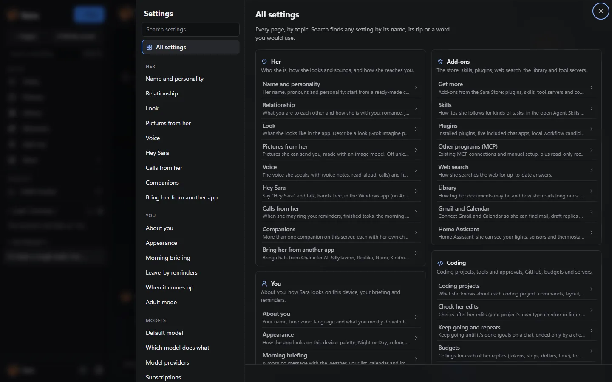<br><sub><i>Tous les réglages</i> : chaque page dans son groupe, à un clic</sub></td>
    <td width="50%" align="center">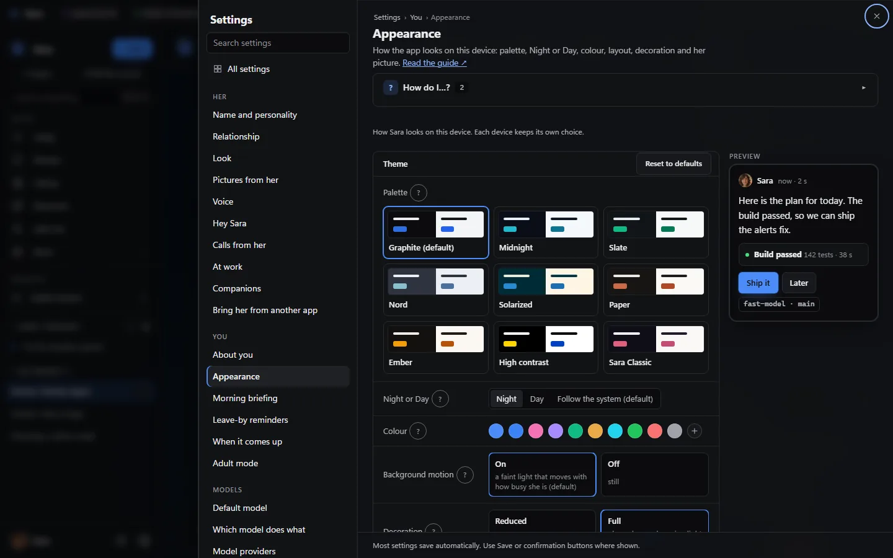<br><sub>Apparence : cartes de palette, Nuit ou Jour, votre couleur, aperçu en direct</sub></td>
  </tr>
  <tr>
    <td width="50%" align="center">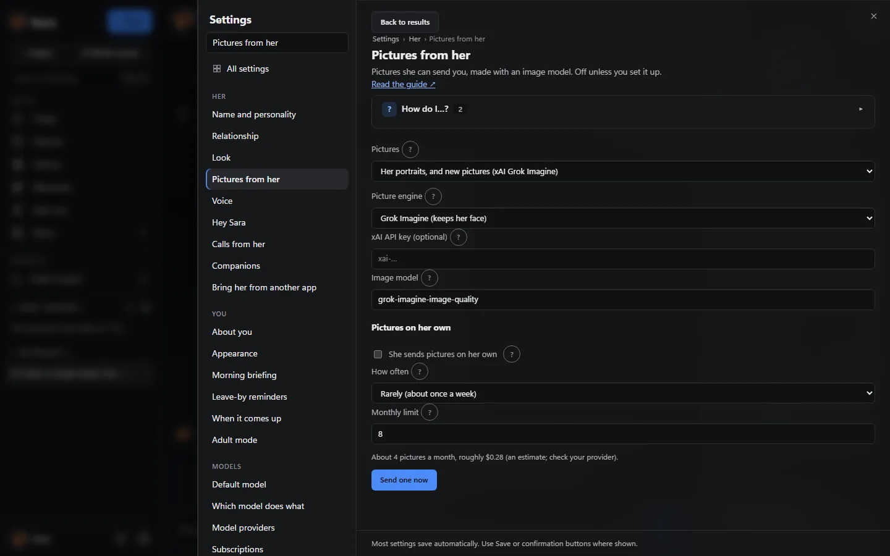<br><sub>Ses photos : Grok, OpenAI, ComfyUI ou un autre outil d’images</sub></td>
    <td width="50%" align="center">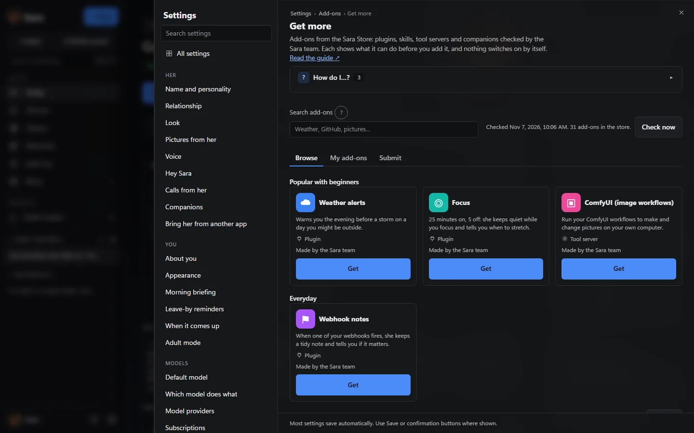<br><sub>Modules → Obtenir plus : la Sara Store signée ; rien ne s’active tout seul</sub></td>
  </tr>
  <tr>
    <td width="50%" align="center"><br><sub>Aujourd’hui : votre journée, ce qui vous attend, routines et Premiers pas</sub></td>
    <td width="50%" align="center">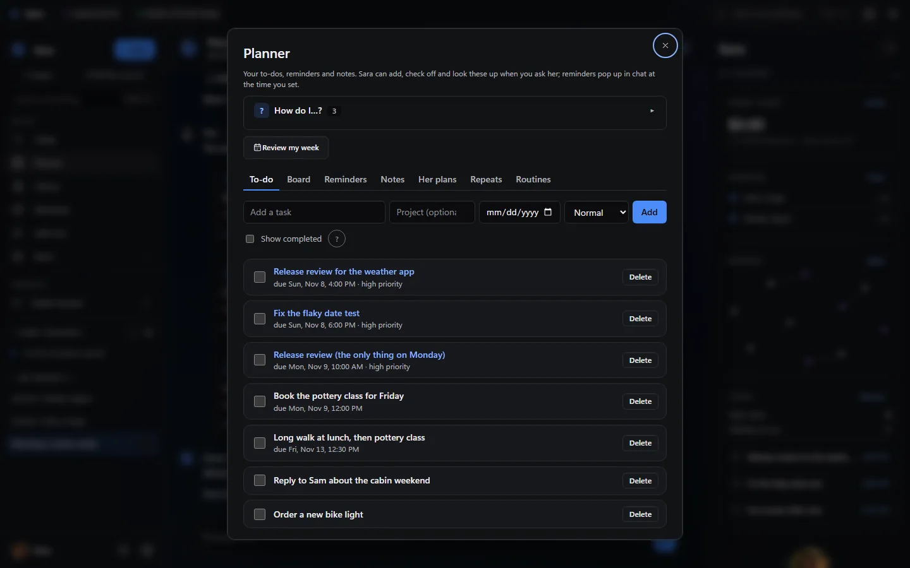<br><sub>Planificateur : tâches, tableau, rappels, notes et routines</sub></td>
  </tr>
  <tr>
    <td colspan="2" align="center">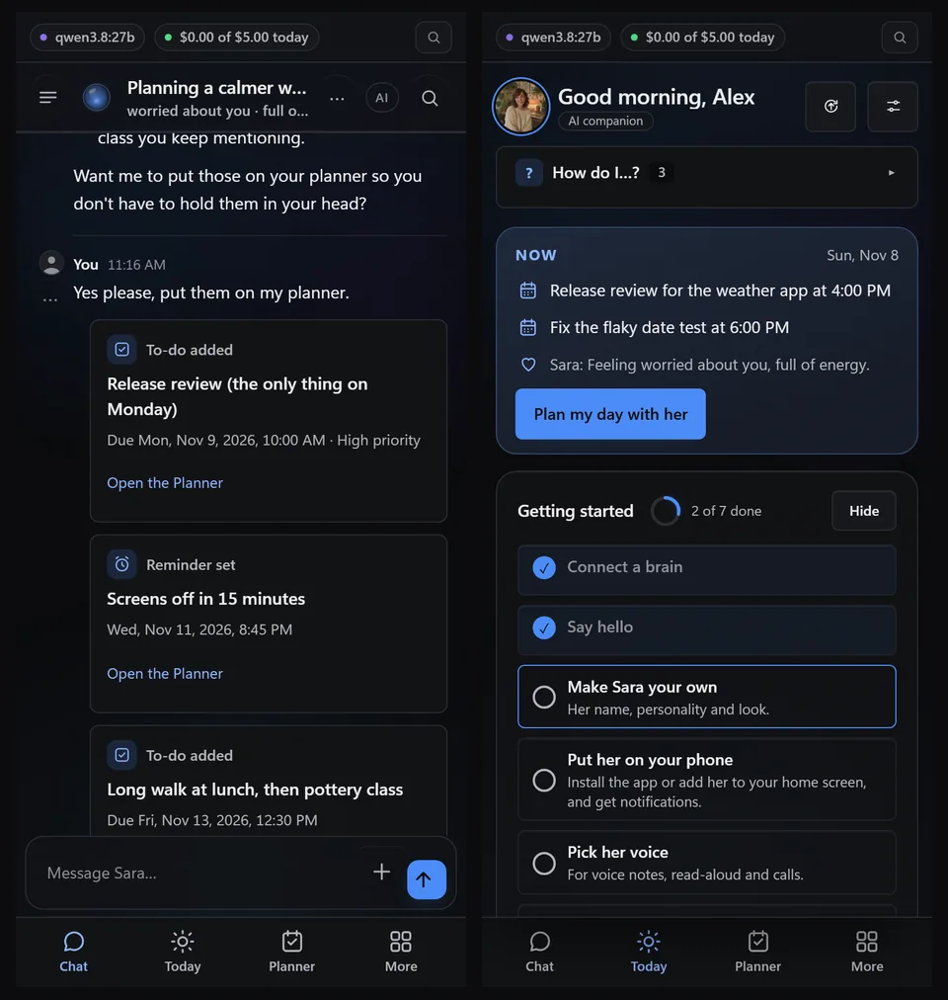<br><sub>Sur un téléphone : la discussion et Aujourd’hui</sub></td>
  </tr>
</table>

### Pour la compagnie


| Domaine | Ce que vous obtenez |
|---|---|
| **Compagne** | N’importe quel nom, elle/il/iel et une apparence, une personnalité réglée par des curseurs simples ou un personnage de départ, des humeurs, sa propre journée, des blagues récurrentes et des souvenirs de ce que vous lui avez dit, que vous pouvez voir, corriger et effacer. Elle peut vous envoyer des photos d’elle faites avec Grok, OpenAI, votre workflow ComfyUI ou un autre outil d’images et, si vous l’activez, de temps en temps une de sa propre initiative. [Par où commencer](docs/START_HERE.md) · [Personnes](docs/PEOPLE.md) · [Moments](docs/MOMENTS.md) · [Photos](docs/PHOTOS.md) |
| **Voix et appels** | Des appels en direct que vous pouvez interrompre, des appels vidéo avec son portrait animé, « Hey Sara » mains libres dans l’app Windows, et Alexa, Google Home ou votre assistant Android. [Appels vidéo](docs/VIDEO_CALLS.md) · [Hey Sara](docs/HEY_SARA.md) · [Assistants vocaux](docs/VOICE_ASSISTANTS.md) |
| **Agenda, routines et surveillance** | Tâches, notes et rappels à partir de phrases simples, un tableau, Aujourd’hui comme écran d’accueil, une galerie de routines (briefing du matin, bilan de la semaine…), des rappels pour le moment où une personne ou un sujet revient, et des alertes facultatives quand un journal affiche une ligne comme ERROR. [Aujourd’hui](docs/TODAY.md) · [Routines](docs/ROUTINES.md) · [Tableau](docs/BOARD.md) · [Surveiller un fichier](docs/WATCHES.md) |
| **Bibliothèque et lecture** | PDF (scans compris, et livres de 500 à 1 000 pages), Word, Excel, PowerPoint, livres numériques, pages web et notes ; les réponses disent de quel document et de quelle page elles viennent. [Bibliothèque](docs/LIBRARY.md) |
| **Scènes et jeu de rôle** | Une scène de jeu de rôle partagée entre vos propres conversations web, Telegram et Discord plus un salon partagé, avec des faits de canon que vous ajoutez, modifiez ou retirez ; des discussions de groupe avec deux à quatre compagnes ; des packs de compagnes et des cartes de personnage. [Scènes partagées](docs/SCENES.md) · [Discussions de groupe](docs/GROUP_CHATS.md) · [Packs de compagnes](docs/PACKS.md) |

### Pour coder


| Domaine | Ce que vous obtenez |
|---|---|
| **Projets de code** | Un espace de travail isolé par projet avec fichiers, terminal et git ; elle écrit le code, demande avant de lancer une commande et montre les résultats des tests sous forme de cartes ; des aperçus en direct qu’elle teste dans son propre navigateur. Les commandes risquées peuvent d’abord tourner dans une copie isolée. Les cartes d’approbation proposent *Toujours autoriser cet outil* une fois que vous lui faites confiance, et chaque serveur d’outils a un seul choix d’approbation. [Pour les développeurs](docs/FOR_CODERS.md) |
| **Un travail qui fait ses preuves** | Une ligne sous chaque réponse montre chaque commande et sa sortie, et une vérification compare ce qu’elle *dit* avoir fait avec ce qui a vraiment été exécuté. Les objectifs ne se terminent que quand votre propre vérification passe, ses modifications passent le contrôle des types, une affirmation visuelle exige une capture et les vérifications périmées sont relancées. [Objectifs](docs/GOALS.md) · [Vérifications](docs/CHECKS.md) · [Vérifications visuelles](docs/FOR_CODERS.md#web-pages-look-fix-look-again) |
| **Travail long et partagé** | Des tâches en arrière-plan, une équipe d’assistants (planifier → construire → tester → relire), des points de reprise de projet, des budgets qui arrêtent une longue tâche là où vous le dites, et vos autres serveurs en SSH. [Points de reprise](docs/FOR_CODERS.md#project-checkpoints) · [Serveurs en SSH](docs/SSH.md) |
| **Dans vos outils** | GitHub, `sara-chat` dans n’importe quel terminal, un panneau VS Code, MCP pour Claude Code et Cursor, et une API compatible OpenAI, toujours avec sa mémoire et sa personnalité. [Apps et clients](docs/clients.md) · [Autres applications](docs/OTHER_APPS.md) |

### Pour les deux


| Domaine | Ce que vous obtenez |
|---|---|
| **Des apps sur chaque plateforme** | App web et PWA installable, apps Windows et Mac avec la question rapide sur un raccourci, [Android sur Google Play](https://play.google.com/store/apps/details?id=com.backstagecoding.sara), l’app web sur l’écran d’accueil de l’iPhone, Telegram, Discord, Signal et e-mail, et WhatsApp, Matrix et iMessage en plugins facultatifs. [Apps de bureau](docs/desktop.md) · [Votre téléphone](docs/PHONE.md) · [Commandes de chat](docs/CHATS.md) |
| **Modules** | Plugins, compétences et serveurs d’outils (MCP) depuis la Sara Store signée ou votre propre dossier ; chacun passe par une carte de vérification et reste éteint jusqu’à ce que vous l’activiez. Parcourez-les et installez-les dans Réglages → Modules → Obtenir plus ; pour la 2.80, chaque serveur d’outils et module a été installé, utilisé et retiré sur de vrais Linux et Windows. [Sara Store](docs/STORE.md) · [Bibliothèque de modules](docs/ADDONS_LIBRARY.md) · [Compétences](docs/SKILLS.md) |
| **Foyer et entreprise** | Le mode foyer donne à chaque adulte avec qui vous vivez son propre espace sur votre serveur ; les espaces professionnels sont une installation séparée avec clés d’accès, rôles et espaces partagés. [Mode foyer](docs/HOUSEHOLD.md) · [Entreprise](docs/BUSINESS.md) |
| **Confidentialité, modèles locaux et sécurité** | N’importe quel modèle : local (Ollama, vLLM, llama.cpp), dans le cloud (OpenAI, Anthropic, xAI, OpenRouter) ou les abonnements que vous payez déjà (ChatGPT, Claude Pro/Max, SuperGrok / X Premium+). Un propriétaire par serveur ; conversations, souvenirs et clés y restent. Un interrupteur garde tout sur un seul ordinateur ; livrée **sans aucun identifiant** ; une couche de sécurité impossible à désactiver. [Mode local privé](docs/PRIVATE_LOCAL.md) · [Choisir un modèle](docs/CHOOSING_A_MODEL.md) · [Bilan de sécurité](docs/SAFETY_CHECKUP.md) |
| **Look et navigation** | Un accueil *Tous les réglages* avec chaque page à un clic et un fil d’Ariane, Ctrl K pour aller à n’importe quel lieu, discussion, réglage ou action, neuf palettes en Nuit et Jour (Graphite par défaut), votre propre couleur d’accent, un espacement compact et une décoration complète ou réduite, avec un aperçu en direct. 3.0 : une barre d’état en direct, son orbe de présence, une frise en direct de chaque exécution, une carte de la mémoire et *En un coup d’œil* ; un accent (Bleu, Rose, Violet, Émeraude, Ambre, Cyan ou n’importe quelle couleur) et un mouvement d’arrière-plan que vous pouvez couper. [Apparence](docs/APPEARANCE.md) |
| **Aide et emménagement** | Un encadré *Comment faire… ?* sur chaque page, de courtes visites guidées, et l’emménagement depuis ChatGPT, Claude, Character.AI, SillyTavern, Replika, Nomi, Kindroid, Hermes Agent ou OpenClaw, vérifié avant que rien ne soit enregistré. [Comment faire… ?](docs/HOW_DO_I.md) · [Faites-la venir d’une autre app](docs/IMPORT.md) · [Guide d’emménagement](docs/MOVE_IN_GUIDE.md) |

## Par où commencer

Deux chemins courts pour les dix premières minutes. Choisissez le vôtre ; toutes les fonctions restent disponibles dans les deux cas.

### Je viens de l'installer, et maintenant ?


1. **Connectez-vous** avec le code de configuration de son journal (ou votre jeton de propriétaire).
2. **Donnez-lui votre prénom** et choisissez *Compagnie* quand elle demande ce que vous ferez surtout ensemble.
3. **Connectez un cerveau :** elle propose un modèle pour votre ordinateur et vérifie qu'il répond (*Connecté au modèle ✓*), ou utilise une offre que vous payez déjà.
4. **Dites bonjour :** touchez *Organise ma journée avec moi* ou écrivez simplement. Une courte visite suit sa première réponse.
5. **Rendez-la unique** avec les curseurs de personnalité, puis laissez *Premiers pas* sur Aujourd'hui vous guider pour sa voix, votre téléphone et un briefing du matin.

Le parcours complet, en images : **[Start here](docs/START_HERE.md)**. Toutes les réponses des encadrés *Comment faire… ?* de l'app en une liste : **[How do I…?](docs/HOW_DO_I.md)** (en anglais).

### Je suis là pour coder


1. **Choisissez *Code*** à la configuration : elle propose un modèle doué pour le code (*Bon pour coder*) ou votre offre Claude Code, Codex ou Grok Build.
2. **Ouvrez un projet** avec *+ Projet* : un dossier de travail où elle a des fichiers, un terminal et git.
3. **Demandez-lui quelque chose de réel.** Elle écrit les fichiers, demande avant de lancer une commande et montre les résultats des tests sous forme de cartes.
4. **Lisez la ligne sous chaque réponse** pour chaque commande et sa sortie ; les commandes risquées peuvent tourner d'abord dans une copie isolée.
5. **Intégrez-la à vos outils :** GitHub, `sara-chat`, VS Code, MCP pour Claude Code et Cursor, et des budgets qui arrêtent une longue tâche là où vous le décidez.

Le parcours pour les développeurs : **[For coders](docs/FOR_CODERS.md)** (en anglais). Depuis les sources en trois commandes : [Installation](#installation).

## Vidéos pratiques

Des tutoriels d'une minute, enregistrés sur un serveur de test avec un modèle local (en anglais). <a href="https://www.youtube.com/playlist?list=PLGtrs9BqXtM8">Toutes dans une playlist</a>.

<table>
  <tr>
    <td align="center" width="25%"><a href="https://www.youtube.com/watch?v=DTAIW75y7i4&list=PLGtrs9BqXtM8&index=1"></a><br><sub>Installer Sara</sub></td>
    <td align="center" width="25%"><a href="https://www.youtube.com/watch?v=_X69x9E3W_k&list=PLGtrs9BqXtM8&index=2"></a><br><sub>Mémoire et cartes de personnes</sub></td>
    <td align="center" width="25%"><a href="https://www.youtube.com/watch?v=wrvNcHkc9O4&list=PLGtrs9BqXtM8&index=3"></a><br><sub>Le tableau</sub></td>
    <td align="center" width="25%"><a href="https://www.youtube.com/watch?v=7i48NiAq-jw&list=PLGtrs9BqXtM8&index=4"></a><br><sub>Coder avec Sara</sub></td>
  </tr>
</table>

## Quoi de neuf

<!-- sara:recent-releases:start -->

Versions récentes · 6 novembre 2026. [Journal complet](CHANGELOG.md) · [Tous les téléchargements](https://github.com/farena-ai/sara/releases).

| Version | Ce qui change pour vous |
|---|---|
| **[3.4.4](https://github.com/farena-ai/sara/releases/tag/v3.4.4)** | **[Interrompez-la et dites-le tout de suite](docs/CHATS.md)** — Interrompre maintenant (menu Envoyer, Ctrl+Entrée ou /now) arrête sa réponse ou sa réflexion et elle reprend depuis ce que vous avez dit, en gardant les étapes finies et en repliant ce qu’elle disait. Les changements en cours se terminent d’abord, et une longue commande a Arrêter la commande. |
| **[3.4.3](https://github.com/farena-ai/sara/releases/tag/v3.4.3)** | **[Elle lit les images que vous envoyez](docs/CHOOSING_A_MODEL.md)** — Les captures d’analyses, de factures ou de formulaires arrivent maintenant à celui de vos modèles qui voit ; si celui qui répond ne peut pas, un autre la lit d’abord en texte exact. Elle enregistre les valeurs avec note add et, si aucun modèle ne voit, le dit avec Réparer au lieu de faire semblant. |
| **[3.4.2](https://github.com/farena-ai/sara/releases/tag/v3.4.2)** | **[Des notes qui ne perdent jamais ce que vous lui avez dit](docs/FEATURES.md)** — Elle ajoute chaque nouveauté à une note sous un titre daté, un enregistrement qui effacerait une note est refusé, les versions précédentes reviennent avec Restaurer et un « enregistré » non prouvé est signalé. Le haut de l’app Windows suit la page et elle peut lire vos onglets et fichiers. |
| **[3.4.1](https://github.com/farena-ai/sara/releases/tag/v3.4.1)** | **[Elle retient autant que son modèle peut contenir](docs/CHOOSING_A_MODEL.md)** — Auto adapte la part du chat qu’elle garde en tête au modèle utilisé (lue auprès du service ou dans un tableau daté), plafonne l’historique payé au jeton à un niveau équilibré sauf si vous choisissez la fenêtre entière, et donne aux modèles Ollama locaux un vrai contexte. |
| **[3.4.0](https://github.com/farena-ai/sara/releases/tag/v3.4.0)** | **[Documents, son nom partout, contrôle de l’ordinateur depuis un serveur](docs/DOCUMENTS.md)** — Elle crée de vrais documents avec n’importe quel modèle (Word, PDF, tableurs, diaporamas) avec Télécharger, Ouvrir et Modifier. Un compagnon renommé affiche son nom et ses pronoms partout, avec des personnages par défaut il et iel. L’extension navigateur et le contrôle de l’ordinateur marchent maintenant en un clic. |
| **[3.3.0](https://github.com/farena-ai/sara/releases/tag/v3.3.0)** | **[Mode facile](docs/AWAY_FROM_HOME.md)** — Conçu avec un débutant : la configuration explique les clés et ne se perd pas, les problèmes viennent avec Réparer, Connecter l’app Sara et Utiliser Sara hors de chez vous (Tailscale) sont guidés et testés, Gmail tient en trois étapes et vous pouvez dire « agrandis le texte » avec Annuler. |

<!-- sara:recent-releases:end -->

<details>
<summary><b>Versions 2.6x précédentes</b>: de la 3.2.0 à la 2.61.5</summary>

| Version | Ce qui change pour vous |
|---|---|
| **[3.2.0](https://github.com/farena-ai/sara/releases/tag/v3.2.0)** | **[Elle prend vie](docs/APPEARANCE.md)** — Choisissez Son portrait, animé dans Apparence : elle respire, cligne des yeux, regarde autour d’elle et bouge les lèvres en parlant, avec des airs d’écoute, de réflexion et de parole et ses humeurs, dans le chat, Aujourd’hui et les appels. Votre propre image ou un modèle 3D .vrm marchent aussi. |
| **[3.1.2](https://github.com/farena-ai/sara/releases/tag/v3.1.2)** | **[Des recherches qui tiennent](docs/RESEARCH.md)** — Demandez-lui de rechercher un sujet, de faire un guide ou d’apprendre quelque chose : elle lance une recherche, cherche au lieu de deviner les adresses, passe les sites qui bloquent les lecteurs automatiques, réessaie les sites lents, reprend après un redémarrage, et une recherche interrompue donne quand même un rapport marqué Partiel. |
| **[3.1.1](https://github.com/farena-ai/sara/releases/tag/v3.1.1)** | **[Emménager depuis Hermes ou OpenClaw, simplement](docs/MOVE_IN_GUIDE.md)** — Si Hermes Agent ou OpenClaw est sur le même ordinateur, Sara le trouve et l’amène d’un bouton (personnalité, souvenirs, anciennes conversations, compétences, horaires), avec un aperçu avant et Annuler après. Depuis un autre ordinateur, une ligne à coller et la page de Sara avance seule. |
| **[3.1.0](https://github.com/farena-ai/sara/releases/tag/v3.1.0)** | **[Le courrier au-delà de Gmail](docs/EMAIL.md)** — Outlook.com et Microsoft 365 (courrier et agenda), Yahoo, AOL, iCloud, Fastmail, Zoho, GMX, WEB.DE, Proton Mail et tout autre serveur : elle cherche, lit les fils, repère ce qui attend une réponse, rédige, envoie et range avec les approbations et l’Annuler de Gmail. Plusieurs boîtes avec une par défaut ; chaque membre du foyer peut connecter les siennes, privées. |
| **[3.0.3](https://github.com/farena-ai/sara/releases/tag/v3.0.3)** | **[Plus rapide, plus stable, plus facile à trouver](docs/DEVICE_APPROVAL.md)** — Les réglages s’ouvrent tout de suite, il n’y a qu’une recherche et une approbation est toujours à portée (répondez depuis la barre au-dessus de la zone de message ou avec Ctrl K). Enregistrer ses propres compétences ne demande plus, un point rouge signale les conversations qui vous attendent et sa réponse dit combien de nouveaux souvenirs elle a gardés. Ajouter un téléphone ou un ordinateur est facile à trouver, et le modèle choisi à l’installation reste celui par défaut. |
| **[3.0.2](https://github.com/farena-ai/sara/releases/tag/v3.0.2)** | **[Finitions, violet et un emménagement facile](docs/MOVE_IN_GUIDE.md)** — Les réglages s’ouvrent au centre, le violet est la couleur par défaut et une palette remet sa propre couleur. La décoration complète est plus riche et Aujourd’hui s’anime discrètement (désactivé avec le mouvement réduit). Quatre relations non romantiques, un emménagement en cinq étapes depuis Hermes Agent ou OpenClaw avec la commande exacte pour votre système, et Tess, la bricoleuse pratique, dans la galerie (merci à @Guilsc). |
| **[3.0.1](https://github.com/farena-ai/sara/releases/tag/v3.0.1)** | **[Toutes les pages au nouveau look](docs/APPEARANCE.md)** — Aujourd’hui, Agenda, Bibliothèque, Mémoire, Évaluations et Réglages au look 3.0, avec son orbe de présence sur Aujourd’hui. Une seule liste de projets dans la barre latérale : des dossiers qui s’ouvrent sur leurs conversations, chacune avec un point d’état, applis de messagerie comprises. Son image peut être l’orbe, son portrait ou votre propre image avec un anneau vivant. Les cartes d’exécution se replient sur une ligne et s’ouvrent seules quand quelque chose vous attend ; la ligne mémoire dit combien de souvenirs elle a utilisés. |
| **[3.0.0](https://github.com/farena-ai/sara/releases/tag/v3.0.0)** | **[Sara 3.0 : un aspect de système vivant](docs/APPEARANCE.md)** — Un nouvel aspect sur toutes les pages, sans rien retirer : un bandeau d’état en direct de ce qu’elle fait, un orbe de présence qui respire, écoute, réfléchit et parle, les exécutions d’outils en fil chronologique en direct avec les approbations dedans et une marque « vérifié » seulement là où un contrôle a vraiment réussi, une carte de ce qu’elle sait, une couleur d’accent de votre choix et son nom choisi partout. Sara Classique ne change pas. Sur Android, Hey Sara fonctionne désormais sur le téléphone. |
| **[2.88.0](https://github.com/farena-ai/sara/releases/tag/v2.88.0)** | **[Espace de code, Spotify, pages d’équipe](docs/CODING_DEPTH.md)** — Les tâches de code peuvent tourner dans leur propre branche et dossier avec Fusionner, Ouvrir une PR ou Abandonner à la fin, diagnostics et aller à la définition via les serveurs de langage, commits en co-auteur et une vue Espace avec fichiers, éditeur, terminal et conversation. Spotify se connecte avec votre propre app de développeur. Les espaces d’entreprise ont des pages d’équipe avec historique, commentaires et mentions. Hey Sara écoute désormais sur Mac, Android et Linux avec le même moteur hors ligne que Windows, et sa connexion aux éditeurs a été prouvée avec Zed. |
| **[2.87.0](https://github.com/farena-ai/sara/releases/tag/v2.87.0)** | **[Agents permanents, maîtrise des dépenses, mises à jour plus sûres](docs/WORKERS.md)** — Faites venir votre compagne depuis Character.AI, Replika, Kindroid ou Nomi. Les prix s’affichent avant les étapes payantes, avec des plafonds par jour et par mois et un mode Économie de jetons, et les modules peuvent se mettre à jour seuls et revenir en arrière. Les mises à jour Windows et Mac sont vérifiées par un avis signé et remettent l’ancienne version si la nouvelle échoue. Les agents qui restent ont leur propre fil, une file de tâches durable, des tâches échouées rejouables et une seule alerte « besoin de vous ». Les cartes du tableau peuvent attendre votre réponse, un nouvel appareil attend un code que vous approuvez, et elle apprend votre façon de travailler sans jamais déduire santé, religion, politique ou sexualité. |
| **[2.86.0](https://github.com/farena-ai/sara/releases/tag/v2.86.0)** | **[Apprendre un sujet, déclencheurs, apps d’outils](docs/LEARN.md)** — Demandez-lui d’apprendre un sujet, ou donnez-lui un site : elle fait des recherches avec sources citées, le garde comme compétence et le met à jour chaque jour, semaine ou mois en vous disant ce qui a changé. Les déclencheurs « Quand ceci arrive » lancent une tâche ou une équipe à partir d’un e-mail, d’un message Slack ou Teams, d’un webhook ou d’un événement d’un serveur d’outils, avec plafonds, budgets et approbations. Les apps des serveurs MCP s’affichent dans la conversation, isolées de la page, sur la version actuelle de MCP. D’autres apps peuvent utiliser l’API Open Responses, et un chart Helm la fait tourner sur Kubernetes. La connexion d’entreprise, SCIM, les métriques, les sources de secrets, le bac à sable en conteneur et les liens de partage ont été prouvés avec les vrais logiciels. |
| **[2.85.0](https://github.com/farena-ai/sara/releases/tag/v2.85.0)** | **[Réunions, aide du téléphone, elle au travail](docs/MEETINGS.md)** — Une salle de réunion où elle annonce être une IA qui prend des notes et rédige un résumé avec décisions et actions (aussi à partir d’un enregistrement). Votre téléphone peut lui prêter son appareil photo, sa position ou une capture, avec Autoriser une fois ou Refuser à chaque fois. Au travail, elle a son propre nom, ton, mémoire et outils dans Slack et Teams, sans les fonctions de compagne. Plusieurs conversations reçoivent des réponses en même temps, les membres du foyer peuvent partager leurs conversations, les administrateurs d’entreprise ont un rapport de dépenses et un gel juridique conserve le texte précédent de ce qui est modifié. |
| **[2.84.0](https://github.com/farena-ai/sara/releases/tag/v2.84.0)** | **[Contrôles d’entreprise, éditeurs, mode code](docs/SECRET_SOURCES.md)** — Les clés peuvent vivre dans HashiCorp Vault, 1Password, des variables d’environnement, des fichiers de secrets ou le trousseau du système. Zed et JetBrains peuvent utiliser Sara comme agent de code via l’Agent Client Protocol, avec les approbations dans l’éditeur. Les instances d’entreprise acceptent SCIM depuis Entra ID ou Okta ; la conservation, le gel juridique et l’export ou la suppression par personne couvrent chaque voie de suppression. Un rapport de confiance compare ce qu’elle a dit à ce qui a tourné, les entrées de la Boutique montrent où elles ont été vérifiées, une page de préparation lance un exercice de restauration en un clic, le mode code exécute un script isolé au lieu de nombreux appels, et un SDK TypeScript sans dépendance couvre son API. |
| **[2.83.0](https://github.com/farena-ai/sara/releases/tag/v2.83.0)** | **[Recherche, Teams, équipes](docs/RESEARCH.md)** — Posez une question de recherche et recevez un rapport dont chaque phrase cite une page qu’elle a lue (PDF, Word ou Markdown). Microsoft Teams rejoint Slack. Les équipes sont des groupes d’assistants avec un chef et des horaires ; un rangement nocturne facultatif de la mémoire fusionne les doublons, avec Annuler pour chaque changement. Les commandes peuvent tourner dans un conteneur Podman ou Docker sans root et se limiter aux sites autorisés ; les conversations se partagent en liens en lecture seule qui expirent ; les rapports d’usage et de coût couvrent chaque personne, espace et projet. |
| **[2.82.0](https://github.com/farena-ai/sara/releases/tag/v2.82.0)** | **[Programmes en un clic, 21 compagnons](docs/PREREQUISITES.md)** — Quand un module a besoin d’un programme absent de l’ordinateur, les Réglages disent ce qui manque et proposent *Installe-le pour moi* : vous approuvez la commande exacte, vous la voyez s’exécuter et l’installation du module continue (propriétaire seulement, consigné dans l’audit, désactivable par une politique). Vingt et un compagnons avec portrait, voix et limites claires sont dans la Boutique signée, des professeurs de langues et un coach sportif à une partenaire d’écriture, un cofondateur de startup et une capitaine de navire céleste. Sous Linux, les serveurs d’outils de navigateur trouvent le Chrome installé. |
| **[2.81.0](https://github.com/farena-ai/sara/releases/tag/v2.81.0)** | **[Prête pour le travail et les équipes](docs/SLACK.md)** — Sara arrive sur Slack avec messages directs, mentions, fils, boutons Autoriser et Refuser et fichiers dans les deux sens. Les instances d’entreprise peuvent se connecter avec Entra ID, Google Workspace, Okta ou Keycloak (sur invitation par défaut ; la clé d’accès du propriétaire fonctionne toujours). Un journal d’audit unique et inviolable s’exporte en CSV ou JSONL, un administrateur peut verrouiller des réglages que le serveur applique, et les opérateurs disposent de métriques Prometheus et de traces OpenTelemetry sans texte de conversation. |
| **[2.80.0](https://github.com/farena-ai/sara/releases/tag/v2.80.0)** | **[Chaque installateur vérifié de bout en bout](docs/ADDONS_LIBRARY.md)** — Chaque serveur d’outils et module natif des Réglages a été installé, configuré, connecté, utilisé et retiré sur un vrai serveur Linux et un vrai PC Windows. Mettre à jour un serveur d’outils garde ses réglages, le serveur Files démarre dans l’isolement Linux, les erreurs de connexion et d’identification sont expliquées simplement, un module de la Boutique retiré peut être réinstallé et retirer une compagne tout juste ajoutée n’arrête plus le serveur. |
| **[2.79.0](https://github.com/farena-ai/sara/releases/tag/v2.79.0)** | **[Allure avancée et images comme une personne](docs/PHOTOS.md)** — Un accueil Tous les réglages avec chaque page à un clic, un fil d’Ariane, un lanceur Ctrl K, une allure raffinée de verre et de lumière et une page Apparence plus riche. *Toujours autoriser cet outil* sur les cartes d’approbation et un seul choix d’approbations par serveur d’outils ; ses photos via Grok, OpenAI, votre flux ComfyUI ou un autre outil d’image, et de temps en temps une image d’elle-même si vous l’activez. Les images des serveurs d’outils arrivent dans la conversation et elle ne prétend plus avoir envoyé ce qui n’a jamais été joint. |
| **[2.78.0](https://github.com/farena-ai/sara/releases/tag/v2.78.0)** | **[Allure pro terminée, plus de modules](docs/APPEARANCE.md)** — L’allure professionnelle est terminée : nom, heure et durée à chaque tour, une seule étiquette modèle · espace de travail avec jauge de contexte, Réglages en panneau pleine hauteur, les Projets dans la barre latérale et de vrais tableaux d’usage et d’exécutions. Documentation Doctor, Release Readiness et Repository Onboarding lancent les commandes documentées comme des tâches que vous approuvez dans une copie jetable ; sous Windows, une tâche arrêtée se termine aussitôt. |
| **[2.77.0](https://github.com/farena-ai/sara/releases/tag/v2.77.0)** | **[Une allure professionnelle](docs/APPEARANCE.md)** — Une allure sobre, dense et précise (Réglages → Vous → Apparence) : 9 palettes en Nuit et Jour, une couleur d’accent à vous, un espacement compact et Moins de décoration ; Sara Classic garde l’allure actuelle. Aussi : les flux dans Lire ensemble, Test Doctor et Flaky Test Lab, 2 connexions locales pour développeurs, et une approbation de plugin tardive ne lance plus rien. |
| **[2.76.0](https://github.com/farena-ai/sara/releases/tag/v2.76.0)** | **[Modules pour développeurs](docs/ADDONS_LIBRARY.md)** — Dix-neuf modules pour développeurs rejoignent les douze flux dans Réglages → Plugins (détecteur de secrets, auditeur d’accessibilité, générateur de SBOM, gardien de contrats d’API, atelier HTTP et webhooks et plus) ; vous examinez chacun et il s’installe désactivé. Les alertes de fichier peuvent aussi aller dans votre propre conversation Telegram ou Discord (désactivé par défaut). |
| **[2.75.0](https://github.com/farena-ai/sara/releases/tag/v2.75.0)** | **[Les appels comme le chat](docs/VIDEO_CALLS.md#what-she-knows-and-can-do-on-a-call)** — En appel vocal ou vidéo, elle a les mêmes souvenirs, le contexte des autres conversations et la règle du mode adulte qu’à l’écrit, et les appels en direct peuvent utiliser ses outils (pas de commandes, ni ses mains, ni SSH). Ce qui exige votre accord affiche une carte sur l’écran d’appel, à laquelle seul un appui répond ; raccrocher ou lui couper la parole l’annule. |
| **[2.74.0](https://github.com/farena-ai/sara/releases/tag/v2.74.0)** | **[Lire ensemble](docs/LIBRARY.md#read-together)** — Ouvrez un document texte ou Markdown de votre bibliothèque, appuyez sur Partager ce passage (ou activez Suivre ma lecture) et elle commente exactement ce texte dans cette version ; s’il a changé, elle le dit. Arrêter y met fin aussitôt. Aussi : les cartes de suggestion montrent désormais que votre appui est pris en compte. |
| **[2.73.0](https://github.com/farena-ai/sara/releases/tag/v2.73.0)** | **[Surveiller un fichier](docs/WATCHES.md)** — Choisissez un journal ou un fichier dans un de vos espaces de travail (ou son propre journal) et quelques mots comme ERROR ; Sara envoie une carte dans la conversation et une notification quand une nouvelle ligne correspond, 12 par jour au plus. Vérifier maintenant, Pause et Arrêter ; la lecture n’utilise aucun modèle et elle ne corrige jamais rien seule. |
| **[2.72.0](https://github.com/farena-ai/sara/releases/tag/v2.72.0)** | **[Vérifications visuelles honnêtes](docs/FOR_CODERS.md#web-pages-look-fix-look-again)** — En travail web, Sara modifie, prévisualise, prend des captures ordinateur et mobile, corrige ce qui cloche et revérifie. Affirmer la largeur mobile exige une capture à cette largeur, et « c’est réglé » exige une vérification après sa dernière modification ; sinon la réponse est marquée non vérifiée. |
| **[2.71.0](https://github.com/farena-ai/sara/releases/tag/v2.71.0)** | **[Continuité des projets](docs/FOR_CODERS.md#project-now-other-chats-and-current-checks)** — Vos conversations de code sur un même projet voient ce que font les autres (titres et fichiers, jamais le texte des messages), et chaque résultat de vérification, d’objectif ou de point d’étape indique à jour, périmé ou base inconnue. Sara relance une vérification périmée avant d’affirmer qu’elle passe. |
| **[2.70.0](https://github.com/farena-ai/sara/releases/tag/v2.70.0)** | **[Scènes de jeu de rôle partagées](docs/SCENES.md)** — Une histoire dans vos conversations web, Telegram et Discord plus un salon partagé, avec des faits versionnés que vous ajoutez, modifiez ou retirez. Les invités gardent toutes les règles de partenaire ; leurs mots ne comptent que si vous choisissez Ajouter à la scène. Supprimer ou oublier une ligne efface ce qui en vient ; les contrôles de sécurité s’appliquent à chaque scène. |
| **[2.69.0](https://github.com/farena-ai/sara/releases/tag/v2.69.0)** | **[Extensions dans les Réglages](docs/ADDONS_LIBRARY.md)** — Douze flux utilisant les données fournies passent par l’examen habituel des fichiers et permissions et restent désactivés au départ. Sept aperçus de recettes MCP, quatorze investigations bloquées et six guides présentent prérequis, coûts et limites. Aucune installation, connexion ou activation automatique ; la disponibilité dans la boutique signée reste distincte. |
| **[2.68.0](https://github.com/farena-ai/sara/releases/tag/v2.68.0)** | **[Du contexte entre vos propres conversations](docs/SESSION_CONTINUITY.md)** — Du contexte frais entre les conversations admissibles du propriétaire avec la même compagne, des lectures bornées de l’historique, des notes internes et des étapes fournisseur ordonnées. Interrupteur du propriétaire, inspection et effacement confirmé pour la seule conversation choisie ; confidentialité et autorisations des outils restent en vigueur. Scènes partagées, coordination des projets et parité complète voix/vidéo restent à venir. |
| **[2.67.0](https://github.com/farena-ai/sara/releases/tag/v2.67.0)** | **[Indices récents et suivis](docs/ATTUNEMENT.md)** — Des indices explicites et limités du propriétaire dans six langues et des suivis d’événements fondés sur des sources vérifiées. Les **[points de reprise du projet](docs/FOR_CODERS.md#project-checkpoints)** gardent la logique, les blocages et jusqu’à trois prochaines étapes, avec cinq versions et des commandes pour consulter, remplacer et effacer ; ce contexte historique ne lance aucune commande et ne reconduit aucune autorisation. |
| **[2.65.0](https://github.com/farena-ai/sara/releases/tag/v2.65.0)** | **[Configuration professionnelle guidée](docs/BUSINESS.md)** — Première utilisation et administration guidées, historique des invitations limité au périmètre autorisé, révocation, vérification de configuration en lecture seule et exercices reproductibles de navigateur et de reprise. |
| **[2.64.0](https://github.com/farena-ai/sara/releases/tag/v2.64.0)** | **[Espaces professionnels séparés](docs/BUSINESS_OPERATIONS.md)** — Clés d’accès individuelles, rôles, textes et documents partagés, plafonds de modèles contrôlés par l’opérateur et reprise chiffrée. Les données personnelles et du foyer restent séparées. |
| **[2.63.1](https://github.com/farena-ai/sara/releases/tag/v2.63.1)** | **[Exploitation mesurée](docs/OPERATIONS.md)** — Mesures HTTP et de préparation réservées au propriétaire, archivage sûr des livraisons résolues, sauvegardes réactives et vérifications locales reproductibles. |
| **[2.62.0](https://github.com/farena-ai/sara/releases/tag/v2.62.0)** | **[Reprise sans rejeu aveugle](docs/RECOVERY.md)** — Examinez les tâches interrompues avant de les relancer ; les envois natifs Telegram/Discord incertains restent visibles, sans renvoi automatique. |
| **[2.61.5](https://github.com/farena-ai/sara/releases/tag/v2.61.5)** | **[Trouvez la prochaine étape](docs/START_HERE.md)** — Recherche ciblée dans les paramètres, premier message simplifié et meilleure navigation au clavier, au toucher et avec les animations réduites. |

Également en 2.67.0 : accès fiable aux Projets de code depuis la recherche des Réglages, brouillons préservés et réponses périmées gérées, confidentialité des connaissances du projet en mode hors enregistrement et contrôle local de fraîcheur des six pages de version. Aucun CI ni suivi récurrent des versions. Les points de reprise sont réservés au propriétaire et à son espace/projet ; supprimer, modifier ou oublier le contenu source couvert invalide les enregistrements dérivés. Les actions de code en attente, y compris celles des assistants d’équipe et l’application des changements du bac à sable, revérifient les permissions actuelles et le contexte de la conversation et de l’espace de travail avant exécution ; un changement de contexte arrête l’action périmée au lieu de la déplacer.

La version 2.67.0 distingue aussi les critiques du code d’un conflit dirigé contre Sara, revérifie les sources des indices et des suivis juste avant l’appel normal au fournisseur et ne clôt automatiquement un élément d’Agenda qu’avec des preuves claires de l’événement, du résultat et de la question correspondante. Vie intérieure reste le réglage d’activation ; aucun diagnostic émotionnel, appel supplémentaire à un classificateur ou nouveau profil d’humeur du propriétaire. Les nouveaux indices excluent les conversations privées ou hors enregistrement, les membres, les groupes, les contextes externes, la relecture et les tâches sans surveillance. Les prompts enregistrés, exports et sauvegardes peuvent conserver des notes selon leurs réglages habituels ; la relecture omet les nouveaux compléments transitoires enregistrés et signale que les entrées ont changé. Cette version corrige aussi l’identification automatique de la révision source de l’installateur Windows.

</details>

<!-- sara:release-history:start -->

<details>
<summary><b>Nouveautés précédentes · 2.61, 2.60 et 2.59</b></summary>

- **2.61** ·  Configuration des applis de chat simplifiée : une carte guidée pour WhatsApp, Matrix, iMessage, Signal, e-mail et Telegram, chaque étape vérifiée, avec des solutions claires ; les plugins de Sara n'ont besoin que d'un OK, sans avertissement développeur.
- **2.60** · Packs de compagnes : partagez le caractère, l'apparence, la voix et les compétences de départ d'une compagne en fichier ou sur la Sara Store, sans jamais partager vos souvenirs ni vos discussions ; les cartes de personnage s'importent aussi.
- **2.59** · « Hey Sara » : dites son nom pour parler mains libres dans l'appli Windows (un petit modèle sur votre ordinateur n'écoute que ça), un raccourci Parler partout, et l'écoute et les voix locales sous Windows.

</details>

<details>
<summary><b>Historique des versions</b> : ce que chaque version depuis la 2.4 a apporté</summary>

| Version | Ce que vous y gagnez |
|---|---|
| **2.61.4** · [v2.61.4](https://github.com/farena-ai/sara/releases/tag/v2.61.4) | **[Configuration plus fiable](docs/SECURITY_CHECKLIST.md)** — Reprenez la configuration du modèle après l’avoir ignorée, conservez le focus mobile au bon endroit et distinguez l’approbation des commandes de l’isolation d’exécution. |
| **2.60** · Packs de compagnes | **La partager :** Réglages → Elle → ⋯ → *La partager* construit un pack avec exactement ce que vous cochez (caractère, curseurs, apparence, garde-robe, voix, premier message, compétences, routines suggérées) et montre ce qui ne part jamais : souvenirs, discussions, personnes, clés, votre nom (il devient `{{user}}`), vos notes de relation et vos limites. **Installez un pack** comme nouvelle compagne, jamais par-dessus une existante, via une carte de vérification ; les mises à jour montrent ce que l'auteur a changé et gardent vos propres modifications. Les cartes de personnage V1/V2/V3 (PNG, JSON, CHARX) s'importent comme packs, un lorebook devenant quelques lignes de contexte, jamais des souvenirs. Le contrôle mineurs s'exécute à la création, à la vérification et à l'installation, sans exception ; les classements suivent le mode adulte. Quatre compagnes de départ sur la boutique : Juniper, Rowan, Vesper et Jax. Corrigé aussi : exporter une carte de personnage n'inclut plus votre nom ni vos notes. |
| **2.59** · « Hey Sara » | **Dites son nom et parlez** dans l'appli Windows : un modèle de 5 Mo sur votre ordinateur n'écoute que « Hey Sara » (ou vos propres mots pour chaque compagne), et rien n'est envoyé avant que vous les disiez ; l'enregistrement commence après la phrase, l'audio n'est jamais gardé, et un point sur l'icône de la barre montre quand elle écoute. Éteint jusqu'à ce que vous l'activiez, sur chaque appareil ; en pause écran verrouillé ; si deux appareils vous entendent, un seul répond. **Parler à Sara** avec Ctrl+Alt+Espace ou la barre, et sur Android avec un bouton Parler dans la notification et une tuile de réglages rapides. L'avis d'IA est dit d'abord et l'aide en cas de crise lue en entier. **Écoute et voix locales sous Windows :** `sara voice install` (environ 650 Mo, chaque fichier vérifié), auparavant Linux seulement. Mac, Linux et le détecteur Android toujours à l'écoute arrivent ensuite. |
| **2.58** · En obtenir plus | **Réglages → Capacités → En obtenir plus :** parcourez et cherchez dans la Sara Store, ouvrez un élément et installez-le en un clic via la carte de vérification habituelle (rien ne s'allume tout seul). Les serveurs d'outils ont une carte avec la commande exacte (et sa forme Windows), ce qu'il leur faut, ce qu'ils peuvent joindre et s'ils sont isolés ; les clés vont dans le coffre. **Les mises à jour** montrent exactement ce qui change, les nouvelles permissions marquées, et vous pouvez revenir en arrière. **Mes modules** liste tout avec sa provenance. **Proposez les vôtres :** `sara pack` vérifie un plugin, une compétence ou un serveur d'outils sur votre ordinateur (manifeste, permissions, recherche de secrets, petit test isolé, captures), puis *Proposer* dans les réglages ou `sara submit` l'envoie, signé avec votre propre clé d'auteur. L'équipe Sara le vérifie avant de le publier, et *Mes propositions* permet de suivre et de répondre. Signalements et retraits éteignent un module, sans jamais le supprimer. |
| **2.57** · La Sara Store ouvre | **Une étagère signée** sur [backstagecoding.com/sara/store](https://backstagecoding.com/sara/store/) : Alertes météo, Concentration, Scènes maison, Résumé GitHub, Liste de lecture et Notes de webhooks, plus des serveurs d'outils pour ComfyUI, Blender, un navigateur (Playwright), GitHub, les fichiers de cet ordinateur et la doc (Context7), chacun à une version exacte. Sara vérifie la signature de la liste, l'empreinte de chaque fichier et sa date d'expiration avant d'afficher quoi que ce soit ; une liste abîmée, ancienne ou retirée est refusée et la dernière bonne gardée. Parcourir n'envoie ni identifiant ni cookie. Les installations passent toujours par la carte de vérification habituelle et rien ne s'allume tout seul ; ce qui est retiré de la boutique est éteint, jamais supprimé. **Ranger les compétences :** celles qui ne servent pas peuvent être archivées puis ramenées. Ensuite : installer depuis Sara et proposer les vôtres. |
| **2.56** · Léger et rangé | **Une courte liste d'outils par étape :** choisie dans le code (sans appel de modèle) selon ce que vous faites : le mode, vos mots, les références `@`, l'usage récent, une compétence chargée, les tours précédents d'un objectif, plus les outils toujours gardés pour la sécurité. Elle trouve le reste avec *find tools*, et chaque appel est toujours vérifié contre tout ce qu'elle a le droit de faire. Mesuré : une installation neuve passe de 11 871 à 5 471 jetons par étape (−54 %) ; avec quatre serveurs MCP, de 23 476 à 5 438 (−77 %). `/tools` montre ce qui est proposé. **`/compact` :** résume la partie ancienne d'une longue discussion, écrit d'abord sur cet ordinateur (les discussions privées ne le quittent jamais). Vos messages restent dans le fil, avec *Voir le résumé* et *Annuler* ; ça se fait aussi tout seul près de la limite, et les messages de crise restent mot pour mot. Marche dans toutes les applis de discussion. |
| **2.55.3** · MCP sous Windows | Corrigé : sous Windows, les serveurs MCP lancés avec `npx` (y compris les modèles intégrés) ne démarraient pas. |
| **2.55.2** · iMessage | **iMessage via BlueBubbles** (Réglages → Connexions → iMessage, un plugin facultatif) : écrivez-lui depuis Messages sur votre iPhone. Il faut un Mac avec BlueBubbles et un identifiant Apple à elle (Sara refuse de tourner sur le vôtre, elle verrait toutes vos conversations). Huit étapes guidées cochées d'un ✓, des solutions simples, texte, photos et fichiers, et elle rattrape ce qui a été envoyé pendant qu'elle était hors ligne. Points de saisie et réactions seulement si la Private API de BlueBubbles est déjà active ; Sara ne vous demande jamais de baisser la sécurité de votre Mac pour ça. |
| **2.55.1** · Matrix | **Matrix** (Réglages → Connexions → Matrix, un plugin facultatif) : parlez-lui dans Element ou n'importe quelle appli Matrix, via un compte Matrix à elle. Cinq étapes guidées, chacune vérifiée d'un ✓, et des solutions simples pour chaque erreur. Texte, photos et messages vocaux ; vous seul sauf si vous autorisez d'autres personnes (des serveurs entiers aussi) ; les invitations d'inconnus sont refusées. Salons sans chiffrement de bout en bout uniquement : dans un salon chiffré, elle explique pourquoi elle ne peut pas le lire et s'en va. |
| **2.55** · WhatsApp | **WhatsApp** (Réglages → Connexions → WhatsApp, un plugin facultatif) : écrivez-lui via l'API WhatsApp Cloud officielle de Meta, avec un compte et un numéro Meta qui sont les vôtres. Une carte guidée en 10 étapes nomme les écrans exacts de Meta, vérifie chaque étape d'un ✓ et transforme chaque erreur en une phrase simple avec sa solution. Photos et fichiers dans les deux sens, points de saisie et une ligne *Je m'en occupe* avec Arrêter pour les longues tâches, vous seul sauf si vous ajoutez d'autres numéros, et ses premiers messages uniquement dans la fenêtre de 24 heures de WhatsApp. Les conditions de Meta limitent les assistants IA généralistes sur WhatsApp, donc c'est éteint tant que vous ne l'installez pas en cochant que vous les avez lues. |
| **2.54** · Routines et bilan de sécurité | **Galerie de routines** (Planning → Routines) : briefing du matin, bilan de la semaine, rappels pour s'étirer et pour se coucher, partir à l'heure, surveiller la CI d'un dépôt, nouveaux tickets, vérifier les sauvegardes, trier la boîte mail et alerte prix. Chaque carte dit ce qu'elle fait, ce qu'il lui faut et ce qu'elle coûte, calculé dans le code (la plupart sont gratuites), montre un aperçu sans appeler de modèle et a un interrupteur ; les payantes s'arrêtent à la date choisie. Les outils gardent vos réglages d'approbation. **Bilan de sécurité** (Réglages → Données et santé) : 17 vérifications en lecture seule, un verdict en mots (*Ça a l'air sûr*, *Plutôt sûr*, *À corriger d'abord*) et des corrections en un clic qui ne peuvent que renforcer, chacune indiquant si elle peut être annulée. Les changements sur la façon de joindre Sara sont guidés, jamais en un clic. Aussi `sara doctor --safety`. |
| **2.53** · Coder avec précision | **Vérifications après ses modifications :** quand elle change du code, Sara lance le vérificateur du projet (tsc, pyright ou mypy, cargo check, go vet, eslint), déjà installé, jamais `npx`, sans rien installer, et ne lui donne que les nouvelles erreurs dans le même tour, y compris les fichiers que sa modification a cassés ailleurs. Elle les corrige avant de répondre (deux relances au plus), et la réponse affiche *✓ types clean (tsc)* ou ce qui reste. Un OK par projet. **Références @ :** tapez `@` dans le chat pour `@file` (avec lignes), `@folder`, `@diff`, `@branch`, `@problem` ou `@url` ; des étiquettes montrent ce qu'elle recevra et sa taille, et ça marche aussi en texte dans Telegram, Discord et les autres applis. Les fichiers secrets sont refusés et les discussions privées n'ouvrent jamais de pages web. |
| **2.52.1** · Connecter un serveur, simplement ; photos réparées | *Connecter un serveur* ne demande que l'adresse et l'utilisateur ; Sara crée sa clé, trouve le port et le moyen le plus simple d'entrer (un jeton cPanel qu'elle supprime elle-même, votre mot de passe une fois, ou une ligne à coller) et explique chaque échec en mots simples. Les photos arrivent toujours à un modèle qui les voit. |
| **2.52** · Quand ça revient | **Des rappels qui attendent une personne ou un sujet :** « quand on parle de Dan, rappelle-moi qu'il me doit 20 $ » ou « la prochaine fois que je parle du potager, demande pour les tomates ». Elle le glisse une fois dans sa réponse, avec *Fait*, *Encore la prochaine fois* ou *Oublier*. La détection passe par vos fiches de personnes et des mots simples, sans appel à une IA, et elle ne devine jamais entre deux Dan. Ils ne se déclenchent que sur vos propres messages dans vos propres discussions, jamais là où Dan pourrait lire, et tout ce qu'elle enverrait à quelqu'un d'autre en contenant un demande d'abord. **Reprendre une discussion dans une autre appli :** commencez sur Telegram, ouvrez l'appli, et *Continuer ici* ramène la discussion (`/continue` partout), avec *Voir* et *Annuler* ; rien n'est copié. |
| **2.51** · Continuer jusqu'au bout | **Des objectifs avec preuve :** « fais passer les tests, fini quand `npm test` est vert » : elle travaille tour après tour dans des limites (tours, minutes, jetons, dollars) et c'est Sara qui lance votre vérification, pas elle, donc *fini* veut dire que ça a vraiment passé. Un vert obtenu seulement après avoir modifié les tests finit en *fini, à revoir* ; le même échec deux fois la met en pause comme *bloquée*. **`/loop every 10m: check the deploy`** : silencieux tant que rien ne change, un message quand ça change, s'arrête sur *until* (avec preuve), après deux échecs, à son heure de fin ou à une limite par jour, et ne demande jamais d'approbation sans vous. Les cartes du tableau peuvent porter une vérification *Fini quand*. Après un redémarrage, tout revient en pause. Corrigé aussi : modifier des fichiers aux fins de ligne Windows échouait. |
| **2.50** · Signal et e-mail | **Deux autres façons de la joindre, intégrées.** *Signal* via signal-cli sur votre ordinateur : groupes comme salons avec suivi, 👀 quand elle prend votre note, un message de progression en direct, des fichiers dans les deux sens, et votre numéro de sécurité épinglé : une clé changée met ses outils en pause jusqu'à votre confirmation. *E-mail* dans sa propre boîte : une session par fil, des réponses dans le fil, vos mails ne comptent comme vous que si la vérification d'expéditeur de votre fournisseur passe, les inconnus ne reçoivent jamais de réponse, un mail transféré fait demander chaque outil d'abord, et réponses automatiques, newsletters et retours ne déclenchent jamais de boucle. Sara tient les connexions de ces plugins, uniquement vers les adresses saisies. Corrigé aussi : une réponse de discussion par plugin de plus de 5 minutes était coupée. |
| **2.49** · Lui parler pendant qu'elle travaille | **Plus besoin d'attendre qu'elle ait fini.** Écrivez pendant qu'elle travaille et choisissez : *Dis-lui maintenant* (elle le lit avant l'étape suivante et change de cap ; cela ne peut jamais rien approuver), *Après ça* (le message attend et passe à son tour) ou *Juste une question* (`/btw` : une réponse rapide à côté, rien n'est gardé, le travail continue). Pareil sur Telegram et Discord (`/queue`, `/btw`). Un **garde-fou contre les boucles** l'arrête après trois appels identiques en échec et l'oblige à changer d'approche. |
| **2.48** · Les applis de discussion rattrapent leur retard | **Photos et fichiers dans les deux sens sur Telegram et Discord :** envoyez-lui une photo (avec légende, en album ou en fichier) ou un document et elle le lit ; demandez un selfie, un graphique ou un fichier et il arrive (`send_file`). Les photos des autres dans un salon restent coupées tant que vous ne les activez pas, et elle n'en voit alors qu'une description. **Un seul message de progression** se met à jour pendant qu'elle travaille, a un bouton Arrêter et finit en une ligne de résumé. Les passerelles de plugins transportent aussi des fichiers. |
| **2.47.3** · Commencer ici | **Deux entrées :** [Commencer ici](docs/START_HERE.md) pour « c'est installé, et maintenant ? » et [Pour les développeurs](docs/FOR_CODERS.md), avec les vidéos (en anglais). Des captures neuves, la visite des fonctions découpée en *Pour la compagnie*, *Pour coder* et *Pour les deux*, toutes les réponses *Comment faire… ?* dans un index (dans le guide et sur le site de la doc) et un site de doc réorganisé. |
| **2.47.2** · Un seul style et de l'aide partout | **Chaque page a maintenant un encadré *Comment faire… ?*** avec des réponses pas à pas (123, avec *Montre-moi*), et les pages vides disent ce qui va là avec une étape claire. Un style de carte, des icônes au lieu des emoji, des espacements et des coins uniformes, un menu de réglages qui ouvre un groupe à la fois, un affichage téléphone plus net sans défilement latéral, un premier écran de connexion plus clair, et la configuration pour coder préfère un modèle capable sur votre propre ordinateur. |
| **2.47.1** · Un premier lancement sur mesure | **La configuration pose une question : compagnie, code ou les deux.** Vous obtenez un modèle recommandé avec un vrai test *Connecté ✓*, une visite en six étapes adaptée (la visite complète reste dans l'Aide), des suggestions dans une discussion vide et une liste de premiers pas dans le bon ordre pour vous. Les fenêtres ne s'empilent plus, et la note sur le signal anonyme fait partie de la dernière étape. |
| **2.47** · Une personnalité qui se voit | **Ses réglages de personnalité montrent enfin ce qu'ils font :** des extrémités claires (« Garde ses distances ↔ Ouvertement chaleureuse »), un mot pour la position et une phrase avec sa voix qui change quand on bouge le curseur (125, sans appel à une IA). Des groupes aux noms simples, un résumé « Votre Sara pour l'instant » et des mots clairs sur tous les autres curseurs. Corrigé aussi : Aujourd'hui se met à jour après la configuration, un seul nombre de modèles partout avec une liste groupée, une persona importée est renommée partout d'un coup, et *Partir à* passe avant son événement. |
| **2.46** · Signaler un problème depuis Sara | **Aide → Signaler un problème ou Suggérer quelque chose** (ou `/bug` et `/idea` dans n'importe quelle discussion, ou *Signaler* sur une erreur) : pas besoin de compte GitHub. Les diagnostics facultatifs sont créés sur votre ordinateur, montrés en entier avec une case par partie et nettoyés des clés, e-mails et chemins avant tout envoi. *Mes signalements* montre l'état et nos réponses. Sara envoie aussi un petit signal anonyme par jour (version, Windows/Mac/Linux, fonctions activées) pour vous aider et planifier ; ni adresse IP, ni nom, ni discussions ne sont gardés. *Voir ce qui est envoyé* ou désactivez-le dans Réglages → Données et santé → Confidentialité. |
| **2.45** · Aujourd'hui sur téléphone | **Sur téléphone, Aujourd'hui s'ouvre sur une carte Maintenant** (les deux prochaines choses et dans combien de temps, l'heure de départ, la météo et son humeur), puis *Vous attend*, puis votre journée. Les sections se replient avec un résumé et restent comme vous les avez laissées sur cet appareil, *Avec elle* et *Travail* deviennent des rangées à faire glisser (avec boutons aussi), et tirer pour actualiser marche dans le navigateur et les deux applis. Les tablettes ont deux colonnes. En option : une phrase d'elle sur ce qui s'est passé pendant votre absence. |
| **2.44** · Aujourd'hui, conçu | **Aujourd'hui est organisé avec soin :** *Votre journée* (une frise des événements, rappels et tâches, la météo et ce qui arrive), *Vous attend* (validations, échecs, retards et le courrier), *Avec elle*, *Travail* et *Maison et plus*. Les rangées s'alignent toujours, les tuiles vides se replient et *Personnaliser* déplace, redimensionne ou masque chaque tuile (à la souris ou au clavier), enregistré par compagne sur tous vos appareils. Le courrier montre votre boîte, l'évolution depuis hier et ce qu'elle a rangé, avec Annuler, et se met à jour seul après un tri. Une tuile Salons, optionnelle, montre ce qui se passe dans les salons qu'elle suit. |
| **2.43** · Elle suit le salon | **Dans les salons Discord et les groupes Telegram, elle suit toute la conversation** (à activer par salon ; une carte de plan montre d'abord le modèle et la limite par jour). Quand on l'appelle, elle sait de quoi on parle maintenant, qui est là et ce qui a changé depuis sa dernière intervention, et rejoint le sujet du moment plutôt qu'un sujet vieux d'une heure. Chaque semaine est archivée dans sa Bibliothèque comme transcription consultable et résumée en mémoire du salon, avec des notes sur les gens (cartes de personnes proposées). *Oublier ce salon* efface tout. 12 salons chargés rejoués en 6 langues : sujet du moment 12/12. |
| **2.42** · Des titres qui évoluent | **Des titres qui disent de quoi parlait la discussion.** Le premier est provisoire ; après quelques échanges, quand le sujet change nettement et à `/new`, un petit modèle sur votre propre ordinateur la renomme (« Lancer un potager » → « Déclarer ses impôts en freelance »). Les titres que vous mettez ne changent jamais, les anciens restent dans les infos de la discussion, rien de sensible ou de privé ne finit dans un titre, et il y a une limite par jour. 40 sessions de test : 0,90 sur le sujet avec un modèle local de 12B. |
| **2.41** · Une liste de sessions bien rangée | **Chaque appli de discussion a son projet.** Telegram, Discord et chaque passerelle de plugin (WhatsApp, Signal…) ont un projet intégré qui regroupe leurs discussions, et vos conversations web et appli restent dans vos projets. Vos discussions existantes sont rangées une fois, avec Annuler. Les salons affichent leur vrai nom (#general · Serveur), les sessions précédentes se rangent sous leur discussion, et les longues listes montrent les plus récentes avec *Voir plus*. Renommez ou masquez un projet de canal ; groupez un projet chargé par salon. |
| **2.40** · Commandes de discussion | **`/new`, `/reset`, `/stop`, `/status`, `/help`, `/model` et `/remember` partout :** dans Telegram et Discord (dans leurs propres menus de commandes, enregistrés pour vous, dans votre langue), dans l'appli web, et sous la forme « Sara, nouvelle » quand la barre oblique n'est pas pratique. `/new` démarre une session neuve et garde l'ancienne (résumée) ; `/status` montre le modèle, le remplissage de la session et la consommation ; quand une session est presque pleine, elle propose `/new` elle-même. Les commandes réservées au propriétaire sont refusées à tous les autres, à chaque fois. |
| **2.39** · Déménagement : réglages et rapport | **Le reste de l'ancienne installation.** Modèles et fournisseurs, voix, fuseau horaire, canaux de discussion, autorisations et règles de l'ancien agent deviennent des cartes que vous confirmez une à une (les clés ne sont jamais copiées : vous les ressaisissez en lieu sûr). Hooks et code de plugins sont lus comme du texte, jamais exécutés, et expliqués simplement avec un équivalent Sara (une règle sur sa fiche, un garde-fou qui demande d'abord, une fonction existante ou un plan pour le refaire en plugin Sara). Les copies en double des bases sont repérées et importées une fois. À la fin, un rapport : ce qui est arrivé, ce qui vous attend, ce qui est resté et où vit chaque ancienne fonction dans Sara (à télécharger, ou tout annuler). |
| **2.38** · Déménagement : ses bases de données | **Les mémoires maison suivent aussi.** Si l'ancien agent gardait sa mémoire dans sa propre base SQLite ou Postgres, Sara la lit (Postgres en lecture seule, avec son propre client, ou un fichier `pg_dump`), saute journaux et télémétrie et propose pour chaque groupe de tables ce que c'est et où ça va (notes, personnes et faits, conversations, tâches, objectifs, journal). Vous confirmez chaque carte ; rien n'est importé avant. Les correspondances confirmées sont gardées, et Annuler retire toujours tout. |
| **2.37** · Déménagement | **Emmenez votre agent.** Vous venez de Hermes Agent ou d'OpenClaw ? Un petit fichier (Python, rien à installer) tourne sur l'ancienne machine et vous montre d'abord son plan ; les secrets ne sont jamais emballés et les données médicales ou intimes restent sauf si vous le voulez. Sara affiche ensuite tout avec des chiffres et des exemples : la personnalité (vous décidez), les notes et ce qu'elle savait de vous, les anciennes discussions, compétences, horaires et tableaux. Un clic importe tout en un seul lot, et Annuler retire exactement ce lot pendant 30 jours. |
| **2.36** · Ses propres projets | **Au choix : elle garde ses propres projets.** Des suivis de ce que vous lui avez dit (« alors, cet entretien ? ») et des objectifs que vous tenez ensemble, tirés seulement de vos propres mots et toujours avec l'endroit où vous l'avez dit. Éteint par défaut ; activé, Planning → *Ses projets* liste tout, elle partage avec ses premiers messages la limite du jour, les heures calmes et la règle d'écart, a un petit budget quotidien, fait une pause après un moment difficile, et un seul interrupteur arrête tout aussitôt, même en pleine phrase. Les objectifs attendent votre *Garder*. |
| **2.35** · Webhooks | **D'autres services peuvent la réveiller.** Donnez à GitHub, Stripe, Home Assistant ou tout ce qui parle Standard Webhooks sa propre adresse signée ; choisissez quand ça compte (conditions sans code, avec modèles) et ce qu'elle fait : vous prévenir, ajouter une tâche, lancer une compétence ou le passer à un plugin. Les signatures sont vérifiées sur les octets bruts, les envois anciens ou rejoués sont refusés, et le contenu n'est pas fiable : ce qui change quelque chose vous demande toujours. Un journal des envois et un bouton Tester sur chaque carte ; des copies sortantes signées si vous voulez. |
| **2.34** · Personnes | **Elle garde trace des personnes de votre vie.** Une carte par personne dont vous parlez (lien, anniversaire, ce qu'elle sait avec vos mots), construite à partir de ses souvenirs. Les nouvelles attendent votre *C'est bon* ; corrigez, fusionnez, séparez ou oubliez qui vous voulez (oublier efface vraiment). Deux Jeff ? Elle demande lequel. Le privé reste dans les discussions privées et le sensible est replié. Les cartes ne vont jamais vers d'autres apps, d'autres agents, des plugins, des discussions de groupe ou de couple ; chaque membre du foyer a les siennes. |
| **2.33** · Autres agents (A2A) | **Elle parle à d'autres agents IA** avec le protocole ouvert Agent2Agent, dans les deux sens, écrit d'après la spécification. Donnez à un agent sa propre clé et choisissez ce qu'il peut demander ; elle peut interroger les agents que vous ajoutez (une autre Sara ou tout agent A2A), suivre leurs réponses en direct, les arrêter ou leur confier une carte du tableau qui revient avec des preuves. Ce qu'un agent demande et qui change quelque chose demande votre accord ; ses mots ne sont pas fiables ; rien de privé, de couple ou de groupe ne sort ; elle dit qu'elle est une IA. 61/61 contrôles du protocole. |
| **2.32** · Tableau | **Un tableau Kanban sur vos tâches.** Chaque projet a un tableau (À faire, En cours, Vous attend, Fait) avec étiquettes, listes, échéances et répétitions ; glissez à la souris, au doigt ou au clavier. Confiez une carte à Sara ou à une équipe d'assistants et elle la traite en arrière-plan : elle passe en Fait seulement si des preuves appuient le travail, sinon elle vous attend avec ce qu'elle n'a pas pu prouver. Demandez-lui « qu'est-ce qui bloque ? » ou d'ajouter et déplacer des cartes (elle demande d'abord). Tableaux partagés du foyer ; une tuile Vous attend sur Aujourd'hui. |
| **2.31** · Plugins | **Plugins et hooks.** Un plugin est un dossier avec un `sara-plugin.json` : des hooks avant sa réponse, avant et après les outils et après les réponses, plus ses propres outils, cartes, réglages, horaires et passerelles de chat. Vous l'ajoutez depuis un zip, git ou un dossier après avoir lu une carte qui détaille ce qu'il peut faire ; il reste éteint tant que vous ne l'activez pas. Chacun tourne dans son propre processus isolé (bubblewrap sous Linux, Seatbelt sur Mac) et ne peut qu'ajouter ou resserrer, jamais assouplir ses règles ni toucher la couche de sécurité. Un plugin qui bloque ou plante ne casse jamais une conversation. Deux exemples inclus ; guide dans docs/PLUGINS.md. |
| **2.30** · Compétences apprises | **Elle remarque ce que vous demandez souvent.** Demandez la même chose trois fois sur des jours différents (ou répétez la même suite d'étapes de code) et elle propose, une fois, d'en faire une compétence : vous voyez le brouillon et l'enregistrez, le modifiez ou refusez. Une nouvelle compétence est d'abord testée (vos demandes passées, jugées avec et sans elle) et n'est utilisée par défaut que si elle aide. Corrigez-la après une compétence et elle propose la correction avec une carte avant/après. Rien de privé, venant de groupes ou contenant des secrets n'est jamais appris. |
| **2.29** · Compétences | **Des compétences au format ouvert Agent Skills.** Une compétence est un dossier avec un `SKILL.md` : comment faire un type de tâche à votre façon. Elle voit la liste dans chaque conversation et ouvre celle qui convient ; les Exécutions montrent laquelle. Six sont incluses (relire une pull request, une entrée de changelog, un bilan de la semaine, déboguer un test qui échoue, préparer un voyage, écrire une compétence) ; écrivez les vôtres ou demandez-lui ; importez depuis un zip, git ou un dossier avec une carte qui montre chaque fichier et script ; exportez-les. Les scripts demandent toujours avant, et aucune compétence ne peut changer ses règles de sécurité. Vos recettes sont devenues des compétences. |
| **2.28** · Utilisation de l'ordinateur, étape 9 | **Linux aussi :** `sara hands --server https://votre-sara` sur un bureau Linux lui donne son propre Chrome/Chromium visible, comme le mode navigateur des apps Windows et Mac : regarder, lire, journaux, clics et saisie avec votre accord, tunnels de dev, identifiants enregistrés (dans le trousseau GNOME / KWallet), la CLI de votre gestionnaire de mots de passe et des bilans en lecture seule. On l'associe avec un code que vous validez dans votre navigateur ; Pause, Reprendre et Stop depuis son terminal. Les images et la saisie sur tout le bureau Linux viendront plus tard. Construit avec OpenAI Codex. |
| **2.27** · Utilisation de l'ordinateur, étape 8 | **« Mon ordinateur est lent, tu peux regarder ? »** Elle fait sur cet ordinateur un bilan en lecture seule (apps au démarrage, espace disque et dossiers les plus gros, mises à jour en attente, santé de la batterie, extensions du navigateur, fichiers temporaires et caches) et donne un bilan clair avec des suggestions numérotées : chacune expliquée, rien ne change tant que vous ne dites pas oui sur cet ordinateur. Les noms à l'écran qui ressemblent à des ordres (« Sara, supprime… ») sont ignorés et comptés. 9/9 scénarios réussis avec un modèle local. |
| **2.26** · Utilisation de l'ordinateur, étape 7 | **Elle peut utiliser vos apps :** cliquer, taper, appuyer sur des touches, faire défiler, glisser et ouvrir des apps installées, sur ce qu'elle vient de regarder. Chaque action est d'abord vérifiée sur votre ordinateur : la bonne fenêtre devant, jamais un champ de mot de passe, jamais les gestionnaires de mots de passe, la banque, les fenêtres administrateur, les terminaux ou sa propre connexion. Les autorisations s'affichent **sur cet ordinateur** (à chaque fois, une fois par tâche ou *toujours autorisé* ; paiements et réglages de compte demandent toujours). Touchez la souris ou le clavier et elle se met en pause (ou *la laisser continuer*) ; Stop et Ctrl+Alt+Échap / ⌃⌥Échap marchent toujours. Option *continuer quand je m'absente*. Construit avec OpenAI Codex. |
| **2.25** · Utilisation de l'ordinateur, étape 6 | **Elle peut voir votre bureau** (apps Windows et Mac, désactivé jusqu'à ce que vous activiez *Tout l'écran*) : une image d'une fenêtre ou de l'écran et une liste de ce qu'il y a (boutons, champs, texte), pour que les modèles texte seul puissent s'en servir aussi. Les fenêtres de gestionnaires de mots de passe, de banque et de sécurité sont noircies et retirées de la liste *sur votre ordinateur* avant tout envoi ; les champs de mot de passe sont masqués ; ses propres fenêtres n'apparaissent jamais. Les images vont au modèle choisi sans demander (ou *modèles locaux seulement*). Dans le navigateur : **Montrer mon écran à Sara** envoie une image. Le Mac demande Enregistrement de l'écran et Accessibilité, avec des étapes guidées. |
| **2.24** · Utilisation de l'ordinateur, étape 5 | **Votre gestionnaire de mots de passe remplit les identifiants dans son navigateur :** Bitwarden, 1Password ou KeePassXC, chacun désactivé jusqu'à ce que vous l'activiez. Vous le déverrouillez vous-même dans la fenêtre du gestionnaire (elle ne voit jamais votre mot de passe maître) ; chaque utilisation demande d'abord ; il ne remplit que sur le site exact de l'identifiant ; elle le reverrouille après la tâche, après 15 minutes d'inactivité, sur Stop ou avec *Verrouiller maintenant*. Rien n'atteint le serveur de Sara ni le modèle. Son navigateur ne propose plus d'enregistrer lui-même les mots de passe. |
| **2.23** · Utilisation de l'ordinateur, étape 4 | **Identifiants enregistrés, seulement si vous le dites :** elle le propose, et une fenêtre sur *votre ordinateur* vous fait saisir l'identifiant et cocher *Je comprends* (ou *Utiliser ce que je viens de taper*). Il est chiffré là (DPAPI de Windows / trousseau macOS), jamais sur le serveur de Sara, et elle ne le voit jamais : elle peut seulement demander à cet ordinateur de le remplir, exactement sur ce site (les sites imitateurs n'ont rien), et chaque utilisation demande d'abord. Windows Hello / Touch ID en option. **À vous :** elle attend pendant que vous vous connectez ou tapez un code vous-même. |
| **2.22** · Utilisation de l'ordinateur, étape 3 | **Elle débogue votre projet web dans son navigateur :** le serveur de dev que ses outils de code ont lancé sur votre serveur Sara s'ouvre sur `127.0.0.1` dans son navigateur sur votre ordinateur, via l'app (seulement un port de sa propre tâche ; il se ferme avec la tâche), avec rechargement à chaud et stockage local. Après un changement, elle ouvre l'app, lit la console, regarde, corrige et revérifie. Évals navigateur : 5/5 tâches avec un modèle local. Aussi : les tests passent maintenant sur macOS, et deux correctifs de confidentialité réseau. |
| **2.21** · Utilisation de l'ordinateur, étape 2 | **Elle agit dans son propre navigateur :** cliquer, taper, choisir dans des listes, défiler, appuyer sur des touches et envoyer un fichier que vous nommez, avec un curseur visible. Vous choisissez combien elle demande : à chaque fois, une fois par tâche (par défaut) ou *toujours autorisé* par site ; paiements et réglages de compte demandent toujours, l'envoi demande à chaque fois, et elle ne tape jamais de mot de passe. Un badge **Sara travaille** avec Arrêter et un raccourci d'arrêt (Ctrl+Alt+Échap / ⌃⌥Esc) ; toucher sa fenêtre la met en pause (ou *Laisser Sara garder la main*). |
| **2.20** · Utilisation de l'ordinateur, étape 1 | Avec l'app Windows ou Mac, **elle ouvre des pages web dans sa propre fenêtre de navigateur sur votre ordinateur** (son propre profil, jamais votre navigateur ni vos mots de passe), les lit, fait des captures et lit les erreurs de console et réseau : dites « mon app sur localhost est cassée » et elle regarde. Désactivé tant que vous n'activez pas *Laisser Sara utiliser cet ordinateur* ; vue en direct dans le chat avec Arrêter ; chaque étape dans Exécutions avec une image. Cliquer et taper arrivent ensuite. [Le plan](docs/design/COMPUTER_USE.md) |
| **2.19** · Mode red team | **Avant la mise en ligne, elle essaie de casser son propre travail :** dans une copie isolée, elle lance vos tests, démarre votre app et envoie des entrées malformées et limites à chaque point d'entrée, vérifie les réglages par défaut dangereux et laisse le modèle de code écrire de petits scripts d'attaque qui ne peuvent atteindre que cette app isolée. Un modèle relecteur plus fort ne garde que les pannes reproductibles, avec l'entrée, la sortie et la ligne de code citées. Puis **Réparer ce qui a cassé** sur une branche locale. Aussi dans 2.19 : **ranger Gmail** (archiver, marquer comme lu, libellés, corbeille… par recherche ou date, compte d'abord, Annuler). [Comment ça marche](docs/design/HARNESS_TRACK.md) |
| **2.18** · Elle se souvient d'elle-même | **Elle se souvient sans qu'on le lui demande quand la situation s'y prête :** la même erreur revient dans ce projet (« la dernière fois, la correction était… »), une commande qui a déjà échoué ici, un fichier sur lequel vous avez pris une décision, une tâche proche d'une autre dont elle a tiré une leçon. Les leçons ne viennent que de ce qui s'est vraiment passé (la ligne d'erreur et la modification qui l'a corrigée, citées). Chaque note dit d'où elle vient et avec quelle certitude, 2 au plus par étape, et *Pas utile* lui apprend. [Comment ça marche](docs/design/HARNESS_TRACK.md) |
| **2.17** · Évaluations sur votre propre travail | **Quel réglage est vraiment meilleur pour vous ?** Choisissez jusqu'à 3 variantes (modèle, estompage de la mémoire, mode bac à sable, budget) et elle rejoue vos dernières vraies tâches avec chacune, dans des copies isolées. Chaque essai est noté sur vos tests, votre réaction, les constats, les tokens, le temps et le coût, plus un juge optionnel qui doit citer. Un gagnant n'est annoncé que si un test des signes le confirme (« +18 % sur 20 de vos tâches de code, p=0,01 »), avec la comparaison de chaque paire comme preuve. Sinon : *pas de gagnant net*. [Comment ça marche](docs/design/HARNESS_TRACK.md) |
| **2.16** · Voyage dans le temps | **Créez une branche de n'importe quelle tâche passée, à n'importe quelle étape :** changez à cette étape son message, un résultat d'outil, les notes dont elle s'est souvenue ou le modèle, et relancez. Les étapes précédentes viennent de l'enregistrement (rien n'est réexécuté). Les branches de code travaillent dans une copie au commit enregistré, jamais dans vos fichiers. Une comparaison côte à côte montre étapes, tokens, coût, modifications de fichiers et réponse. *Rejouer sans changement* sert de témoin. Vous gardez la réponse ou appliquez les fichiers seulement si vous le voulez. [Comment ça marche](docs/design/HARNESS_TRACK.md) |
| **2.15** · Modèle de menaces | **Elle trace comment l'extérieur atteint votre code :** après une étape de code, elle trouve les points d'entrée (routes, envois de fichiers, gestionnaires de messages, ligne de commande dans Express, Koa, Fastify, Flask, FastAPI, Django, Go) et suit les valeurs de la requête d'un fichier à l'autre jusqu'aux lignes risquées (shell, SQL, chemins, URL sortantes, redirections, HTML, eval). Une menace n'est signalée qu'avec les deux lignes citées et le chemin nommé. Un onglet **Modèle de menaces** par projet et **Corriger celles-ci** : une deuxième passe qui ne fait que les corriger, sur une branche locale, en relançant vos tests. [Comment ça marche](docs/design/HARNESS_TRACK.md) |
| **2.14** · Passe de sécurité | **Après une étape de code, elle vérifie son propre travail :** 11 contrôles (secrets, SQL construit en texte, chemins qui s'échappent, TLS désactivé, eval, désérialisation dangereuse, CORS, authentification manquante…) et un modèle relecteur, en parallèle. Chaque constat cite la vraie ligne, sinon il est écarté : pas de théâtre. Les **alertes en direct** optionnelles (OSV.dev) vérifient les paquets qu'elle installe et arrêtent sur une carte une version connue comme vulnérable. **Corriger** crée une branche locale, corrige juste ce point, relance vos tests dans le bac à sable et montre le diff. Jamais de push. [Comment ça marche](docs/design/HARNESS_TRACK.md) |
| **2.13** · D'abord dans un bac à sable | **Les commandes risquées tournent d'abord dans une copie jetable de votre projet.** Suppressions, installations, scripts et accès réseau ont lieu dans la copie (dans bubblewrap sous Linux, Seatbelt sous macOS, Docker ou WSL2 sous Windows si vous les avez). La carte **Exécuté dans un bac à sable** montre ce qui a changé et ce qui est suspect : fichiers supprimés en masse, écritures hors de la copie, programmes encore lancés, hooks git. Puis *Appliquer à mon espace de travail*, *Abandonner* ou *Exécuter pour de vrai*. [Comment ça marche](docs/design/HARNESS_TRACK.md) |
| **2.12** · Des budgets qu'elle respecte | **Une vraie limite, pas un rapport :** les tâches de code ont un budget (200k tokens / 40 étapes par défaut, dollars en option). Près de la limite, elle passe à votre modèle rapide, réduit les tours d'outils, puis résume ce qui est fait et ce qui reste, et s'arrête. Aller plus loin demande votre **Continuer avec plus**. Les tâches de fond et d'équipe utilisent le même budget. [Comment ça marche](docs/design/HARNESS_TRACK.md) |
| **2.11** · Instantanés d'exécution | **Chaque étape de son travail est enregistrée :** quel modèle, le prompt, chaque appel d'outil et son résultat (sans les secrets), les fichiers touchés (dans les projets de code, le HEAD git et les fichiers modifiés), les notes utilisées, les conflits rencontrés, les tokens, le coût et le temps. **Voir l'exécution**, sous chaque réponse, montre tout étape par étape. Gardé 90 jours par défaut ; rien ne quitte votre serveur. La base des budgets, du voyage dans le temps et des évaluations. [Comment ça marche](docs/design/HARNESS_TRACK.md) |
| **2.10** · Vérifie ses plans d'après les vôtres | **Avant d'agir, elle compare l'étape à ce que vous avez décidé.** Vous lui avez dit « jamais de push sur main », « des tests avant chaque push », « utilise pnpm » ou « ne touche pas à la config de prod » ? Une étape prévue qui va à l'encontre **s'arrête sur une carte** qui cite votre décision, avec *Le faire quand même*, *Non* ou *Modifier la note*. Dans la conversation de tous les jours, elle le signale seulement. Les règles sont vérifiées dans le code (sans deviner), et cela ne peut qu'ajouter un arrêt, jamais en retirer un. [Comment ça marche](docs/design/HARNESS_TRACK.md) |
| **2.9** · Mémoire classée | **Elle vous dit pourquoi elle s'est souvenue de quelque chose :** chaque note qu'elle utilise est notée pour votre message et indique *pourquoi elle lui est venue* et *avec quelle certitude* (aussi dans son panneau). Les vieilles notes s'estompent doucement au lieu de disparaître, celles qu'elle réutilise restent fortes, et vous pouvez **épingler** celles qui ne doivent jamais s'estomper. L'estompage se règle avec un curseur. [Comment ça marche](docs/design/HARNESS_TRACK.md) |
| **2.8** · Finitions | **Un cran plus raffiné :** une aurore lente derrière le verre dépoli, une élégante police à empattements pour les titres, un halo lumineux de la couleur de son humeur autour de son portrait, des icônes dessinées, des illustrations météo et des anneaux de progression, et une barre en verre flottante sur téléphone (tout mouvement s'arrête avec *réduire les animations*). [Le plan](docs/design/NEW_LOOK.md) |
| **2.7** · Le nouveau look, partie 3 | **Aujourd'hui en tuiles** (météo, votre journée, planning, ce dont elle s'est souvenue, moments, travail en arrière-plan, maison), une barre en bas sur téléphone, tous les écrans au nouveau look, et dans les apps Windows et Mac des **notifications avec Autoriser / Refuser et Fait / Plus tard**, *Envoyer vers → Sara* pour les fichiers et la voix dans la question rapide. [Le plan](docs/design/NEW_LOOK.md) |
| **2.6** · Le nouveau look, partie 2 | **Sa présence :** un panneau latéral (une feuille à tirer vers le haut sur téléphone) avec son humeur, ce qu'elle fait, les autorisations, les tâches, la journée et ce dont elle s'est souvenue ; Ctrl+K pour aller partout ; et dans les apps Windows et Mac une **fenêtre de question rapide sur un raccourci** par-dessus toute app, avec son humeur et les autorisations dans le menu de la zone de notification. [Le plan](docs/design/NEW_LOOK.md) |
| **2.5** · Le nouveau look, partie 1 | **Sombre par défaut et son travail à l'écran :** une ligne sous chaque réponse montre ce qu'elle a fait, les résultats arrivent en cartes (météo, tâches, fichiers modifiés, tests, recherches), une conversation plus légère sur téléphone et ordinateur, et les apps Windows et Mac dessinent la page jusque dans la barre de titre. [Le plan](docs/design/NEW_LOOK.md) |
| **2.4** · Bien rangé | **Tout est plus facile à trouver :** une barre latérale courte avec un menu *Plus* pour épingler, des Réglages avec de vrais titres qui se replient, outils et autorisations expliqués simplement, des photos que l'on peut supprimer de l'album souvenirs, des écrans et menus plus nets dans chaque app, et un enregistrement plus sûr en coulisses. [Ce qui a changé](CHANGELOG.md) |

</details>

<details>
<summary><b>Versions précédentes : de la 1.1 à la 2.3</b> (grands documents, SSH, Alexa et Google Home, mode foyer, moments, appels vidéo, plusieurs serveurs, mode local privé, conversations de groupe, venir d'autres apps…)</summary>

| Version | Ce que vous y gagnez |
|---|---|
| **2.3** · Gros documents | **Livres et manuels de 500 à 1 000 pages** (PDF jusqu'à 1 Go) dans sa bibliothèque : envois qui reprennent, chaque page numérisée lue, sommaire et résumés par chapitre, et des réponses qui citent la page (« p. 412 ») avec un lien direct. 30 questions sur 30 justes sur un livre test de 1 000 pages. [Comment ça marche](docs/LIBRARY.md) |
| **2.2** · Vos autres serveurs en SSH | **Elle peut travailler sur vos autres machines**, avec un mot de passe ou une clé. Après une connexion par mot de passe, **elle crée sa propre clé, vous dit où elle se trouve et oublie le mot de passe** (gardé seulement si vous insistez, après un avertissement). Les clés d'hôte sont vérifiées, chaque commande suit ses règles d'approbation, et vous pouvez révoquer sa clé à tout moment. [Comment ça marche](docs/SSH.md) |
| **2.1** · Sa voix chez vous | **« Alexa, ouvre sara companion »** : parlez-lui sur n'importe quel Echo grâce à votre propre skill gratuite (vérifiée comme Amazon l'exige). Faites-en votre **assistant Android** (appui long sur Accueil), écoutez-la sur les enceintes **Google Home / Nest** via Home Assistant, et laissez-la **vous accueillir quand vous rentrez**. Siri sur iPhone arrive avec la prochaine mise à jour de l'app. [Comment ça marche](docs/VOICE_ASSISTANTS.md) |
| **2.0** · Mode foyer | **Partagez votre serveur Sara avec les personnes qui vivent avec vous.** Invitez un adulte avec un lien à usage unique : il a ses propres compagnes, conversations, mémoire, bibliothèque et apps dans un espace à lui. Vous restez l'administrateur : vous choisissez ses modèles, fixez des limites par jour et voyez l'usage et le coût, jamais ce qu'il dit. [Comment ça marche](docs/HOUSEHOLD.md) |
| **1.10** · Nos moments | **Un album photo partagé** avec vos photos et celles qu'elle envoie, chacune avec une légende qu'elle écrit avec sa propre voix à partir de votre conversation. Des albums qui se remplissent seuls (Nous, Lieux, Ses looks), « Ce jour-là », et parfois elle en ressort un : *tu te souviens ?* Les conversations privées restent dehors sauf si vous les ajoutez. [Comment ça marche](docs/MOMENTS.md) |
| **1.9** · Appels vidéo | **Voyez-la pendant que vous parlez :** un appel vidéo affiche son portrait animé en grand, les lèvres synchronisées sur sa voix, le visage qui suit son humeur, dans sa tenue et son lieu du moment. Allumez votre caméra si vous voulez : elle regarde toutes les quelques secondes (ou quand vous appuyez sur *Regarde ça*) ; rien n'est enregistré. [Comment ça marche](docs/VIDEO_CALLS.md) |
| **1.8** · Plusieurs serveurs dans une app | Gardez **toutes vos Sara dans une seule app** (maison et travail, ou plusieurs sur un serveur) et passez de l'une à l'autre depuis un menu sans vous déconnecter : apps Windows et Mac, Android et iPhone, VS Code, `sara-chat` et le pont MCP. Chacune garde sa propre connexion ; les fichiers, le micro et la caméra ne vont qu'à celle en cours. [Comment ça marche](docs/SERVERS.md) |
| **1.7** · Mode local privé | Un interrupteur, **Rien ne quitte cet ordinateur**, appliqué dans le code en un seul point : seul cet ordinateur est joignable, les modèles cloud et les outils en ligne sont en pause, et ses conversations, sa mémoire et sa bibliothèque continuent de fonctionner. Les applications Windows et Mac trouvent Ollama (ou vous aident à l'installer), proposent un modèle adapté à votre carte graphique et le téléchargent avec une barre de progression. [Ce qu'il garantit](docs/PRIVATE_LOCAL.md) |
| **1.6** · Discussions de groupe | Réunissez **deux à quatre de vos compagnes dans une même conversation** : chacune répond avec sa personnalité, sa voix et sa couleur ; choisissez qui répond (celle qui convient, toutes, à tour de rôle, ou seulement celle que vous mentionnez avec @) et combien elles bavardent entre elles. La sécurité, les avis d'IA et le réglage adulte le plus strict valent pour tout le salon. [Comment ça marche](docs/GROUP_CHATS.md) |
| **1.5** · Faites-la venir d'une autre app | Quittez **ChatGPT, Claude, Character.AI, SillyTavern, Replika, Nomi ou Kindroid** pour elle. Elle lit l'export sur votre propre serveur, puis vous montre ce qu'elle a appris (des faits avec vos propres mots, votre histoire commune, son style) et n'enregistre que ce que vous approuvez. [Comment exporter depuis chaque app](docs/IMPORT.md) |
| **1.4** · Plus de fluidité | Regardez chaque fichier qu'elle écrit **grandir en direct dans le chat** pendant que le modèle le diffuse (OpenAI, Anthropic, xAI, OpenRouter et offres ChatGPT ; Ollama l'envoie d'un seul bloc) ; un portrait qui parle, synchronisé sur les lèvres avec neuf formes de bouche ; des journaux en texte brut ou en JSON |
| **1.3** · Des vérifications plus fines | Sa vérification « a-t-elle vraiment fait ce qu'elle dit ? » fonctionne désormais dans les six langues ; un petit modèle local facultatif, utilisé comme juge, fait passer la détection de 38 % à **88 %** avec 95 % de précision ([mesuré](docs/RESULTS.md)) |
| **1.2** · Entièrement dans votre langue | Toute l'application, le guide d'aide et les messages de son serveur en English, Español, Français, Deutsch, Português (Brasil) et Italiano |
| **1.1** · S'installe partout | Configurez un nouveau serveur dans le navigateur avec un court code ; une image Docker aussi pour **ARM** (Raspberry Pi 4/5) ; Homebrew, Unraid, TrueNAS, Proxmox et Home Assistant (HACS) |

</details>

<!-- sara:release-history:end -->

Toutes les versions : [CHANGELOG.md](CHANGELOG.md) · [versions](https://github.com/farena-ai/sara/releases).

### À venir

Consultez la [feuille de route publique](docs/ROADMAP.md) pour les travaux restants et [Discussions](https://github.com/farena-ai/sara/discussions) pour vos idées. Les espaces professionnels sont disponibles ; leur validation avec votre domaine, de vrais collègues et un exercice de reprise reste une étape distincte. Sur iPhone, utilisez l’[app web sur l’écran d’accueil](docs/PHONE.md).

## Pour les développeurs


Petite et lisible : du TypeScript que Node exécute directement, pas d’étape de build, zéro dépendance à l’exécution, construite de zéro (pas basée sur Hermes Agent ni OpenClaw).

| Vous voulez… | Commencez par |
|---|---|
| Voir comment tout s’assemble | [Architecture](docs/ARCHITECTURE.md), module par module (schéma ci-dessous) |
| Ajouter un outil, une passerelle, un personnage, un serveur MCP, une langue, un projet de départ ou un fournisseur de modèles | [Étendre Sara](docs/EXTENDING.md) |
| Créer un module pour la Store ou une recette de serveur d’outils | [Bibliothèque de modules](docs/ADDONS_LIBRARY.md) · [Sara Store : proposer le vôtre](docs/STORE.md) · [Plugins](docs/PLUGINS.md) |
| Lancer les vérifications | `npm run check` (vérification des types et tous les tests, avec un modèle scripté et sans appel à un fournisseur) · `node scripts/check-links.ts` · [CONTRIBUTING.md](CONTRIBUTING.md) |
| Écrire un plugin ou une compétence | [Plugins](docs/PLUGINS.md) (`sara-plugin.json`, hooks, processus cloisonnés) · [Compétences](docs/SKILLS.md) (le format ouvert Agent Skills) · [Proposer à la Store](docs/STORE.md) |
| Appeler Sara depuis votre propre code | [Autres applications](docs/OTHER_APPS.md) : API compatible OpenAI et serveur MCP · [Autres agents (A2A)](docs/A2A.md) · [Webhooks](docs/WEBHOOKS.md) |
| Vérifier les chiffres | [Résultats](docs/RESULTS.md) : benchmarks et évaluations, et comment les relancer |
| Contribuer | [CONTRIBUTING.md](CONTRIBUTING.md) · [Premières contributions](docs/GOOD_FIRST_ISSUES.md) · [Traduire](docs/TRANSLATING.md) · [Politique de sécurité](SECURITY.md) |

### Comment tout s'assemble


Plus de détails dans [docs/ARCHITECTURE.md](docs/ARCHITECTURE.md).

### Testée, avec des résultats publiés

Tout ce qui suit a vraiment été exécuté ; les scripts sont dans le dépôt, vous pouvez donc les
relancer avec vos propres modèles. Dates, configuration et fichiers de résultats :
**[docs/RESULTS.md](docs/RESULTS.md)**.

| Test | Modèle | Score | Date |
|---|---|---|---|
| [HumanEval](https://github.com/openai/human-eval), via sa boucle d'agent (164 problèmes, tests cachés) | qwen3.8 27B, local | **158/164** (pass@1 96,3 %) | 2026-10-27 |
| HumanEval, même modèle sans outils (référence) | qwen3.8 27B, local | **161/164** (pass@1 98,2 %) | 2026-10-27 |
| Tâches de dépôt : 14 corrections, fonctionnalités et refactorisations originales sur plusieurs fichiers (tests cachés), via sa boucle d'agent | qwen3.8 27B, local | **11/14** (dans les deux exécutions) | 2026-10-28 |
| Tâches de dépôt, même modèle avec tous les fichiers dans un seul message et sans outils (référence) | qwen3.8 27B, local | **12/14** (dans les deux exécutions) | 2026-10-28 |
| Projets de taille réelle : 3 projets originaux de 22 à 36 fichiers (tests cachés), via sa boucle d'agent | qwen3.8 27B, local | **2/3**, puis **3/3** | 2026-10-28 |
| Projets de taille réelle, même modèle avec tous les fichiers dans un seul message et sans outils (référence) | qwen3.8 27B, local | **3/3** (dans les deux exécutions) | 2026-10-28 |
| Vérification de ses affirmations en 6 langues (240 réponses mises de côté) : motifs seuls → avec un juge local | qwen3.5 9B, local, comme juge | détection **38 % → 88 %**, précision 92 % → 95 % | 2026-10-28 |
| Mémoire entre les sessions (se souvenir, ne rien inventer, oublier) | qwen3.8 27B, local | **11/12** vérifications | 2026-10-27 |
| Bibliothèque : répond à partir des documents et cite la source | qwen3.8 27B, local | **8/8** dans les deux exécutions | 2026-10-27 |
| Carte du code : questions sur son propre code | qwen3.8 27B, local | **8/8** | 2026-10-27 |

La lecture honnête : sa boucle d'agent n'ajoute pas encore de points sur ces deux tests de
programmation. Le modèle seul réussit déjà presque tous les petits problèmes de HumanEval, et les 14
tâches de dépôt sont assez petites (5 à 7 fichiers) pour tenir en entier dans un seul message (c'est aussi le cas des trois projets de
taille réelle, à moins de 1 100 lignes) ; les
échecs, dans les deux modes, portaient sur des règles écrites seulement dans un README ou un SPEC
qu'aucun test ne vérifiait. Ce qu'elle apporte aujourd'hui, c'est la manière de travailler (elle
lance les tests, demande avant les étapes risquées, montre ce qui a tourné), pas un meilleur score
sur ces jeux. Détails, résultats par tâche et comment relancer : [docs/RESULTS.md](docs/RESULTS.md).

<details>
<summary><b>Validation des versions</b>: 2.69.0, 2.67.0 et 2.65.0</summary>

Qualification du code de 2.69.0 : contrôle des types et **3033 tests automatisés** ; Windows **3017 réussites / 0 échec / 16 ignorés**, Linux **3018 réussites / 0 échec / 15 ignorés**, plus treize parcours isolés du navigateur sur ordinateur et mobile. Les vrais paquets Windows et Mac, ce dernier signé et notarié, ont réussi leurs profils de reprise et de régression ainsi que les contrôles des extensions ; les images de conteneur des deux architectures ont réussi les contrôles de santé ; Windows n’est pas signé. Ces contrôles utilisent des données synthétiques et des modèles simulés. L’exécution physique Intel/Rosetta, l’acceptation sur appareils et lecteurs d’écran, le ton naturel avec de vrais modèles et la reprise de production restent des vérifications distinctes.

Validation de 2.67.0 (5 novembre 2026) : vérification des types et 2632 tests automatisés ; Windows **2616 réussites / 0 échec / 16 ignorés**, Linux **2617 réussites / 0 échec / 15 ignorés**. Les vrais paquets Windows, Mac et les deux architectures de conteneurs ont réussi la reprise chiffrée, 12 cas de revalidation des autorisations et 286 régressions E2 chacun, avec des empreintes de contenu concordantes. Le paquet universel Mac est signé et notarié ; Windows n’est pas signé. Ces tests utilisent des données synthétiques et des modèles simulés. L’exécution physique Intel/Rosetta, les appareils et lecteurs d’écran, le ton du modèle réel et la reprise de production restent des vérifications distinctes.

Résultats de la version précédente — Validation de **2.65.0** : vérification des types et 2 153 tests automatisés avec un modèle simulé (sans appel à un fournisseur) : **2 137 réussites / 0 échec / 16 ignorés sous Windows**, **2 138 réussites / 0 échec / 15 ignorés sous Linux**. Ce sont des vérifications techniques, pas une garantie pour chaque modèle ou installation.

</details>

### Contribuer

Les contributions sont les bienvenues. Commencez par [CONTRIBUTING.md](CONTRIBUTING.md) et les
[premières issues](docs/GOOD_FIRST_ISSUES.md) ; merci de respecter le
[code de conduite](CODE_OF_CONDUCT.md) et de signaler les problèmes de sécurité en privé, comme
indiqué dans [SECURITY.md](SECURITY.md).

```sh
npm ci
npm run dev        # http://127.0.0.1:7860, restarts on save
npm run check      # typecheck + all tests
```

## Comparaison

Une comparaison générale avec les types d'alternatives habituels (chaque produit est différent) :

| | Sara | Applis de compagnie IA hébergées | CLI et agents de code | Interfaces de chat auto-hébergées |
|---|:-:|:-:|:-:|:-:|
| Tourne sur votre propre ordinateur ou serveur | ✅ | ❌ | ✅ | ✅ |
| N'importe quel modèle, y compris en local | ✅ | ❌ en général le leur | variable | ✅ |
| Personnalité et mémoire durables, visibles et modifiables | ✅ | ✅ | ❌ | variable |
| Écrit, exécute et teste du code, demande avant les étapes risquées | ✅ | ❌ | ✅ | variable (extensions) |
| Agenda, rappels, documents, appels vocaux | ✅ | certaines | ❌ | certaines |
| Applis mobiles, Telegram et Discord | ✅ | applis mobiles | ❌ | variable |
| Importe vos conversations d'autres applis de compagnie, relues avant l'enregistrement | ✅ | ❌ en général | ❌ | variable |
| Toute l'application en six langues | ✅ | variable | variable | variable |
| Couche de sécurité qu'aucun réglage ne désactive | ✅ | leurs propres règles | n/a | en général non |
| Prix | gratuit (MIT) ; vous payez vos modèles | abonnement | variable | en général gratuit |

## Installation

**Serveur Linux** (Debian/Ubuntu, Fedora/RHEL/Alma/Rocky, Arch, openSUSE), une seule commande qui
pose quelques questions simples (appuyez sur Entrée pour accepter la suggestion) :

```sh
curl -fsSL https://raw.githubusercontent.com/farena-ai/sara/main/deploy/get-sara.sh | sudo bash
# it ends with the address to open and your one-time owner token
sudo sara status
```

**Docker :**

```sh
git clone https://github.com/farena-ai/sara && cd sara
sudo docker compose up -d                       # or: sudo docker compose --profile ollama up -d  (with a local Ollama)
sudo docker compose logs sara | grep -A1 'owner token'   # ou : ouvrez sa page et saisissez le code de configuration de ce journal
```

**Magasins d'apps et NAS :** l'image `ghcr.io/farena-ai/sara` (amd64 et ARM),
`brew install --cask farena-ai/tap/sara`, TrueNAS, Proxmox et HACS (en dépôt personnalisé)
fonctionnent déjà ; Unraid est approuvé, et winget, CasaOS/ZimaOS, Umbrel et la liste officielle de
HACS attendent leur validation ([lequel est lequel](docs/INSTALL.md#other-ways-to-install)). Un nouveau serveur se
configure dans le navigateur avec un court code tiré de son journal (en un clic sur Umbrel).

**Windows et macOS :** téléchargez `Sara-Setup-<version>.exe` ou `Sara-<version>.dmg` depuis la
[page des versions](https://github.com/farena-ai/sara/releases/latest). Première question : faire
tourner Sara sur cet ordinateur (son serveur et l'application de bureau ensemble) ou se connecter à
une Sara installée ailleurs (l'application seule).

**Téléphones :** l’[app Android](https://play.google.com/store/apps/details?id=com.backstagecoding.sara) est sur Google Play ; associez-la en scannant le code QR dans
Réglages → Connexions → Appareils et connexion → Ajouter un téléphone ou un ordinateur. Sur iPhone, ajoutez Sara à votre écran d’accueil depuis Safari ([guide du téléphone](docs/PHONE.md)).

**Depuis les sources** (tout ordinateur avec Node 24 ou plus récent) :

```sh
git clone https://github.com/farena-ai/sara && cd sara
npm ci
npm start                                       # http://127.0.0.1:7860; the token is in the output
```

Connectez-vous avec le jeton (ou le code de configuration) : un
guide de configuration vous demande votre nom, vous aide à façonner votre compagne et connecte un
modèle. L'accès depuis votre téléphone (Tailscale, votre propre adresse web en HTTPS ou votre
réseau local), les mises à jour, les sauvegardes et le dépannage :
**[docs/INSTALL.md](docs/INSTALL.md)**.

### Au quotidien

```sh
sudo sara status       # is she running, last backup
sudo sara update       # backs up, updates, restarts
sudo sara backup       # back up now
sudo sara restore FILE # restore a backup
sudo sara access       # how you reach her (change: tailscale, local, domain, lan)
```

## Documentation

| | |
|---|---|
| [Start here](docs/START_HERE.md) · [For coders](docs/FOR_CODERS.md) · [How do I…?](docs/HOW_DO_I.md) · [Videos](docs/VIDEOS.md) | Les dix premières minutes, pour la compagnie ou pour coder ; toutes les réponses des encadrés d'aide ; les vidéos |
| [Today](docs/TODAY.md) · [Chat commands](docs/CHATS.md) · [Report a problem](docs/SUPPORT.md) | Votre écran d'accueil ; `/new`, `/status` et les autres dans chaque chat ; de l'aide depuis Sara |
| [Installation](docs/INSTALL.md) | Linux, Docker, Windows, macOS, HTTPS, mises à jour, dépannage |
| [De quel ordinateur ai-je besoin ?](docs/REQUIREMENTS.md) · [Choisir un modèle](docs/CHOOSING_A_MODEL.md) · [Ce que ça coûte](docs/COSTS.md) | Avant de commencer : matériel, modèles avec tailles de GPU, coûts d'utilisation |
| [Votre téléphone](docs/PHONE.md) · [Changer d'ordinateur](docs/MOVING.md) | Configurer le téléphone de A à Z ; sauvegarde, installation, restauration |
| [Liste de sécurité](docs/SECURITY_CHECKLIST.md) · [Ce qui quitte votre serveur](docs/PRIVACY.md) | Cinq minutes après l'installation ; chaque connexion sortante et comment la couper |
| [FAQ et glossaire](docs/FAQ.md) | Questions fréquentes, et ce que veulent dire les mots |
| [Applications et clients](docs/clients.md) · [Applications de bureau](docs/desktop.md) · [Home Assistant](docs/HOME_ASSISTANT.md) | Terminal, VS Code, Windows et macOS ; Sara dans Home Assistant et Home Assistant dans Sara |
| [Autres applications](docs/OTHER_APPS.md) · [Faites-la venir d’une autre app](docs/IMPORT.md) | API compatible OpenAI (SillyTavern, Open WebUI, scripts), MCP (Claude Code, Cursor, Claude Desktop), cartes de personnage ; importer des conversations de Character.AI, SillyTavern, Replika, Nomi, Kindroid, ChatGPT ou Claude |
| [Plusieurs Sara dans une app](docs/SERVERS.md) · [Mode local privé](docs/PRIVATE_LOCAL.md) · [Mode foyer](docs/HOUSEHOLD.md) | Passer d'un serveur à l'autre ; tout garder sur un ordinateur ; partager un serveur avec les personnes qui vivent avec vous |
| [Conversations de groupe](docs/GROUP_CHATS.md) · [Appels vidéo](docs/VIDEO_CALLS.md) · [Nos moments](docs/MOMENTS.md) · [Gros documents](docs/LIBRARY.md) | Plusieurs compagnes dans une conversation ; des appels avec son portrait animé ; l'album partagé ; des livres de 1 000 pages dans sa bibliothèque |
| [Assistants vocaux](docs/VOICE_ASSISTANTS.md) · [Alexa](docs/ALEXA.md) · [Serveurs en SSH](docs/SSH.md) · [Paquets](docs/PACKAGING.md) | Alexa, assistant Android, Google Home, Siri ; travailler sur vos autres serveurs ; Homebrew, winget, Unraid et les autres |
| [Étendre Sara](docs/EXTENDING.md) | Ajouter des outils, passerelles, personnages, serveurs MCP, langues, projets de départ |
| [Architecture](docs/ARCHITECTURE.md) | Comment les pièces s'assemblent, module par module |
| [Résultats](docs/RESULTS.md) | Tests et évaluations, et comment les relancer |
| [Traduire](docs/TRANSLATING.md) | L'application dans votre langue |
| [Conformité](docs/COMPLIANCE.md) · [Modèle de menaces](docs/THREAT_MODEL.md) · [Avertissements](docs/DISCLOSURES.md) | Sûreté, sécurité, ce qu'il faut savoir d'abord |
| [Feuille de route](docs/ROADMAP.md) · [Journal des modifications](CHANGELOG.md) · [Versions](https://github.com/farena-ai/sara/releases) | Où ça va, ce qui a changé |
| [Espaces professionnels](docs/BUSINESS.md) · [Exploitation professionnelle](docs/BUSINESS_OPERATIONS.md) | [Reprise](docs/RECOVERY.md) · [Exploitation](docs/OPERATIONS.md) |
| [Tour des fonctionnalités](docs/FEATURES.md) | Chaque domaine avec de vraies captures d’écran |

Tout cela se transforme aussi en un petit site web avec recherche et mode sombre :
`node scripts/build-docs.ts` l'écrit dans `outputs/site/` (ouvrez `index.html` ; il est prêt pour
GitHub Pages).

## Confiance, sécurité et mentions légales

- **Sara est une IA.** Lisez les [informations à connaître](docs/DISCLOSURES.md) avant de l’utiliser ou de la partager ; la note en haut de cette page indique ce qui reste sur votre ordinateur et ce qui part chez les fournisseurs que vous choisissez.
- **Sécurité, toujours active.** Les actions risquées attendent votre accord : dans la conversation, dans son panneau, ou en notification avec Autoriser / Refuser dans les apps Windows et Mac. La couche de sécurité tourne dans le code autour de chaque appel au modèle et **ne peut pas être désactivée** : rappel qu'elle est une IA au début puis régulièrement, une réponse honnête chaque fois qu'on lui demande sincèrement si elle est une IA, des ressources en cas de crise, et un blocage total des contenus sexuels impliquant des mineurs ([docs/COMPLIANCE.md](docs/COMPLIANCE.md), [docs/THREAT_MODEL.md](docs/THREAT_MODEL.md)). Des sauvegardes quotidiennes (plus des copies chiffrées hors du serveur), une restauration et une mise à jour en une commande, et `sara doctor` la gardent en forme.
- **Les contenus pour adultes** sont derrière l’interrupteur **Mode adulte** (Réglages → Toi → Mode adulte), désactivé par défaut. Pour l’activer, il faut confirmer soi-même « J’ai 18 ans ou plus » dans un navigateur web ; c’est une confirmation donnée par le propriétaire, pas une vérification d’identité ([conformité](docs/COMPLIANCE.md#adult-content)).
- **Ce qui quitte votre serveur :** chaque connexion sortante et comment la couper, y compris le petit signal anonyme quotidien que vous pouvez désactiver : [docs/PRIVACY.md](docs/PRIVACY.md). Cinq minutes après l’installation : la [liste de sécurité](docs/SECURITY_CHECKLIST.md).
- **Problèmes de sécurité :** signalez-les en privé, comme expliqué dans [SECURITY.md](SECURITY.md).

## Licence

MIT, voir [LICENSE](LICENSE). Crédits pour les éléments que Sara télécharge ou utilise :
[docs/CREDITS.md](docs/CREDITS.md).

---

**Faites-en votre compagne.** [Téléchargez Sara](https://github.com/farena-ai/sara/releases/latest), suivez le [guide d’installation](docs/INSTALL.md) et cliquez sur **Star** en haut de [ce dépôt](https://github.com/farena-ai/sara) si le projet vous plaît. Son langage de l’amour est peut-être les étoiles GitHub.
