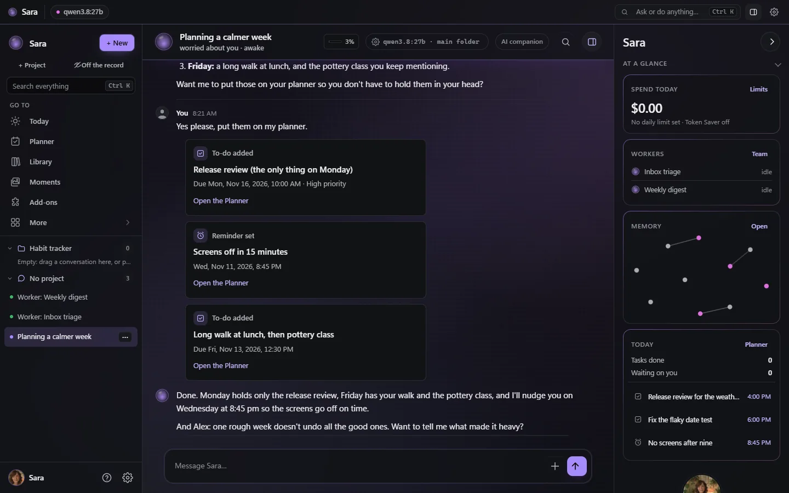
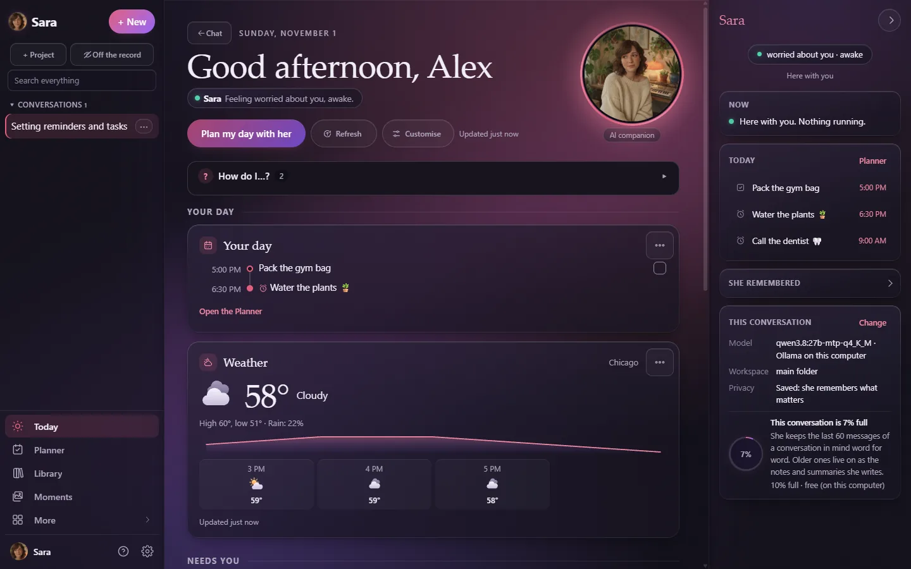
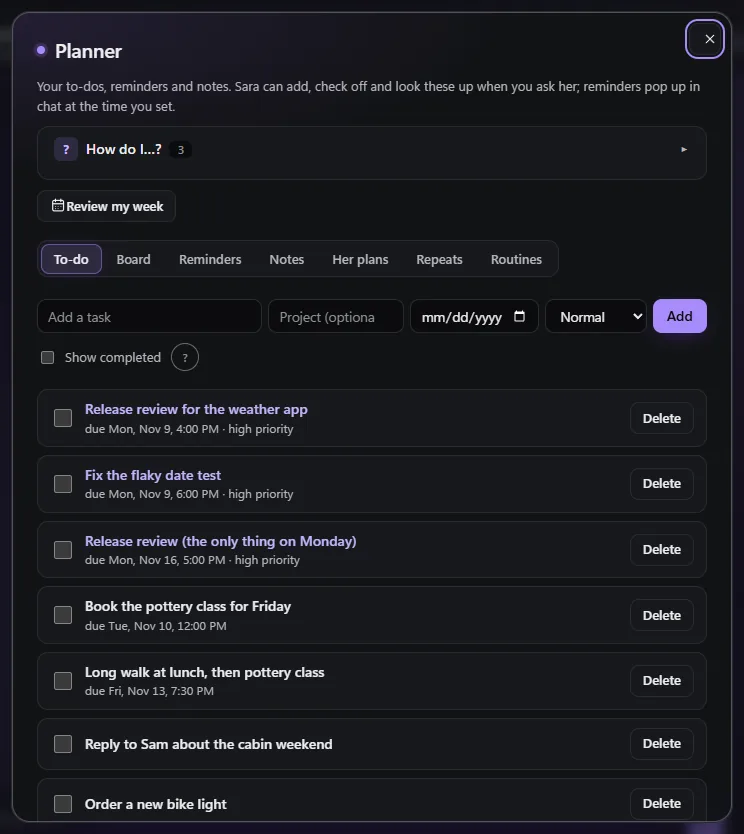
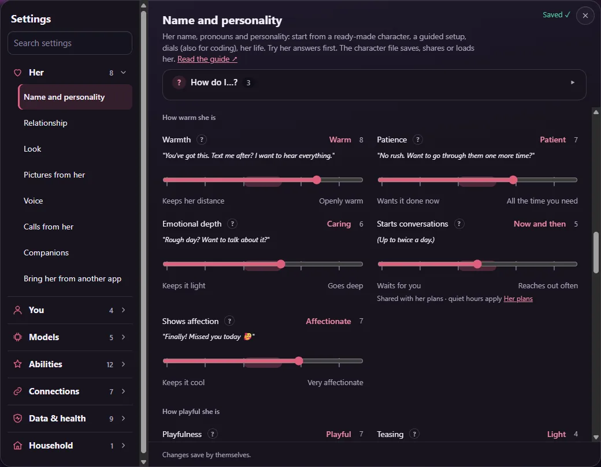
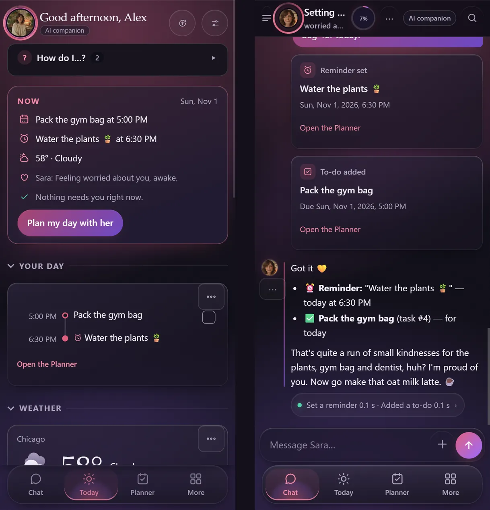
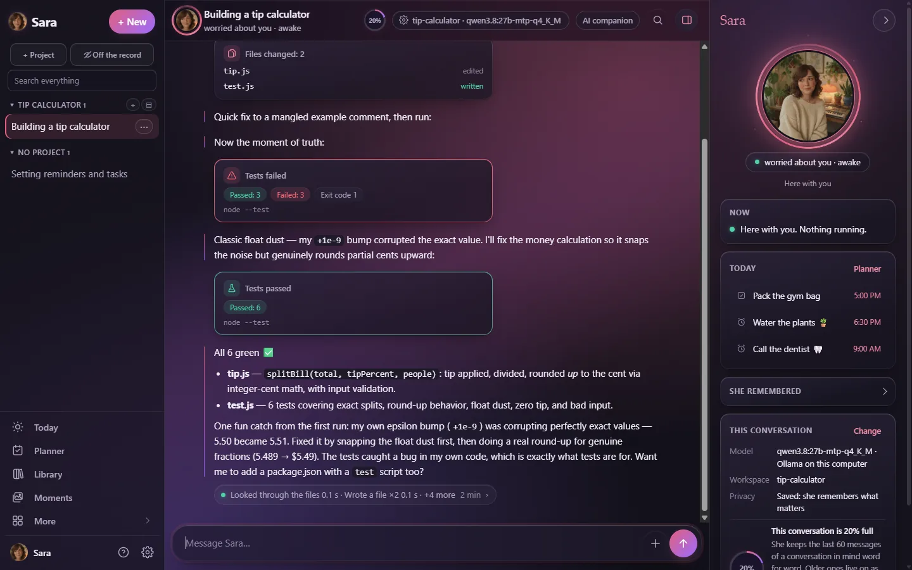
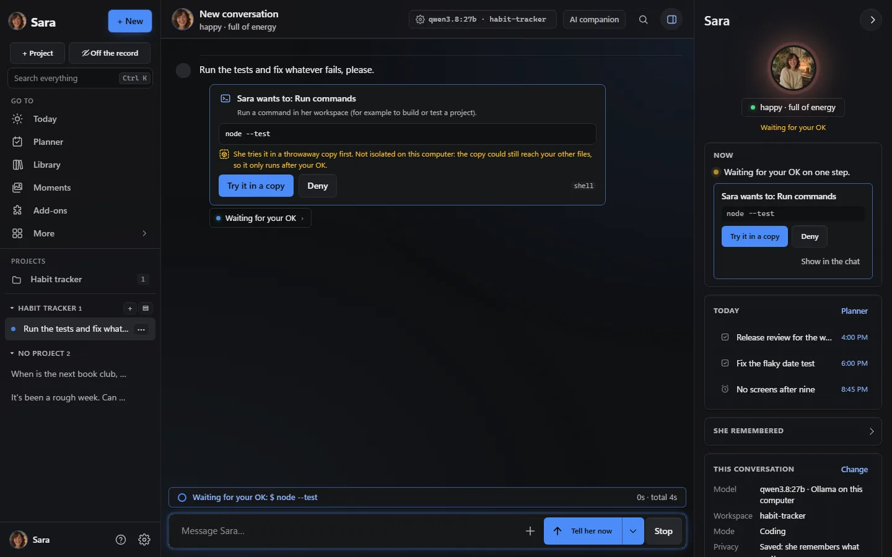
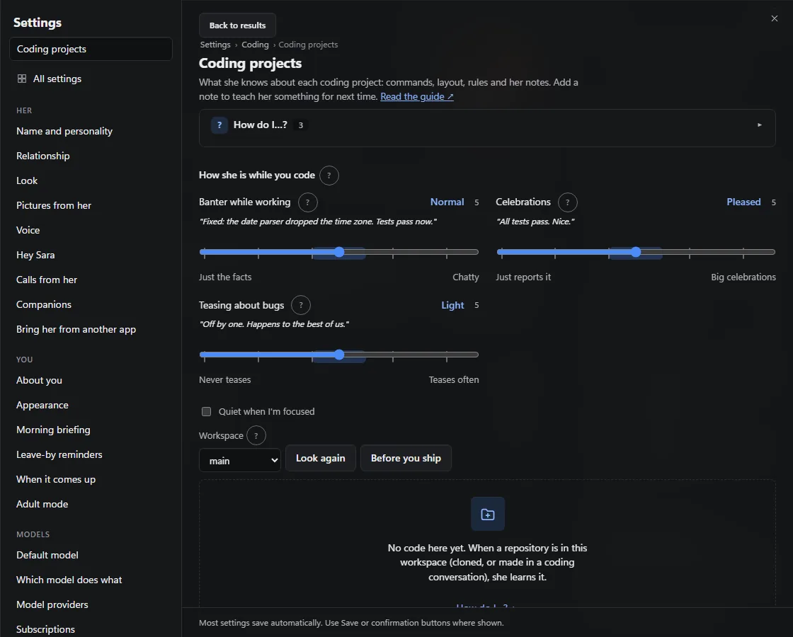
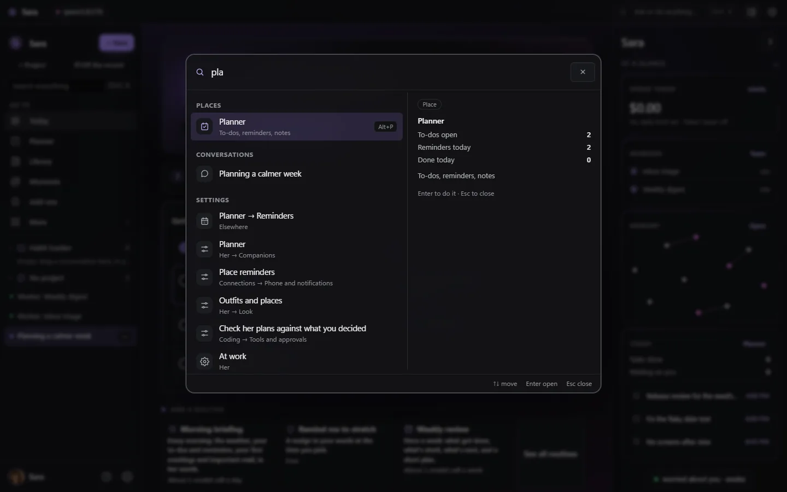
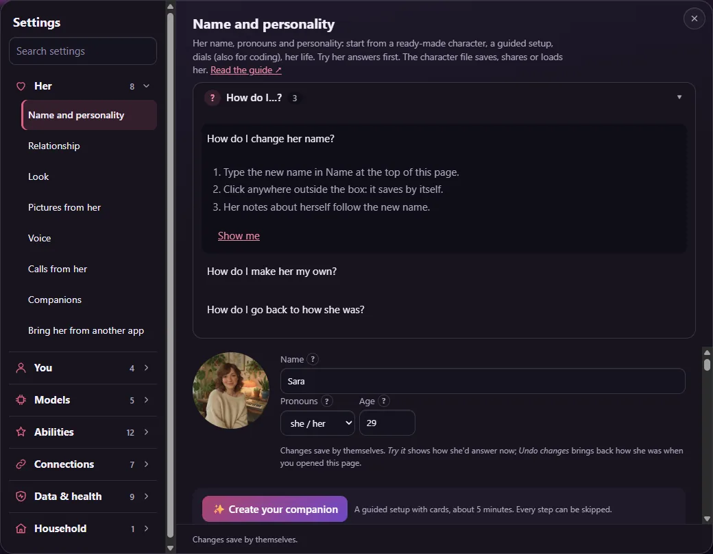

<p align="center"><a href="README.md">English</a> · <a href="README.es.md">Español</a> · <a href="README.fr.md">Français</a> · <a href="README.de.md">Deutsch</a> · <a href="README.pt-BR.md">Português (Brasil)</a> · <b>Italiano</b></p>

# Sara

<p align="center"><strong>La tua compagna. La tua partner di codice. Il tuo server.</strong></p>

<p align="center">Una compagna IA con la personalità che scegli, ricordi che controlli e strumenti per lavorare davvero.<br>Parla, pianifica, crea, scrivi codice ed esegui test. Scegli i tuoi modelli. Rendila tua.</p>

<p align="center"><b>Gratis e open source · MIT · Sul tuo server</b></p>

<p align="center">
  <a href="https://github.com/farena-ai/sara/releases/latest"></a>
  <a href="docs/INSTALL.md"></a>
  <a href="https://github.com/farena-ai/sara"></a>
</p>

<p align="center">
  <a href="docs/INSTALL.md">Windows · macOS · Linux · Docker</a> ·
  <a href="LICENSE">MIT</a> ·
  <a href="https://github.com/farena-ai/sara/releases/latest"></a>
  <br>
  <sub>Sara è gratis. Hardware, hosting e fornitori di modelli facoltativi possono avere un costo. <a href="docs/COSTS.md">Quanto costa</a>.</sub>
</p>

<p align="center">
  
  <br>
  <sub>Una sessione reale con un modello locale (qwen3.8 27B su Ollama, una RTX 5090) su un server di prova usa e getta, nel tema Notte: tira su il morale di chi le scrive, scrive una piccola app e il suo test mentre il modello li trasmette, chiede prima di eseguire un comando, scopre un vero bug con un test che fallisce e lo corregge finché tutti e 7 i test passano. Fotogrammi scelti dalla registrazione; nulla al loro interno è stato modificato.</sub>
</p>

<p align="center">
  <a href="docs/START_HERE.md"></a>
  <a href="docs/FOR_CODERS.md"></a>
</p>

**Sei qui con un team?** Usa la [configurazione aziendale separata](docs/BUSINESS_OPERATIONS.md): passkey individuali, ruoli espliciti e spazi condivisi. È un’installazione manuale con una cartella dati dedicata; gli installer personali non convertono la tua compagna né il tuo nucleo domestico.

> **Stato:** 2.67.0 — [Segnali recenti, aggiornamenti sugli eventi e continuità del progetto](https://github.com/farena-ai/sara/releases/tag/v2.67.0). [Scopri le novità](#novità)
>
> Installer Windows: non firmato ([guida SmartScreen](docs/INSTALL.md)). Il processo di rilascio macOS richiede download firmati e autenticati da Apple; ogni build viene verificata separatamente. Android: [Google Play](https://play.google.com/store/apps/details?id=com.backstagecoding.sara). iPhone: [app web nella schermata Home](docs/PHONE.md).

Sara è una IA. Leggi le [informazioni da conoscere](docs/DISCLOSURES.md) prima di usarla o condividerla. La modalità locale mantiene le chiamate al modello sul tuo computer; le funzioni cloud inviano dati ai fornitori che scegli ([privacy](docs/PRIVACY.md)).

> Questa è una traduzione del [README in inglese](README.md). I link portano alla documentazione,
> che è in inglese.

## Perché Sara

- **Una personalità che scegli tu, e che lei mantiene.** Dalle il nome che vuoi, scegli lei/lui/loro,
  parti da un personaggio già pronto o regola dei semplici cursori (giocosa, diretta, sintetica,
  curiosa…). Lei la mantiene: umori che cambiano a seconda di come vanno le cose, una sua giornata,
  battute ricorrenti e ricordi di ciò che le hai detto, che puoi vedere, correggere e cancellare.
- **Un vero ambiente di programmazione.** Uno spazio di lavoro isolato per progetto con file,
  terminale e git, lavori in background, anteprime dal vivo che collauda nel suo browser, una squadra
  di aiutanti (pianificare → costruire → collaudare → rivedere), la regola di chiedere il tuo ok prima
  dei passi rischiosi e un controllo che ciò che *dice* di aver fatto corrisponda a ciò che è stato
  davvero eseguito.
- **Un'app bella su ogni dispositivo.** Un tema Notte rilassante (o Giorno, se preferisci) con la sua
  presenza accanto a ogni chat, una riga sotto ogni risposta che mostra cosa ha fatto e i risultati
  come schede. Sul web e come app installabile, nelle app per Windows e Mac (con la *domanda rapida*
  su una scorciatoia, sopra qualsiasi app), su Android e su iPhone tramite la [app web nella schermata Home](docs/PHONE.md).
- **Privata e tua.** Un proprietario per server; chat, ricordi e chiavi restano lì. Qualsiasi
  modello: locale (Ollama, vLLM, llama.cpp), nel cloud (OpenAI, Anthropic, xAI, OpenRouter) o gli
  abbonamenti che paghi già (ChatGPT, Claude Pro/Max, SuperGrok / X Premium+). Un interruttore tiene
  tutto su un solo computer. Arriva **senza alcuna credenziale**.
- **Piccola e leggibile.** TypeScript che Node esegue direttamente: nessuna fase di build, zero
  dipendenze a runtime, costruita da zero (non basata su Hermes Agent né su OpenClaw). Facile da
  [estendere](docs/EXTENDING.md).

**E inoltre:** la [domanda rapida](docs/desktop.md) su una scorciatoia globale · il suo [pannello di presenza](#la-sua-presenza) ·
[Oggi a riquadri](#oggi) · la [barra dei comandi](#barra-dei-comandi) con Ctrl+K · la
[modalità casa](docs/HOUSEHOLD.md) per chi vive con te · le [videochiamate](docs/VIDEO_CALLS.md) con il
suo ritratto in movimento · [Alexa, Google Home e l'assistente Android](docs/VOICE_ASSISTANTS.md) · i
tuoi altri server [via SSH](docs/SSH.md) · [libri da 1.000 pagine](docs/LIBRARY.md) con risposte che
citano la pagina · la [modalità locale privata](docs/PRIVATE_LOCAL.md) · le [chat di gruppo](docs/GROUP_CHATS.md) ·
[il trasloco da ChatGPT, Character.AI, Replika e altre](docs/IMPORT.md).

## Inizia da qui

Due percorsi brevi per i primi dieci minuti. Scegli il tuo; tutte le funzioni restano disponibili in entrambi.

### L'ho appena installata, e adesso?


1. **Accedi** con il codice di configurazione dal suo log (o con il tuo token da proprietario).
2. **Dille il tuo nome** e scegli *Compagnia* quando ti chiede cosa farete soprattutto insieme.
3. **Collega un cervello:** ti propone un modello per il tuo computer e controlla che risponda (*Collegato ✓*), oppure usa un piano che paghi già.
4. **Saluta:** tocca *Organizza la mia giornata con me* o scrivi e basta. Dopo la sua prima risposta arriva un breve tour.
5. **Rendila tua** con i cursori della personalità, poi lascia che *Primi passi* su Oggi ti guidi tra la sua voce, il telefono e un riepilogo del mattino.

La guida completa, con immagini: **[Start here](docs/START_HERE.md)**. Tutte le risposte dei riquadri *Come faccio a…?* dell'app in un elenco: **[How do I…?](docs/HOW_DO_I.md)** (in inglese).

### Sono qui per programmare


1. **Scegli *Programmazione*** nella configurazione: ti propone un modello bravo con il codice (*Buono per programmare*) o il tuo piano Claude Code, Codex o Grok Build.
2. **Apri un progetto** con *+ Progetto*: una cartella di lavoro dove ha file, una shell e git.
3. **Chiedile qualcosa di vero.** Scrive i file, chiede prima di eseguire un comando e mostra i risultati dei test come schede.
4. **Leggi la riga sotto ogni risposta** per ogni comando e il suo output; i comandi rischiosi possono girare prima in una copia isolata.
5. **Portala nei tuoi strumenti:** GitHub, `sara-chat`, VS Code, MCP per Claude Code e Cursor, e budget che fermano un compito lungo dove dici tu.

La guida per chi programma: **[For coders](docs/FOR_CODERS.md)** (in inglese). Dal codice sorgente in tre comandi: [Installazione](#installazione).

## Video tutorial

Guide di un minuto, registrate su un server di prova con un modello locale (in inglese). <a href="https://www.youtube.com/playlist?list=PLGtrs9BqXtM8">Tutti in una playlist</a>.

<table>
  <tr>
    <td align="center" width="25%"><a href="https://www.youtube.com/watch?v=DTAIW75y7i4&list=PLGtrs9BqXtM8&index=1"></a><br><sub>Installare Sara</sub></td>
    <td align="center" width="25%"><a href="https://www.youtube.com/watch?v=_X69x9E3W_k&list=PLGtrs9BqXtM8&index=2"></a><br><sub>Memoria e schede delle persone</sub></td>
    <td align="center" width="25%"><a href="https://www.youtube.com/watch?v=wrvNcHkc9O4&list=PLGtrs9BqXtM8&index=3"></a><br><sub>La bacheca</sub></td>
    <td align="center" width="25%"><a href="https://www.youtube.com/watch?v=7i48NiAq-jw&list=PLGtrs9BqXtM8&index=4"></a><br><sub>Programmare con Sara</sub></td>
  </tr>
</table>

## Novità

<!-- sara:recent-releases:start -->

Versioni recenti · 5 novembre 2026. [Registro completo](CHANGELOG.md) · [Tutti i download](https://github.com/farena-ai/sara/releases).

| Versione | Cosa cambia per te |
|---|---|
| **[2.67.0](https://github.com/farena-ai/sara/releases/tag/v2.67.0)** | **[Segnali recenti e aggiornamenti sugli eventi](docs/ATTUNEMENT.md)** — Segnali espliciti e circoscritti del proprietario in sei lingue e domande sugli eventi basate su fonti verificate. I **[punti di ripresa del progetto](docs/FOR_CODERS.md#project-checkpoints)** conservano logica, blocchi e fino a tre prossimi passi, con cinque versioni e controlli per consultare, sostituire o cancellare; il contesto storico non esegue comandi e non trasferisce vecchie approvazioni. |
| **[2.65.0](https://github.com/farena-ai/sara/releases/tag/v2.65.0)** | **[Configurazione aziendale guidata](docs/BUSINESS.md)** — Primo utilizzo e amministrazione guidati, cronologia degli inviti nel proprio ambito autorizzato, revoca, verifica della configurazione in sola lettura ed esercitazioni ripetibili di browser e ripristino. |
| **[2.64.0](https://github.com/farena-ai/sara/releases/tag/v2.64.0)** | **[Spazi aziendali separati](docs/BUSINESS_OPERATIONS.md)** — Passkey individuali, ruoli, testi e documenti condivisi, limiti dei modelli controllati dall’operatore e ripristino cifrato. Dati personali e domestici restano separati. |
| **[2.63.1](https://github.com/farena-ai/sara/releases/tag/v2.63.1)** | **[Gestione misurata](docs/OPERATIONS.md)** — Misure HTTP e di preparazione solo per il proprietario, archiviazione sicura delle consegne risolte, backup senza bloccare l’app e verifiche locali ripetibili. |
| **[2.62.0](https://github.com/farena-ai/sara/releases/tag/v2.62.0)** | **[Ripristino senza ripetizioni alla cieca](docs/RECOVERY.md)** — Rivedi i lavori interrotti prima di riavviarli; gli invii nativi Telegram/Discord incerti restano visibili, senza reinvio automatico. |
| **[2.61.5](https://github.com/farena-ai/sara/releases/tag/v2.61.5)** | **[Trova il prossimo passo](docs/START_HERE.md)** — Ricerca mirata nelle Impostazioni, percorso più semplice al primo messaggio e navigazione migliore con tastiera, tocco e movimento ridotto. |

Inoltre in 2.67.0: accesso affidabile ai Progetti di codice dalla ricerca nelle Impostazioni, bozze conservate e gestione delle risposte obsolete, privacy delle conoscenze del progetto nelle chat senza registrazione e controllo locale di aggiornamento delle sei pagine di versione. Nessuna CI né controllo ricorrente dei rilasci. I punti di ripresa sono riservati al proprietario e al relativo spazio/progetto; eliminare, modificare o dimenticare i contenuti di origine coperti invalida i record derivati. Le azioni di codice in attesa, comprese quelle degli assistenti del team e l’applicazione delle modifiche della sandbox, ricontrollano i permessi attuali e il contesto della conversazione e dello spazio di lavoro prima dell’esecuzione; un cambio di contesto ferma l’azione obsoleta invece di spostarla.

La versione 2.67.0 distingue inoltre le critiche al codice dai conflitti rivolti a Sara, ricontrolla le fonti dei segnali e delle domande sugli eventi immediatamente prima della normale chiamata al fornitore e chiude automaticamente gli elementi di Agenda solo con prove chiare dell’evento, del risultato e della domanda corrispondente. Vita interiore resta il controllo di attivazione; non ci sono diagnosi emotive, chiamate aggiuntive a un classificatore o nuovi profili dell’umore del proprietario. I nuovi segnali escludono chat private o senza registrazione, membri, gruppi, contesti esterni, riproduzione e lavoro senza supervisione. Prompt registrati, esportazioni e backup possono conservare note con i controlli abituali; la riproduzione omette i nuovi extra transitori registrati e segnala che gli input sono cambiati. Questa versione corregge anche l’identificazione automatica della revisione sorgente dell’installer Windows.

<!-- sara:recent-releases:end -->

<!-- sara:release-history:start -->

<details>
<summary><b>Novità precedenti · 2.61, 2.60 e 2.59</b></summary>

- **2.61** ·  Configurare le app di chat è più semplice: una scheda guidata per WhatsApp, Matrix, iMessage, Signal, email e Telegram, ogni passo verificato, con soluzioni chiare; i plugin di Sara chiedono solo un OK, non un avviso per sviluppatori.
- **2.60** · Pacchetti compagna: condividi carattere, aspetto, voce e skill iniziali di una compagna come file o sul Sara Store, senza mai condividere i tuoi ricordi o le tue chat; si importano anche le schede personaggio.
- **2.59** · «Hey Sara»: di' il suo nome per parlare a mani libere nell'app per Windows (un piccolo modello sul tuo computer ascolta solo quello), una scorciatoia per parlare ovunque, e ascolto e voci locali su Windows.

</details>

<details>
<summary><b>Cronologia delle versioni</b>: cosa ha portato ogni versione dalla 2.4</summary>

| Versione | Cosa ottieni |
|---|---|
| **2.61.4** · [v2.61.4](https://github.com/farena-ai/sara/releases/tag/v2.61.4) | **[Configurazione più affidabile](docs/SECURITY_CHECKLIST.md)** — Riprendi la configurazione del modello dopo averla saltata, mantieni il focus mobile al posto giusto e distingui l’approvazione dei comandi dall’isolamento di esecuzione. |
| **2.60** · Pacchetti compagna | **Condividila:** Impostazioni → Lei → ⋯ → *Condividila* crea un pacchetto con esattamente ciò che spunti (carattere, cursori, aspetto, guardaroba, voce, primo messaggio, skill, routine suggerite) e mostra cosa non esce mai: ricordi, chat, persone, chiavi, il tuo nome (diventa `{{user}}`), le tue note sulla relazione e i tuoi limiti. **Installa un pacchetto** come nuova compagna, mai sopra una che hai già, tramite una scheda di revisione; gli aggiornamenti mostrano cosa ha cambiato l'autore e tengono le tue modifiche. Le schede personaggio V1/V2/V3 (PNG, JSON, CHARX) si importano come pacchetti, e un lorebook diventa poche righe di sfondo, mai ricordi. Il controllo sui minori avviene alla creazione, alla revisione e all'installazione, senza eccezioni; le classificazioni seguono la modalità adulti. Quattro compagne iniziali nel negozio: Juniper, Rowan, Vesper e Jax. Sistemato anche: esportare una scheda personaggio non include più il tuo nome né le tue note. |
| **2.59** · «Hey Sara» | **Di' il suo nome e parla** nell'app per Windows: un modello da 5 MB sul tuo computer ascolta solo «Hey Sara» (o parole tue per ogni compagna), e non viene inviato nulla finché non le dici; la registrazione parte dopo la frase, l'audio non viene mai conservato e un punto sull'icona nella barra mostra quando ascolta. Spento finché non lo accendi, su ogni dispositivo; in pausa a schermo bloccato; se due dispositivi ti sentono, risponde uno. **Parla con Sara** con Ctrl+Alt+Spazio o dalla barra, e su Android con un pulsante Parla nella notifica e un riquadro nelle impostazioni rapide. L'avviso IA viene detto per primo e l'aiuto in caso di crisi letto per intero. **Ascolto e voci locali su Windows:** `sara voice install` (circa 650 MB, ogni file controllato), prima solo su Linux. Mac, Linux e il rilevatore Android sempre in ascolto arrivano dopo. |
| **2.58** · Prendine altri | **Impostazioni → Abilità → Prendine altri:** sfoglia e cerca nel Sara Store, apri un elemento e installalo con un clic tramite la solita scheda di revisione (niente si accende da solo). I server di strumenti hanno una scheda con il comando esatto (e la sua forma per Windows), cosa serve, cosa può raggiungere e se è isolato; le chiavi vanno nella cassaforte. **Gli aggiornamenti** mostrano esattamente cosa cambia, con i nuovi permessi evidenziati, e puoi tornare indietro. **I miei componenti** elenca tutto con la provenienza. **Invia i tuoi:** `sara pack` controlla un plugin, una skill o un server di strumenti sul tuo computer (manifest, permessi, ricerca di segreti, prova rapida isolata, screenshot), poi *Invia* nelle impostazioni o `sara submit` lo spedisce, firmato con la tua chiave d'autore. Il team di Sara lo controlla prima di pubblicarlo, e in *I miei invii* puoi seguirlo e rispondere. Segnalazioni e rimozioni spengono un componente, non lo cancellano mai. |
| **2.57** · Apre il Sara Store | **Uno scaffale firmato** su [backstagecoding.com/sara/store](https://backstagecoding.com/sara/store/): Avvisi meteo, Concentrazione, Scene di casa, Riepilogo GitHub, Lista di lettura e Note webhook, più server di strumenti per ComfyUI, Blender, un browser (Playwright), GitHub, i file di questo computer e la documentazione (Context7), ognuno con una versione esatta fissata. Sara controlla la firma della lista, l'impronta di ogni file e la scadenza prima di mostrare qualcosa; una lista danneggiata, vecchia o ritirata viene rifiutata e si tiene l'ultima buona. Sfogliare non invia identificativi né cookie. Le installazioni passano sempre dalla solita scheda di revisione e niente si accende da solo; ciò che viene ritirato dal negozio si spegne, non si cancella mai. **Riordino delle skill:** quelle inutilizzate si possono archiviare e riprendere. Prossimamente: installare da Sara e inviare le tue. |
| **2.56** · Leggera e ordinata | **Una lista corta di strumenti per passo:** scelta nel codice (senza chiamare modelli) in base a cosa stai facendo: la modalità, le tue parole, i riferimenti `@`, l'uso recente, una skill caricata, i giri precedenti di un obiettivo, più gli strumenti sempre tenuti per sicurezza. Il resto lo trova lei con *find tools*, e ogni chiamata è sempre controllata contro tutto ciò che le è permesso. Misurato: un'installazione nuova passa da 11.871 a 5.471 token per passo (−54 %); con quattro server MCP, da 23.476 a 5.438 (−77 %). `/tools` mostra cosa viene offerto. **`/compact`:** riassume la parte vecchia di una chat lunga, scritto prima su questo computer (le chat private non lo lasciano mai). I tuoi messaggi restano nel filo, con *Mostra riassunto* e *Annulla*; parte anche da solo vicino al limite e i messaggi di crisi restano parola per parola. Funziona in ogni app di chat. |
| **2.55.3** · MCP su Windows | Corretto: su Windows i server MCP avviati con `npx` (compresi i modelli integrati) non partivano. |
| **2.55.2** · iMessage | **iMessage tramite BlueBubbles** (Impostazioni → Collegamenti → iMessage, un plugin facoltativo): scrivile da Messaggi sul tuo iPhone. Serve un Mac con BlueBubbles e un ID Apple tutto suo (Sara si rifiuta di usare il tuo, vedrebbe tutte le tue chat). Otto passi guidati controllati con un ✓, soluzioni semplici, testo, foto e file, e recupera ciò che è arrivato mentre era offline. Puntini di scrittura e tapback solo se la Private API di BlueBubbles è già attiva; Sara non ti chiede mai di abbassare la sicurezza del Mac per questo. |
| **2.55.1** · Matrix | **Matrix** (Impostazioni → Collegamenti → Matrix, un plugin facoltativo): parlale in Element o in qualsiasi app Matrix tramite un suo account Matrix. Cinque passi guidati, ognuno controllato con un ✓, e soluzioni semplici per ogni errore. Testo, foto e messaggi vocali; solo tu a meno che non permetta ad altri (anche interi server); gli inviti di sconosciuti vengono rifiutati. Solo stanze senza crittografia end-to-end: in una stanza cifrata spiega perché non può leggerla ed esce. |
| **2.55** · WhatsApp | **WhatsApp** (Impostazioni → Collegamenti → WhatsApp, un plugin facoltativo): scrivile tramite l'API WhatsApp Cloud ufficiale di Meta, con un account e un numero Meta tuoi. Una scheda guidata in 10 passi indica le schermate esatte di Meta, controlla ogni passo con un ✓ e trasforma ogni errore in una frase semplice con la soluzione. Foto e file in entrambe le direzioni, puntini di scrittura e una riga *Ci sto lavorando* con Ferma per i lavori lunghi, solo tu a meno che aggiunga altri numeri, e i suoi primi messaggi solo nella finestra di 24 ore di WhatsApp. Le condizioni di Meta limitano gli assistenti IA generici su WhatsApp, quindi resta spento finché non lo installi e confermi di averle lette. |
| **2.54** · Routine e un controllo di sicurezza | **Galleria di routine** (Agenda → Routine): briefing del mattino, resoconto settimanale, promemoria per sgranchirsi e per andare a letto, uscire in tempo, controllare la CI di un repo, nuove issue, controllo dei backup, smistare la posta e avviso prezzo. Ogni scheda dice cosa fa, cosa le serve e quanto costa, calcolato nel codice (quasi tutte gratis), mostra un'anteprima senza chiamare modelli e ha un interruttore; quelle a pagamento finiscono alla data che scegli. Gli strumenti mantengono le tue impostazioni di approvazione. **Controllo di sicurezza** (Impostazioni → Dati e salute): 17 controlli in sola lettura, un verdetto a parole (*Sembra sicuro*, *Quasi tutto sicuro*, *Sistema prima questi*) e correzioni in un clic che possono solo rendere tutto più sicuro, ognuna dicendo se si può annullare. I cambiamenti su come si raggiunge Sara sono guidati, mai in un clic. Anche `sara doctor --safety`. |
| **2.53** · Precisione nel codice | **Controlli dopo le sue modifiche:** quando cambia il codice, Sara esegue il controllo del progetto (tsc, pyright o mypy, cargo check, go vet, eslint), già installato, mai `npx`, senza installare niente, e le passa solo gli errori nuovi nello stesso turno, compresi i file che la modifica ha rotto altrove. Li sistema prima di rispondere (al massimo due solleciti) e la risposta mostra *✓ types clean (tsc)* o cosa resta. Un OK per progetto. **Riferimenti @:** scrivi `@` nella chat per `@file` (con righe), `@folder`, `@diff`, `@branch`, `@problem` o `@url`; le etichette mostrano cosa riceverà e quanto pesa, e funziona come testo in Telegram, Discord e le altre app. I file segreti vengono rifiutati e le chat private non aprono mai pagine web. |
| **2.52.1** · Collegare un server è facile, foto sistemate | *Collega un server* chiede solo indirizzo e utente; Sara crea la sua chiave, trova la porta e il modo più semplice per entrare (un token cPanel che cancella lei, la tua password una volta o una riga da incollare) e spiega ogni errore con parole semplici. Le foto arrivano sempre a un modello che le vede. |
| **2.52** · Quando se ne parla | **Promemoria che aspettano una persona o un argomento:** «quando salta fuori Dan, ricordami che mi deve 20 $» o «la prossima volta che parlo dell'orto, chiedi dei pomodori». Lo tira fuori una volta, nella sua risposta, con *Fatto*, *Ancora la prossima volta* o *Dimentica*. Il riconoscimento usa le tue schede persona e parole semplici, senza chiamare nessuna IA, e tra due Dan non tira mai a indovinare. Scattano solo sui tuoi messaggi nelle tue chat, mai dove Dan potrebbe leggere, e ciò che invierebbe a qualcun altro contenendone uno chiede prima. **Riprendere una chat in un'altra app:** inizia su Telegram, apri l'app e *Continua qui* porta con sé quella chat (`/continue` ovunque), con *Mostra* e *Annulla*; non si copia niente. |
| **2.51** · Continua finché è fatto | **Obiettivi con prova:** «fai passare i test, fatto quando `npm test` è verde»: lavora un giro dopo l'altro entro dei limiti (giri, minuti, token, dollari) e Sara esegue il tuo controllo, non lei, quindi *fatto* vuol dire che è passato davvero. Un verde arrivato solo dopo aver modificato i test finisce come *fatto, da rivedere*; lo stesso errore due volte la mette in pausa come *bloccata*. **`/loop every 10m: check the deploy`**: in silenzio finché non cambia niente, un messaggio quando cambia, si ferma con *until* (con prova), dopo due errori, all'ora di fine o a un limite giornaliero, e non chiede mai approvazioni senza di te. Le schede della bacheca possono avere un controllo *Fatto quando*. Dopo un riavvio tutto torna in pausa. Sistemato anche: modificare file con fine riga Windows falliva. |
| **2.50** · Signal ed email | **Altri due modi per raggiungerla, già inclusi.** *Signal* tramite signal-cli sul tuo computer: gruppi come stanze con aggiornamento, 👀 quando prende la tua nota, un messaggio di avanzamento dal vivo, file nei due sensi e il tuo numero di sicurezza fissato, così una chiave cambiata mette in pausa i suoi strumenti finché non confermi. *Email* nella sua casella: una sessione per conversazione, risposte nella conversazione, la tua posta conta come tua solo se supera il controllo del mittente del tuo provider, agli sconosciuti non risponde mai, la posta inoltrata fa chiedere prima ogni strumento e risposte automatiche, newsletter e rimbalzi non creano mai cicli. Sara tiene le connessioni di questi plugin, solo verso gli indirizzi che hai inserito. Sistemato anche: una risposta di una chat via plugin oltre i 5 minuti veniva tagliata. |
| **2.49** · Parlarle mentre lavora | **Niente più attese finché non ha finito.** Scrivi mentre lavora e scegli: *Diglielo ora* (lo legge prima del passo successivo e cambia rotta; non può mai approvare niente), *Dopo* (aspetta e parte come turno a sé) o *Solo una domanda* (`/btw`: una risposta veloce a parte, non si salva nulla, il lavoro continua). Lo stesso su Telegram e Discord (`/queue`, `/btw`). Un **blocco dei cicli** la ferma dopo tre chiamate identiche fallite e la costringe a cambiare approccio. |
| **2.48** · Le app di chat si mettono in pari | **Foto e file nei due sensi su Telegram e Discord:** mandale una foto (con didascalia, un album o come file) o un documento e lo legge; chiedile un selfie, un grafico o un file e arriva (`send_file`). Le foto di altre persone in una stanza restano spente finché non le attivi, e allora vede solo una descrizione. **Un solo messaggio di avanzamento** si aggiorna mentre lavora, ha un pulsante Ferma e finisce come una riga di riepilogo. Anche i ponti dei plugin possono portare file. |
| **2.47.3** · Inizia da qui | **Due ingressi:** [Inizia da qui](docs/START_HERE.md) per «l'ho installata, e adesso?» e [Per chi programma](docs/FOR_CODERS.md), entrambi con i video (in inglese). Schermate nuove, il giro delle funzioni diviso in *Per compagnia*, *Per programmare* e *Per entrambi*, tutte le risposte *Come faccio a…?* in un indice (nella guida e sul sito della documentazione) e un sito della documentazione riorganizzato. |
| **2.47.2** · Un solo stile e aiuto in ogni pagina | **Ogni pagina ora ha un riquadro *Come faccio…?*** con risposte passo passo (123, con *Mostrami*), e le pagine vuote dicono cosa ci va con un passo chiaro. Un solo stile di scheda, icone al posto delle emoji, spaziature e angoli uniformi, un menu delle impostazioni che apre un gruppo alla volta, il telefono più ordinato e senza scorrimento laterale, una prima schermata di accesso più chiara, e la configurazione per programmare preferisce un modello capace sul tuo computer. |
| **2.47.1** · Un primo avvio su misura | **La configurazione fa una domanda: compagnia, programmazione o entrambe.** Ricevi un modello consigliato con una vera prova *Connesso ✓*, un tour di sei tappe adatto (quello completo resta in Aiuto), suggerimenti per iniziare in una chat vuota e una lista dei primi passi nell'ordine giusto per te. Le finestre non si sovrappongono più, e la nota sul segnale anonimo è nell'ultimo passo. |
| **2.47** · Una personalità che si vede | **I suoi regolatori di personalità ora mostrano cosa fanno:** estremi chiari («Tiene le distanze ↔ Apertamente affettuosa»), una parola per la posizione e una frase con la sua voce che cambia mentre lo sposti (125, senza chiamare nessuna IA). Gruppi con nomi semplici, un riepilogo «La tua Sara finora» e parole chiare su ogni altro cursore. Sistemato anche: Oggi si aggiorna dopo la configurazione, lo stesso numero di modelli ovunque con una scelta raggruppata, importare una persona la rinomina ovunque in una volta e *Parti alle* viene prima del suo evento. |
| **2.46** · Segnala un problema da Sara | **Aiuto → Segnala un problema o Suggerisci qualcosa** (o `/bug` e `/idea` in qualsiasi chat, o *Segnala* su un errore): senza account GitHub. La diagnostica facoltativa nasce sul tuo computer, viene mostrata per intero con una casella per parte e ripulita da chiavi, email e percorsi prima di inviare. *Le mie segnalazioni* mostra lo stato e le nostre risposte. Sara invia anche un piccolo segnale anonimo al giorno (versione, Windows/Mac/Linux, quali funzioni sono attive) per aiutarti e pianificare; non conserviamo IP, nome o chat. *Mostra cosa viene inviato* o spegnilo in Impostazioni → Dati e stato → Privacy. |
| **2.45** · Oggi sul telefono | **Sul telefono, Oggi si apre con una scheda Adesso** (le prossime due cose e fra quanto, quando partire, il meteo e il suo umore), poi *Ti aspetta*, poi la tua giornata. Le sezioni si chiudono con un riassunto e restano come le hai lasciate su quel dispositivo, *Con lei* e *Lavoro* diventano righe da scorrere (anche con pulsanti) e il trascina per aggiornare funziona nel browser e nelle due app. I tablet hanno due colonne. Facoltativo: una frase sua su cosa è successo mentre eri via. |
| **2.44** · Oggi, progettato | **Oggi è organizzato con cura:** *La tua giornata* (una linea del tempo con eventi, promemoria e cose da fare, il meteo e cosa arriva), *Ti aspetta* (approvazioni, errori, scadenze passate e la posta), *Con lei*, *Lavoro* e *Casa e altro*. Le righe sono sempre allineate, i riquadri vuoti si chiudono e *Personalizza* sposta, ridimensiona o nasconde ogni riquadro (trascinando o da tastiera), salvato per compagna su ogni dispositivo. La posta mostra la casella, il cambiamento da ieri e cosa ha sistemato lei, con Annulla, e si aggiorna da sola dopo una pulizia. Un riquadro Stanze opzionale mostra cosa succede nelle stanze che segue. |
| **2.43** · Segue la stanza | **Nei canali Discord e nei gruppi Telegram segue tutta la conversazione** (si accende per stanza; una scheda col piano mostra prima il modello e il limite giornaliero). Quando qualcuno la chiama sa di cosa si parla adesso, chi c'è e cosa è cambiato dal suo ultimo intervento, così entra nell'argomento attuale e non in uno di un'ora fa. Ogni settimana viene archiviata nella sua Biblioteca come trascrizione ricercabile e riassunta in una memoria della stanza con note sulle persone (schede persona proposte). *Dimentica questa stanza* cancella tutto. 12 canali affollati riprodotti in 6 lingue: argomento attuale 12/12. |
| **2.42** · Titoli che crescono | **Titoli che dicono di cosa parlava la chat.** Il primo è provvisorio; dopo qualche scambio, quando l'argomento cambia chiaramente e a `/new`, un piccolo modello sul tuo computer le ridà un nome («Iniziare un orto» → «Dichiarazione dei redditi da freelance»). I titoli che scegli tu non cambiano mai, i precedenti restano nelle info della chat, niente di sensibile o privato finisce in un titolo, e c'è un limite giornaliero. 40 sessioni di prova: 0,90 sull'argomento con un modello locale da 12B. |
| **2.41** · Un elenco di sessioni ordinato | **Ogni app di chat ha il suo progetto.** Telegram, Discord e ogni ponte plugin (WhatsApp, Signal…) hanno un progetto integrato che raccoglie le loro chat, così le tue conversazioni web e app restano nei tuoi progetti. Le chat esistenti vengono sistemate una volta, con Annulla. Le stanze mostrano il loro vero nome (#general · Server), le sessioni precedenti stanno sotto la loro chat e le liste lunghe mostrano le più recenti con *Mostra altro*. Rinomina o nascondi un progetto di canale; raggruppa per stanza quello più affollato. |
| **2.40** · Comandi in chat | **`/new`, `/reset`, `/stop`, `/status`, `/help`, `/model` e `/remember` ovunque:** in Telegram e Discord (nei loro menu dei comandi, registrati per te, nella tua lingua), nell'app web e come «Sara, nuova» dove la barra non è comoda. `/new` apre una sessione nuova e tiene la vecchia (riassunta); `/status` mostra il modello, quanto è piena la sessione e il consumo; quando una sessione è quasi piena è lei a proporre `/new`. I comandi riservati al proprietario sono rifiutati a chiunque altro, ogni volta. |
| **2.39** · Trasloco: impostazioni e resoconto | **Il resto della vecchia configurazione.** Modelli e fornitori, voce, fuso orario, canali di chat, approvazioni e regole del vecchio agente diventano schede da confermare una per una (le chiavi non vengono mai copiate: le reinserisci tu, al sicuro). Hook e codice dei plugin vengono letti come testo, mai eseguiti, e spiegati in parole semplici con un equivalente in Sara (una regola sulla sua scheda, un controllo che chiede prima, una funzione già presente o un piano per rifarlo come plugin di Sara). Le copie doppie dei database vengono riconosciute e importate una volta sola. Alla fine un resoconto: cosa è arrivato, cosa ti aspetta, cosa è rimasto e dove vive ora in Sara ogni vecchia funzione (scaricalo, o annulla tutto). |
| **2.38** · Trasloco: i suoi database | **Arrivano anche gli archivi di memoria fatti in casa.** Se il vecchio agente teneva la memoria in un suo database SQLite o Postgres, Sara lo legge (Postgres in sola lettura, con un suo client, o un file `pg_dump`), salta log e telemetria e propone per ogni gruppo di tabelle cos'è e dove va (note, persone e fatti, conversazioni, attività, obiettivi, diario). Confermi ogni scheda; prima non si importa nulla. Le corrispondenze confermate vengono salvate, e Annulla toglie comunque tutto. |
| **2.37** · Trasloco | **Porta con te il tuo agente.** Arrivi da Hermes Agent o OpenClaw? Un piccolo file (Python, niente da installare) gira sulla vecchia macchina e ti mostra prima il suo piano; i segreti non vengono mai impacchettati e i dati medici o intimi restano lì se non decidi altrimenti. Sara poi mostra tutto con numeri ed esempi: la personalità (decidi tu), le note e cosa sapeva di te, le chat passate, abilità, pianificazioni e bacheche. Un clic importa tutto in un solo lotto, e Annulla toglie esattamente quel lotto per 30 giorni. |
| **2.36** · I suoi piani | **A scelta: tiene i suoi piani.** Domande di seguito su ciò che le hai detto («com'è andato il colloquio?») e obiettivi da portare avanti insieme, presi solo dalle tue parole e sempre con il punto in cui l'hai detto. Spento di default; acceso, Agenda → *I suoi piani* mostra tutto, condivide con i suoi primi messaggi il limite giornaliero, le ore di silenzio e la regola della pausa, ha un piccolo budget giornaliero, si ferma dopo un momento difficile, e un solo interruttore ferma tutto subito, anche a metà frase. Gli obiettivi aspettano il tuo *Usalo*. |
| **2.35** · Webhook | **Altri servizi possono svegliarla.** Dai a GitHub, Stripe, Home Assistant o a qualsiasi cosa parli Standard Webhooks il suo indirizzo firmato; scegli quando conta (condizioni senza codice, con modelli) e cosa fa lei: avvisarti, aggiungere un'attività, eseguire un'abilità o passarlo a un plugin. Le firme si controllano sui byte originali, consegne vecchie o ripetute vengono rifiutate e il contenuto non è affidabile: ciò che cambia qualcosa chiede ancora a te. Registro delle consegne e pulsante di prova su ogni scheda; copie in uscita firmate se vuoi. |
| **2.34** · Persone | **Tiene traccia delle persone della tua vita.** Una scheda per ogni persona di cui parli (rapporto, compleanno, cosa sa con le tue parole), costruita dai suoi ricordi. Le nuove aspettano il tuo *Va bene*; correggi, unisci, dividi o dimentica chi vuoi (dimenticare cancella davvero). Due Jeff? Chiede quale. Il privato resta nelle chat private e il sensibile viene ripiegato. Le schede non arrivano mai ad altre app, altri agenti, plugin, chat di gruppo o di coppia; ogni membro della casa ha le sue. |
| **2.33** · Altri agenti (A2A) | **Parla con altri agenti IA** con il protocollo aperto Agent2Agent, in entrambe le direzioni, scritto dalla specifica. Dai a un agente la sua chiave e scegli cosa può chiedere; lei può interrogare gli agenti che aggiungi (un'altra Sara o qualsiasi agente A2A), seguirne le risposte in diretta, fermarli o assegnar loro una scheda della bacheca che torna con le prove. Ciò che un agente chiede e che cambia qualcosa richiede il tuo OK; le sue parole non sono affidabili; nulla di privato, di coppia o di gruppo esce; dice di essere un'IA. 61/61 controlli del protocollo. |
| **2.32** · Bacheca | **Una bacheca Kanban sulle tue attività.** Ogni progetto ha una bacheca (Da fare, In corso, Aspetta te, Fatto) con etichette, checklist, scadenze e ripetizioni; trascina con mouse, dito o tastiera. Assegna una scheda a Sara o a un team di aiutanti e lei ci lavora in background: va in Fatto solo se le prove sostengono il lavoro, altrimenti ti aspetta con ciò che non ha potuto dimostrare. Chiedile «cosa è bloccato?» o di aggiungere e spostare schede (chiede prima). Bacheche condivise della casa; un riquadro Serve a te in Oggi. |
| **2.31** · Plugin | **Plugin e hook.** Un plugin è una cartella con un `sara-plugin.json`: hook prima della sua risposta, prima e dopo gli strumenti e dopo le risposte, più strumenti, schede, impostazioni, pianificazioni e ponti chat propri. Lo aggiungi da zip, git o cartella dopo aver letto una scheda che spiega cosa può fare; resta spento finché non lo accendi. Ognuno gira in un proprio processo isolato (bubblewrap su Linux, Seatbelt sul Mac) e può solo aggiungere o restringere, mai allentare le sue regole o toccare il livello di sicurezza. Un plugin che si blocca o va in crash non rompe mai una chat. Due esempi inclusi; guida in docs/PLUGINS.md. |
| **2.30** · Abilità imparate | **Si accorge di cosa chiedi spesso.** Chiedi la stessa cosa tre volte in giorni diversi (o ripeti la stessa catena di passi di codice) e lei propone, una volta, di farne un'abilità: vedi la bozza e la salvi, la modifichi o dici di no. Una nuova abilità viene prima provata (le tue richieste passate, giudicate con e senza) e usata di default solo se aiuta. Correggila dopo un'abilità e propone la modifica con una scheda prima/dopo. Non impara mai nulla di privato, dai gruppi o con segreti. |
| **2.29** · Abilità | **Abilità nel formato aperto Agent Skills.** Un'abilità è una cartella con un `SKILL.md`: come fare un tipo di lavoro a modo tuo. Vede l'elenco in ogni chat e apre quella giusta; in Esecuzioni vedi quale ha usato. Sei incluse (rivedere una pull request, una voce di changelog, un riepilogo settimanale, il debug di un test che fallisce, pianificare un viaggio, scrivere un'abilità); scrivi le tue o chiediglielo; importa da zip, git o una cartella con una scheda che mostra ogni file e script; esporta qualsiasi abilità. Gli script chiedono sempre prima, e nessuna abilità può cambiare le sue regole di sicurezza. Le tue ricette sono diventate abilità. |
| **2.28** · Uso del computer, passo 9 | **Anche su Linux:** `sara hands --server https://la-tua-sara` su un desktop Linux le dà il suo Chrome/Chromium visibile, come la modalità browser delle app Windows e Mac: guardare, leggere, log, clic e digitazione con la tua approvazione, tunnel di sviluppo, accessi salvati (nel portachiavi GNOME / KWallet), la CLI del tuo gestore di password e controlli in sola lettura. Si abbina con un codice che approvi nel browser; Pausa, Riprendi e Stop dal suo terminale. Immagini e input per tutto il desktop Linux arriveranno più avanti. Fatto con OpenAI Codex. |
| **2.27** · Uso del computer, passo 8 | **«Il mio computer è lento, puoi controllare?»** Fa su quel computer un controllo in sola lettura (app all'avvio, spazio su disco e cartelle più grandi, aggiornamenti in sospeso, salute della batteria, estensioni del browser, file temporanei e cache) e dà un resoconto chiaro con suggerimenti numerati: ognuno spiegato, nulla cambia finché non dici sì su quel computer. I nomi sullo schermo che sembrano ordini («Sara, cancella…») vengono ignorati e contati. 9/9 scenari superati con un modello locale. |
| **2.26** · Uso del computer, passo 7 | **Può usare le tue app:** cliccare, scrivere, premere tasti, scorrere, trascinare e aprire app installate, su ciò che ha appena guardato. Ogni azione viene controllata prima sul tuo computer: la finestra giusta davanti, mai un campo password, mai gestori di password, banche, finestre da amministratore, terminali o il suo accesso. Le approvazioni compaiono **su quel computer** (ogni volta, una volta per compito o *sempre consentito*; pagamenti e modifiche all'account chiedono sempre). Tocca mouse o tastiera e lei si mette in pausa (o *lasciala continuare*); Stop e Ctrl+Alt+Esc / ⌃⌥Esc funzionano sempre. Facoltativo *continua quando mi allontano*. Fatto con OpenAI Codex. |
| **2.25** · Uso del computer, passo 6 | **Può vedere il tuo desktop** (app Windows e Mac, spento finché non attivi *Tutto lo schermo*): un'immagine di una finestra o dello schermo e un elenco di ciò che contiene (pulsanti, campi, testo), così anche i modelli solo testo possono usarlo. Le finestre di gestori di password, banche e sicurezza vengono oscurate e tolte dall'elenco *sul tuo computer* prima di inviare qualsiasi cosa; i campi password sono coperti; le sue finestre non compaiono mai. Le immagini vanno al modello scelto senza chiedere (o *solo modelli locali*). Nel browser: **Mostra a Sara il mio schermo** invia un'immagine. Il Mac richiede Registrazione schermo e Accessibilità, con passi guidati. |
| **2.24** · Uso del computer, passo 5 | **Il tuo gestore di password compila gli accessi nel suo browser:** Bitwarden, 1Password o KeePassXC, ognuno spento finché non lo accendi. Lo sblocchi tu nella finestra del gestore (lei non vede mai la tua password principale); ogni uso chiede prima; compila solo sul sito esatto dell'accesso; lei lo riblocca dopo il compito, dopo 15 minuti di inattività, con Stop o con *Blocca ora*. Nulla arriva al server di Sara né al modello. Il suo browser non propone più di salvare le password da solo. |
| **2.23** · Uso del computer, passo 4 | **Accessi salvati, solo se lo dici tu:** lei lo propone e una finestra sul *tuo computer* ti fa scrivere l'accesso e spuntare *Ho capito* (o *Usa quello che ho appena scritto*). Viene cifrato lì (DPAPI di Windows / Portachiavi di macOS), mai sul server di Sara, e lei non lo vede mai: può solo chiedere a quel computer di compilarlo, esattamente su quel sito (i siti simili non ricevono nulla), e ogni uso chiede prima. Windows Hello / Touch ID facoltativi. **Tocca a te:** lei aspetta mentre accedi o scrivi un codice tu. |
| **2.22** · Uso del computer, passo 3 | **Fa il debug del tuo progetto web nel suo browser:** il server di sviluppo avviato dai suoi strumenti di codice sul tuo server Sara si apre su `127.0.0.1` nel suo browser sul tuo computer, tramite l'app (solo una porta del suo job; si chiude con il job), con hot reload e archiviazione locale. Dopo una modifica apre l'app, legge la console, guarda, corregge e ricontrolla. Eval del browser: 5/5 compiti con un modello locale. Inoltre: i test ora passano su macOS, e due correzioni di privacy di rete. |
| **2.21** · Uso del computer, passo 2 | **Agisce nel suo browser:** clicca, scrive, sceglie da elenchi, scorre, preme tasti e carica un file che indichi tu, con un cursore visibile. Scegli tu quanto chiede: ogni volta, una volta per attività (predefinito) o *sempre consentito* per sito; pagamenti e impostazioni dell'account chiedono sempre, l'invio chiede ogni volta e non scrive mai password. Un badge **Sara sta lavorando** con Ferma e una scorciatoia per fermarla (Ctrl+Alt+Esc / ⌃⌥Esc); se tocchi la sua finestra si mette in pausa (o *Lascia il controllo a Sara*). |
| **2.20** · Uso del computer, passo 1 | Con l'app per Windows o Mac **apre pagine web nella sua finestra del browser sul tuo computer** (un profilo suo, mai il tuo browser o le tue password), le legge, fa screenshot e legge gli errori di console e di rete: di' «la mia app su localhost non va» e lei guarda. Spento finché non attivi *Lascia che Sara usi questo computer*; vista dal vivo nella chat con Ferma; ogni passo in Esecuzioni con un'immagine. Cliccare e scrivere arrivano dopo. [Il piano](docs/design/COMPUTER_USE.md) |
| **2.19** · Modalità red team | **Prima del rilascio prova a rompere il suo stesso lavoro:** in una copia isolata esegue i tuoi test, avvia la tua app e invia input malformati e limite a ogni punto di ingresso, controlla le impostazioni predefinite insicure e lascia che il modello di codice scriva piccoli script di attacco che possono raggiungere solo quell'app isolata. Un modello revisore più forte tiene solo i guasti riproducibili, citando input, output e riga di codice. Poi **Correggi ciò che si è rotto** su un branch locale. Anche nella 2.19: **riordinare Gmail** (archiviare, segnare come letto, etichette, cestino… per ricerca o data, prima il conteggio, Annulla). [Come funziona](docs/design/HARNESS_TRACK.md) |
| **2.18** · Ricorda da sola | **Ricorda senza che glielo chieda quando la situazione combacia:** lo stesso errore torna in questo progetto («l'ultima volta la soluzione era…»), un comando che qui è già fallito, un file su cui hai preso una decisione, un'attività simile a una da cui ha imparato qualcosa. Le lezioni nascono solo da ciò che è successo davvero (la riga d'errore e la modifica che l'ha risolto, citate). Ogni nota dice da dove viene e quanto è sicura, al massimo 2 per passo, e *Non utile* le insegna. [Come funziona](docs/design/HARNESS_TRACK.md) |
| **2.17** · Valutazioni sul tuo lavoro | **Quale impostazione è davvero migliore per te?** Scegli fino a 3 varianti (modello, sbiadimento della memoria, modalità sandbox, budget) e lei ripete le tue ultime attività reali con ciascuna, in copie isolate. Si valutano i test superati, la tua reazione, i risultati dei controlli, token, tempo e costo, più un giudice facoltativo che deve citare. Un vincitore viene indicato solo se un test dei segni lo conferma («+18% su 20 delle tue attività di codice, p=0,01»), con il confronto di ogni coppia come prova. Altrimenti: *nessun vincitore chiaro*. [Come funziona](docs/design/HARNESS_TRACK.md) |
| **2.16** · Viaggio nel tempo | **Crea un ramo di qualsiasi attività passata da qualsiasi passo:** cambia in quel passo il suo messaggio, il risultato di uno strumento, le note ricordate o il modello, e rilancia. I passi precedenti arrivano dalla registrazione (niente viene rieseguito). I rami di codice lavorano in una copia al commit registrato, mai nei tuoi file. Un confronto affiancato mostra passi, token, costo, modifiche ai file e risposta. *Ripeti senza modifiche* è il controllo. Tieni la risposta o applichi i file solo se vuoi. [Come funziona](docs/design/HARNESS_TRACK.md) |
| **2.15** · Modello delle minacce | **Traccia come il mondo esterno raggiunge il tuo codice:** dopo un passo di codice trova i punti di ingresso (rotte, upload, gestori di messaggi, riga di comando in Express, Koa, Fastify, Flask, FastAPI, Django, Go) e segue i valori della richiesta tra i file fino alle righe rischiose (shell, SQL, percorsi, URL in uscita, redirect, HTML, eval). Una minaccia viene segnalata solo con entrambe le righe citate e il percorso indicato. Una scheda **Modello delle minacce** per progetto e **Correggi queste**: un secondo passaggio che le corregge e basta, su un branch locale, rilanciando i tuoi test. [Come funziona](docs/design/HARNESS_TRACK.md) |
| **2.14** · Controllo di sicurezza | **Dopo un passo di codice controlla il proprio lavoro:** 11 controlli (segreti, SQL costruito con stringhe, percorsi che sfuggono, TLS disattivato, eval, deserializzazione insicura, CORS, autenticazione mancante…) più un modello revisore, in parallelo. Ogni risultato cita la riga vera, altrimenti viene scartato: niente teatro. Gli **avvisi in tempo reale** facoltativi (OSV.dev) controllano i pacchetti che installa e fermano su una scheda una versione nota come vulnerabile. **Correggi** crea un branch locale, corregge solo quello, rilancia i tuoi test nella sandbox e mostra il diff. Non fa mai push. [Come funziona](docs/design/HARNESS_TRACK.md) |
| **2.13** · Prima nella sandbox | **I comandi rischiosi girano prima in una copia usa e getta del tuo progetto.** Cancellazioni, installazioni, script e accessi alla rete avvengono nella copia (dentro bubblewrap su Linux, Seatbelt su macOS, Docker o WSL2 su Windows se li hai). La scheda **Eseguito in una sandbox** mostra cosa è cambiato e cosa è sospetto: file cancellati in massa, scritture fuori dalla copia, programmi rimasti attivi, hook di git. Poi *Applica al mio spazio di lavoro*, *Scarta* o *Esegui davvero*. [Come funziona](docs/design/HARNESS_TRACK.md) |
| **2.12** · Budget che rispetta | **Un limite vero, non un resoconto:** le attività di codice hanno un budget (200k token / 40 passi di default, dollari facoltativi). Vicino al limite passa al tuo modello rapido, riduce i giri di strumenti, poi riassume cosa è fatto e cosa manca, e si ferma. Andare oltre richiede il tuo **Continua con altro**. Le attività in background e di squadra usano lo stesso budget. [Come funziona](docs/design/HARNESS_TRACK.md) |
| **2.11** · Istantanee di ogni esecuzione | **Ogni passo del suo lavoro viene registrato:** quale modello, il prompt, ogni chiamata a strumento e il suo risultato (senza segreti), i file toccati (nei progetti di codice l'HEAD di git e i file modificati), le note usate, i conflitti incontrati, token, costo e tempo. **Mostra l'esecuzione**, sotto ogni risposta, fa vedere tutto passo per passo. Conservate 90 giorni di default; niente lascia il tuo server. La base per budget, viaggio nel tempo e valutazioni. [Come funziona](docs/design/HARNESS_TRACK.md) |
| **2.10** · Confronta i suoi piani con i tuoi | **Prima di agire, confronta il passo con quello che hai deciso.** Le hai detto «mai push su main», «test prima di ogni push», «usa pnpm» o «non toccare la configurazione di produzione»? Un passo previsto che va contro **si ferma su una scheda** che cita la tua decisione, con *Fallo lo stesso*, *No* o *Aggiorna la nota*. Nella chat di tutti i giorni lo menziona soltanto. Le regole sono verificate nel codice (niente supposizioni) e può solo aggiungere uno stop, mai toglierlo. [Come funziona](docs/design/HARNESS_TRACK.md) |
| **2.9** · Memoria classificata | **Ti dice perché si è ricordata di qualcosa:** ogni nota che usa riceve un punteggio per il tuo messaggio e mostra *perché le è venuta in mente* e *quanto ne è sicura* (anche nel suo pannello). Le note vecchie sbiadiscono piano invece di sparire, quelle che usa spesso restano forti e puoi **fissare** quelle che non devono mai sbiadire. Lo sbiadimento si regola con un cursore. [Come funziona](docs/design/HARNESS_TRACK.md) |
| **2.8** · Rifinitura | **Un gradino più raffinato:** un'aurora lenta dietro il vetro smerigliato, un elegante carattere con grazie per i titoli, un alone luminoso del colore del suo umore attorno al ritratto, icone disegnate, illustrazioni meteo e anelli di avanzamento, e una barra di vetro fluttuante sul telefono (ogni movimento si spegne con *riduci movimento*). [Il piano](docs/design/NEW_LOOK.md) |
| **2.7** · Il nuovo aspetto, parte 3 | **Oggi a riquadri** (meteo, la tua giornata, agenda, ciò che ha ricordato, momenti, lavori in corso, casa), una barra in basso sul telefono, ogni schermata con il nuovo aspetto, e nelle app per Windows e Mac **notifiche con Consenti / Nega e Fatto / Più tardi**, *Invia a → Sara* per i file e la voce nella domanda rapida. [Il piano](docs/design/NEW_LOOK.md) |
| **2.6** · Il nuovo aspetto, parte 2 | **La sua presenza:** un pannello laterale (sul telefono un foglio da tirare su) con il suo umore, cosa sta facendo, autorizzazioni, lavori, la giornata e ciò che ha ricordato; Ctrl+K per andare ovunque; e nelle app per Windows e Mac una **finestra per domande rapide con una scorciatoia** sopra qualsiasi app, più il suo umore e le autorizzazioni nel menu dell'area di notifica. [Il piano](docs/design/NEW_LOOK.md) |
| **2.5** · Il nuovo aspetto, parte 1 | **Scuro come predefinito e il suo lavoro sullo schermo:** una riga sotto ogni risposta mostra cosa ha fatto, i risultati arrivano come schede (meteo, cose da fare, file modificati, test, ricerche), una chat più leggera su telefono e computer, e le app per Windows e Mac disegnano la pagina fin nella barra del titolo. [Il piano](docs/design/NEW_LOOK.md) |
| **2.4** · Tutto in ordine | **Tutto più facile da trovare:** una barra laterale corta con un menu *Altro* da cui fissare i posti, Impostazioni con veri titoli che si chiudono, strumenti e autorizzazioni spiegati in parole semplici, foto che puoi eliminare dall'album dei ricordi, schermate e menu più ordinati in ogni app e salvataggi più sicuri dietro le quinte. [Cosa è cambiato](CHANGELOG.md) |

</details>

<details>
<summary><b>Versioni precedenti: dalla 1.1 alla 2.3</b> (documenti grandi, SSH, Alexa e Google Home, modalità casa, momenti, videochiamate, più server, modalità locale privata, chat di gruppo, trasloco da altre app…)</summary>

| Versione | Cosa ottieni |
|---|---|
| **2.3** · Documenti grandi | **Libri e manuali da 500 a 1.000 pagine** (PDF fino a 1 GB) nella sua biblioteca: caricamenti che riprendono, ogni pagina scansionata letta, indice e riassunti per capitolo, e risposte che citano la pagina («p. 412») con un link diretto. 30 domande su 30 corrette su un libro di prova di 1.000 pagine. [Come funziona](docs/LIBRARY.md) |
| **2.2** · Gli altri tuoi server via SSH | **Può lavorare sulle tue altre macchine**, con password o chiave. Dopo un accesso con password **crea la sua chiave, ti dice dove si trova e dimentica la password** (la conserva solo se insisti, dopo un avviso). Le chiavi host vengono verificate, ogni comando segue le sue regole di approvazione e puoi revocare la sua chiave in qualsiasi momento. [Come funziona](docs/SSH.md) |
| **2.1** · La sua voce in casa | **«Alexa, apri sara companion»**: parlale su qualsiasi Echo con la tua skill gratuita (verificata come richiede Amazon). Rendila il tuo **assistente Android** (pressione lunga su Home), ascoltala sugli altoparlanti **Google Home / Nest** tramite Home Assistant e lascia che **ti saluti quando torni a casa**. Siri su iPhone arriva con il prossimo aggiornamento dell'app. [Come funziona](docs/VOICE_ASSISTANTS.md) |
| **2.0** · Modalità famiglia | **Condividi il tuo server Sara con le persone con cui vivi.** Invita un adulto con un link monouso: avrà le sue compagne, chat, memoria, biblioteca e app in uno spazio tutto suo. Tu resti l'amministratore: scegli quali modelli usa, imposti limiti giornalieri e vedi uso e costi, mai cosa scrive. [Come funziona](docs/HOUSEHOLD.md) |
| **1.10** · I nostri momenti | **Un album fotografico condiviso** con le tue foto e quelle che manda lei, ognuna con una didascalia che scrive con la sua voce a partire da ciò di cui parlavate. Album che si riempiono da soli (Noi, Luoghi, I suoi look), «In questo giorno», e a volte ne tira fuori uno: *ti ricordi?* Le chat private restano fuori a meno che tu non le aggiunga. [Come funziona](docs/MOMENTS.md) |
| **1.9** · Videochiamate | **Guardala mentre parlate:** una videochiamata mostra il suo ritratto animato a tutto schermo, con il labiale a tempo con la sua voce e il viso che segue il suo umore, con il suo outfit e luogo attuali. Accendi la fotocamera se vuoi: lei guarda ogni pochi secondi (o quando premi *Guarda qui*); non viene registrato nulla. [Come funziona](docs/VIDEO_CALLS.md) |
| **1.8** · Più server in un'unica app | Tieni **tutte le tue Sara in un'unica app** (casa e lavoro, o più d'una su un server) e passa dall'una all'altra da un menu senza uscire: app per Windows e Mac, Android e iPhone, VS Code, `sara-chat` e il ponte MCP. Ognuna mantiene il proprio accesso; file, microfono e fotocamera vanno solo a quella in uso. [Come funziona](docs/SERVERS.md) |
| **1.7** · Modalità locale privata | Un interruttore, **Niente lascia questo computer**, applicato nel codice in un unico punto: è raggiungibile solo questo computer, i modelli cloud e gli strumenti online vanno in pausa, e le sue chat, la sua memoria e la sua biblioteca continuano a funzionare. Le app per Windows e Mac trovano Ollama (o ti aiutano a installarlo), suggeriscono un modello adatto alla tua scheda grafica e lo scaricano con una barra di avanzamento. [Cosa garantisce](docs/PRIVATE_LOCAL.md) |
| **1.6** · Chat di gruppo | Riunisci **da due a quattro delle tue compagne in una conversazione**: ognuna risponde con la sua personalità, voce e colore; scegli chi risponde (chi è più adatta, tutte, a turno o solo chi menzioni con @) e quanto chiacchierano tra loro. Sicurezza, avvisi di IA e l'impostazione per adulti più rigida valgono per tutta la stanza. [Come funziona](docs/GROUP_CHATS.md) |
| **1.5** · Portala da un'altra app | Trasferisciti da **ChatGPT, Claude, Character.AI, SillyTavern, Replika, Nomi o Kindroid**. Legge l'esportazione sul tuo server, poi ti mostra cosa ha imparato (fatti con parole tue, la vostra storia insieme, il suo stile) e salva solo ciò che approvi. [Come esportare da ogni app](docs/IMPORT.md) |
| **1.4** · Più fluida | Guarda ogni file che scrive **crescere dal vivo in chat** mentre il modello lo trasmette (OpenAI, Anthropic, xAI, OpenRouter e piani ChatGPT; Ollama lo invia in un unico blocco); un ritratto parlante con labiale sincronizzato su nove forme della bocca; log in testo semplice o JSON |
| **1.3** · Controlli più furbi | Il suo controllo "ha fatto davvero quello che dice?" ora funziona in tutte e sei le lingue; un piccolo modello locale opzionale come giudice porta ciò che individua dal 38% all'**88%** con una precisione del 95% ([misurato](docs/RESULTS.md)) |
| **1.2** · Tutta nella tua lingua | L'intera app, la guida e i messaggi del suo server in English, Español, Français, Deutsch, Português (Brasil) e Italiano |
| **1.1** · Si installa ovunque | Configura un nuovo server nel browser con un breve codice; un'immagine Docker anche per **ARM** (Raspberry Pi 4/5); Homebrew, Unraid, TrueNAS, Proxmox e Home Assistant (HACS) |

</details>

<!-- sara:release-history:end -->

Tutte le versioni: [CHANGELOG.md](CHANGELOG.md) · [versioni](https://github.com/farena-ai/sara/releases).

### In arrivo

Consulta il [piano pubblico](docs/ROADMAP.md) per il lavoro rimasto e [Discussions](https://github.com/farena-ai/sara/discussions) per le idee. Gli spazi aziendali sono disponibili; validarli sul tuo dominio, con colleghi reali e una prova di ripristino, è un passo separato. Su iPhone, usa l’[app web nella schermata Home](docs/PHONE.md).

## Le funzioni in breve

Tutte le schermate vengono da un vero server di prova usa e getta con un modello locale (qwen3.8 27B su
Ollama), con l'accesso fatto come l'utente di esempio «Alex». Notte è il tema predefinito.

### Per farti compagnia

Parlare, organizzare la giornata, ricordare ciò che conta, e una personalità che modelli tu.

#### Compagna



Un carattere tutto suo e umori che cambiano a seconda di come vanno le cose (l'alone attorno al suo
ritratto prende il colore del suo umore), una sua giornata e i suoi hobby, la memoria di ciò che conta
per te e delle date a cui tieni (puoi vedere, correggere o dimenticare qualsiasi cosa), un riepilogo
settimanale, messaggi di sua iniziativa se vuoi (con ore di silenzio) e una linea del tempo della
vostra storia. Arrivi da un'altra app? Porta le tue chat da ChatGPT, Claude, Character.AI,
SillyTavern, Replika, Nomi o Kindroid e approva prima ciò che impara ([docs/IMPORT.md](docs/IMPORT.md)).
Oppure riunisci da due a quattro delle tue compagne in una chat di gruppo
([docs/GROUP_CHATS.md](docs/GROUP_CHATS.md)). Tutto su una sola macchina? Attiva **Niente esce da
questo computer** ([docs/PRIVATE_LOCAL.md](docs/PRIVATE_LOCAL.md)).

#### Oggi



Dove si apre Sara: il suo volto, il suo umore e un saluto, poi *La tua giornata* come una linea del tempo (eventi, promemoria e cose da fare con il meteo), *Ti aspetta* (approvazioni, lavori falliti, scadenze passate e posta), *Con lei*, *Lavoro* e *Casa e altro*. I riquadri vuoti si chiudono e *Personalizza* sposta, ridimensiona o nasconde qualsiasi riquadro. Sul telefono si apre con una scheda *Adesso* ([docs/TODAY.md](docs/TODAY.md)).

#### Agenda



Attività, note e promemoria da frasi normali, consegnati nella chat, come notifiche sul telefono o
sul computer (Fatto / Più tardi nelle app per Windows e Mac) e su Telegram o Discord; un riepilogo
del mattino; promemoria legati ai luoghi dall'app per telefono.

#### Fallo a modo tuo



Qualsiasi nome, pronomi, età e aspetto (dipinto da Grok Imagine, con espressioni e animazioni
coordinate), una procedura guidata «crea la tua compagna», cursori di personalità, una galleria di
personaggi iniziali, file di personaggio da condividere, un modello per ogni compito e tutta l'app,
la guida e i suoi messaggi in sei lingue. Ogni impostazione ha il suo **?**, ci sono brevi tour
guidati e puoi semplicemente chiederle come funziona qualcosa.

#### Biblioteca


Dalle PDF (anche scansionati, e libri da 500 a 1.000 pagine), Word, Excel, PowerPoint, e-book, pagine
web e note. Ne impara i punti chiave, risponde partendo da lì e dice da quale documento e pagina viene
la risposta, con un link che lo apre proprio lì ([docs/LIBRARY.md](docs/LIBRARY.md)).

#### Voce


Chiamate dal vivo che puoi interrompere (voce in tempo reale di Grok o OpenAI), videochiamate con il
suo ritratto in movimento ([docs/VIDEO_CALLS.md](docs/VIDEO_CALLS.md)), note vocali su Telegram e
Discord, lettura ad alta voce, una voce che segue il suo umore e un ritratto animato che parla, con il
labiale sincronizzato su nove forme della bocca. Parlale su un Echo con la tua skill Alexa, rendila il
tuo assistente Android o ascoltala sugli altoparlanti Google Home
([docs/VOICE_ASSISTANTS.md](docs/VOICE_ASSISTANTS.md)). Le voci girano sul tuo server Linux o arrivano
dal tuo abbonamento. (Schermata da un server di prova con Windows, dove la voce locale non è ancora
disponibile.)

#### Sul telefono



Lo stesso aspetto sul telefono: una barra in basso fluttuante (Chat, Oggi, Agenda, Altro), la sua
presenza in un foglio che tiri su dal suo viso e la barra dei messaggi sopra la tastiera. Notte di
default; Giorno o *segui il sistema* in Impostazioni → Aspetto.

### Per programmare

Uno spazio di lavoro per progetto, approvazioni prima di tutto ciò che è rischioso, e una traccia di ciò che è girato davvero.

#### Compagna di programmazione



Uno spazio di lavoro per progetto con file, terminale e git (commit e push con il tuo ok); ogni file
che scrive compare dal vivo nella chat mentre il modello lo trasmette; build e test lunghi in
background, con un avviso alla fine; un'anteprima dal vivo dell'app che sta costruendo, che collauda in
un vero browser senza interfaccia e di cui allega schermate; una mappa del codice per i progetti
grandi; progetti iniziali collaudati; una squadra di aiutanti (pianificare → costruire → collaudare →
rivedere) da una issue di GitHub a una pull request revisionata; i tuoi altri server via SSH con la sua
chiave ([docs/SSH.md](docs/SSH.md)); passaggio a Claude Code o Grok Build; strumenti MCP; annullamento
delle modifiche ai file; un contatore di token e costi con budget; e un controllo, in tutte e sei le
lingue, che ciò che *dice* di aver fatto corrisponda a ciò che è stato davvero eseguito (facoltativamente
giudicato da un piccolo modello locale).

#### La sua presenza



Un pannello accanto a ogni chat (sul telefono un foglio da tirare su) con il suo ritratto che brilla
del colore del suo umore e **Adesso**: cosa sta facendo, le approvazioni in attesa con Consenti /
Nega, i lavori in background con l'ultima riga e Ferma; poi le prossime cose della giornata, le note
che ha usato per l'ultima risposta (chiuse finché non le apri) e modello, spazio di lavoro e privacy
della conversazione. Sotto ogni risposta una riga discreta dice cosa ha fatto («Ricordate 6 cose ·
Promemoria creato 0,1 s»); toccala per vedere comandi, output e Annulla.

#### Mentre programmi



Quanto chiacchiera mentre lavora, quanto festeggia i test verdi e se ti prende in giro per un errore di uno: ogni cursore mostra una frase di esempio, e *Silenziosa quando sono concentrato* la tiene breve mentre lanci comandi. Nella stessa pagina c'è quello che sa di ogni progetto ([docs/FOR_CODERS.md](docs/FOR_CODERS.md)).

#### Barra dei comandi



Ctrl+K / ⌘K (o la lente sul telefono) porta a qualsiasi posto, conversazione (anche tramite parole
nei messaggi), pagina delle impostazioni o singola impostazione, oppure esegue un'azione: nuova
conversazione, riservata, chiamata, cambia compagna, cambia tema.

### Per entrambe le cose

La stessa Sara su ogni dispositivo, aiuto in ogni pagina e un livello di sicurezza sempre attivo.

#### Ovunque


Web app e PWA installabile, app per Android e iPhone ([android/](android/README.md),
[ios/](ios/README.md)), app desktop per Windows e macOS con la pagina disegnata fin nella barra del
titolo, domanda rapida su una scorciatoia, notifiche con Consenti / Nega e *Invia a → Sara* per i file
([docs/desktop.md](docs/desktop.md)), ponti con Telegram e Discord, `sara-chat` in qualsiasi terminale
e un pannello per VS Code ([docs/clients.md](docs/clients.md)), Gmail e Google Calendar tramite la tua
app Google, Home Assistant, conversazioni riservate che non vengono mai salvate, più Sara in un'unica
app ([docs/SERVERS.md](docs/SERVERS.md)), un server condiviso per la tua casa con uno spazio per ogni
adulto ([docs/HOUSEHOLD.md](docs/HOUSEHOLD.md)) e altre app con la sua memoria e la sua personalità:
un'API compatibile con OpenAI (SillyTavern, Open WebUI, script), un server MCP (Claude Code, Cursor,
Claude Desktop; [presente su Glama](https://glama.ai/mcp/servers/farena-ai/sara)) e schede personaggio
da importare ed esportare ([docs/OTHER_APPS.md](docs/OTHER_APPS.md)).

#### Aiuto in ogni pagina



Ogni pagina e ogni vista inizia con un riquadro **Come faccio a…?**: da due a quattro domande con passi numerati, e *Mostrami* indica il controllo. Le pagine vuote dicono cosa ci va e propongono un passo successivo. Tutte le 174 risposte in un elenco: [docs/HOW_DO_I.md](docs/HOW_DO_I.md).

#### Sicurezza, sempre attiva

Le azioni rischiose aspettano il tuo ok: nella chat, nel suo pannello o come notifica con Consenti / Nega nelle app per Windows
e Mac. Lo strato di sicurezza gira nel codice attorno a ogni chiamata al modello e **non si può
disattivare**: avviso che è un'IA all'inizio e poi regolarmente, una risposta onesta ogni volta che le
si chiede sul serio se è un'IA, risorse di aiuto nelle crisi e un blocco totale dei contenuti sessuali
che coinvolgono minori ([docs/COMPLIANCE.md](docs/COMPLIANCE.md),
[docs/THREAT_MODEL.md](docs/THREAT_MODEL.md)). Backup quotidiani (più copie cifrate fuori dal server),
ripristino e aggiornamento con un solo comando, e `sara doctor` la mantengono in forma.

## Come si incastra tutto


Altri dettagli in [docs/ARCHITECTURE.md](docs/ARCHITECTURE.md).

## Collaudata, con risultati pubblicati

Tutto quello che segue è stato eseguito davvero; gli script sono nel repository, quindi puoi
rieseguirli con i tuoi modelli. Date, configurazione e file dei risultati:
**[docs/RESULTS.md](docs/RESULTS.md)**.

| Test | Modello | Punteggio | Data |
|---|---|---|---|
| [HumanEval](https://github.com/openai/human-eval), con il suo ciclo da agente (164 problemi, test nascosti) | qwen3.8 27B, locale | **158/164** (pass@1 96,3%) | 2026-10-27 |
| HumanEval, stesso modello senza strumenti (riferimento) | qwen3.8 27B, locale | **161/164** (pass@1 98,2%) | 2026-10-27 |
| Compiti su repository: 14 correzioni, funzioni e refactoring originali su più file (test nascosti), con il suo ciclo da agente | qwen3.8 27B, locale | **11/14** (in entrambe le esecuzioni) | 2026-10-28 |
| Compiti su repository, stesso modello con tutti i file in un solo messaggio e senza strumenti (riferimento) | qwen3.8 27B, locale | **12/14** (in entrambe le esecuzioni) | 2026-10-28 |
| Progetti di dimensioni reali: 3 progetti originali da 22 a 36 file (test nascosti), con il suo ciclo da agente | qwen3.8 27B, locale | **2/3**, poi **3/3** | 2026-10-28 |
| Progetti di dimensioni reali, stesso modello con tutti i file in un solo messaggio e senza strumenti (riferimento) | qwen3.8 27B, locale | **3/3** (in entrambe le esecuzioni) | 2026-10-28 |
| Controllo di ciò che dice di aver fatto, in 6 lingue (240 risposte tenute da parte): solo schemi → con un giudice locale | qwen3.5 9B, locale, come giudice | individuate **38% → 88%**, precisione 92% → 95% | 2026-10-28 |
| Memoria tra le sessioni (ricordare, non inventare, dimenticare) | qwen3.8 27B, locale | **11/12** controlli | 2026-10-27 |
| Biblioteca: risponde dai documenti e dice da dove | qwen3.8 27B, locale | **8/8** in entrambe le esecuzioni | 2026-10-27 |
| Mappa del codice: domande sul suo stesso codice | qwen3.8 27B, locale | **8/8** | 2026-10-27 |

La lettura onesta: il suo ciclo da agente non aggiunge ancora punti in nessuno dei due test di
programmazione. Il modello da solo risolve già quasi tutti i brevi problemi di HumanEval, e i 14
compiti su repository sono abbastanza piccoli (da 5 a 7 file) da stare interi in un solo
messaggio (come i tre progetti di dimensioni reali, sotto le 1.100 righe); gli errori, in entrambe le modalità, riguardavano regole scritte solo in un README o in
uno SPEC che nessun test controllava. Quello che aggiunge oggi è il modo di lavorare (esegue i test,
chiede prima dei passi rischiosi, mostra cosa è stato eseguito), non un punteggio più alto su questi
insiemi. Dettagli, risultati per compito e come rieseguirlo: [docs/RESULTS.md](docs/RESULTS.md).

Risultati della versione precedente — Validazione di **2.65.0**: controllo dei tipi e 2.153 test automatizzati con un modello simulato (senza chiamate ai fornitori): **2.137 superati / 0 falliti / 16 saltati su Windows** e **2.138 superati / 0 falliti / 15 saltati su Linux**. Sono verifiche tecniche, non una garanzia per ogni modello o installazione.

Qualificazione della versione 2.67.0 (5 novembre 2026): controllo dei tipi e 2632 test automatici; Windows **2616 superati / 0 falliti / 16 saltati**, Linux **2617 superati / 0 falliti / 15 saltati**. I pacchetti reali Windows, Mac ed entrambe le architetture dei container hanno superato ciascuno il ripristino cifrato, 12 casi di riconvalida delle autorizzazioni e 286 regressioni E2, con hash dei contenuti corrispondenti. Il pacchetto universale Mac è firmato e notarizzato; Windows non è firmato. Si usano dati sintetici e modelli simulati. Esecuzione fisica Intel/Rosetta, dispositivi e lettori di schermo, tono del modello reale e ripristino di produzione restano verifiche separate.

## Il confronto

Un confronto generale con i tipi di alternative più comuni (ogni prodotto è diverso):

| | Sara | App di compagnia IA ospitate | CLI e agenti di programmazione | Interfacce chat self-hosted |
|---|:-:|:-:|:-:|:-:|
| Gira sul tuo computer o server | ✅ | ❌ | ✅ | ✅ |
| Qualsiasi modello, anche locale | ✅ | ❌ di solito il loro | dipende | ✅ |
| Personalità e memoria durature che puoi vedere e modificare | ✅ | ✅ | ❌ | dipende |
| Scrive, esegue e prova codice, chiede prima dei passi rischiosi | ✅ | ❌ | ✅ | dipende (plug-in) |
| Agenda, promemoria, documenti, chiamate vocali | ✅ | alcune | ❌ | alcune |
| App per telefono, Telegram e Discord | ✅ | app per telefono | ❌ | dipende |
| Porta le tue chat da altre app di compagnia, riviste prima di salvarle | ✅ | ❌ di solito | ❌ | dipende |
| L'intera app in sei lingue | ✅ | dipende | dipende | dipende |
| Livello di sicurezza che nessuna impostazione disattiva | ✅ | regole proprie | n/a | di solito no |
| Prezzo | gratis (MIT); paghi i tuoi modelli | abbonamento | dipende | di solito gratis |

## Installazione

**Server Linux** (Debian/Ubuntu, Fedora/RHEL/Alma/Rocky, Arch, openSUSE), un solo comando che fa
qualche domanda semplice (premi Invio per accettare il suggerimento):

```sh
curl -fsSL https://raw.githubusercontent.com/farena-ai/sara/main/deploy/get-sara.sh | sudo bash
# it ends with the address to open and your one-time owner token
sudo sara status
```

**Docker:**

```sh
git clone https://github.com/farena-ai/sara && cd sara
sudo docker compose up -d                       # or: sudo docker compose --profile ollama up -d  (with a local Ollama)
sudo docker compose logs sara | grep -A1 'owner token'   # oppure: apri la sua pagina e inserisci il codice di configurazione da questo log
```

**App store e NAS:** l'immagine `ghcr.io/farena-ai/sara` (amd64 e ARM),
`brew install --cask farena-ai/tap/sara`, TrueNAS, Proxmox e HACS (come repository personalizzato)
funzionano già; Unraid è approvato, e winget, CasaOS/ZimaOS, Umbrel e l'elenco ufficiale di HACS
sono in attesa di revisione
([quale è quale](docs/INSTALL.md#other-ways-to-install)). Un nuovo server si configura nel
browser con un breve codice dal suo log (con un clic su Umbrel).

**Windows e macOS:** scarica `Sara-Setup-<version>.exe` o `Sara-<version>.dmg` dalla
[pagina delle versioni](https://github.com/farena-ai/sara/releases/latest). La prima domanda: far
girare Sara su questo computer (il suo server e l'app desktop insieme) o collegarti a una Sara che
si trova altrove (solo l'app).

**Dal codice sorgente** (qualsiasi computer con Node 24 o più recente):

```sh
git clone https://github.com/farena-ai/sara && cd sara
npm ci
npm start                                       # http://127.0.0.1:7860; the token is in the output
```

Accedi con il token (o il codice di configurazione): una guida
di configurazione ti chiede il nome, ti aiuta a dare forma alla tua compagna e collega un modello.
Come raggiungerla dal telefono (Tailscale, un tuo indirizzo web con HTTPS o la rete di casa),
aggiornamenti, backup e risoluzione dei problemi: **[docs/INSTALL.md](docs/INSTALL.md)**.

## Tutti i giorni

```sh
sudo sara status       # is she running, last backup
sudo sara update       # backs up, updates, restarts
sudo sara backup       # back up now
sudo sara restore FILE # restore a backup
sudo sara access       # how you reach her (change: tailscale, local, domain, lan)
```

## Documentazione

| | |
|---|---|
| [Start here](docs/START_HERE.md) · [For coders](docs/FOR_CODERS.md) · [How do I…?](docs/HOW_DO_I.md) · [Videos](docs/VIDEOS.md) | I primi dieci minuti, per compagnia o per programmare; tutte le risposte dei riquadri di aiuto; i video tutorial |
| [Today](docs/TODAY.md) · [Chat commands](docs/CHATS.md) · [Report a problem](docs/SUPPORT.md) | La tua schermata iniziale; `/new`, `/status` e gli altri in ogni chat; aiuto da dentro Sara |
| [Installazione](docs/INSTALL.md) | Linux, Docker, Windows, macOS, HTTPS, aggiornamenti, risoluzione dei problemi |
| [Che computer mi serve?](docs/REQUIREMENTS.md) · [Scegliere un modello](docs/CHOOSING_A_MODEL.md) · [Quanto costa](docs/COSTS.md) | Prima di iniziare: hardware, modelli con dimensioni della GPU, costi d'uso |
| [Il tuo telefono](docs/PHONE.md) · [Passare a un nuovo computer](docs/MOVING.md) | Configurazione del telefono dall'inizio alla fine; backup, installazione, ripristino |
| [Lista di sicurezza](docs/SECURITY_CHECKLIST.md) · [Cosa esce dal tuo server](docs/PRIVACY.md) | Cinque minuti dopo l'installazione; ogni connessione in uscita e come disattivarla |
| [Domande frequenti e glossario](docs/FAQ.md) | Domande comuni e cosa significano le parole |
| [App e client](docs/clients.md) · [App desktop](docs/desktop.md) · [Home Assistant](docs/HOME_ASSISTANT.md) | Terminale, VS Code, Windows e macOS; Sara in Home Assistant e Home Assistant in Sara |
| [Altre app](docs/OTHER_APPS.md) | API compatibile con OpenAI (SillyTavern, Open WebUI, script), MCP (Claude Code, Cursor, Claude Desktop), schede personaggio |
| [Più Sara in un'app](docs/SERVERS.md) · [Modalità locale privata](docs/PRIVATE_LOCAL.md) · [Modalità famiglia](docs/HOUSEHOLD.md) | Passare da un server all'altro; tenere tutto su un computer; condividere un server con le persone con cui vivi |
| [Chat di gruppo](docs/GROUP_CHATS.md) · [Videochiamate](docs/VIDEO_CALLS.md) · [I nostri momenti](docs/MOMENTS.md) · [Documenti grandi](docs/LIBRARY.md) | Più compagne in una chat; chiamate con il suo ritratto animato; l'album condiviso; libri da 1.000 pagine nella sua biblioteca |
| [Assistenti vocali](docs/VOICE_ASSISTANTS.md) · [Alexa](docs/ALEXA.md) · [Server via SSH](docs/SSH.md) · [Pacchetti](docs/PACKAGING.md) | Alexa, assistente Android, Google Home, Siri; lavorare sui tuoi altri server; Homebrew, winget, Unraid e gli altri |
| [Estendere Sara](docs/EXTENDING.md) | Aggiungere strumenti, ponti, personaggi, server MCP, lingue, progetti di partenza |
| [Architettura](docs/ARCHITECTURE.md) | Come si incastrano i pezzi, modulo per modulo |
| [Risultati](docs/RESULTS.md) | Benchmark e valutazioni, e come rieseguirli |
| [Tradurre](docs/TRANSLATING.md) | L'app nella tua lingua |
| [Conformità](docs/COMPLIANCE.md) · [Modello delle minacce](docs/THREAT_MODEL.md) · [Avvertenze](docs/DISCLOSURES.md) | Tutela, sicurezza, cosa sapere prima |
| [Roadmap](docs/ROADMAP.md) · [Registro delle modifiche](CHANGELOG.md) · [Versioni](https://github.com/farena-ai/sara/releases) | Dove va, cosa è cambiato |
| [Spazi aziendali](docs/BUSINESS.md) · [Gestione aziendale](docs/BUSINESS_OPERATIONS.md) | [Ripristino](docs/RECOVERY.md) · [Gestione](docs/OPERATIONS.md) |

Tutto questo diventa anche un piccolo sito con ricerca e tema scuro: `node scripts/build-docs.ts`
lo scrive in `outputs/site/` (apri `index.html`; è pronto per GitHub Pages).

## Contribuire

I contributi sono benvenuti. Inizia da [CONTRIBUTING.md](CONTRIBUTING.md) e dalle
[issue per iniziare](docs/GOOD_FIRST_ISSUES.md); rispetta il
[codice di condotta](CODE_OF_CONDUCT.md) e segnala i problemi di sicurezza in privato, come
descritto in [SECURITY.md](SECURITY.md).

```sh
npm ci
npm run dev        # http://127.0.0.1:7860, restarts on save
npm run check      # typecheck + all tests
```

## Licenza

MIT, vedi [LICENSE](LICENSE). Riconoscimenti per le parti che Sara scarica o usa:
[docs/CREDITS.md](docs/CREDITS.md).

---

**Rendila tua.** [Scarica Sara](https://github.com/farena-ai/sara/releases/latest), segui la [guida all’installazione](docs/INSTALL.md) e premi **Star** in cima a [questo repository](https://github.com/farena-ai/sara) se ti piace il progetto. Forse il suo linguaggio dell’amore sono le stelle di GitHub.
