<p align="center"><b>English</b> · <a href="README.es.md">Español</a> · <a href="README.fr.md">Français</a> · <a href="README.de.md">Deutsch</a> · <a href="README.pt-BR.md">Português (Brasil)</a> · <a href="README.it.md">Italiano</a></p>

<p align="center">
  
</p>

<p align="center"><b>Sara is a self-hosted AI companion with a personality you shape and memory you control, and a real coding harness that asks before risky steps and shows what actually ran.</b></p>

<p align="center">
  <a href="https://github.com/farena-ai/sara/releases/latest"></a>
  <a href="docs/INSTALL.md"></a>
  <a href="https://github.com/farena-ai/sara"></a>
</p>

<p align="center">
  <a href="docs/INSTALL.md">Windows · macOS · Linux · Docker</a> ·
  <a href="LICENSE">MIT</a> ·
  <a href="https://github.com/farena-ai/sara/releases/latest"></a>
  <br>
  <sub>Free &amp; open source · Self-hosted · Bring your own models. Sara is free; your hardware, hosting and optional model providers may cost money. <a href="docs/COSTS.md">What it costs</a>.</sub>
</p>

**Run it now:** Docker `git clone https://github.com/farena-ai/sara && cd sara && sudo docker compose up -d` (image `ghcr.io/farena-ai/sara`, amd64 and ARM) · a Linux server in one command, Windows, macOS and phones: [install guide](docs/INSTALL.md) · installers: [latest release](https://github.com/farena-ai/sara/releases/latest).

**Update:** on a Linux server `sudo sara update` (backs up first, rolls back if she doesn't answer) · Docker: `sudo git pull && sudo docker compose up -d --build` · Windows and Mac apps: Settings → Data & health → Updates · Android: Google Play. [Upgrading](docs/INSTALL.md#upgrading).

> **Status:** 3.6.5, [PDF forms too](https://github.com/farena-ai/sara/releases/tag/v3.6.5). Fillable PDF forms are filled in a copy of your own file and checked field by field. [See what changed](#whats-new)
>
> Windows installer: unsigned ([SmartScreen guidance](docs/INSTALL.md)). The macOS release process requires signed and notarized downloads; each build is qualified separately. Android: [Google Play](https://play.google.com/store/apps/details?id=com.backstagecoding.sara). iPhone: [home-screen web app](docs/PHONE.md).

<p align="center">
  <a href="docs/START_HERE.md"></a>
  <a href="docs/FOR_CODERS.md"></a>
</p>

Sara is AI. Read the [disclosures](docs/DISCLOSURES.md) before using or sharing her. Local mode keeps model calls on your computer; cloud features send data to the providers you choose ([privacy](docs/PRIVACY.md)).

**Here with a team?** Use the [separate business setup](docs/BUSINESS_OPERATIONS.md): individual passkeys, explicit roles and shared workspaces. It is a manual installation with its own data root; personal installers do not convert your companion or household.

## What Sara does

<p align="center">
  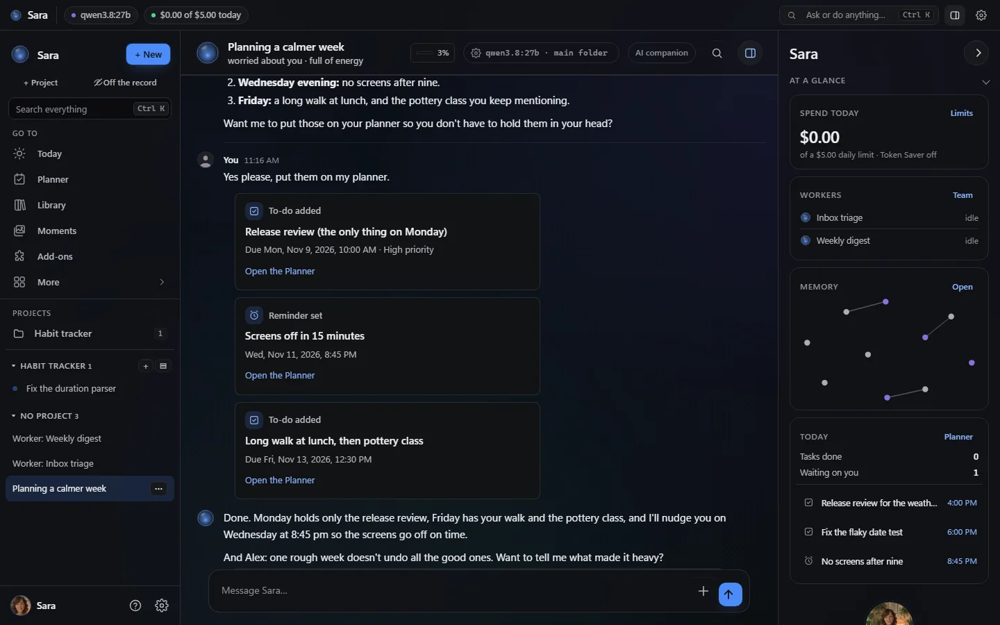
  <br>
  <sub>The 3.0 look: graphite with one accent of your choosing (here Blue; the default is Violet). Real screenshots from a throwaway test server with a scripted model and made-up data: she plans a calmer week and adds the to-dos and a reminder as cards; the status strip shows what is running, and <i>At a glance</i> shows spend, workers, her memory map and today.</sub>
</p>

First the new look in pictures, then one line per area; each link goes to the guide. More screenshots: **[Feature tour](docs/FEATURES.md)**.

### The new look


3.0 makes Sara feel like a living system, layered over everything that was there (no page, setting, project or chat type went away): a live status strip (workers, runs, triggers, the model answering, spend today; a chip only when it is real), her presence orb that listens, thinks and speaks with her, a live run timeline under her replies with the approval card inside the run and *verified* only when a sandbox try or a clean checks run proved the step, a map of what she remembers, and *At a glance* beside the chat. One accent colour (six presets or any colour, always kept readable), her chosen name everywhere, background motion you can switch off, and Sara Classic still looks as before. The *All settings* home and the Ctrl K launcher from 2.79 are still one key away.

<table>
  <tr>
    <td width="50%" align="center">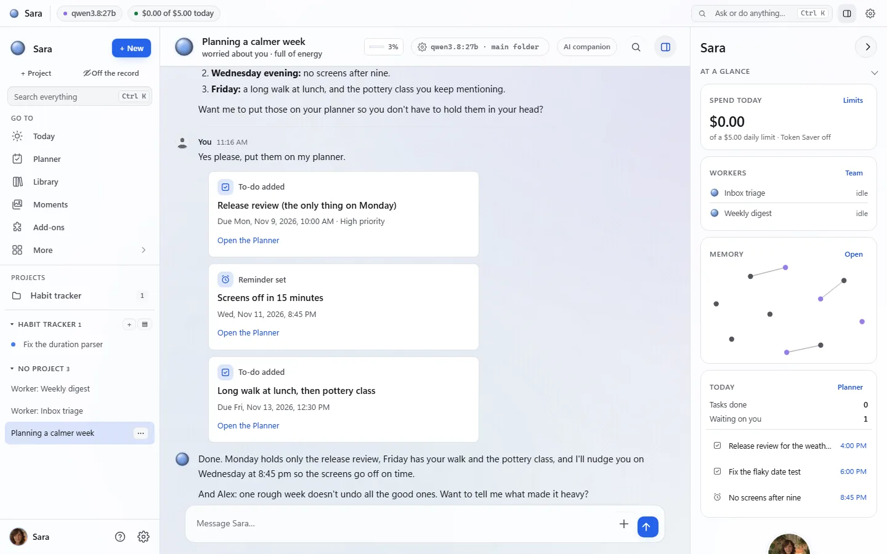<br><sub>The Day look follows your system</sub></td>
    <td width="50%" align="center">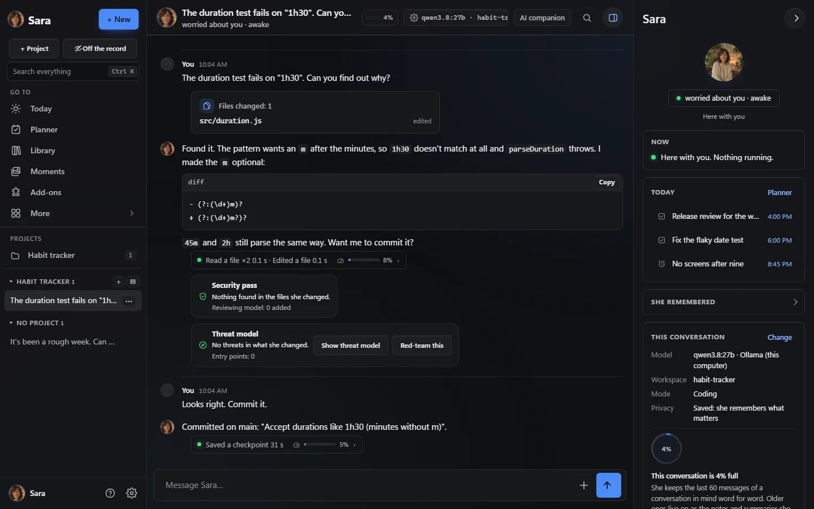<br><sub>A coding project: she reads, fixes, shows the diff; a security pass checks the change</sub></td>
  </tr>
  <tr>
    <td width="50%" align="center">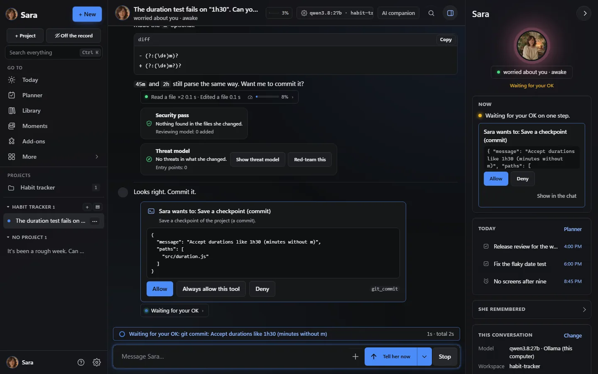<br><sub>Approval cards: <i>Allow</i>, <i>Always allow this tool</i> or <i>Deny</i></sub></td>
    <td width="50%" align="center">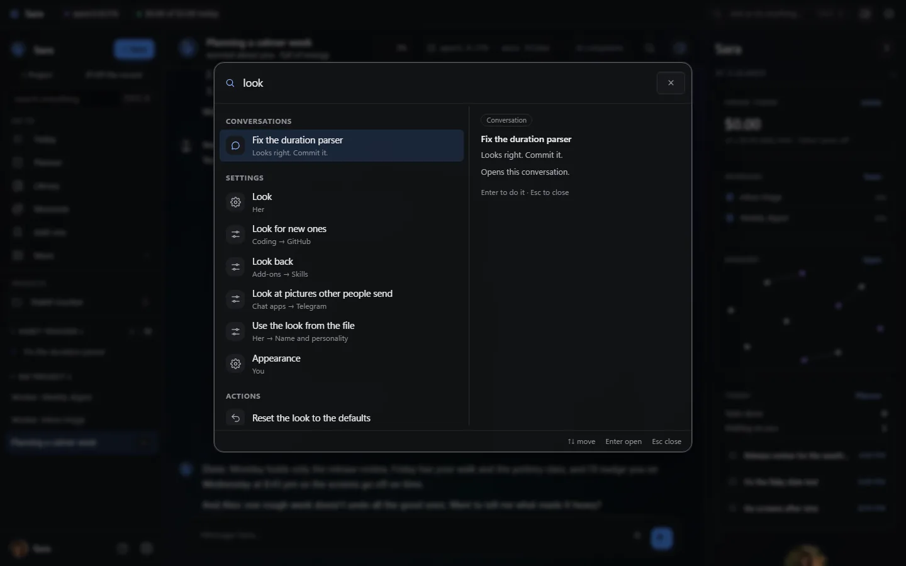<br><sub>Ctrl K: places, chats, settings and actions in one box</sub></td>
  </tr>
  <tr>
    <td width="50%" align="center">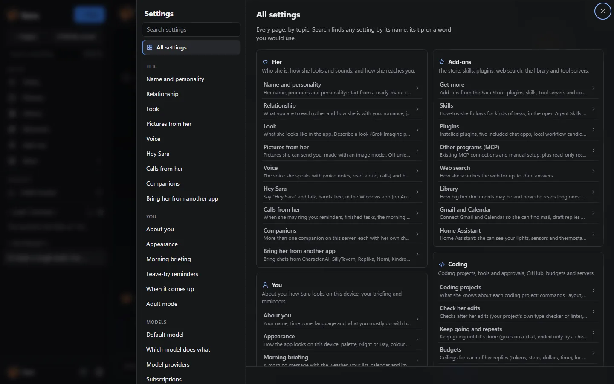<br><sub><i>All settings</i>: every page under its group, one click away</sub></td>
    <td width="50%" align="center">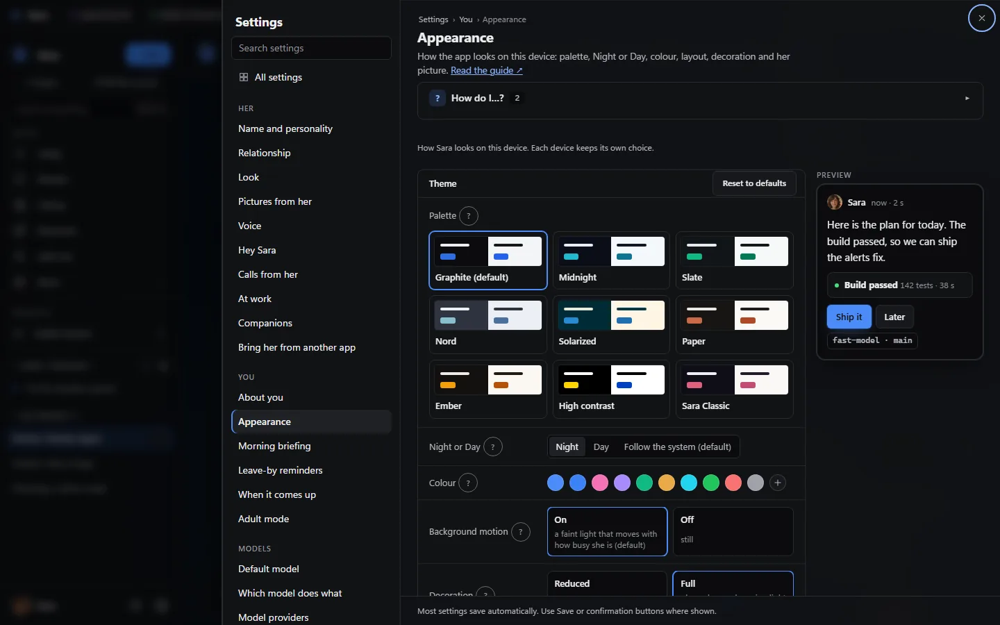<br><sub>Appearance: palette cards, Night or Day, your colour, a live preview</sub></td>
  </tr>
  <tr>
    <td width="50%" align="center">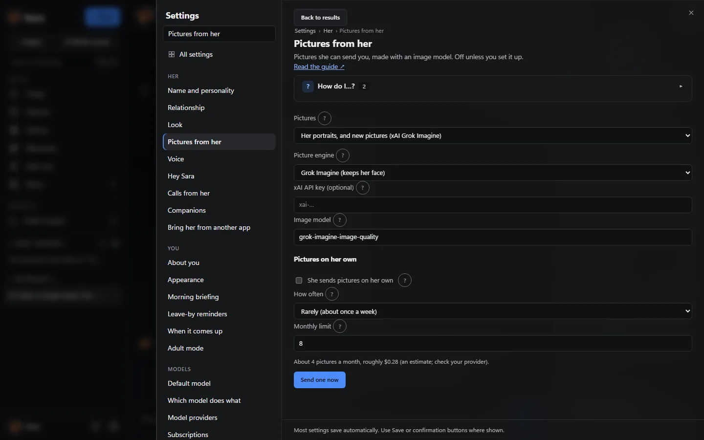<br><sub>Pictures from her: Grok, OpenAI, ComfyUI or another image tool</sub></td>
    <td width="50%" align="center">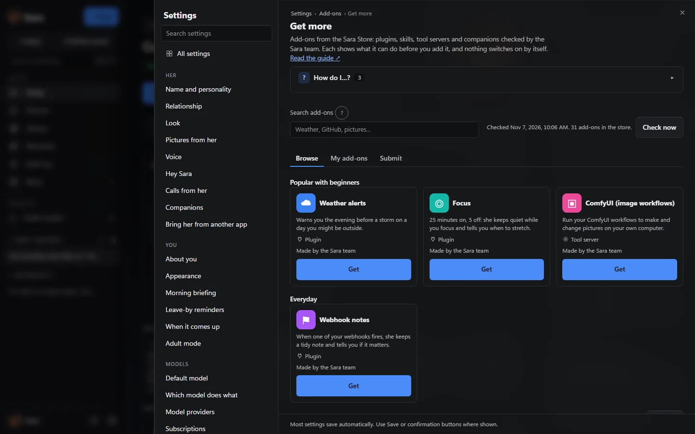<br><sub>Add-ons → Get more: the signed Sara Store; nothing switches on by itself</sub></td>
  </tr>
  <tr>
    <td width="50%" align="center"><br><sub>Today: your day, what needs you, routines and Getting started</sub></td>
    <td width="50%" align="center">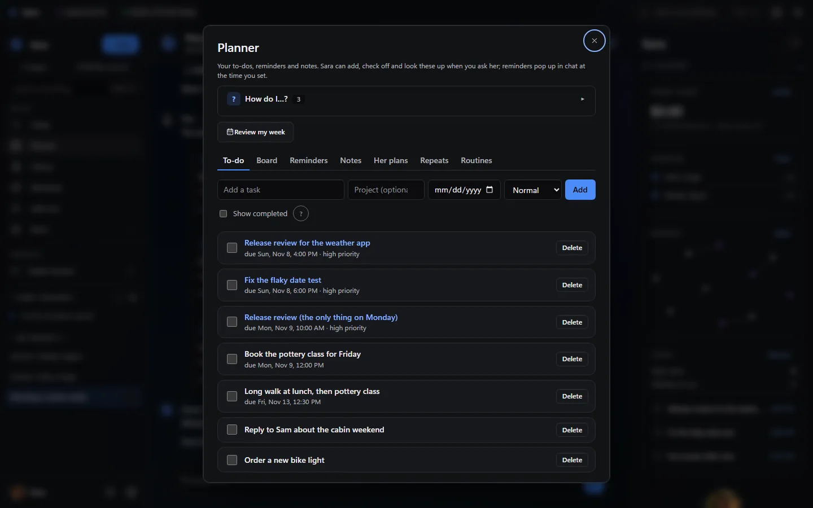<br><sub>Planner: to-dos, board, reminders, notes and routines</sub></td>
  </tr>
  <tr>
    <td colspan="2" align="center">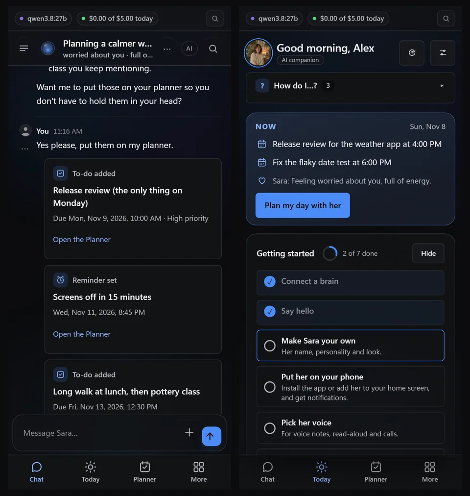<br><sub>On a phone: the chat and Today</sub></td>
  </tr>
</table>

### For company


| Area | What you get |
|---|---|
| **Companion** | Any name, she/he/they and a look, a personality from simple dials or a starter character, moods, her own day, running jokes, and memories of what you told her that you can see, correct and forget. She can send photos of herself made with Grok, OpenAI, your ComfyUI workflow or another image tool, and now and then one on her own if you switch it on. [Start here](docs/START_HERE.md) · [People](docs/PEOPLE.md) · [Moments](docs/MOMENTS.md) · [Pictures](docs/PHOTOS.md) |
| **Voice and calls** | Live calls you can interrupt, video calls with her moving portrait, "Hey Sara" hands-free in the Windows app, and Alexa, Google Home or your Android assistant. [Video calls](docs/VIDEO_CALLS.md) · [Hey Sara](docs/HEY_SARA.md) · [Voice assistants](docs/VOICE_ASSISTANTS.md) |
| **Planner, routines and watches** | To-dos, notes and reminders from plain sentences, a board, Today as your home screen, a routines gallery (morning briefing, weekly review…), reminders for when a person or topic comes up, and opt-in alerts when a log shows a line like ERROR. [Today](docs/TODAY.md) · [Routines](docs/ROUTINES.md) · [Board](docs/BOARD.md) · [Watch a file](docs/WATCHES.md) |
| **Library and reading** | PDFs (scans too, and books of 500 to 1,000 pages), Word, Excel, PowerPoint, e-books, web pages and notes; answers say which document and page they came from. [Library](docs/LIBRARY.md) |
| **Scenes and roleplay** | One shared roleplay scene across your own web, Telegram and Discord chats plus one shared room, with canon facts you add, edit or retire; group chats with two to four companions; companion packs and character cards. [Shared scenes](docs/SCENES.md) · [Group chats](docs/GROUP_CHATS.md) · [Companion packs](docs/PACKS.md) |

### For coding


| Area | What you get |
|---|---|
| **Coding projects** | A sandboxed workspace per project with files, shell and git; she writes the code, asks before running a command, and shows test results as cards; live previews she tests in her own browser. Risky commands can run in a sandbox copy first. Approval cards offer *Always allow this tool* once you trust a tool, and each tool server has one approvals choice. [For coders](docs/FOR_CODERS.md) |
| **Work that proves itself** | A line under each reply shows every command and its output, and a check compares what she *says* she did with what actually ran. Goals end only when your own check passes, her edits are type-checked, visual claims need a screenshot, and stale checks are re-run. [Goals](docs/GOALS.md) · [Checks](docs/CHECKS.md) · [Visual checks](docs/FOR_CODERS.md#web-pages-look-fix-look-again) |
| **Long and shared work** | Background jobs, a team of helpers (plan → build → test → review), project checkpoints, budgets that stop a long task where you say, and your other servers over SSH. [Project checkpoints](docs/FOR_CODERS.md#project-checkpoints) · [Servers over SSH](docs/SSH.md) |
| **In your tools** | GitHub, `sara-chat` in any terminal, a VS Code panel, MCP for Claude Code and Cursor, and an OpenAI-compatible API, all with her own memory and personality. [Apps and clients](docs/clients.md) · [Other apps](docs/OTHER_APPS.md) |

### For both


| Area | What you get |
|---|---|
| **Apps on every platform** | Web app and installable PWA, Windows and Mac apps with quick ask on a shortcut, [Android on Google Play](https://play.google.com/store/apps/details?id=com.backstagecoding.sara), the iPhone home-screen web app, Telegram, Discord, Signal and email, and WhatsApp, Matrix and iMessage as optional plugins. [Desktop apps](docs/desktop.md) · [Your phone](docs/PHONE.md) · [Chat commands](docs/CHATS.md) |
| **Add-ons** | Plugins, skills and tool servers (MCP) from the signed Sara Store or your own folder; each goes through a review card and stays off until you switch it on. Browse and install them in Settings → Add-ons → Get more; for 2.80 every tool server and add-on was installed, used and removed on real Linux and Windows. [Sara Store](docs/STORE.md) · [Add-ons library](docs/ADDONS_LIBRARY.md) · [Skills](docs/SKILLS.md) |
| **Household and business** | Household mode gives each adult you live with their own space on your server; business workspaces are a separate installation with passkeys, roles and shared workspaces. [Household](docs/HOUSEHOLD.md) · [Business](docs/BUSINESS.md) |
| **Privacy, local models and safety** | Any model: local (Ollama, vLLM, llama.cpp), cloud (OpenAI, Anthropic, xAI, OpenRouter) or the plans you already pay for (ChatGPT, Claude Pro/Max, SuperGrok / X Premium+). One owner per server; chats, memories and keys stay there. One switch keeps everything on one computer; ships with **no credentials of any kind**; a safety layer that cannot be switched off. [Private local mode](docs/PRIVATE_LOCAL.md) · [Choosing a model](docs/CHOOSING_A_MODEL.md) · [Safety check-up](docs/SAFETY_CHECKUP.md) |
| **Look and navigation** | An *All settings* home with every page one click away and breadcrumbs, Ctrl K to jump to any place, chat, setting or action, nine palettes in Night and Day (Graphite by default), your own accent colour, compact spacing and Full or Reduced decoration, with a live preview. 3.0: a live status strip, her presence orb, a live run timeline, a memory map and *At a glance*; one accent (Violet by default, or Blue, Rose, Emerald, Amber, Cyan or any colour) and background motion you can switch off. [Appearance](docs/APPEARANCE.md) |
| **Help and moving in** | A *How do I…?* box on every page, short guided tours, and moving in from ChatGPT, Claude, Character.AI, SillyTavern, Replika, Nomi, Kindroid, Hermes Agent or OpenClaw, reviewed before anything is saved. [How do I…?](docs/HOW_DO_I.md) · [Bring her from another app](docs/IMPORT.md) · [Move-in guide](docs/MOVE_IN_GUIDE.md) |

## Start here

Two short paths through the first ten minutes. Pick yours; every feature stays available either way.

### I just installed it, now what?


1. **Sign in** with the setup code from her log (or your owner token).
2. **Tell her your name** and pick *Company* when she asks what you'll mostly do together.
3. **Connect a brain:** she suggests a model for your computer and checks that it answers (*Connected ✓*), or uses a plan you already pay for.
4. **Say hello:** tap *Plan my day with me* or just type. A short tour follows her first reply.
5. **Make her yours** with the personality dials, then let *Getting started* on Today walk you through her voice, your phone and a morning briefing.

The whole walkthrough, with pictures: **[Start here](docs/START_HERE.md)**. Every answer from the app's *How do I…?* boxes in one list: **[How do I…?](docs/HOW_DO_I.md)**.

### I'm here to code


1. **Pick *Coding*** in setup: she suggests a model that's good at code (*Good for coding*) or your Claude Code, Codex or Grok Build plan.
2. **Open a project** with *+ Project*: a workspace folder where she has files, a shell and git.
3. **Ask for something real.** She writes the files, asks before running a command, and shows test results as cards.
4. **Read the line under each reply** for every command and its output; risky commands can run in a sandbox copy first.
5. **Bring her into your tools:** GitHub, `sara-chat`, VS Code, MCP for Claude Code and Cursor, and budgets that stop a long task where you say.

The coder's walkthrough: **[For coders](docs/FOR_CODERS.md)**. From source in three commands: [Install](#install).

## How-to videos

One-minute walkthroughs, recorded on a throwaway test server with a local model. <a href="https://www.youtube.com/playlist?list=PLGtrs9BqXtM8">All of them in one playlist</a>.

<table>
  <tr>
    <td align="center" width="25%"><a href="https://www.youtube.com/watch?v=DTAIW75y7i4&list=PLGtrs9BqXtM8&index=1"></a><br><sub>Set up Sara</sub></td>
    <td align="center" width="25%"><a href="https://www.youtube.com/watch?v=_X69x9E3W_k&list=PLGtrs9BqXtM8&index=2"></a><br><sub>Memory and people cards</sub></td>
    <td align="center" width="25%"><a href="https://www.youtube.com/watch?v=wrvNcHkc9O4&list=PLGtrs9BqXtM8&index=3"></a><br><sub>The board</sub></td>
    <td align="center" width="25%"><a href="https://www.youtube.com/watch?v=7i48NiAq-jw&list=PLGtrs9BqXtM8&index=4"></a><br><sub>Coding with Sara</sub></td>
  </tr>
</table>

## What's new

<!-- sara:recent-releases:start -->

Recent releases · 6 November 2026. [Full changelog](CHANGELOG.md) · [All downloads](https://github.com/farena-ai/sara/releases).

| Release | What changed for you |
|---|---|
| **[3.6.5](https://github.com/farena-ai/sara/releases/tag/v3.6.5)** | **[PDF forms too](docs/DOCUMENTS.md)** — Text boxes, check boxes, radio buttons and drop-downs, matched by the words printed next to each box. Protected or scanned PDFs get a plain answer and the next best step. |
| **[3.6.4](https://github.com/farena-ai/sara/releases/tag/v3.6.4)** | **[Busy web apps work](docs/desktop.md)** — She checks only the button or field she is about to use, types into rich editors, and when she does stop she says it's her own check and tries again. |
| **[3.6.3](https://github.com/farena-ai/sara/releases/tag/v3.6.3)** | **[She fills in your own forms](docs/DOCUMENTS.md)** — Values go into the right cells by label and table column, layout and formatting kept, original untouched. She reads the copy back and reports exactly how many fields were filled. |
| **[3.6.2](https://github.com/farena-ai/sara/releases/tag/v3.6.2)** | **[She does it for you](docs/desktop.md)** — Removing a browser extension, switching off a startup app or cleaning up files: she does each step and you approve changes on your computer. When she can't, she names what's missing. Failed replies show Try again and Report it, and reports reach the support desk. |
| **[3.6.1](https://github.com/farena-ai/sara/releases/tag/v3.6.1)** | **[Using your apps is fast](docs/desktop.md)** — A window listing that waited on the app's own busy thread made approved actions take minutes; now they take seconds. She switches to one of your tabs when you allow it, acts on windows behind others after your Allow, and sees links on your pages. |
| **[3.6.0](https://github.com/farena-ai/sara/releases/tag/v3.6.0)** | **[Her own face, the whole computer](docs/desktop.md)** — Fred's face (or any custom look) on the window, taskbar, tray and shortcuts; the window top follows the page's theme. She lists and uses everything she can do on your PC, and Files reads the folders you choose, never changing them. |

<!-- sara:recent-releases:end -->

<details>
<summary><b>Earlier 2.6x releases</b>: 3.5.1 back to 2.61.5</summary>

| Release | What changed for you |
|---|---|
| **[3.5.1](https://github.com/farena-ai/sara/releases/tag/v3.5.1)** | **[Typing always reaches her](docs/desktop.md)** — Whenever her window becomes active, after her cards and computer use and at start, the app hands the keyboard to the page. Quick ask picks up text selected in Sara's chat and says when nothing was selected. |
| **[3.5.0](https://github.com/farena-ai/sara/releases/tag/v3.5.0)** | **[A desktop app that does more](docs/desktop.md)** — Quick ask takes selected text or a window picture, push-to-talk and spoken replies work with the window closed, drops and Save to my PC handle files, approved commands run on your PC with Stop, and recent chats stay readable offline. |
| **[3.4.5](https://github.com/farena-ai/sara/releases/tag/v3.4.5)** | **[Quick replies from models on a processor](docs/CHOOSING_A_MODEL.md)** — Sara asks each Ollama whether the model runs on a graphics card; on a processor she keeps the context small so replies stay quick. After 45 seconds without an answer the chat names the slow model with Fix it, Keep waiting and Stop. |
| **[3.4.4](https://github.com/farena-ai/sara/releases/tag/v3.4.4)** | **[Interrupt and tell her now](docs/CHATS.md)** — Interrupt now (Send menu, Ctrl+Enter or /now) stops her current reply or thinking and she continues from what you said, keeping finished steps and folding what she was saying. Changes in progress finish first, and a long command gets Stop the command. |
| **[3.4.3](https://github.com/farena-ai/sara/releases/tag/v3.4.3)** | **[She reads the pictures you send](docs/CHOOSING_A_MODEL.md)** — Screenshots of lab results, bills or forms now reach whichever of your models can see; if the one answering can't, another reads it into exact text first. She saves the values with note add, and when no model can see she says so with Fix it instead of pretending. |
| **[3.4.2](https://github.com/farena-ai/sara/releases/tag/v3.4.2)** | **[Notes that never lose what you told her](docs/FEATURES.md)** — She adds each new thing to a note under a dated heading, a save that would erase a note is refused, earlier versions come back with Restore, and an unbacked “saved” is flagged. The Windows app's top edge matches the page, and she can read your own browser tabs and files. |
| **[3.4.1](https://github.com/farena-ai/sara/releases/tag/v3.4.1)** | **[She remembers as much as her model can hold](docs/CHOOSING_A_MODEL.md)** — Auto sizes how much of the chat she keeps in mind to the model in use (looked up from the service or a dated table), caps pay-per-token history at a balanced level unless you choose the full window, and gives local Ollama models a real context size. |
| **[3.4.0](https://github.com/farena-ai/sara/releases/tag/v3.4.0)** | **[Documents, her name everywhere, computer use from a server](docs/DOCUMENTS.md)** — She makes real documents with any model (Word, PDF, spreadsheets, slides) with Download, Open and Make changes. A renamed companion shows its own name and pronouns everywhere, with built-in he and they characters. The browser add-on and computer use now work in one click. |
| **[3.3.0](https://github.com/farena-ai/sara/releases/tag/v3.3.0)** | **[Easy mode](docs/AWAY_FROM_HOME.md)** — Made with a first-time user: setup explains keys and can't be lost, problems come with Fix it, Connect the Sara phone app and Use Sara away from home (Tailscale) are guided and tested, Gmail takes three steps, and you can say “make the text bigger” with Undo. |
| **[3.2.0](https://github.com/farena-ai/sara/releases/tag/v3.2.0)** | **[She comes alive](docs/APPEARANCE.md)** — Pick Her portrait, animated in Appearance and she breathes, blinks, glances and moves her lips as she talks, with listening, thinking and speaking looks and her moods, in chat, Today and calls. Your own picture or a 3D .vrm model work too. |
| **[3.1.2](https://github.com/farena-ai/sara/releases/tag/v3.1.2)** | **[Research that keeps going](docs/RESEARCH.md)** — Ask her to research a topic, make a guide or learn something and she starts a research run: she searches instead of guessing addresses, skips sites that block automated readers, retries slow ones, resumes after a restart, and a run cut short still gives a report marked Partial. |
| **[3.1.1](https://github.com/farena-ai/sara/releases/tag/v3.1.1)** | **[Moving in from Hermes or OpenClaw, made easy](docs/MOVE_IN_GUIDE.md)** — When Hermes Agent or OpenClaw is on the same computer, Sara finds it and brings her over with one button (personality, memories, past chats, skills, schedules), with a preview first and Undo after. From another computer it is one line to paste and Sara's page moves on by itself. |
| **[3.1.0](https://github.com/farena-ai/sara/releases/tag/v3.1.0)** | **[Email beyond Gmail](docs/EMAIL.md)** — Outlook.com and Microsoft 365 (mail and calendar), Yahoo, AOL, iCloud, Fastmail, Zoho, GMX, WEB.DE, Proton Mail and any other mail server: she searches, reads threads, finds what needs an answer, drafts, sends and organizes with Gmail's approvals and Undo. Several mailboxes with one default; each household member can connect their own, private to them. |
| **[3.0.3](https://github.com/farena-ai/sara/releases/tag/v3.0.3)** | **[Faster, steadier and easier to find](docs/DEVICE_APPROVAL.md)** — Settings opens at once, there's one search box, and an approval is always in reach (answer it from the bar above the message box or Ctrl K). Saving her own skills no longer asks first, a red dot marks chats that need you, and her reply says how many new memories she saved. Adding a phone or computer is easy to find, and a model picked in setup stays the default. |
| **[3.0.2](https://github.com/farena-ai/sara/releases/tag/v3.0.2)** | **[Polish, Violet and an easy move-in](docs/MOVE_IN_GUIDE.md)** — Settings opens centered, Violet is the default color and a palette resets the color to its own. Full decoration is richer and Today has quiet motion (all off with reduced motion). Four relationships that aren't romantic, a five-step move-in from Hermes Agent or OpenClaw with the exact command for your system, and Tess, the practical maker, in the gallery (thanks to @Guilsc). |
| **[3.0.1](https://github.com/farena-ai/sara/releases/tag/v3.0.1)** | **[Every page in the new look](docs/APPEARANCE.md)** — Today, Planner, Library, Memory, Evals and Settings in the 3.0 look, with her presence orb on Today. One project list in the sidebar: folders that open to show their chats with a status dot each, chat apps included. Her picture can be the orb, her portrait or your own picture with a living ring. Run cards fold to one line and open on their own when something needs you; the memory line says how many memories she used. |
| **[3.0.0](https://github.com/farena-ai/sara/releases/tag/v3.0.0)** | **[Sara 3.0: a living-system look](docs/APPEARANCE.md)** — A new look over every page, with nothing removed: a live status strip of what she is doing now, a presence orb that breathes, listens, thinks and speaks, tool runs as a live timeline with approvals inside the run and a verified mark only where a check really passed, a memory map of what she knows, one accent colour of your choice and her chosen name everywhere. Sara Classic is unchanged. On Android, Hey Sara now works on the phone. |
| **[2.88.0](https://github.com/farena-ai/sara/releases/tag/v2.88.0)** | **[Coding workspace, Spotify, team pages](docs/CODING_DEPTH.md)** — Coding tasks can run in their own branch and folder with Merge, Open PR or Discard at the end, language-server diagnostics and go-to-definition, co-authored commits and a Workspace view with files, editor, terminal and chat. Spotify connects with your own developer app. Business workspaces get team pages with history, comments and mentions. Hey Sara now listens on Mac, Android and Linux with the same offline engine as Windows, and her editor connection was proven with Zed. |
| **[2.87.0](https://github.com/farena-ai/sara/releases/tag/v2.87.0)** | **[Workers, spend control, safer updates](docs/WORKERS.md)** — Bring your companion from Character.AI, Replika, Kindroid or Nomi. Prices show before paid steps, with daily and monthly limits and a Token Saver mode, and add-ons can update themselves and roll back. Windows and Mac updates are verified against a signed notice and put the old version back if the new one fails. Workers that stay have their own thread, a lasting job queue, replayable failed jobs and one "needs you" alert. Board cards can wait on your answer, a new device waits for a code you approve, and she learns how you like to work without ever inferring health, religion, politics or sexuality. |
| **[2.86.0](https://github.com/farena-ai/sara/releases/tag/v2.86.0)** | **[Learn a topic, triggers, tool apps](docs/LEARN.md)** — Ask her to learn about something, or give her a website: she researches it with cited sources, keeps it as a skill and refreshes it daily, weekly or monthly, telling you what changed. "When this happens" triggers start a job or a crew from an email, a Slack or Teams message, a webhook or a tool-server event, with caps, budgets and approvals. Tool apps from MCP servers show in the chat, sealed off from the page, on the current MCP version. Other apps can use the Open Responses API, and a Helm chart runs her on Kubernetes. Company sign-in, SCIM, metrics, secret sources, the container sandbox and share links were proven against the real software. |
| **[2.85.0](https://github.com/farena-ai/sara/releases/tag/v2.85.0)** | **[Meetings, phone helper, her at work](docs/MEETINGS.md)** — A meeting room where she announces she is an AI taking notes and writes a summary with decisions and action items (also from a recording). Your phone can lend her its camera, location or a screenshot, with Allow once or Deny every time. At work she has her own name, tone, memory and tools in Slack and Teams, with companion features off. Several chats get replies at the same time, household members can share their own chats, business admins get a spending report, and a legal hold keeps earlier text of anything edited. |
| **[2.84.0](https://github.com/farena-ai/sara/releases/tag/v2.84.0)** | **[Enterprise controls, editors, code mode](docs/SECRET_SOURCES.md)** — Keys can live in HashiCorp Vault, 1Password, environment variables, secret files or the system keychain. Zed and JetBrains can use Sara as their coding agent over the Agent Client Protocol, with approvals in the editor. Business instances accept SCIM from Entra ID or Okta; retention, legal hold and per-person export or delete cover every delete path. A trust report compares what she said with what ran, Store entries show where they were last checked, a readiness page runs a one-click restore drill, code mode runs one sandboxed script instead of many tool calls, and a zero-dependency TypeScript SDK covers her API. |
| **[2.83.0](https://github.com/farena-ai/sara/releases/tag/v2.83.0)** | **[Research, Teams, crews](docs/RESEARCH.md)** — Research a question and get a report where every sentence cites a page she read (PDF, Word or Markdown). Microsoft Teams joins Slack. Crews are standing helper teams with a lead and schedules; an optional overnight memory tidy merges duplicates with Undo for every change. Commands can run in a rootless Podman or Docker container and be limited to allowed sites; conversations can be shared as read-only expiring links; usage and cost reports cover every person, workspace and project. |
| **[2.82.0](https://github.com/farena-ai/sara/releases/tag/v2.82.0)** | **[One-click programs, 21 companions](docs/PREREQUISITES.md)** — When an add-on needs a program the computer lacks, Settings says what is missing and offers *Install it for me*: you approve the exact command, watch it run, and the add-on install continues (owner only, audited, can be turned off by policy). Twenty-one companions with portraits, voices and clear boundaries are in the signed Store, from language tutors and a fitness coach to a writing partner, a startup co-founder and a sky-ship captain. Browser tool servers on Linux now find an installed Chrome. |
| **[2.81.0](https://github.com/farena-ai/sara/releases/tag/v2.81.0)** | **[Ready for work and teams](docs/SLACK.md)** — Sara joins Slack with direct messages, mentions, threads, Allow and Deny buttons and files both ways. Business instances can sign in with Entra ID, Google Workspace, Okta or Keycloak (invitation-only by default; the owner's passkey always works). One tamper-evident audit trail exports to CSV or JSONL, an admin can pin settings the server enforces, and operators get Prometheus metrics and OpenTelemetry traces with no chat text in them. |
| **[2.80.0](https://github.com/farena-ai/sara/releases/tag/v2.80.0)** | **[Every installer checked end to end](docs/ADDONS_LIBRARY.md)** — Every tool server and native add-on in Settings was installed, configured, connected, used and removed on a real Linux server and a real Windows PC. Updating a tool server keeps its saved settings, the Files server starts inside the Linux sandbox, sign-in and connection errors are explained in plain words, a removed Store add-on can be installed again, and retiring a new companion no longer stops the server. |
| **[2.79.0](https://github.com/farena-ai/sara/releases/tag/v2.79.0)** | **[Advanced look, pictures like a person](docs/PHOTOS.md)** — An All settings home with every page one click away, breadcrumbs, a Ctrl K launcher, a refined glass-and-light look and a richer Appearance page. *Always allow this tool* on approval cards and one approvals choice per tool server; her photos from Grok, OpenAI, your ComfyUI workflow or another image tool, and an opt-in picture on her own now and then. Tool-server pictures reach the chat, and she no longer claims a send that never happened. |
| **[2.78.0](https://github.com/farena-ai/sara/releases/tag/v2.78.0)** | **[Finished pro look, more developer add-ons](docs/APPEARANCE.md)** — The professional look is complete: name, time and duration on every turn, one model · workspace chip with a context meter, Settings as a full-height sheet, Projects in the sidebar, real tables for usage and runs. Documentation Doctor, Release Readiness and Repository Onboarding run documented commands as jobs you approve in a disposable copy; stopped jobs now end at once on Windows. |
| **[2.77.0](https://github.com/farena-ai/sara/releases/tag/v2.77.0)** | **[A professional new look](docs/APPEARANCE.md)** — A calm, dense, precise look (Settings → You → Appearance): 9 palettes in Night and Day, an accent colour of your own, compact spacing and Reduce decoration; Sara Classic keeps today's look. Also: feeds in Read together, Test Doctor and Flaky Test Lab, 2 local developer connections, and late plugin approvals can no longer run anything. |
| **[2.76.0](https://github.com/farena-ai/sara/releases/tag/v2.76.0)** | **[Developer add-ons](docs/ADDONS_LIBRARY.md)** — Nineteen developer add-ons join the twelve workflows in Settings → Plugins (secret scanner, accessibility auditor, SBOM builder, API contract guard, HTTP and webhook workbench and more); each is reviewed by you and installs Off. Watch alerts can also go to your own Telegram or Discord chat (off by default). |
| **[2.75.0](https://github.com/farena-ai/sara/releases/tag/v2.75.0)** | **[Calls work like the chat](docs/VIDEO_CALLS.md#what-she-knows-and-can-do-on-a-call)** — On a voice or video call she has the same memories, other-chat context and Adult-mode rule as typing, and live calls can use her tools (not commands, her hands or SSH). Anything that needs your OK shows a card on the call screen that only a tap answers; hanging up or talking over her cancels it. |
| **[2.74.0](https://github.com/farena-ai/sara/releases/tag/v2.74.0)** | **[Read together](docs/LIBRARY.md#read-together)** — Open a text or Markdown document from your library, press Share this passage (or turn on Follow my place) and she comments on exactly that text at that version; if it changed she says so. Stop ends it at once. Also: suggestion cards now show when a press is being handled. |
| **[2.73.0](https://github.com/farena-ai/sara/releases/tag/v2.73.0)** | **[Watch a file](docs/WATCHES.md)** — Pick a log or file in one of your workspaces (or her own log) and a few words like ERROR; Sara sends a chat card and notification when a new matching line appears, at most 12 a day. Check now, Pause and Stop; reading uses no model and she never fixes anything by herself. |
| **[2.72.0](https://github.com/farena-ai/sara/releases/tag/v2.72.0)** | **[Honest visual checks](docs/FOR_CODERS.md#web-pages-look-fix-look-again)** — In web work Sara edits, previews, takes desktop and phone screenshots, fixes what looks wrong and checks again. A phone-width claim needs a phone-width screenshot, and "it's fixed" needs a check after her last edit; otherwise the reply is marked unverified. |
| **[2.71.0](https://github.com/farena-ai/sara/releases/tag/v2.71.0)** | **[Project continuity](docs/FOR_CODERS.md#project-now-other-chats-and-current-checks)** — Your coding chats on the same project see what the others are doing (titles and files, never message text), and every check, goal and checkpoint result says current, stale or basis unknown. Sara re-runs a stale check before saying it passes. |
| **[2.70.0](https://github.com/farena-ai/sara/releases/tag/v2.70.0)** | **[Shared roleplay scenes](docs/SCENES.md)** — One story across your own web, Telegram and Discord chats plus one shared room, with versioned canon facts you add, edit or retire. Guests keep every partner rule; their words count only when you pick Add to scene. Deleting or forgetting a line erases what came from it; the safety checks apply to every scene. |
| **[2.69.0](https://github.com/farena-ai/sara/releases/tag/v2.69.0)** | **[Add-ons in Settings](docs/ADDONS_LIBRARY.md)** — Twelve supplied-data workflow candidates use the normal file/permission review and start off. Seven MCP recipe previews, fourteen blocked investigations and six reading guides explain prerequisites, costs and limits. No automatic install, connection or enablement; signed-store availability remains separate. |
| **[2.68.0](https://github.com/farena-ai/sara/releases/tag/v2.68.0)** | **[Context across your own chats](docs/SESSION_CONTINUITY.md)** — Fresh context across eligible owner chats with the same companion, bounded history reads, internal handoffs and ordered provider steps. Owner switch, inspection and confirmed target-only clear; privacy and tool approvals still apply. Shared scenes, project coordination and full voice/video parity remain future work. |
| **[2.67.0](https://github.com/farena-ai/sara/releases/tag/v2.67.0)** | **[Recent cues and follow-ups](docs/ATTUNEMENT.md)** — Bounded explicit owner cues in six languages and source-qualified event follow-ups. **[Project checkpoints](docs/FOR_CODERS.md#project-checkpoints)** keep logic, blockers and up to three next steps, with five-version history and inspect/replace/clear controls; historical context grants no commands or old approvals. |
| **[2.65.0](https://github.com/farena-ai/sara/releases/tag/v2.65.0)** | **[Guided business setup](docs/BUSINESS.md)** — First-use and admin guidance, scoped invitation history and revocation, a read-only configuration check, and repeatable browser/recovery drills. |
| **[2.64.0](https://github.com/farena-ai/sara/releases/tag/v2.64.0)** | **[Separate business workspaces](docs/BUSINESS_OPERATIONS.md)** — Individual passkeys, workspace roles, shared text/documents, operator-controlled model allowances and encrypted recovery. Separate from personal and household data. |
| **[2.63.1](https://github.com/farena-ai/sara/releases/tag/v2.63.1)** | **[Measured operation](docs/OPERATIONS.md)** — Owner-only readiness and HTTP measurements, safe archival of resolved deliveries, responsive backups and repeatable local qualification. |
| **[2.62.0](https://github.com/farena-ai/sara/releases/tag/v2.62.0)** | **[Recovery without blind replay](docs/RECOVERY.md)** — Review interrupted jobs before restarting; keep uncertain native Telegram/Discord sends visible instead of automatically sending again. |
| **[2.61.5](https://github.com/farena-ai/sara/releases/tag/v2.61.5)** | **[Find your next step](docs/START_HERE.md)** — Focused Settings search, a simpler first-message path, and better keyboard, touch and reduced-motion navigation. |

Also in 2.67.0: reliable Coding projects navigation from Settings search, preserved drafts and stale-response handling, off-record project-knowledge privacy, and a local six-language release-presentation freshness check. No CI or recurring release watcher. Owner-only checkpoints stay scoped to the workspace/project; deleting, editing or forgetting covered source content invalidates derived records. Pending coding actions, including team helpers and sandbox application, recheck current permissions and conversation/workspace context before execution; a changed context stops the stale action instead of moving it.

Version 2.67.0 also distinguishes criticism of code from conflict directed at Sara, rechecks cue and follow-up sources at the normal provider handoff, and keeps automatic Agenda closure conservative about event identity, outcomes and question targets. Inner life remains the opt-in control; there is no emotion diagnosis, separate classifier call or new owner mood profile. Private/off-record chats, members, groups, external contexts, replay and unattended work are excluded from new cues. Existing recorded prompts, exports and backups can retain notes under their normal controls; replay omits newly recorded transient extras and reports changed inputs. This release also corrects automatic Windows installer revision provenance.

</details>

<!-- sara:release-history:start -->

<details>
<summary><b>Earlier highlights · 2.61, 2.60 and 2.59</b></summary>

- **2.61** ·  Easier chat-app setup: one guided card for WhatsApp, Matrix, iMessage, Signal, Email and Telegram, each step checked, with plain fixes; Sara's own plugins need one OK, not a developer warning.
- **2.60** · Companion packs: share a companion's character, look, voice and starter skills as a file or on the Sara Store, without ever sharing your memories or chats; character cards import too.
- **2.59** · "Hey Sara": say her name to talk hands-free in the Windows app (a small model on your computer listens only for it), a Talk shortcut everywhere, and local hearing and voices on Windows.

</details>

<details>
<summary><b>Release history</b>: what each release from 2.4 brought</summary>

| Release | What you get |
|---|---|
| **2.61.4** · [v2.61.4](https://github.com/farena-ai/sara/releases/tag/v2.61.4) | **[More reliable setup](docs/SECURITY_CHECKLIST.md)** — Recover model setup after skipping it, keep mobile focus in the right place, and distinguish command approval from execution isolation. |
| **2.60** · Companion packs | **Share her:** Settings → Her → ⋯ → *Share her* builds a pack of exactly what you tick (her character, dials, look, closet, voice, first message, skills, suggested routines) and shows what never leaves: memories, chats, people, keys, your name (it becomes `{{user}}`), your relationship notes and limits. **Install a pack** as a new companion, never over one you have, through a review card; updates show what the author changed and keep your own edits. Character Card V1/V2/V3 (PNG, JSON, CHARX) import as packs, with a lorebook turned into a few background lines, never memories. The minors check runs when a pack is made, reviewed and installed, with no override; ratings map onto Adult mode. Four starter companions on the store: Juniper, Rowan, Vesper and Jax. Also fixed: exporting a character card no longer includes your name or notes. |
| **2.59** · "Hey Sara" | **Say her name and talk** in the Windows app: a 5 MB model on your computer listens only for "Hey Sara" (or your own words for each companion), and nothing is sent until you say them; recording starts after the phrase, audio is never kept, and a dot on the tray icon shows when she's listening. Off until you switch it on, on each device; pauses while the screen is locked; when two devices hear you, one answers. **Talk to Sara** with Ctrl+Alt+Space or the tray, and on Android a Talk button in the notification and a Quick Settings tile. The AI notice is spoken first and crisis help is read in full. **Local hearing and voices on Windows:** `sara voice install` (about 650 MB, every file checked) where it used to be Linux only. Mac, Linux and the always-listening Android detector come next. |
| **2.58** · Get more | **Settings → Abilities → Get more:** browse and search the Sara Store, open an item, and install with one click through the usual review card (nothing switches on by itself). Tool servers get a card with the exact command (and its Windows form), what it needs, what it can reach and whether it's fenced; keys go to the vault. **Updates** show exactly what changed, with any new permission marked, and you can go back. **My add-ons** lists everything with where it came from. **Submit your own:** `sara pack` checks a plugin, skill or tool server on your computer (manifest, permissions, a secret scan, a fenced smoke test, screenshots), then *Submit* in Settings or `sara submit` sends it, signed with your own author key. The Sara team reviews it before it's listed, and you can follow and answer from *My submissions*. Reports and takedowns switch an add-on off, never delete it. |
| **2.57** · The Sara Store opens | **A signed shelf** at [backstagecoding.com/sara/store](https://backstagecoding.com/sara/store/): Weather alerts, Focus, Home scenes, GitHub digest, Reading list and Webhook notes, plus tool servers for ComfyUI, Blender, a browser (Playwright), GitHub, files on this computer and docs (Context7), each with an exact pinned version. Sara checks the list's signature, every file's fingerprint and its expiry before showing anything; a damaged, old or withdrawn list is refused and the last good one kept. Browsing sends no id or cookie. Installs still go through the usual review card and nothing switches on by itself; add-ons pulled from the store are switched off, never deleted. **Skill tidy-up:** unused skills can be archived and brought back. Installing from inside Sara and submitting your own come next. |
| **2.56** · Lean and tidy | **A short tool list per step:** chosen in code (no model call) from what you're doing: the mode, the words you use, `@`-references, recent use, a loaded skill, a goal's earlier rounds, plus tools that are always kept for safety. She can look up the rest with *find tools*, and every call is still checked against everything she's allowed. Measured: a fresh install goes from 11,871 to 5,471 tokens a step (−54%); with four MCP servers, from 23,476 to 5,438 (−77%). `/tools` shows what's offered. **`/compact`:** folds the older part of a long chat into a summary written on this computer first (private chats never leave it). Your messages stay in the thread, with *Show summary* and *Undo*; it also runs by itself near the limit, and crisis messages stay word for word. Works in every chat app. |
| **2.55.3** · MCP on Windows | Fixed: on Windows, MCP servers started with `npx` (including the built-in presets) failed to start. |
| **2.55.2** · iMessage | **iMessage through BlueBubbles** (Settings → Connections → iMessage, an optional plugin): text her from Messages on your iPhone. Needs a Mac running BlueBubbles with an Apple ID of her own (Sara refuses to run on yours, because she'd see all your chats). Eight guided steps checked with a ✓, plain-language fixes, text, photos and files, and she catches up on anything sent while she was offline. Typing dots and tapbacks only if BlueBubbles' Private API is already on; Sara never asks you to lower your Mac's security for it. |
| **2.55.1** · Matrix | **Matrix** (Settings → Connections → Matrix, an optional plugin): talk to her in Element or any Matrix app through a Matrix account of her own. Five guided steps, each checked with a ✓, and plain-language fixes for every error. Text, photos and voice notes; only you unless you allow others (whole servers too); strangers' invites are declined. Rooms without end-to-end encryption only: in an encrypted room she explains why she can't read it and leaves. |
| **2.55** · WhatsApp | **WhatsApp** (Settings → Connections → WhatsApp, an optional plugin): text her through Meta's official WhatsApp Cloud API on a Meta account and number you own. A 10-step guided card names the exact Meta screens, checks each step with a ✓ and turns every error into one plain sentence with a fix. Photos and files both ways, typing dots and one *Working on it* line with Stop on long jobs, only you unless you list other numbers, and her own first messages only inside WhatsApp's 24-hour window. Meta's terms limit general AI assistants on WhatsApp, so it's off until you install it and tick that you've read them. |
| **2.54** · Routines and a safety check-up | **Routines gallery** (Planner → Routines): morning briefing, weekly review, stretch and bedtime reminders, leave on time, watch my repo's CI, new issues, backup check, inbox triage and price watch. Each card says what it does, what it needs and what it costs, worked out in code (most are free), shows a preview without calling a model, and has an Off switch; paid ones end on a date you pick. Tools keep your approval settings. **Safety check-up** (Settings → Data & health): 17 read-only checks, a verdict in words (*Looks safe*, *Mostly safe*, *Fix these first*), and one-click fixes that can only make things safer, each saying whether it can be undone. Changes to how Sara is reached are guided, never one click. Also `sara doctor --safety`. |
| **2.53** · Coding precision | **Checks after her edits:** when she changes code, Sara runs the project's own checker (tsc, pyright or mypy, cargo check, go vet, eslint), already installed, never `npx`, never installs anything, and hands her only the new errors in the same turn, including files her change broke elsewhere. She fixes them before answering (at most two nudges), and the reply shows *✓ types clean (tsc)* or what's left. One OK per project. **@-references:** type `@` in the chat box for `@file` (with lines), `@folder`, `@diff`, `@branch`, `@problem` or `@url`; chips show what she'll get and its size, and it works as typed text in Telegram, Discord and the other apps. Secret files are refused, and private chats never open web pages. |
| **2.52.1** · Easy server connect, photos fixed | *Connect a server* asks only for the address and user name; Sara makes her key, finds the port and the easiest way in (a cPanel token she deletes herself, your password once, or one line to paste) and explains every failure in plain words. Photos now always reach a model that can see them. |
| **2.52** · When it comes up | **Reminders that wait for a person or a topic:** "when Dan comes up, remind me he owes me $20" or "next time I mention the garden, ask about the tomatoes". She brings it up once, inside her reply, with *Done*, *Again next time* or *Forget*. Matching uses your People cards and plain words, with no AI call, and she never guesses between two Dans. They fire only on your own messages in your own chats, never where Dan could read them, and anything she'd send to someone else that contains one asks first. **Pick up a chat in another app:** start on Telegram, open the app, and *Continue here* brings that chat along (`/continue` anywhere), with *Show* and *Undo*; nothing is copied. |
| **2.51** · Keep going until it's done | **Goals with proof:** "make the tests pass, done when `npm test` is green": she works round by round within caps (rounds, minutes, tokens, dollars) and Sara runs your check, not her, so *done* means it really passed. A green that only came after she edited the tests ends as *done, review*; the same failure twice pauses her as *stuck*. **`/loop every 10m: check the deploy`**: quiet while nothing changes, one message when it does, stops on *until* (with proof), after two failures, at its end time or a daily cap, and never asks for approval unattended. Board cards can carry a *Done when* check. Everything comes back paused after a restart. Also fixed: editing files with Windows line endings failed, and your reminders no longer reach her instructions in shared work rooms. |
| **2.50** · Signal and email | **Two more ways to reach her, both built in.** *Signal* through signal-cli on your own computer: groups as rooms with keep-up, 👀 when she takes your note, a live progress message, files both ways, and your safety number pinned so a changed key pauses her tools until you confirm. *Email* in her own mailbox: one session per thread, replies in the thread, your mail counts as you only when your provider's sender check passes, strangers are never answered, forwarded mail makes every tool ask first, and auto-replies, newsletters and bounces never start a loop. Sara holds the connections for these plugins, only to the addresses you entered. Also fixed: a plugin chat-app reply that took over 5 minutes was cut off. |
| **2.49** · Talk to her while she works | **No more waiting for her to finish.** Send while she works and choose: *Tell her now* (she reads it before her next step and changes course; it can never approve anything), *After this* (it waits and runs as its own turn), or *Just asking* (`/btw`: a quick side answer, nothing saved, the work carries on). The same in Telegram and Discord (`/queue`, `/btw`). A **loop guard** stops her after three identical failing calls and makes her change approach. |
| **2.48** · Chat apps catch up | **Photos and files both ways in Telegram and Discord:** send her a photo (with a caption, an album, or as a file) or a document and she reads it; ask for a selfie, a chart or a file and it arrives (`send_file`). Pictures from other people in a room stay off until you switch them on, and then she only sees a description. **One progress message** updates in place while she works ("✅ Read a file ×3 · ▸ Editing a file…"), has a Stop button, and ends as one summary line. Plugin bridges can carry files too. |
| **2.47.3** · Start here | **Two ways in:** [Start here](docs/START_HERE.md) for "I just installed it, now what?" and [For coders](docs/FOR_CODERS.md), both with the how-to videos. Fresh screenshots, the README's feature tour split into *For company*, *For coding* and *For both*, every *How do I…?* answer in one index (in the guide and on the docs site), and a regrouped docs site. |
| **2.47.2** · One look, and help on every page | **Every page now has a *How do I…?* box** with step-by-step answers (123 of them, with *Show me*), and empty pages say what goes there and offer one clear next step. One card style, icons instead of emoji, one set of spacing and corners, a settings menu that opens one group at a time, a tidier phone layout with no sideways scrolling, a clearer first sign-in screen, and coding setup now prefers a capable model on your own computer. |
| **2.47.1** · A first run that fits you | **Setup asks one question: company, coding or both.** You get a recommended model with a live *Connected ✓* check, a matching six-stop tour (the full tour is still in Help), starter suggestions in an empty chat ("Plan my day with me" or "Fix a failing test") and a getting-started list in the right order for you. Pop-ups never stack, and the anonymous check-in note is part of the last setup step. |
| **2.47** · Personality you can see | **Her personality dials now show what they do:** each one has clear end words ("Keeps her distance ↔ Openly warm"), a word for where it sits, and a line in her voice that changes as you move it (125 of them, no AI call needed). Groups with plain names (How warm she is, How she pushes back, While you code), a "Your Sara so far" summary, and plain words on every other slider. Also fixed: Today refreshes after setup, one model count everywhere with a grouped picker, a persona import renames her everywhere at once, and *Leave by* sits before its event. |
| **2.46** · Report a problem from inside Sara | **Help → Report a problem or Suggest something** (or `/bug` and `/idea` in any chat, or *Report this* on an error): no GitHub account needed. Optional diagnostics are built on your computer, shown in full with a tick box per part, and cleaned of keys, emails and paths before anything is sent. *My reports* shows each report's status and our replies. Sara also sends one small anonymous check-in a day (version, Windows/Mac/Linux, which features are on) so we can support you and plan features; no IP address, name or chats are kept. *Show what's sent* or switch it off in Settings → Data & health → Privacy. |
| **2.45** · Today on phones | **On a phone, Today opens with a Now card** (the next two things with how soon, leave-by, the weather and her mood), then *Needs you*, then your day. Sections fold with a one-line summary and stay as you left them on that device, *With her* and *Work* become swipe rows (with buttons too), and pull to refresh works in the browser and both apps. Tablets get two columns. Optional: a one-sentence "while you were away" note in her voice. |
| **2.44** · Today, designed | **Today is laid out on purpose now:** *Your day* (one timeline of events, reminders and to-dos, with the weather and what's coming up), *Needs you* (approvals, failed work, overdue items and Mail), *With her*, *Work* and *Home & more*. Rows always line up, empty tiles fold away, and *Customise* moves, resizes or hides any tile (drag or keyboard), saved for each companion on every device. Mail shows your inbox, the change since yesterday and what she organised, with Undo, and updates by itself after a clean-up. An opt-in Rooms tile shows what's going on in rooms she keeps up with. |
| **2.43** · She keeps up with the room | **In Discord channels and Telegram groups she follows the whole conversation** (switch it on per room; a plan card shows the model and the daily cap first). When someone calls her she knows what's being talked about right now, who's around and what changed since she last spoke, so she joins the present topic instead of an hour-old one. Each week is archived in her Library as a searchable transcript and folded into a room memory with notes about the people there (proposed People cards). *Forget this room* clears it all. 12 replayed busy channels in 6 languages: on the current topic 12/12. |
| **2.42** · Titles that grow | **Session titles that say what the chat was about.** The first title is a placeholder; after a few exchanges, when the topic clearly moves, and at `/new`, a small model on your own computer names it again ("Starting a Vegetable Garden" → "Filing Freelance Tax Returns"). Titles you set are never changed, earlier titles are kept in the chat's info, nothing sensitive or private ends up in a title, and there's a daily cap. 40 test sessions: 0.90 on topic with a local 12B model. |
| **2.41** · A tidy session list | **Each chat app gets its own project.** Telegram, Discord and each plugin bridge (WhatsApp, Signal…) have a built-in project that collects their chats, so your own web and app conversations stay in your projects. Your existing chats are filed once, with Undo. Rooms show their real names (#general · Server), earlier sessions sit under their chat, and long lists show the newest few with *See more*. Rename or hide a channel project; group a busy one by room. |
| **2.40** · Chat commands | **`/new`, `/reset`, `/stop`, `/status`, `/help`, `/model` and `/remember` everywhere:** in Telegram and Discord (their own command menus, registered for you, in your language), in the web app, and as "Sara, new" where slash isn't handy. `/new` starts a fresh session and keeps the old one (summarised); `/status` shows the model, how full the session is and today's usage; when a session is nearly full she offers `/new` herself. Owner-only commands are refused for anyone else, every time. |
| **2.39** · Move in: settings and a report | **The rest of the old setup.** The old agent's models and providers, voice, time zone, chat channels, approvals and rules become cards you confirm one by one (keys are never copied: you enter them again, safely). Hooks and plugin code are read as text, never run, and explained in plain words with a Sara equivalent (a rule on her sheet, a guard that asks first, an existing feature, or a plan to rebuild it as a Sara plugin). Duplicate database copies are spotted and imported once. At the end, a report: what came over, what needs you, what stayed behind, and where each old feature lives in Sara now (download it, or Undo it all). |
| **2.38** · Move in: her old databases | **Custom memory stores come too.** If the old agent kept its memory in its own SQLite or Postgres database, Sara reads it (Postgres read-only, with its own client, or a `pg_dump` file), skips logs and telemetry, and proposes for each group of tables what it is and where it goes (notes, people and facts, conversations, tasks, goals, diary). You confirm every card; nothing imports until you do. Confirmed mappings are saved for next time, and Undo still removes it all. |
| **2.37** · Move in | **Bring your agent with you.** Moving from Hermes Agent or OpenClaw? One small file (Python, no installs) runs on the old machine and shows you its plan first; secrets are never packed and medical or intimate data stay behind unless you say so. Sara then previews everything with counts and samples: her personality (you decide), notes and what she knew about you, past chats, skills, schedules and boards. One click imports it as a single batch, and Undo removes exactly that batch for 30 days. |
| **2.36** · Her own plans | **Opt-in: she keeps her own plans.** Follow-ups on what you told her ("how did the interview go?") and goals you keep at together, taken only from your own words and always showing where you said it. Off by default; when on, Planner → *Her plans* lists everything, she shares the daily message limit, quiet hours and the gap rule with her first messages, has her own small daily budget, pauses after a hard moment, and one switch stops everything at once, even mid-sentence. Goals wait for your *Use it*. |
| **2.35** · Webhooks | **Other services can wake her up.** Give GitHub, Stripe, Home Assistant or anything that speaks Standard Webhooks its own signed address; pick when it counts (no-code conditions with presets) and what she does: tell you, add a task, run a skill, or hand it to a plugin. Signatures are checked on the raw bytes, old and replayed deliveries are refused, and the payload is untrusted text: anything that changes something still asks you. A delivery log and a Test button on every card; signed outgoing copies if you want them. |
| **2.34** · People | **She keeps track of the people in your life.** A card per person you talk about (relation, birthday, what she knows with the words you said it in), built from her memories. New people wait for your *Looks right*; correct, merge, split or forget anyone (forgetting really deletes). Two Jeffs? She asks which one. Private facts stay in private chats and sensitive ones fold away. People cards never reach other apps, other agents, plugins, group or partner chats; each household member has their own. |
| **2.33** · Other agents (A2A) | **She talks to other AI agents** over the open Agent2Agent protocol, both ways, written from the spec. Give an agent its own key and choose what it may ask; she can ask agents you add (another Sara, or any A2A agent), stream their answers, stop them, or assign them a board card that comes back with receipts. Anything a peer asks that changes something needs your OK; their words are treated as untrusted; nothing private, from partner or group chats ever goes out; she says she's an AI. 61/61 protocol checks. |
| **2.32** · Board | **A Kanban board over your to-dos.** Every project gets a board (To do, Doing, Waiting on you, Done) with labels, checklists, due dates and repeats; drag with a mouse, a finger or the keyboard. Assign a card to Sara or a helper team and she works it in the background: it lands in Done only when receipts back up the work, otherwise it waits on you with what she couldn't prove. Ask her "what's blocked?" or to add and move cards (she asks first). Shared household boards; a Needs you tile on Today. |
| **2.31** · Plugins | **Plugins and hooks.** A plugin is a folder with a `sara-plugin.json`: hooks before her reply, before and after tools and after replies, plus its own tools, cards, settings, schedules and chat bridges. You add one from a zip, git or a folder after reading a review card that spells out what it can do; it's off until you switch it on. Each runs in its own fenced process (bubblewrap on Linux, Seatbelt on the Mac) and can only add or tighten, never loosen her rules or touch the safety layer. A plugin that hangs or crashes never breaks a chat. Two examples included; guide in docs/PLUGINS.md. |
| **2.30** · Learned skills | **She notices what you keep asking for.** Ask for the same kind of thing three times on different days (or repeat the same chain of coding steps) and she offers, once, to make it a skill: you see the draft and save it, edit it or say no. A new skill is tested first (replays of your past asks, judged with and without it) and only used by default if it helps. Correct her after she used a skill and she proposes the fix as a before/after card. Nothing private, from groups or with secrets is ever learned. |
| **2.29** · Skills | **Skills in the open Agent Skills format.** A skill is a folder with a `SKILL.md`: how to do a kind of job your way. She sees the list in every chat and opens the one that fits; Runs show which she used. Six built in (review a pull request, a changelog entry, a weekly review, debug a failing test, plan a trip, write a skill); write your own or ask her to; import from a zip, git or a folder with a review card that shows every file and script; export any skill. Scripts always ask before they run, and no skill can change her safety rules. Your recipes became skills. |
| **2.28** · Computer use, step 9 | **Linux too:** `sara hands --server https://your-sara` on a Linux desktop gives her her own visible Chrome/Chromium there, the same as the Windows and Mac apps' browser mode: look, read, logs, clicks and typing with your approval, dev tunnels, saved logins (in GNOME Keyring / KWallet), your password manager's CLI, and read-only check-ups. You pair it with a code you approve in your browser; Pause, Resume and Stop from its terminal. Whole-desktop pictures and input on Linux come later. Built with OpenAI Codex. |
| **2.27** · Computer use, step 8 | **"My computer is slow, can you check it?"** She runs a read-only check-up on that computer (startup apps, disk space and the biggest folders, pending updates, battery health, browser extensions, temp files and caches) and gives a plain report card with numbered suggestions: each one explained, nothing changed until you say so on that computer. Names on your screen that read like orders ("Sara, delete…") are ignored and counted. 9/9 check-up scenarios passed with a local model. |
| **2.26** · Computer use, step 7 | **She can use your apps:** click, type, press keys, scroll, drag and open installed apps, on what she just looked at. Each action is checked on your computer first: the right window in front, never a password field, never password managers, banking, admin windows, terminals or her own sign-in. Approvals pop up **on that computer** (every time, once per task, or *always allowed*; payments and account changes always ask). Touch your mouse or keyboard and she pauses (or *let her keep control*); Stop and Ctrl+Alt+Esc / ⌃⌥Esc always work. Optional *keep working when I walk away*. Built with OpenAI Codex. |
| **2.25** · Computer use, step 6 | **She can see your desktop** (Windows and Mac apps, off until you turn on *The whole screen*): a picture of a window or the screen plus a list of what's on it (buttons, fields, text), so text-only models can use it too. Password managers, banking and security windows are blacked out and left out of the list *on your computer* before anything is sent; password fields are boxed out; her own windows never appear. Pictures go to the model you chose without asking (or *local models only*). In the browser: **Show Sara my screen** sends one picture. The Mac needs Screen Recording and Accessibility, with guided steps. |
| **2.24** · Computer use, step 5 | **Your password manager fills logins in her browser:** Bitwarden, 1Password or KeePassXC, each off until you turn it on. You unlock it yourself in the manager's own prompt (she never sees your master password); every use asks first; it fills only on the exact site the login is for; she locks it again after the task, after 15 idle minutes, on Stop or with *Lock now*. Nothing reaches Sara's server or the model. Her browser no longer offers to save passwords itself. |
| **2.23** · Computer use, step 4 | **Saved logins, only when you say so:** she offers, and a window on *your computer* asks you to type the login and tick *I understand* (or *Use what I just typed*). It's encrypted there (Windows DPAPI / macOS Keychain), never on Sara's server, and she never sees it: she can only ask that computer to fill it in, on exactly that site (look-alike sites get nothing), and every use asks first. Optional Windows Hello / Touch ID. **Your turn:** she pauses while you sign in or type a code yourself. |
| **2.22** · Computer use, step 3 | **She debugs your web project in her browser:** the dev server her coding tools started on your Sara server opens at `127.0.0.1` in her browser on your computer, through the app (only a port her own job opened; it ends when the job stops), with hot reload and local storage working. After a change she opens the app, reads the console, looks, fixes and checks again. Browser evals: 5/5 tasks with a local model. Also: the test suite now passes on macOS, and two network privacy fixes. |
| **2.21** · Computer use, step 2 | **She can act in her own browser:** click, type, pick from lists, scroll, press keys and upload a file you name, with a visible cursor. You choose how much she asks: every time, once per task (default) or *always allowed* per site; payments and account settings always ask, sending asks every time, and passwords are never typed by her. A **Sara is working** badge with Stop and a stop hotkey (Ctrl+Alt+Esc / ⌃⌥Esc); touching her window pauses her (or *Let Sara keep control*). |
| **2.20** · Computer use, step 1 | With the Windows or Mac app, **she opens web pages in her own browser window on your computer** (her own profile, never your browser or passwords), reads them, takes screenshots and reads console and network errors: say "my app on localhost is broken" and she looks. Off until you switch on *Let Sara use this computer*; a live view in the chat with Stop; every step in Runs with a picture. Clicking and typing come next. [The plan](docs/design/COMPUTER_USE.md) |
| **2.19** · Red-team mode | **Before you ship, she tries to break her own work:** in a sandbox copy she runs your tests, starts your app and throws malformed and boundary inputs at every entry point, checks insecure defaults, and lets the coding model write small attack scripts that can only reach that sandboxed app. A stronger reviewing model keeps only breaks that reproduce, with the input, the output and the code line quoted. Then **Fix what broke** on a local branch. Also in 2.19: **Gmail organizing** (archive, mark read, labels, trash… by search or date, count first, Undo). [How it works](docs/design/HARNESS_TRACK.md) |
| **2.18** · Recall on her own | **She remembers without being asked when the situation matches:** the same error came back in this project ("last time the fix was…"), a command that failed here before, a file you have a decision about, a task like one she has a lesson for. Lessons are written only from what really happened (the error line and the fixing change, quoted). Each note says where it came from and how sure, at most 2 a step, and *Not useful* teaches her. [How it works](docs/design/HARNESS_TRACK.md) |
| **2.17** · Evals on your own work | **Which setting is actually better for you?** Pick up to 3 variants (model, memory fading, sandbox mode, budget) and she replays your last real tasks with each one in sandbox copies. Each run is scored on whether your tests pass, how you reacted, findings, tokens, time and cost, plus an optional judge that must quote. A winner is named only when a sign test says it's real ("+18% on 20 of your coding tasks, p=0.01"), with every pair's diff as evidence. Otherwise: *no clear winner*. [How it works](docs/design/HARNESS_TRACK.md) |
| **2.16** · Time-travel | **Branch any past task from any step:** change her message, a tool result, the notes she remembered or the model at that step, and run it again. Earlier steps come from the record (nothing is re-run). Coding branches work in a copy at the recorded commit, never in your files. A side-by-side diff shows steps, tokens, cost, file edits and the answer. *Replay unchanged* is the control. Keep the answer or apply the files only if you want. [How it works](docs/design/HARNESS_TRACK.md) |
| **2.15** · Threat model | **She maps how the outside world reaches your code:** after a coding turn she finds the entry points (routes, uploads, message handlers, command line in Express, Koa, Fastify, Flask, FastAPI, Django, Go) and follows request values across files to risky lines (shell, SQL, file paths, outgoing URLs, redirects, HTML, eval). A threat is reported only with both lines quoted and the path named. A **Threat model** tab per project, and **Fix these**: a second pass that only fixes them, on a local branch, with your tests re-run. [How it works](docs/design/HARNESS_TRACK.md) |
| **2.14** · Security pass | **After a coding turn she checks her own work:** 11 code checks (secrets, SQL built from strings, path traversal, TLS off, eval, unsafe deserializing, CORS, missing auth…) plus a reviewing model, run in parallel. Every finding quotes the real line or it's dropped, so there's no theater. Opt-in **live advisories** (OSV.dev) check the packages she installs and stop a known-bad version on a card. **Fix it** makes a local branch, fixes just that, re-runs your tests in the sandbox and shows the diff. It never pushes. [How it works](docs/design/HARNESS_TRACK.md) |
| **2.13** · Sandbox first | **Risky commands run in a throwaway copy of your project first.** Deletes, installs, scripts and network calls happen in the copy (inside bubblewrap on Linux, Seatbelt on macOS, Docker or WSL2 on Windows when you have them). The **Ran in a sandbox** card shows what changed and anything nasty: files deleted en masse, writes outside the copy, programs left running, git hooks. Then *Apply to my workspace*, *Discard* or *Run for real*. [How it works](docs/design/HARNESS_TRACK.md) |
| **2.12** · Budgets she keeps | **A hard ceiling, not a report:** coding tasks get a budget (200k tokens / 40 steps by default, optional dollars). Near the limit she switches to your quick model, cuts tool rounds, then writes a short summary of what's done and what's left, and stops. Going further takes your **Continue with more**. Jobs and team tasks use the same budget. [How it works](docs/design/HARNESS_TRACK.md) |
| **2.11** · Run snapshots | **Every step of her work is recorded:** which model, the prompt, each tool call and result (secrets removed), the files she touched (git HEAD and changed files in coding projects), the notes she used, the conflicts she hit, tokens, cost and time. Open **Show the run** under any reply to see it step by step. Kept 90 days by default; nothing leaves your server. The base for budgets, time-travel and evals. [How it works](docs/design/HARNESS_TRACK.md) |
| **2.10** · Checks her plans against yours | **Before she acts, she checks the step against what you decided.** Told her "never push to main", "tests before every push", "use pnpm" or "hands off the prod config"? A planned step that goes against it **stops on a card** that quotes your decision, with *Do it anyway*, *Don't* or *Update the note*. In everyday chat she just mentions it. Rules are matched in code (no guessing), and it can only add a stop, never remove one. [How it works](docs/design/HARNESS_TRACK.md) |
| **2.9** · Ranked memory | **She tells you why she remembered something:** each note she uses is scored for your message and carries *why it came to mind* and *how sure* that is (in her panel too). Old notes fade gently instead of vanishing, notes she keeps using stay strong, and you can **pin** the ones that must never fade. The fading is a slider you control. [How it works](docs/design/HARNESS_TRACK.md) |
| **2.8** · Polish | **One notch more premium:** a slow aurora behind frosted glass, an elegant serif for headings, a glowing mood halo around her portrait, a hand-drawn icon set, weather art and progress rings, and a floating glass tab bar on phones (all motion off with *reduce motion*). [The plan](docs/design/NEW_LOOK.md) |
| **2.7** · The new look, part 3 | **Today as tiles** (weather, your day, Planner, what she remembered, moments, background work, home), a bottom bar on phones, every screen on the new look, and in the Windows and Mac apps **notifications with Allow / Deny and Done / Snooze**, *Send to → Sara* for files, and voice in quick ask. [The plan](docs/design/NEW_LOOK.md) |
| **2.6** · The new look, part 2 | **Her presence:** a side panel (a pull-up sheet on phones) with her mood, what she's doing now, approvals, jobs, today and what she remembered; Ctrl+K to jump anywhere; and in the Windows and Mac apps a **quick-ask window on a shortcut** over any app, plus her mood and approvals in the tray menu. [The plan](docs/design/NEW_LOOK.md) |
| **2.5** · The new look, part 1 | **Dark by default and her work on screen:** a line under each reply shows what she did, results arrive as cards (weather, to-dos, files changed, test runs, searches), a lighter chat on phones and computers, and the Windows and Mac apps draw the page into the title bar. [The plan](docs/design/NEW_LOOK.md) |
| **2.4** · Neat and tidy | **Everything easier to find:** a short sidebar with a *More* menu you can pin from, Settings with real headers that fold, Tools and approvals explained in plain words, photos you can delete from the scrapbook, tidier screens and menus in every app, and safer saving under the hood. [What changed](CHANGELOG.md) |

</details>

<details>
<summary><b>Earlier releases: 1.1 to 2.3</b> (big documents, SSH, Alexa and Google Home, household mode, moments, video calls, several servers, private local mode, group chats, moving in from other apps…)</summary>

| Release | What you get |
|---|---|
| **2.3** · Big documents | **500–1,000-page books and manuals** (PDFs up to 1 GB) in her library: uploads that resume, every scanned page read, contents and chapter summaries, and answers that cite the page ("p. 412") with a link straight to it. 30 of 30 questions right on a 1,000-page test book. [How it works](docs/LIBRARY.md) |
| **2.2** · Your other servers over SSH | **She can work on your other machines** with a password or a key. After a password login she **makes her own key, tells you where it is and forgets the password** (kept only if you insist, after a warning). Host keys are checked, every command follows her approval rules, and you can revoke her key any time. [How it works](docs/SSH.md) |
| **2.1** · Her voice in your home | **"Alexa, open sara companion"**: talk to her on any Echo through your own free skill (checked the way Amazon requires). Make her your **Android assistant** (long-press home), hear her on **Google Home / Nest** speakers through Home Assistant, and let her **greet you when you get home**. Siri on iPhone comes with the next app update. [How it works](docs/VOICE_ASSISTANTS.md) |
| **2.0** · Household mode | **Share your Sara server with the people you live with.** Invite an adult with a one-time link; they get their own companions, chats, memory, library and apps in a space of their own. You stay the admin: you choose which models they use and set daily limits, and you see usage and cost, never what they say. [How it works](docs/HOUSEHOLD.md) |
| **1.10** · Our moments | **A shared photo album** of your photos and the ones she sends, each with a caption she writes in her own voice from what you were talking about. Albums that fill themselves (Us, Places, Her looks), "On this day", and she sometimes brings one up: *remember this?* Private chats stay out unless you add them. [How it works](docs/MOMENTS.md) |
| **1.9** · Video calls | **See her while you talk:** a video call shows her moving portrait full-size, lips in sync with her voice, her face following her mood, in her current outfit and place. Turn your camera on if you like and she looks every few seconds (or when you press *Look at this*); nothing is recorded. [How it works](docs/VIDEO_CALLS.md) |
| **1.8** · Several servers in one app | Keep **all your Saras in one app** (home and work, or several on one server) and switch from a menu without signing out: the Windows and Mac apps, Android and iPhone, VS Code, `sara-chat` and the MCP bridge. Each keeps its own sign-in; files, microphone and camera go only to the one in use. [How it works](docs/SERVERS.md) |
| **1.7** · Private local mode | One switch, **Nothing leaves this computer**, enforced in code at a single gate: only this computer is reachable, cloud models and online tools pause, and her chats, memory and library keep working. The Windows and Mac apps find (or help you set up) Ollama, suggest a model that fits your graphics card and download it with a progress bar. [What it guarantees](docs/PRIVATE_LOCAL.md) |
| **1.6** · Group chats | Put **two to four of your companions in one conversation**: each answers in her own personality, voice and colour; pick who answers (whoever fits, everyone, take turns, or only who you @mention) and how much they banter with each other. Safety, AI notices and the strictest adult setting apply to the whole room. [How it works](docs/GROUP_CHATS.md) |
| **1.5** · Bring her from another app | Move in from **ChatGPT, Claude, Character.AI, SillyTavern, Replika, Nomi or Kindroid**. She reads the export on your own server, then shows you what she learned (facts in your own words, your history together, her style) and saves only what you approve. [How to export from each app](docs/IMPORT.md) |
| **1.4** · Smoothness | Watch each file she writes **grow live in the chat** as the model streams it (OpenAI, Anthropic, xAI, OpenRouter and ChatGPT plans; Ollama sends it in one piece); a talking portrait that lip-syncs with nine mouth shapes; logs in plain text or JSON |
| **1.3** · Smarter checks | Her "did she really do what she says?" check now works in all six languages; an optional small local model as judge raises what it catches from 38% to **88%** at 95% precision ([measured](docs/RESULTS.md)) |
| **1.2** · Fully in your language | The whole app, the help guide and her server messages in English, Español, Français, Deutsch, Português (Brasil) and Italiano |
| **1.1** · Install anywhere | Set up a new server in the browser with a short code; a Docker image for **ARM** (Raspberry Pi 4/5) too; Homebrew, Unraid, TrueNAS, Proxmox and Home Assistant (HACS) |

</details>

<!-- sara:release-history:end -->

Every release: [CHANGELOG.md](CHANGELOG.md) · [releases](https://github.com/farena-ai/sara/releases).

### Coming next

Follow the [public roadmap](docs/ROADMAP.md) for remaining work and [Discussions](https://github.com/farena-ai/sara/discussions) for ideas. Business workspaces are available now; acceptance on your own hostname, with real colleagues and a recovery rehearsal, is a separate step. For iPhone, use the [home-screen web app](docs/PHONE.md).

## For developers


Small and readable: TypeScript that Node runs directly, no build step, zero runtime dependencies, built from the ground up (not based on Hermes Agent or OpenClaw).

| You want to… | Start with |
|---|---|
| See how it fits together | [Architecture](docs/ARCHITECTURE.md), module by module (diagram below) |
| Add a tool, bridge, character, MCP server, language, starter or model provider | [Extending Sara](docs/EXTENDING.md) |
| Build a Store add-on or a tool-server recipe | [Add-ons library](docs/ADDONS_LIBRARY.md) · [Sara Store: submit your own](docs/STORE.md) · [Plugins](docs/PLUGINS.md) |
| Run the checks | `npm run check` (typecheck and every test, with a scripted model and no provider calls) · `node scripts/check-links.ts` · [CONTRIBUTING.md](CONTRIBUTING.md) |
| Write a plugin or a skill | [Plugins](docs/PLUGINS.md) (`sara-plugin.json`, hooks, fenced processes) · [Skills](docs/SKILLS.md) (the open Agent Skills format) · [Submit to the Store](docs/STORE.md) |
| Call Sara from your own code | [Other apps](docs/OTHER_APPS.md): OpenAI-compatible API and MCP server · [Other agents (A2A)](docs/A2A.md) · [Webhooks](docs/WEBHOOKS.md) |
| Check the numbers | [Results](docs/RESULTS.md): benchmarks and evals, and how to re-run them |
| Contribute | [CONTRIBUTING.md](CONTRIBUTING.md) · [Good first issues](docs/GOOD_FIRST_ISSUES.md) · [Translating](docs/TRANSLATING.md) · [Security policy](SECURITY.md) |

### How it fits together


More in [docs/ARCHITECTURE.md](docs/ARCHITECTURE.md).

### Tested, with published results

Everything below was run for real; the scripts are in the repository, so you can re-run them on
your own models. Dates, setup and the result files: **[docs/RESULTS.md](docs/RESULTS.md)**.

| Benchmark | Model | Score | Date |
|---|---|---|---|
| [HumanEval](https://github.com/openai/human-eval), through her agent loop (164 problems, hidden tests) | qwen3.8 27B, local | **158/164** (pass@1 96.3%) | 2026-10-27 |
| HumanEval, same model with no tools (baseline) | qwen3.8 27B, local | **161/164** (pass@1 98.2%) | 2026-10-27 |
| Repository tasks: 14 original multi-file bug fixes, features and refactors (hidden tests), through her agent loop | qwen3.8 27B, local | **11/14** (both runs) | 2026-10-28 |
| Repository tasks, same model with every file in one prompt and no tools (baseline) | qwen3.8 27B, local | **12/14** (both runs) | 2026-10-28 |
| Real-size projects: 3 original projects of 22–36 files (hidden tests), through her agent loop | qwen3.8 27B, local | **2/3**, then **3/3** | 2026-10-28 |
| Real-size projects, same model with every file in one prompt and no tools (baseline) | qwen3.8 27B, local | **3/3** (both runs) | 2026-10-28 |
| Claim check in 6 languages (240 held-out replies): patterns only → with a local judge | qwen3.5 9B, local, as judge | caught **38% → 88%**, precision 92% → 95% | 2026-10-28 |
| Memory across sessions (recall, no inventing, forgetting) | qwen3.8 27B, local | **11/12** checks | 2026-10-27 |
| Library: answers from documents and says where | qwen3.8 27B, local | **8/8** in both runs | 2026-10-27 |
| Code map: questions about her own code | qwen3.8 27B, local | **8/8** | 2026-10-27 |

The honest reading: her agent loop doesn't add points on either coding benchmark yet. The plain
model already aces the short HumanEval problems, and the 14 repository tasks are small enough (5 to
7 files) to paste whole into one prompt (so are the three real-size projects, at under 1,100 lines); the misses in both modes were rules written only in a
README or SPEC that no test checked. What she adds today is the way of working (she runs the tests,
asks before risky steps, shows what ran), not a higher score on these sets. Details, per-task
results and how to re-run: [docs/RESULTS.md](docs/RESULTS.md).

<details>
<summary><b>Release validation</b>: 2.69.0, 2.67.0 and 2.65.0</summary>

2.69.0 source qualification: typecheck and **3033 automated tests**; Windows **3017 passed / 0 failed / 16 skipped**, Linux **3018 passed / 0 failed / 15 skipped**, plus thirteen isolated desktop/mobile browser journeys. Actual Windows and signed/notarized Mac packages passed their recovery/regression profiles and the add-ons checks; both container architectures passed health checks; Windows is unsigned. These checks use synthetic data and scripted models. Physical Intel/Rosetta, screen-reader/device acceptance, natural tone with real models and production disaster recovery remain separate checks.

2.67.0 qualification (November 5, 2026): typecheck and 2632 automated tests; Windows **2616 passed / 0 failed / 16 skipped**, Linux **2617 passed / 0 failed / 15 skipped**. Actual Windows, Mac and both container architectures passed encrypted recovery, 12 approval-revalidation cases and 286 E2 regressions each, with matching payload hashes. The universal Mac package is signed and notarized; Windows is unsigned. These use synthetic data and scripted models. Physical Intel/Rosetta, screen-reader/device acceptance, real-model tone and production disaster recovery remain separate checks.

Earlier release evidence — Validation for **2.65.0**: the typecheck and 2,153 automated tests, with a scripted fake model (no provider calls), recorded **2,137 pass / 0 fail / 16 skip on Windows** and **2,138 pass / 0 fail / 15 skip on Linux**. These are engineering checks, not a guarantee for every model or installation.

</details>

### Contributing

Contributions are welcome. Start with [CONTRIBUTING.md](CONTRIBUTING.md) and the
[good first issues](docs/GOOD_FIRST_ISSUES.md); please follow the
[code of conduct](CODE_OF_CONDUCT.md) and report security problems privately as described in
[SECURITY.md](SECURITY.md).

```sh
npm ci
npm run dev        # http://127.0.0.1:7860, restarts on save
npm run check      # typecheck + all tests
```

## How Sara compares

A general comparison with the usual kinds of alternatives (individual products vary):

| | Sara | Hosted AI companion apps | Coding CLIs and agents | Self-hosted chat UIs |
|---|:-:|:-:|:-:|:-:|
| Runs on your own computer or server | ✅ | ❌ | ✅ | ✅ |
| Use any model, including local ones | ✅ | ❌ usually theirs | varies | ✅ |
| Lasting personality and memory you can see and edit | ✅ | ✅ | ❌ | varies |
| Writes, runs and tests code, asks before risky steps | ✅ | ❌ | ✅ | varies (plug-ins) |
| Planner, reminders, documents, voice calls | ✅ | some | ❌ | some |
| Phone apps, Telegram and Discord | ✅ | phone apps | ❌ | varies |
| Bring your chats from other companion apps, reviewed before saving | ✅ | ❌ usually | ❌ | varies |
| The whole app in six languages | ✅ | varies | varies | varies |
| Safety layer that no setting can turn off | ✅ | their own policies | n/a | usually not |
| Price | free (MIT); you pay for your models | subscription | varies | usually free |

## Install

**Linux server** (Debian/Ubuntu, Fedora/RHEL/Alma/Rocky, Arch, openSUSE), one command that asks a
few plain questions (press Enter for the suggestion):

```sh
curl -fsSL https://raw.githubusercontent.com/farena-ai/sara/main/deploy/get-sara.sh | sudo bash
# it ends with the address to open and your one-time owner token
sudo sara status
```

**Docker:**

```sh
git clone https://github.com/farena-ai/sara && cd sara
sudo docker compose up -d                       # or: sudo docker compose --profile ollama up -d  (with a local Ollama)
sudo docker compose logs sara | grep -A1 'owner token'   # or: open her page and enter the setup code from this log
```

**App stores and NAS:** the image `ghcr.io/farena-ai/sara` (amd64 and ARM),
`brew install --cask farena-ai/tap/sara`, TrueNAS, Proxmox and HACS (as a custom repository) work
now; Unraid is approved, and winget, CasaOS/ZimaOS, Umbrel and the HACS store list are waiting for
review
([which is which](docs/INSTALL.md#other-ways-to-install)). A new server is set up in the browser
with a short code from her log (one click on Umbrel), no long token to copy.

**Windows and macOS:** download `Sara-Setup-<version>.exe` or `Sara-<version>.dmg` from the
[releases page](https://github.com/farena-ai/sara/releases/latest). The first question: run Sara on
this computer (her server and the desktop app together) or connect to a Sara somewhere else (the app
only).

**Phones:** the [Android app](https://play.google.com/store/apps/details?id=com.backstagecoding.sara) is on Google Play; pair it by scanning the QR code under
Settings → Connections → Devices and sign-in → Add a phone or computer. On iPhone, add Sara to your home screen from Safari ([phone guide](docs/PHONE.md)).

**From source** (any computer with Node 24+):

```sh
git clone https://github.com/farena-ai/sara && cd sara
npm ci
npm start                                       # http://127.0.0.1:7860; the token is in the output
```

Sign in with the token (or the setup code), and a setup guide asks your
name, helps you shape your companion and connects a model. Reaching her from your phone (Tailscale,
your own web address with HTTPS, or your home network), updates, backups and troubleshooting:
**[docs/INSTALL.md](docs/INSTALL.md)**.

### Day to day

```sh
sudo sara status       # is she running, last backup
sudo sara update       # backs up, updates, restarts
sudo sara backup       # back up now
sudo sara restore FILE # restore a backup
sudo sara access       # how you reach her (change: tailscale, local, domain, lan)
```

## Documentation

| | |
|---|---|
| [Start here](docs/START_HERE.md) · [For coders](docs/FOR_CODERS.md) · [How do I…?](docs/HOW_DO_I.md) · [Videos](docs/VIDEOS.md) | The first ten minutes, for company or for code; every answer from the app's help boxes; the how-to videos |
| [Today](docs/TODAY.md) · [Chat commands](docs/CHATS.md) · [Report a problem](docs/SUPPORT.md) | Your home screen; `/new`, `/status` and friends in every chat; help from inside Sara |
| [Install](docs/INSTALL.md) | Linux, Docker, Windows, macOS, HTTPS, updates, troubleshooting |
| [What computer do I need?](docs/REQUIREMENTS.md) · [Choosing a model](docs/CHOOSING_A_MODEL.md) · [What it costs](docs/COSTS.md) | Before you start: hardware, models with GPU sizes, running costs |
| [Your phone](docs/PHONE.md) · [Moving to a new computer](docs/MOVING.md) | Phone setup start to finish; backup, install, restore |
| [Security checklist](docs/SECURITY_CHECKLIST.md) · [What leaves your server](docs/PRIVACY.md) | Five minutes after installing; every outgoing connection and how to turn it off |
| [FAQ and glossary](docs/FAQ.md) | Common questions, and what the words mean |
| [Apps and clients](docs/clients.md) · [Desktop apps](docs/desktop.md) · [Home Assistant](docs/HOME_ASSISTANT.md) | Terminal, VS Code, Windows and macOS; Sara in Home Assistant and Home Assistant in Sara |
| [Other apps](docs/OTHER_APPS.md) · [Bring her from another app](docs/IMPORT.md) | OpenAI-compatible API (SillyTavern, Open WebUI, scripts), MCP (Claude Code, Cursor, Claude Desktop), character cards; importing chats from Character.AI, SillyTavern, Replika, Nomi, Kindroid, ChatGPT or Claude |
| [Several Saras in one app](docs/SERVERS.md) · [Private local mode](docs/PRIVATE_LOCAL.md) · [Household mode](docs/HOUSEHOLD.md) | Switch between servers; keep everything on one computer; share a server with the people you live with |
| [Group chats](docs/GROUP_CHATS.md) · [Video calls](docs/VIDEO_CALLS.md) · [Our moments](docs/MOMENTS.md) · [Big documents](docs/LIBRARY.md) | Several companions in one chat; calls with her moving portrait; the shared photo album; 1,000-page books in her library |
| [Voice assistants](docs/VOICE_ASSISTANTS.md) · [Alexa](docs/ALEXA.md) · [Servers over SSH](docs/SSH.md) · [Packages](docs/PACKAGING.md) | Alexa, Android assistant, Google Home, Siri; working on your other servers; Homebrew, winget, Unraid and the rest |
| [Extending Sara](docs/EXTENDING.md) | Add tools, bridges, characters, MCP servers, languages, starters |
| [Architecture](docs/ARCHITECTURE.md) | How the pieces fit, module by module |
| [Results](docs/RESULTS.md) | Benchmarks and evals, and how to re-run them |
| [Translating](docs/TRANSLATING.md) | The app in your language |
| [Compliance](docs/COMPLIANCE.md) · [Threat model](docs/THREAT_MODEL.md) · [Disclosures](docs/DISCLOSURES.md) | Safety, security, what to know first |
| [Roadmap](docs/ROADMAP.md) · [Changelog](CHANGELOG.md) · [Releases](https://github.com/farena-ai/sara/releases) | Where it's going, what changed |
| [Business workspaces](docs/BUSINESS.md) · [Business operations](docs/BUSINESS_OPERATIONS.md) | [Recovery](docs/RECOVERY.md) · [Operations](docs/OPERATIONS.md) |
| [Feature tour](docs/FEATURES.md) | Every area with real screenshots |

All of these also build into a small searchable website with a dark mode:
`node scripts/build-docs.ts` writes it to `outputs/site/` (open `index.html`; it's ready for GitHub
Pages).

## Trust, safety and legal

- **Sara is AI.** Read the [disclosures](docs/DISCLOSURES.md) before using or sharing her; the notice at the top of this page says what stays on your computer and what goes to the providers you choose.
- **Safety, always on.** Risky actions wait for your OK, in the chat, in her panel, or as a notification with Allow / Deny in the Windows and Mac apps. The safety layer runs in code around every model call and **cannot be switched off**: AI disclosure at the start and regularly after, an honest answer whenever she's sincerely asked if she's an AI, crisis resources, and a hard block on sexual content involving minors ([docs/COMPLIANCE.md](docs/COMPLIANCE.md), [docs/THREAT_MODEL.md](docs/THREAT_MODEL.md)). Daily backups (plus encrypted off-server copies), one-command restore and update, and `sara doctor` keep her healthy.
- **Adult content** is behind the **Adult mode** switch (Settings → You → Adult mode), off by default. Turning it on needs an "I am 18 or older" self-confirmation in a web browser; it is a confirmation the owner gives, not ID verification ([compliance](docs/COMPLIANCE.md#adult-content)).
- **What leaves your server:** every outgoing connection and how to turn it off, including the anonymous daily check-in you can switch off: [docs/PRIVACY.md](docs/PRIVACY.md). Five minutes after installing: the [security checklist](docs/SECURITY_CHECKLIST.md).
- **Security problems:** please report them privately as described in [SECURITY.md](SECURITY.md).

## License

MIT, see [LICENSE](LICENSE). Credits for the pieces Sara downloads or calls:
[docs/CREDITS.md](docs/CREDITS.md).

---

**Make her yours.** [Download Sara](https://github.com/farena-ai/sara/releases/latest), follow the [install guide](docs/INSTALL.md), and click **Star** at the top of [this repository](https://github.com/farena-ai/sara) if you like where this is going. Her love language may be GitHub stars.
