<p align="center"><a href="README.md">English</a> · <a href="README.es.md">Español</a> · <a href="README.fr.md">Français</a> · <a href="README.de.md">Deutsch</a> · <b>Português (Brasil)</b> · <a href="README.it.md">Italiano</a></p>

<p align="center">
  
</p>

<p align="center"><b>A Sara é uma companheira de IA auto-hospedada, com uma personalidade que você molda e uma memória que você controla, e um ambiente de programação de verdade que pede permissão antes de passos arriscados e mostra o que realmente rodou.</b></p>

<p align="center">
  <a href="https://github.com/farena-ai/sara/releases/latest"></a>
  <a href="docs/INSTALL.md"></a>
  <a href="https://github.com/farena-ai/sara"></a>
</p>

<p align="center">
  <a href="docs/INSTALL.md">Windows · macOS · Linux · Docker</a> ·
  <a href="LICENSE">MIT</a> ·
  <a href="https://github.com/farena-ai/sara/releases/latest"></a>
  <br>
  <sub>Grátis e de código aberto · No seu servidor · Use seus próprios modelos. A Sara é grátis; seu hardware, hospedagem e provedores opcionais de modelos podem ter custos. <a href="docs/COSTS.md">Quanto custa</a>.</sub>
</p>

**Rode agora:** Docker `git clone https://github.com/farena-ai/sara && cd sara && sudo docker compose up -d` (imagem `ghcr.io/farena-ai/sara`, amd64 e ARM) · um servidor Linux com um só comando, Windows, macOS e celulares: [guia de instalação](docs/INSTALL.md) · instaladores: [versão mais recente](https://github.com/farena-ai/sara/releases/latest).

**Atualizar:** num servidor Linux, `sudo sara update` (faz backup antes e volta atrás se ela não responder) · Docker: `sudo git pull && sudo docker compose up -d --build` · apps de Windows e Mac: Configurações → Dados e saúde → Atualizações · Android: Google Play. [Como atualizar](docs/INSTALL.md#upgrading).

> **Status:** 3.4.5, [Respostas rápidas com modelos no processador](https://github.com/farena-ai/sara/releases/tag/v3.4.5). Um modelo sem placa de vídeo recebe um contexto pequeno e rápido, e um modelo lento é apontado com Corrigir. [Veja as novidades](#novidades)
>
> Instalador Windows: sem assinatura ([guia do SmartScreen](docs/INSTALL.md)). O processo de publicação do macOS exige downloads assinados e notarizados; cada compilação é verificada separadamente. Android: [Google Play](https://play.google.com/store/apps/details?id=com.backstagecoding.sara). iPhone: [app web na tela inicial](docs/PHONE.md).

<p align="center">
  <a href="docs/START_HERE.md"></a>
  <a href="docs/FOR_CODERS.md"></a>
</p>

Sara é uma IA. Leia os [avisos](docs/DISCLOSURES.md) antes de usar ou compartilhar. O modo local mantém as chamadas ao modelo no seu computador; recursos na nuvem enviam dados aos provedores que você escolher ([privacidade](docs/PRIVACY.md)).

**Veio com uma equipe?** Use a [instalação empresarial separada](docs/BUSINESS_OPERATIONS.md): chaves de acesso individuais, papéis explícitos e espaços compartilhados. É uma instalação manual com sua própria pasta de dados; os instaladores pessoais não convertem sua companheira nem sua casa.

> Esta é uma tradução do [README em inglês](README.md). Os links levam à documentação, que está em
> inglês.

## O que a Sara faz

<p align="center">
  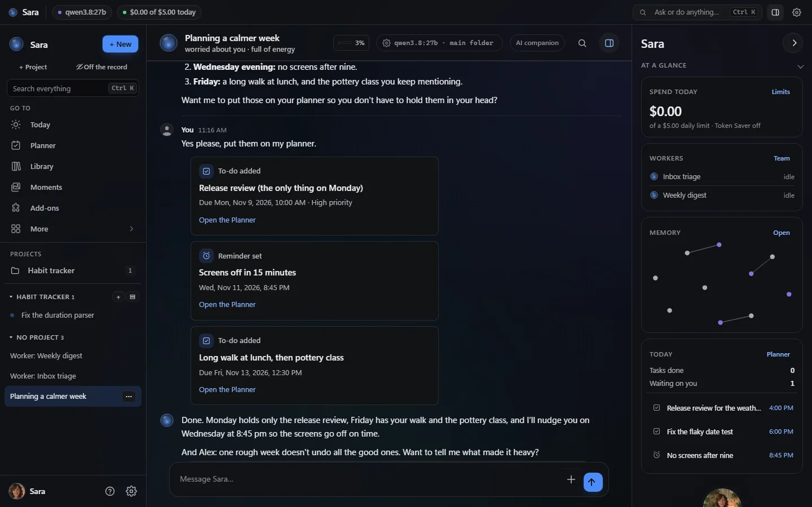
  <br>
  <sub>O visual da 3.0: grafite com uma cor de destaque à sua escolha (aqui o Azul padrão). Capturas reais de um servidor de teste descartável com um modelo roteirizado e dados inventados: ela planeja uma semana mais calma e adiciona as tarefas e um lembrete como cartões; a barra de status mostra o que está rodando, e <i>Num relance</i> mostra o gasto, os trabalhadores, o mapa da memória dela e o dia.</sub>
</p>

Primeiro o novo visual em imagens, depois uma linha por área; cada link leva ao guia. Mais capturas: **[Tour pelos recursos](docs/FEATURES.md)**.

### O novo visual


A 3.0 faz a Sara parecer um sistema vivo, por cima de tudo o que já existia (nenhuma página, configuração, projeto ou tipo de conversa sumiu): uma barra de status ao vivo (trabalhadores, execuções, gatilhos, o modelo respondendo, o gasto de hoje; um chip só quando é real), o orbe de presença dela que escuta, pensa e fala junto com ela, uma linha do tempo ao vivo sob as respostas dela com o cartão de aprovação dentro da execução e *verificado* só quando um teste em sandbox ou verificações limpas comprovaram o passo, um mapa do que ela lembra e *Num relance* ao lado da conversa. Uma cor de destaque (seis prontas ou qualquer cor, sempre legível), o nome que você escolheu em todo lugar, movimento do fundo que você pode desligar, e o Sara Clássico continua como antes. O início *Todas as configurações* e o atalho Ctrl K da 2.79 continuam a uma tecla.

<table>
  <tr>
    <td width="50%" align="center">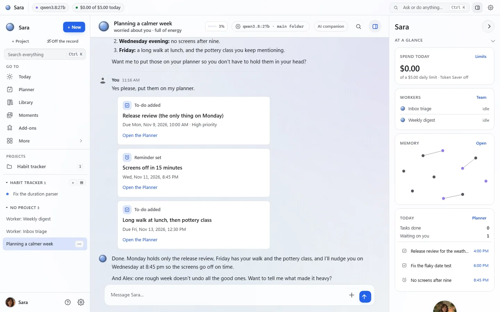<br><sub>O visual Dia segue o seu sistema</sub></td>
    <td width="50%" align="center">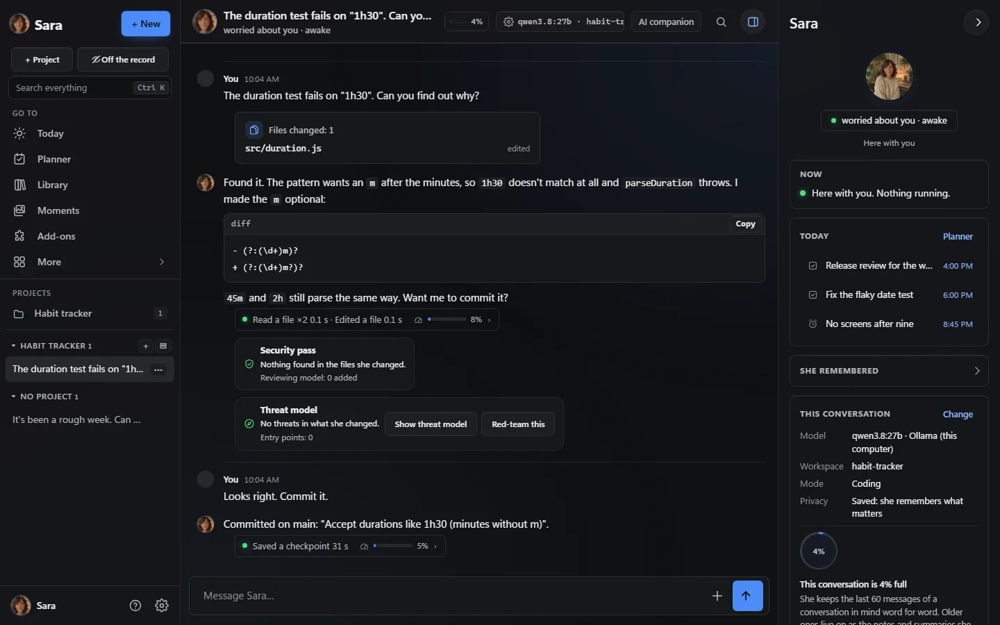<br><sub>Um projeto de código: ela lê, corrige e mostra o diff; uma revisão de segurança confere a mudança</sub></td>
  </tr>
  <tr>
    <td width="50%" align="center">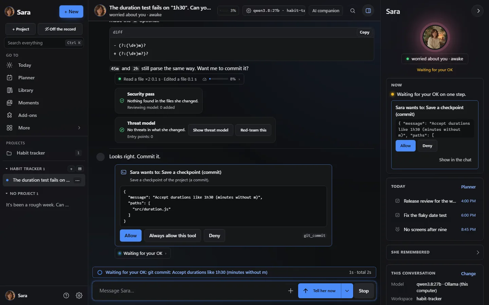<br><sub>Cartões de aprovação: <i>Permitir</i>, <i>Sempre permitir esta ferramenta</i> ou <i>Negar</i></sub></td>
    <td width="50%" align="center">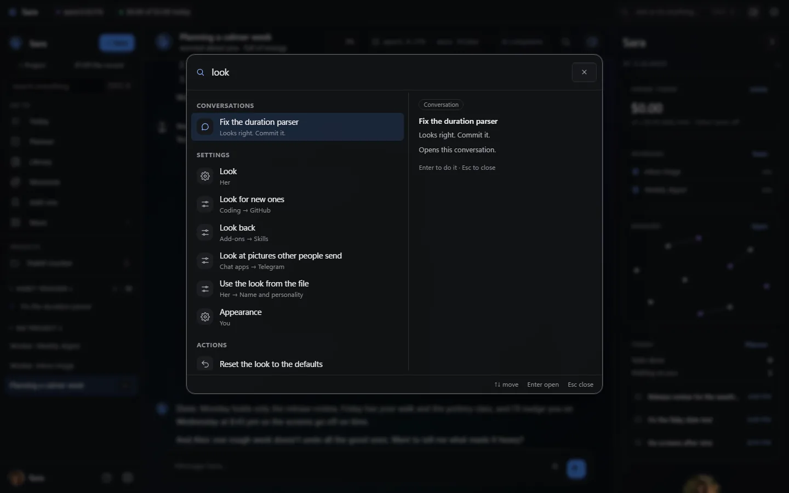<br><sub>Ctrl K: lugares, conversas, configurações e ações numa só caixa</sub></td>
  </tr>
  <tr>
    <td width="50%" align="center">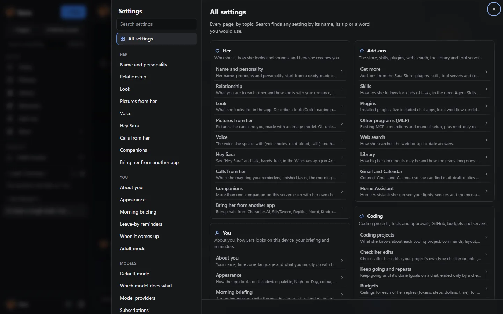<br><sub><i>Todas as configurações</i>: cada página no seu grupo, a um clique</sub></td>
    <td width="50%" align="center">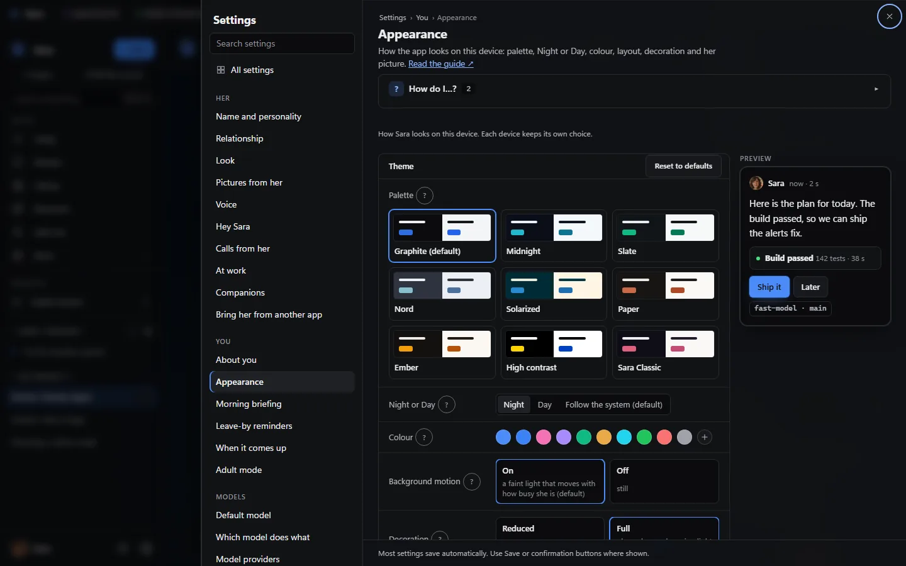<br><sub>Aparência: cartões de paleta, Noite ou Dia, sua cor, prévia ao vivo</sub></td>
  </tr>
  <tr>
    <td width="50%" align="center">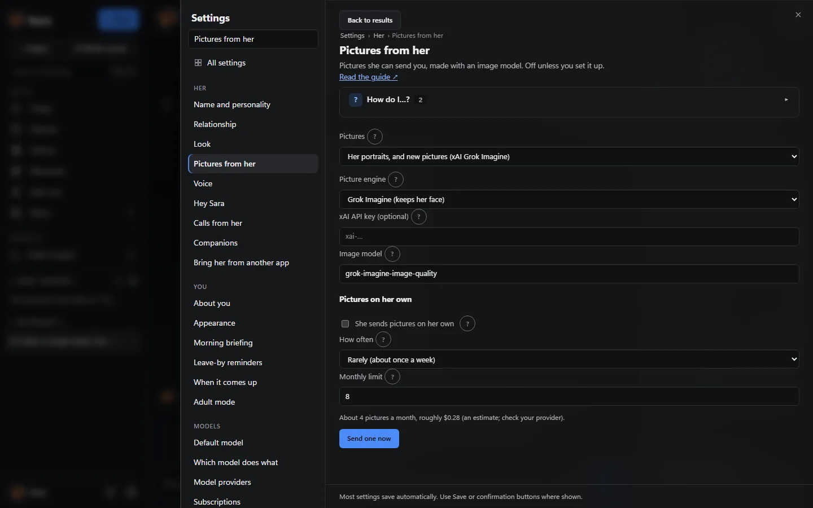<br><sub>Fotos dela: Grok, OpenAI, ComfyUI ou outra ferramenta de imagens</sub></td>
    <td width="50%" align="center">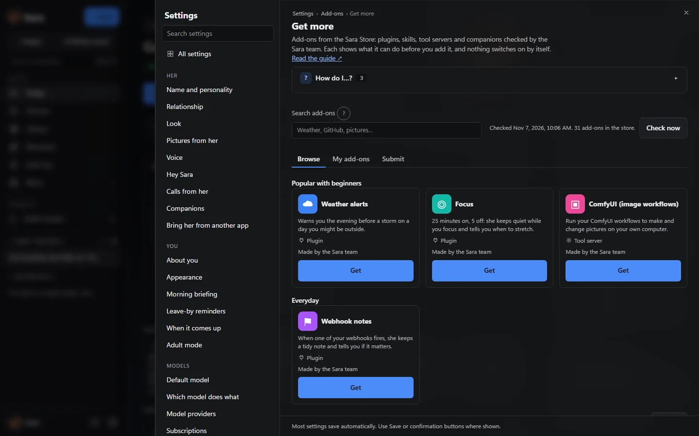<br><sub>Complementos → Obter mais: a Sara Store assinada; nada liga sozinho</sub></td>
  </tr>
  <tr>
    <td width="50%" align="center"><br><sub>Hoje: seu dia, o que precisa de você, rotinas e Primeiros passos</sub></td>
    <td width="50%" align="center">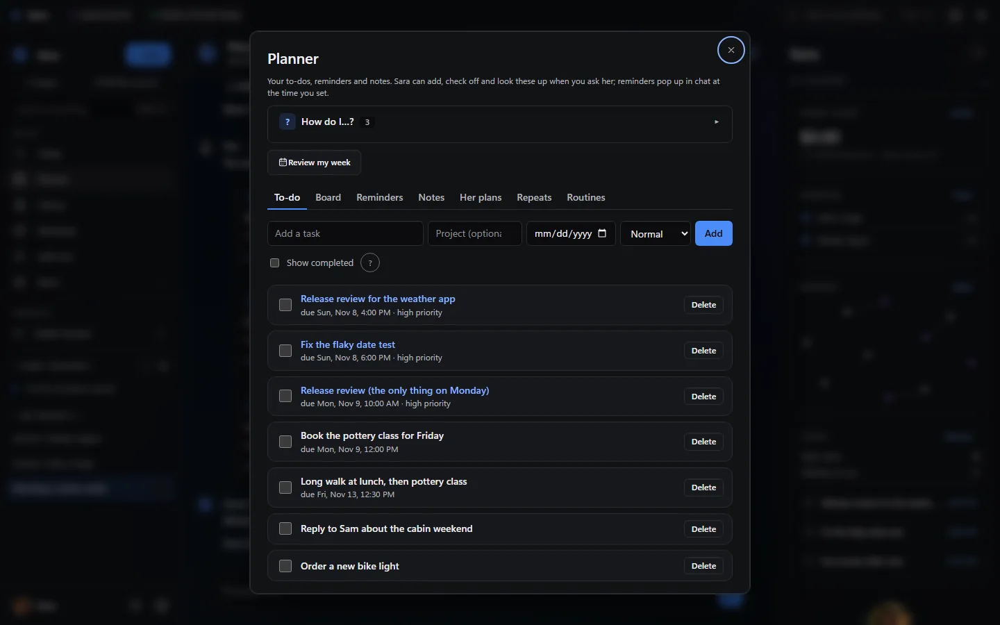<br><sub>Planejador: tarefas, quadro, lembretes, notas e rotinas</sub></td>
  </tr>
  <tr>
    <td colspan="2" align="center">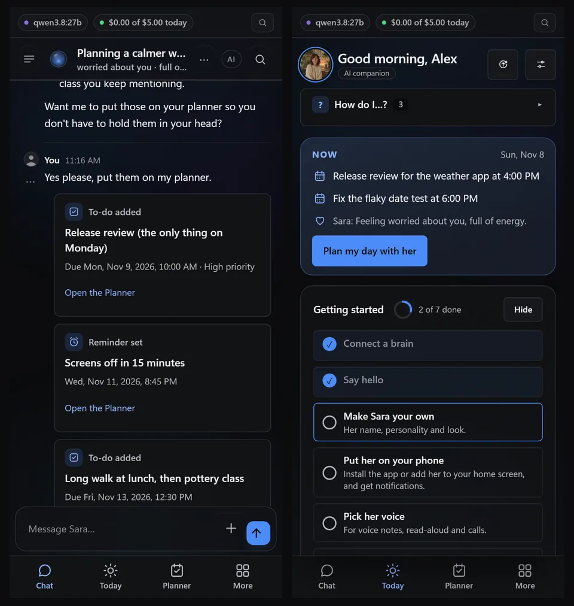<br><sub>No celular: a conversa e Hoje</sub></td>
  </tr>
</table>

### Para companhia


| Área | O que você ganha |
|---|---|
| **Companheira** | Qualquer nome, ela/ele/elu e uma aparência, uma personalidade a partir de controles simples ou de uma personagem inicial, humores, o dia dela, piadas recorrentes e memórias do que você contou, que você pode ver, corrigir e apagar. Ela pode mandar fotos dela feitas com Grok, OpenAI, seu fluxo do ComfyUI ou outra ferramenta de imagens e, se você ligar, de vez em quando uma por conta própria. [Comece aqui](docs/START_HERE.md) · [Pessoas](docs/PEOPLE.md) · [Momentos](docs/MOMENTS.md) · [Fotos](docs/PHOTOS.md) |
| **Voz e chamadas** | Chamadas ao vivo que você pode interromper, chamadas de vídeo com o retrato animado dela, “Hey Sara” sem mãos no app do Windows, e Alexa, Google Home ou o seu assistente do Android. [Chamadas de vídeo](docs/VIDEO_CALLS.md) · [Hey Sara](docs/HEY_SARA.md) · [Assistentes de voz](docs/VOICE_ASSISTANTS.md) |
| **Agenda, rotinas e vigilância** | Tarefas, notas e lembretes a partir de frases normais, um quadro, o Hoje como tela inicial, uma galeria de rotinas (resumo da manhã, revisão da semana…), lembretes para quando uma pessoa ou um assunto surgir, e alertas opcionais quando um log mostra uma linha como ERROR. [Hoje](docs/TODAY.md) · [Rotinas](docs/ROUTINES.md) · [Quadro](docs/BOARD.md) · [Vigiar um arquivo](docs/WATCHES.md) |
| **Biblioteca e leitura** | PDFs (inclusive digitalizados, e livros de 500 a 1.000 páginas), Word, Excel, PowerPoint, e-books, páginas web e notas; as respostas dizem de qual documento e página vieram. [Biblioteca](docs/LIBRARY.md) |
| **Cenas e roleplay** | Uma cena de roleplay compartilhada entre as suas próprias conversas na web, no Telegram e no Discord mais uma sala compartilhada, com fatos do cânone que você adiciona, edita ou retira; chats em grupo com duas a quatro companheiras; pacotes de companheira e cartões de personagem. [Cenas compartilhadas](docs/SCENES.md) · [Chats em grupo](docs/GROUP_CHATS.md) · [Pacotes de companheira](docs/PACKS.md) |

### Para programar


| Área | O que você ganha |
|---|---|
| **Projetos de código** | Um espaço de trabalho isolado por projeto com arquivos, terminal e git; ela escreve o código, pergunta antes de rodar um comando e mostra os resultados dos testes como cartões; prévias ao vivo que ela testa no próprio navegador. Comandos arriscados podem rodar antes numa cópia isolada. Os cartões de aprovação oferecem *Sempre permitir esta ferramenta* quando você já confia nela, e cada servidor de ferramentas tem uma única escolha de aprovações. [Para programadores](docs/FOR_CODERS.md) |
| **Trabalho que se prova** | Uma linha embaixo de cada resposta mostra cada comando e a saída dele, e uma checagem compara o que ela *diz* que fez com o que realmente rodou. Objetivos só terminam quando a sua própria checagem passa, as edições dela passam pelo verificador de tipos, afirmações visuais exigem uma captura de tela e checagens desatualizadas rodam de novo. [Metas](docs/GOALS.md) · [Checagens](docs/CHECKS.md) · [Checagens visuais](docs/FOR_CODERS.md#web-pages-look-fix-look-again) |
| **Trabalho longo e compartilhado** | Tarefas em segundo plano, uma equipe de ajudantes (planejar → construir → testar → revisar), pontos de controle do projeto, orçamentos que param uma tarefa longa onde você mandar, e seus outros servidores por SSH. [Pontos de controle do projeto](docs/FOR_CODERS.md#project-checkpoints) · [Servidores por SSH](docs/SSH.md) |
| **Nas suas ferramentas** | GitHub, `sara-chat` em qualquer terminal, um painel no VS Code, MCP para Claude Code e Cursor, e uma API compatível com a OpenAI, tudo com a memória e a personalidade dela. [Apps e clientes](docs/clients.md) · [Outros apps](docs/OTHER_APPS.md) |

### Para os dois


| Área | O que você ganha |
|---|---|
| **Apps em todas as plataformas** | App web e PWA instalável, apps de Windows e Mac com pergunta rápida num atalho, [Android no Google Play](https://play.google.com/store/apps/details?id=com.backstagecoding.sara), o app web na tela inicial do iPhone, Telegram, Discord, Signal e e-mail, e WhatsApp, Matrix e iMessage como plugins opcionais. [Apps de desktop](docs/desktop.md) · [Seu celular](docs/PHONE.md) · [Comandos de chat](docs/CHATS.md) |
| **Complementos** | Plugins, habilidades e servidores de ferramentas (MCP) da Sara Store assinada ou da sua própria pasta; cada um passa por um cartão de revisão e fica desligado até você ligar. Navegue e instale em Configurações → Complementos → Obter mais; para a 2.80, cada servidor de ferramentas e complemento foi instalado, usado e removido em Linux e Windows de verdade. [Sara Store](docs/STORE.md) · [Biblioteca de complementos](docs/ADDONS_LIBRARY.md) · [Habilidades](docs/SKILLS.md) |
| **Casa e empresa** | O modo casa dá a cada adulto que mora com você um espaço próprio no seu servidor; os espaços empresariais são uma instalação separada com chaves de acesso, papéis e espaços compartilhados. [Modo casa](docs/HOUSEHOLD.md) · [Empresa](docs/BUSINESS.md) |
| **Privacidade, modelos locais e segurança** | Qualquer modelo: local (Ollama, vLLM, llama.cpp), na nuvem (OpenAI, Anthropic, xAI, OpenRouter) ou os planos que você já paga (ChatGPT, Claude Pro/Max, SuperGrok / X Premium+). Um dono por servidor; conversas, memórias e chaves ficam lá. Um interruptor deixa tudo num só computador; vem **sem nenhuma credencial**; uma camada de segurança que não pode ser desligada. [Modo local privado](docs/PRIVATE_LOCAL.md) · [Escolher um modelo](docs/CHOOSING_A_MODEL.md) · [Checagem de segurança](docs/SAFETY_CHECKUP.md) |
| **Visual e navegação** | Um início *Todas as configurações* com cada página a um clique e trilha de navegação, Ctrl K para ir a qualquer lugar, conversa, configuração ou ação, nove paletas em Noite e Dia (Graphite por padrão), sua própria cor de destaque, espaçamento compacto e decoração completa ou reduzida, com prévia ao vivo. 3.0: barra de status ao vivo, o orbe de presença dela, linha do tempo ao vivo de cada execução, mapa da memória e *Num relance*; uma cor de destaque (Azul, Rosa, Violeta, Esmeralda, Âmbar, Ciano ou qualquer cor) e movimento do fundo que você pode desligar. [Aparência](docs/APPEARANCE.md) |
| **Ajuda e mudança** | Uma caixa *Como eu…?* em cada página, tours guiados curtos e a mudança a partir do ChatGPT, Claude, Character.AI, SillyTavern, Replika, Nomi, Kindroid, Hermes Agent ou OpenClaw, revisada antes de qualquer coisa ser salva. [Como eu…?](docs/HOW_DO_I.md) · [Traga a Sara de outro app](docs/IMPORT.md) · [Guia de mudança](docs/MOVE_IN_GUIDE.md) |

## Comece aqui

Dois caminhos curtos para os primeiros dez minutos. Escolha o seu; todos os recursos continuam disponíveis nos dois.

### Acabei de instalar, e agora?


1. **Entre** com o código de configuração do log dela (ou com seu token de dono).
2. **Diga seu nome** e escolha *Companhia* quando ela perguntar o que vocês vão fazer mais juntos.
3. **Conecte um cérebro:** ela sugere um modelo para o seu computador e confere se ele responde (*Conectado ✓*), ou usa um plano que você já paga.
4. **Diga oi:** toque em *Planeje meu dia comigo* ou só escreva. Um tour curto vem depois da primeira resposta dela.
5. **Deixe ela do seu jeito** com os controles de personalidade, e deixe *Primeiros passos* no Hoje guiar você pela voz dela, pelo seu celular e por um resumo da manhã.

O passo a passo completo, com imagens: **[Start here](docs/START_HERE.md)**. Todas as respostas das caixas *Como eu…?* do app numa lista: **[How do I…?](docs/HOW_DO_I.md)** (em inglês).

### Vim para programar


1. **Escolha *Programação*** na configuração: ela sugere um modelo bom em código (*Bom para programar*) ou o seu plano do Claude Code, Codex ou Grok Build.
2. **Abra um projeto** com *+ Projeto*: uma pasta de trabalho onde ela tem arquivos, um terminal e git.
3. **Peça algo de verdade.** Ela escreve os arquivos, pergunta antes de rodar um comando e mostra os resultados dos testes como cartões.
4. **Leia a linha embaixo de cada resposta** para ver cada comando e a saída dele; comandos arriscados podem rodar antes numa cópia isolada.
5. **Leve ela para as suas ferramentas:** GitHub, `sara-chat`, VS Code, MCP para Claude Code e Cursor, e orçamentos que param uma tarefa longa onde você mandar.

O passo a passo para quem programa: **[For coders](docs/FOR_CODERS.md)** (em inglês). A partir do código-fonte em três comandos: [Instalação](#instalação).

## Vídeos de como fazer

Guias de um minuto, gravados num servidor de teste com um modelo local (em inglês). <a href="https://www.youtube.com/playlist?list=PLGtrs9BqXtM8">Todos numa playlist</a>.

<table>
  <tr>
    <td align="center" width="25%"><a href="https://www.youtube.com/watch?v=DTAIW75y7i4&list=PLGtrs9BqXtM8&index=1"></a><br><sub>Instalar a Sara</sub></td>
    <td align="center" width="25%"><a href="https://www.youtube.com/watch?v=_X69x9E3W_k&list=PLGtrs9BqXtM8&index=2"></a><br><sub>Memória e cartões de pessoas</sub></td>
    <td align="center" width="25%"><a href="https://www.youtube.com/watch?v=wrvNcHkc9O4&list=PLGtrs9BqXtM8&index=3"></a><br><sub>O quadro</sub></td>
    <td align="center" width="25%"><a href="https://www.youtube.com/watch?v=7i48NiAq-jw&list=PLGtrs9BqXtM8&index=4"></a><br><sub>Programar com a Sara</sub></td>
  </tr>
</table>

## Novidades

<!-- sara:recent-releases:start -->

Versões recentes · 6 de novembro de 2026. [Histórico completo](CHANGELOG.md) · [Todos os downloads](https://github.com/farena-ai/sara/releases).

| Versão | O que muda para você |
|---|---|
| **[3.4.5](https://github.com/farena-ai/sara/releases/tag/v3.4.5)** | **[Respostas rápidas com modelos no processador](docs/CHOOSING_A_MODEL.md)** — A Sara pergunta a cada Ollama se o modelo roda na placa de vídeo; no processador ela mantém o contexto pequeno para as respostas continuarem rápidas. Após 45 segundos sem resposta, o chat aponta o modelo lento com Corrigir, Continuar esperando e Parar. |
| **[3.4.4](https://github.com/farena-ai/sara/releases/tag/v3.4.4)** | **[Interrompa e diga agora](docs/CHATS.md)** — Interromper agora (menu Enviar, Ctrl+Enter ou /now) para a resposta ou o raciocínio dela e ela continua do que você disse, mantendo os passos concluídos e recolhendo o que estava dizendo. Mudanças em andamento terminam primeiro, e um comando longo ganha Parar o comando. |
| **[3.4.3](https://github.com/farena-ai/sara/releases/tag/v3.4.3)** | **[Ela lê as imagens que você envia](docs/CHOOSING_A_MODEL.md)** — Capturas de exames, contas ou formulários agora chegam a qualquer um dos seus modelos que enxergue; se o que responde não consegue, outro a lê primeiro como texto exato. Ela salva os valores com note add e, quando nenhum modelo vê, diz isso com Corrigir em vez de fingir. |
| **[3.4.2](https://github.com/farena-ai/sara/releases/tag/v3.4.2)** | **[Notas que nunca perdem o que você contou](docs/FEATURES.md)** — Ela adiciona cada coisa nova a uma nota sob um título com data, um salvamento que apagaria uma nota é recusado, versões anteriores voltam com Restaurar e um “salvo” sem prova é sinalizado. A borda superior do app do Windows acompanha a página e ela pode ler suas abas e arquivos. |
| **[3.4.1](https://github.com/farena-ai/sara/releases/tag/v3.4.1)** | **[Ela lembra tanto quanto o modelo dela comporta](docs/CHOOSING_A_MODEL.md)** — O Auto ajusta quanto do chat ela tem em mente ao modelo em uso (consultado no serviço ou numa tabela datada), limita o histórico pago por token a um nível equilibrado, a menos que você escolha a janela inteira, e dá aos modelos locais do Ollama um contexto real. |
| **[3.4.0](https://github.com/farena-ai/sara/releases/tag/v3.4.0)** | **[Documentos, o nome dela em todo lugar, uso do computador a partir de um servidor](docs/DOCUMENTS.md)** — Ela cria documentos de verdade com qualquer modelo (Word, PDF, planilhas, apresentações) com Baixar, Abrir e Fazer alterações. Um companheiro renomeado mostra seu nome e pronomes em todo lugar, com personagens padrão ele e elu. O complemento de navegador e o uso do computador agora funcionam com um clique. |

<!-- sara:recent-releases:end -->

<details>
<summary><b>Versões 2.6x anteriores</b>: da 3.3.0 até a 2.61.5</summary>

| Versão | O que muda para você |
|---|---|
| **[3.3.0](https://github.com/farena-ai/sara/releases/tag/v3.3.0)** | **[Modo fácil](docs/AWAY_FROM_HOME.md)** — Feito com um usuário iniciante: a configuração explica as chaves e não se perde, problemas vêm com Corrigir, Conectar o app da Sara e Usar a Sara fora de casa (Tailscale) são guiados e testados, o Gmail leva três passos e você pode dizer “aumente o texto” com Desfazer. |
| **[3.2.0](https://github.com/farena-ai/sara/releases/tag/v3.2.0)** | **[Ela ganha vida](docs/APPEARANCE.md)** — Escolha O retrato dela, animado em Aparência e ela respira, pisca, olha em volta e mexe os lábios ao falar, com jeitos de ouvir, pensar e falar e seus humores, no chat, em Hoje e nas chamadas. Sua própria imagem ou um modelo 3D .vrm também funcionam. |
| **[3.1.2](https://github.com/farena-ai/sara/releases/tag/v3.1.2)** | **[Pesquisa que não desiste](docs/RESEARCH.md)** — Peça para ela pesquisar um assunto, fazer um guia ou aprender algo e ela inicia uma pesquisa: busca em vez de adivinhar endereços, pula sites que bloqueiam leitores automáticos, tenta de novo os lentos, continua após reiniciar, e uma pesquisa interrompida ainda entrega um relatório marcado como Parcial. |
| **[3.1.1](https://github.com/farena-ai/sara/releases/tag/v3.1.1)** | **[Mudar do Hermes ou OpenClaw, agora fácil](docs/MOVE_IN_GUIDE.md)** — Se o Hermes Agent ou o OpenClaw está no mesmo computador, a Sara encontra e a traz com um botão (personalidade, lembranças, conversas antigas, habilidades, horários), com prévia antes e Desfazer depois. De outro computador basta colar uma linha e a página da Sara avança sozinha. |
| **[3.1.0](https://github.com/farena-ai/sara/releases/tag/v3.1.0)** | **[E-mail além do Gmail](docs/EMAIL.md)** — Outlook.com e Microsoft 365 (e-mail e agenda), Yahoo, AOL, iCloud, Fastmail, Zoho, GMX, WEB.DE, Proton Mail e qualquer outro servidor: ela busca, lê conversas, acha o que espera resposta, rascunha, envia e organiza com as aprovações e o Desfazer do Gmail. Várias caixas com uma padrão; cada membro da casa pode conectar as suas, privadas. |
| **[3.0.3](https://github.com/farena-ai/sara/releases/tag/v3.0.3)** | **[Mais rápida, mais estável e mais fácil de achar](docs/DEVICE_APPROVAL.md)** — As configurações abrem na hora, há uma só busca e uma aprovação está sempre ao alcance (responda pela barra acima da caixa de mensagem ou com Ctrl K). Salvar as próprias habilidades não pergunta mais, um ponto vermelho marca as conversas que precisam de você e a resposta dela diz quantas lembranças novas salvou. Adicionar um celular ou computador é fácil de achar, e o modelo escolhido na configuração continua o padrão. |
| **[3.0.2](https://github.com/farena-ai/sara/releases/tag/v3.0.2)** | **[Acabamento, violeta e uma mudança fácil](docs/MOVE_IN_GUIDE.md)** — As configurações abrem centralizadas, violeta é a cor padrão e uma paleta volta para a própria cor. A decoração completa está mais rica e Hoje tem movimento sutil (desligado com movimento reduzido). Quatro relacionamentos que não são românticos, uma mudança em cinco passos do Hermes Agent ou OpenClaw com o comando exato para o seu sistema, e Tess, a faz-tudo prática, na galeria (obrigado a @Guilsc). |
| **[3.0.1](https://github.com/farena-ai/sara/releases/tag/v3.0.1)** | **[Todas as páginas no visual novo](docs/APPEARANCE.md)** — Hoje, Agenda, Biblioteca, Memória, Avaliações e Configurações no visual 3.0, com o orbe de presença dela em Hoje. Uma única lista de projetos na barra lateral: pastas que se abrem para mostrar as conversas com um ponto de status cada, incluindo apps de chat. A imagem dela pode ser o orbe, o retrato dela ou uma foto sua com um anel vivo. Os cartões de execução se recolhem em uma linha e se abrem sozinhos quando algo precisa de você; a linha de memória diz quantas lembranças ela usou. |
| **[3.0.0](https://github.com/farena-ai/sara/releases/tag/v3.0.0)** | **[Sara 3.0: um visual de sistema vivo](docs/APPEARANCE.md)** — Um visual novo em todas as páginas, sem tirar nada: uma faixa de status ao vivo com o que ela está fazendo, um orbe de presença que respira, escuta, pensa e fala, as execuções de ferramentas como uma linha do tempo ao vivo com as aprovações dentro e uma marca de verificado só onde uma checagem passou de verdade, um mapa do que ela sabe, uma cor de destaque à sua escolha e o nome escolhido dela em todo lugar. A Sara Clássica não muda. No Android, o Hey Sara agora funciona no celular. |
| **[2.88.0](https://github.com/farena-ai/sara/releases/tag/v2.88.0)** | **[Espaço de código, Spotify, páginas de equipe](docs/CODING_DEPTH.md)** — Tarefas de código podem rodar em branch e pasta próprios com Mesclar, Abrir PR ou Descartar no fim, diagnósticos e ir para definição com servidores de linguagem, commits em coautoria e uma visão Espaço com arquivos, editor, terminal e chat. O Spotify conecta com seu próprio app de desenvolvedor. Espaços empresariais ganham páginas de equipe com histórico, comentários e menções. Hey Sara agora escuta no Mac, Android e Linux com o mesmo motor offline do Windows, e a conexão com editores foi comprovada com o Zed. |
| **[2.87.0](https://github.com/farena-ai/sara/releases/tag/v2.87.0)** | **[Trabalhadores, controle de gastos, atualizações mais seguras](docs/WORKERS.md)** — Traga sua companheira do Character.AI, Replika, Kindroid ou Nomi. Os preços aparecem antes das etapas pagas, com limites diários e mensais e um modo Economia de tokens, e os complementos podem se atualizar sozinhos e voltar atrás. As atualizações de Windows e Mac são verificadas com um aviso assinado e voltam à versão anterior se a nova falhar. Os trabalhadores que ficam têm seu próprio tópico, uma fila de tarefas duradoura, tarefas com falha que podem ser repetidas e um único alerta "precisa de você". Os cartões do quadro podem esperar sua resposta, um dispositivo novo espera um código que você aprova e ela aprende como você gosta de trabalhar sem nunca deduzir saúde, religião, política ou sexualidade. |
| **[2.86.0](https://github.com/farena-ai/sara/releases/tag/v2.86.0)** | **[Aprender um tema, gatilhos, apps de ferramentas](docs/LEARN.md)** — Peça que ela aprenda sobre algo, ou dê um site: ela pesquisa com fontes citadas, guarda como habilidade e atualiza todo dia, semana ou mês, contando o que mudou. Os gatilhos "Quando isto acontecer" iniciam uma tarefa ou uma equipe a partir de um e-mail, uma mensagem do Slack ou Teams, um webhook ou um evento de um servidor de ferramentas, com limites, orçamentos e aprovações. Apps de servidores MCP aparecem no chat, isolados da página, na versão atual do MCP. Outros apps podem usar a API Open Responses, e um chart Helm a executa no Kubernetes. Login corporativo, SCIM, métricas, fontes de segredos, o sandbox em contêiner e os links de compartilhamento foram comprovados com o software real. |
| **[2.85.0](https://github.com/farena-ai/sara/releases/tag/v2.85.0)** | **[Reuniões, ajuda do celular, ela no trabalho](docs/MEETINGS.md)** — Uma sala de reunião em que ela avisa que é uma IA tomando notas e escreve um resumo com decisões e tarefas (também a partir de uma gravação). Seu celular pode emprestar a câmera, a localização ou uma captura, com Permitir uma vez ou Negar toda vez. No trabalho ela tem nome, tom, memória e ferramentas próprios no Slack e no Teams, sem os recursos de companheira. Vários chats recebem respostas ao mesmo tempo, membros da casa podem compartilhar seus chats, administradores empresariais têm um relatório de gastos e a retenção legal guarda o texto anterior do que for editado. |
| **[2.84.0](https://github.com/farena-ai/sara/releases/tag/v2.84.0)** | **[Controles empresariais, editores, modo código](docs/SECRET_SOURCES.md)** — As chaves podem ficar no HashiCorp Vault, no 1Password, em variáveis de ambiente, em arquivos de segredos ou no chaveiro do sistema. Zed e JetBrains podem usar a Sara como agente de código pelo Agent Client Protocol, com aprovações no editor. Instâncias empresariais aceitam SCIM do Entra ID ou do Okta; retenção, retenção legal e exportação ou exclusão por pessoa cobrem todos os caminhos de exclusão. Um relatório de confiança compara o que ela disse com o que foi executado, os itens da Loja mostram onde foram verificados, uma página de prontidão faz uma simulação de restauração com um clique, o modo código executa um script isolado em vez de muitas chamadas e um SDK em TypeScript sem dependências cobre a API dela. |
| **[2.83.0](https://github.com/farena-ai/sara/releases/tag/v2.83.0)** | **[Pesquisa, Teams, equipes](docs/RESEARCH.md)** — Pesquise uma pergunta e receba um relatório em que cada frase cita uma página que ela leu (PDF, Word ou Markdown). O Microsoft Teams se junta ao Slack. Equipes são grupos fixos de ajudantes com um líder e horários; uma arrumação noturna opcional da memória junta duplicatas, com Desfazer para cada mudança. Comandos podem rodar em um contêiner Podman ou Docker sem root e ficar limitados a sites permitidos; conversas podem ser compartilhadas como links somente leitura que expiram; relatórios de uso e custo cobrem cada pessoa, espaço e projeto. |
| **[2.82.0](https://github.com/farena-ai/sara/releases/tag/v2.82.0)** | **[Programas com um clique, 21 companheiros](docs/PREREQUISITES.md)** — Quando um complemento precisa de um programa que o computador não tem, as Configurações dizem o que falta e oferecem *Instale para mim*: você aprova o comando exato, acompanha a execução e a instalação do complemento continua (só o proprietário, registrado na auditoria, pode ser desligado por política). Vinte e um companheiros com retrato, voz e limites claros estão na Loja assinada, de tutores de idiomas e um treinador físico a uma parceira de escrita, um cofundador de startup e uma capitã de nave celeste. No Linux, os servidores de ferramentas de navegador encontram o Chrome instalado. |
| **[2.81.0](https://github.com/farena-ai/sara/releases/tag/v2.81.0)** | **[Pronta para o trabalho e as equipes](docs/SLACK.md)** — Sara chega ao Slack com mensagens diretas, menções, threads, botões Permitir e Negar e arquivos nos dois sentidos. Instâncias empresariais podem entrar com Entra ID, Google Workspace, Okta ou Keycloak (só por convite por padrão; a chave de acesso do proprietário sempre funciona). Uma única trilha de auditoria à prova de adulteração exporta para CSV ou JSONL, um administrador pode fixar configurações que o servidor aplica e os operadores recebem métricas do Prometheus e rastros do OpenTelemetry sem texto de conversa. |
| **[2.80.0](https://github.com/farena-ai/sara/releases/tag/v2.80.0)** | **[Cada instalador verificado de ponta a ponta](docs/ADDONS_LIBRARY.md)** — Cada servidor de ferramentas e complemento nativo das Configurações foi instalado, configurado, conectado, usado e removido em um servidor Linux e um PC Windows reais. Atualizar um servidor de ferramentas mantém suas configurações, o servidor Files inicia dentro do isolamento do Linux, erros de login e de conexão são explicados em palavras simples, um complemento da Loja removido pode ser instalado de novo e aposentar uma companheira recém-adicionada não derruba mais o servidor. |
| **[2.79.0](https://github.com/farena-ai/sara/releases/tag/v2.79.0)** | **[Visual avançado e imagens como uma pessoa](docs/PHOTOS.md)** — Um início Todas as configurações com cada página a um clique, trilha de navegação, um lançador Ctrl K, um visual refinado de vidro e luz e uma página de Aparência mais completa. *Sempre permitir esta ferramenta* nos cartões de aprovação e uma só escolha de aprovações por servidor de ferramentas; as fotos dela com Grok, OpenAI, seu fluxo do ComfyUI ou outra ferramenta de imagem, e de vez em quando uma imagem por conta própria se você ativar. Imagens dos servidores de ferramentas chegam ao chat, e ela não diz mais que enviou algo que nunca foi anexado. |
| **[2.78.0](https://github.com/farena-ai/sara/releases/tag/v2.78.0)** | **[Visual profissional completo e mais complementos](docs/APPEARANCE.md)** — O visual profissional está completo: nome, hora e duração em cada turno, um único rótulo de modelo · espaço de trabalho com medidor de contexto, Configurações como painel de altura total, Projetos na barra lateral e tabelas reais de uso e execuções. Documentation Doctor, Release Readiness e Repository Onboarding executam os comandos documentados como tarefas que você aprova numa cópia descartável; no Windows, uma tarefa interrompida termina na hora. |
| **[2.77.0](https://github.com/farena-ai/sara/releases/tag/v2.77.0)** | **[Um visual profissional](docs/APPEARANCE.md)** — Um visual sóbrio, denso e preciso (Configurações → Você → Aparência): 9 paletas em Noite e Dia, uma cor de destaque sua, espaçamento compacto e Menos decoração; Sara Classic mantém o visual de hoje. Também: feeds no Ler juntos, Test Doctor e Flaky Test Lab, 2 conexões locais para desenvolvedores, e aprovações atrasadas de plugins não executam mais nada. |
| **[2.76.0](https://github.com/farena-ai/sara/releases/tag/v2.76.0)** | **[Complementos para desenvolvedores](docs/ADDONS_LIBRARY.md)** — Dezenove complementos para desenvolvedores se juntam aos doze fluxos em Configurações → Plugins (detector de segredos, auditor de acessibilidade, gerador de SBOM, guardião de contratos de API, bancada de HTTP e webhooks e mais); você revisa cada um e ele é instalado desligado. Os alertas de arquivo também podem ir para o seu próprio chat do Telegram ou Discord (desligado por padrão). |
| **[2.75.0](https://github.com/farena-ai/sara/releases/tag/v2.75.0)** | **[Chamadas como o chat](docs/VIDEO_CALLS.md#what-she-knows-and-can-do-on-a-call)** — Numa chamada de voz ou vídeo ela tem as mesmas memórias, o contexto de outras conversas e a regra do modo adulto de quando você digita, e as chamadas ao vivo podem usar as ferramentas dela (sem comandos, sem as mãos dela, sem SSH). O que precisa do seu OK mostra um cartão na tela da chamada que só um toque responde; desligar ou falar por cima cancela. |
| **[2.74.0](https://github.com/farena-ai/sara/releases/tag/v2.74.0)** | **[Ler juntos](docs/LIBRARY.md#read-together)** — Abra um documento de texto ou Markdown da sua biblioteca, toque em Compartilhar este trecho (ou ative Seguir onde estou) e ela comenta exatamente esse texto nessa versão; se mudou, ela avisa. Parar encerra na hora. Também: os cartões de sugestão agora mostram que seu toque está sendo atendido. |
| **[2.73.0](https://github.com/farena-ai/sara/releases/tag/v2.73.0)** | **[Vigiar um arquivo](docs/WATCHES.md)** — Escolha um log ou arquivo em um dos seus espaços de trabalho (ou o log dela) e algumas palavras como ERROR; Sara envia um cartão no chat e uma notificação quando surge uma nova linha correspondente, no máximo 12 por dia. Verificar agora, Pausar e Parar; a leitura não usa modelo e ela nunca corrige nada sozinha. |
| **[2.72.0](https://github.com/farena-ai/sara/releases/tag/v2.72.0)** | **[Verificações visuais honestas](docs/FOR_CODERS.md#web-pages-look-fix-look-again)** — No trabalho web Sara edita, visualiza, tira capturas de desktop e celular, corrige o que parece errado e verifica de novo. Dizer que conferiu a largura de celular exige uma captura nessa largura, e "está resolvido" exige uma verificação após a última edição; senão a resposta é marcada como não verificada. |
| **[2.71.0](https://github.com/farena-ai/sara/releases/tag/v2.71.0)** | **[Continuidade de projetos](docs/FOR_CODERS.md#project-now-other-chats-and-current-checks)** — Seus chats de código no mesmo projeto veem o que os outros estão fazendo (títulos e arquivos, nunca o texto das mensagens), e cada resultado de verificação, meta ou ponto de controle diz atual, desatualizado ou base desconhecida. Sara repete uma verificação desatualizada antes de dizer que passou. |
| **[2.70.0](https://github.com/farena-ai/sara/releases/tag/v2.70.0)** | **[Cenas de roleplay compartilhadas](docs/SCENES.md)** — Uma história nos seus chats web, do Telegram e do Discord mais uma sala compartilhada, com fatos versionados que você adiciona, edita ou retira. Convidados mantêm todas as regras de parceiro; as palavras deles só contam quando você escolhe Adicionar à cena. Apagar ou esquecer uma linha remove o que veio dela; as verificações de segurança valem para todas as cenas. |
| **[2.69.0](https://github.com/farena-ai/sara/releases/tag/v2.69.0)** | **[Complementos nas Configurações](docs/ADDONS_LIBRARY.md)** — Doze fluxos com dados fornecidos usam a revisão normal de arquivos e permissões e começam desligados. Sete prévias de receitas MCP, catorze investigações bloqueadas e seis guias explicam requisitos, custos e limites. Sem instalação, conexão ou ativação automáticas; a disponibilidade da loja assinada continua separada. |
| **[2.68.0](https://github.com/farena-ai/sara/releases/tag/v2.68.0)** | **[Contexto entre suas próprias conversas](docs/SESSION_CONTINUITY.md)** — Contexto recente entre conversas permitidas do proprietário com a mesma companheira, leitura limitada do histórico, notas internas e etapas ordenadas do provedor. Controle do proprietário, inspeção e limpeza confirmada apenas do destino escolhido; a privacidade e as aprovações de ferramentas continuam valendo. Cenas compartilhadas, coordenação de projetos e paridade completa de voz e vídeo ficam para etapas futuras. |
| **[2.67.0](https://github.com/farena-ai/sara/releases/tag/v2.67.0)** | **[Sinais recentes e acompanhamentos](docs/ATTUNEMENT.md)** — Sinais explícitos e limitados do proprietário em seis idiomas e acompanhamentos de eventos com fontes verificadas. Os **[pontos de controle do projeto](docs/FOR_CODERS.md#project-checkpoints)** mantêm lógica, bloqueios e até três próximos passos, com cinco versões e controles para inspecionar, substituir ou limpar; o contexto histórico não executa comandos nem preserva aprovações anteriores. |
| **[2.65.0](https://github.com/farena-ai/sara/releases/tag/v2.65.0)** | **[Configuração empresarial guiada](docs/BUSINESS.md)** — Primeiro uso e administração guiados, histórico de convites no escopo autorizado, revogação, verificação de configuração somente leitura e exercícios repetíveis de navegador e recuperação. |
| **[2.64.0](https://github.com/farena-ai/sara/releases/tag/v2.64.0)** | **[Espaços empresariais separados](docs/BUSINESS_OPERATIONS.md)** — Chaves de acesso individuais, papéis, textos e documentos compartilhados, limites de modelos controlados pelo operador e recuperação criptografada. Dados pessoais e da casa continuam separados. |
| **[2.63.1](https://github.com/farena-ai/sara/releases/tag/v2.63.1)** | **[Operação medida](docs/OPERATIONS.md)** — Métricas HTTP e de preparação só para o proprietário, arquivamento seguro de entregas resolvidas, backups sem travar o app e verificação local repetível. |
| **[2.62.0](https://github.com/farena-ai/sara/releases/tag/v2.62.0)** | **[Recuperação sem repetir às cegas](docs/RECOVERY.md)** — Revise trabalhos interrompidos antes de reiniciar; envios nativos incertos do Telegram/Discord ficam visíveis, sem reenvio automático. |
| **[2.61.5](https://github.com/farena-ai/sara/releases/tag/v2.61.5)** | **[Encontre o próximo passo](docs/START_HERE.md)** — Busca focada nas Configurações, caminho mais simples até a primeira mensagem e melhor navegação por teclado, toque e com movimento reduzido. |

Também em 2.67.0: navegação confiável para Projetos de programação pela busca das Configurações, rascunhos preservados e tratamento de respostas antigas, privacidade do conhecimento do projeto no modo sem registro e verificação local de atualização das seis páginas de versão. Sem CI nem monitoramento recorrente de lançamentos. Os pontos de controle são exclusivos do proprietário e do espaço/projeto; excluir, editar ou esquecer o conteúdo de origem abrangido invalida os registros derivados. As ações de programação pendentes, incluindo as dos assistentes de equipe e a aplicação de mudanças do ambiente isolado, verificam novamente as permissões atuais e o contexto da conversa e do espaço de trabalho antes da execução; uma mudança de contexto interrompe a ação desatualizada em vez de transferi-la.

A versão 2.67.0 também distingue críticas ao código de conflitos dirigidos à Sara, verifica novamente as fontes dos sinais e acompanhamentos imediatamente antes da chamada normal ao provedor e só conclui itens da Agenda automaticamente quando o evento, o resultado e a pergunta correspondente estão claros. Vida interior continua sendo o controle de ativação; não há diagnóstico emocional, chamada extra a um classificador nem novo perfil de humor do proprietário. Os novos sinais excluem conversas privadas ou sem registro, membros, grupos, contextos externos, reprodução e trabalho sem supervisão. Prompts registrados, exportações e backups podem reter notas conforme os controles habituais; a reprodução omite os novos extras transitórios registrados e informa que as entradas mudaram. Esta versão também corrige a identificação automática da revisão de origem do instalador Windows.

</details>

<!-- sara:release-history:start -->

<details>
<summary><b>Destaques anteriores · 2.61, 2.60 e 2.59</b></summary>

- **2.61** ·  Configurar apps de chat ficou mais fácil: um cartão guiado para WhatsApp, Matrix, iMessage, Signal, e-mail e Telegram, cada passo conferido, com soluções claras; os plugins da própria Sara pedem só um OK, sem aviso de desenvolvedor.
- **2.60** · Pacotes de companheira: compartilhe o caráter, a aparência, a voz e as habilidades iniciais de uma companheira como arquivo ou na Sara Store, sem nunca compartilhar suas memórias ou conversas; cartões de personagem também são importados.
- **2.59** · “Hey Sara”: diga o nome dela para falar sem as mãos no app do Windows (um modelo pequeno no seu computador só escuta isso), um atalho para falar em todo lugar, e audição e vozes locais no Windows.

</details>

<details>
<summary><b>Histórico de versões</b>: o que cada versão desde a 2.4 trouxe</summary>

| Versão | O que você ganha |
|---|---|
| **2.61.4** · [v2.61.4](https://github.com/farena-ai/sara/releases/tag/v2.61.4) | **[Configuração mais confiável](docs/SECURITY_CHECKLIST.md)** — Retome a configuração de modelo após pulá-la, mantenha o foco móvel no lugar certo e diferencie aprovação de comandos de isolamento de execução. |
| **2.60** · Pacotes de companheira | **Compartilhe-a:** Configurações → Ela → ⋯ → *Compartilhar* monta um pacote com exatamente o que você marcar (caráter, controles, aparência, guarda-roupa, voz, primeira mensagem, habilidades, rotinas sugeridas) e mostra o que nunca sai: memórias, conversas, pessoas, chaves, seu nome (vira `{{user}}`), suas notas de relacionamento e limites. **Instale um pacote** como companheira nova, nunca por cima de uma que você já tem, com um cartão de revisão; atualizações mostram o que o autor mudou e mantêm suas próprias edições. Cartões de personagem V1/V2/V3 (PNG, JSON, CHARX) são importados como pacotes, e um lorebook vira poucas linhas de contexto, nunca memórias. A checagem de menores roda ao criar, revisar e instalar o pacote, sem exceção; as classificações seguem o modo adulto. Quatro companheiras iniciais na loja: Juniper, Rowan, Vesper e Jax. Corrigido também: exportar um cartão de personagem não inclui mais seu nome nem suas notas. |
| **2.59** · “Hey Sara” | **Diga o nome dela e fale** no app do Windows: um modelo de 5 MB no seu computador só escuta “Hey Sara” (ou suas próprias palavras para cada companheira), e nada é enviado até você dizê-las; a gravação começa depois da frase, o áudio nunca é guardado e um ponto no ícone da bandeja mostra quando ela está ouvindo. Desligado até você ligar, em cada aparelho; pausa com a tela bloqueada; se dois aparelhos ouvirem, um responde. **Fale com a Sara** com Ctrl+Alt+Espaço ou pela bandeja, e no Android com um botão Falar na notificação e um bloco nas configurações rápidas. O aviso de IA vem primeiro e a ajuda em crise é lida inteira. **Audição e vozes locais no Windows:** `sara voice install` (cerca de 650 MB, cada arquivo conferido), antes só no Linux. Mac, Linux e o detector do Android sempre ouvindo vêm depois. |
| **2.58** · Pegar mais | **Configurações → Habilidades → Pegar mais:** navegue e pesquise na Sara Store, abra um item e instale com um clique pelo cartão de revisão de sempre (nada liga sozinho). Servidores de ferramentas têm um cartão com o comando exato (e a forma para Windows), do que precisam, o que podem alcançar e se rodam isolados; chaves vão para o cofre. **Atualizações** mostram exatamente o que muda, com permissões novas marcadas, e dá para voltar. **Meus complementos** lista tudo com a origem. **Envie os seus:** `sara pack` confere um plugin, uma habilidade ou um servidor de ferramentas no seu computador (manifesto, permissões, busca de segredos, teste rápido isolado, capturas), e então *Enviar* nas configurações ou `sara submit` manda, assinado com sua própria chave de autor. A equipe da Sara revisa antes de listar, e em *Meus envios* você acompanha e responde. Denúncias e remoções desligam um complemento, nunca apagam. |
| **2.57** · A Sara Store abre | **Uma prateleira assinada** em [backstagecoding.com/sara/store](https://backstagecoding.com/sara/store/): Alertas do tempo, Foco, Cenas da casa, Resumo do GitHub, Lista de leitura e Notas de webhook, mais servidores de ferramentas para ComfyUI, Blender, um navegador (Playwright), GitHub, arquivos deste computador e documentação (Context7), cada um com uma versão exata fixada. A Sara confere a assinatura da lista, a impressão digital de cada arquivo e a validade antes de mostrar qualquer coisa; uma lista danificada, velha ou retirada é recusada e a última boa é mantida. Navegar não envia identificador nem cookie. Instalações continuam passando pelo cartão de revisão de sempre e nada liga sozinho; o que sai da loja é desligado, nunca apagado. **Arrumar habilidades:** as que não são usadas podem ser arquivadas e trazidas de volta. A seguir: instalar de dentro da Sara e enviar as suas. |
| **2.56** · Enxuta e arrumada | **Uma lista curta de ferramentas por passo:** escolhida no código (sem chamar modelo) pelo que você está fazendo: o modo, suas palavras, referências com `@`, uso recente, uma habilidade carregada, rodadas anteriores de um objetivo, mais as ferramentas sempre mantidas por segurança. O resto ela acha com *find tools*, e cada chamada continua sendo conferida contra tudo o que ela pode fazer. Medido: uma instalação nova cai de 11.871 para 5.471 tokens por passo (−54 %); com quatro servidores MCP, de 23.476 para 5.438 (−77 %). `/tools` mostra o que está sendo oferecido. **`/compact`:** resume a parte antiga de uma conversa longa, escrito primeiro neste computador (conversas privadas nunca saem dele). Suas mensagens ficam no histórico, com *Ver resumo* e *Desfazer*; também roda sozinho perto do limite, e mensagens de crise ficam palavra por palavra. Funciona em todos os apps de chat. |
| **2.55.3** · MCP no Windows | Corrigido: no Windows, servidores MCP iniciados com `npx` (incluindo os modelos embutidos) não iniciavam. |
| **2.55.2** · iMessage | **iMessage pelo BlueBubbles** (Configurações → Conexões → iMessage, um plugin opcional): escreva para ela pelo Mensagens no seu iPhone. Precisa de um Mac com BlueBubbles e um ID Apple só dela (a Sara se recusa a rodar com o seu, porque veria todas as suas conversas). Oito passos guiados conferidos com um ✓, soluções simples, texto, fotos e arquivos, e ela põe em dia o que chegou enquanto estava offline. Pontinhos de digitação e reações só se a Private API do BlueBubbles já estiver ligada; a Sara nunca pede para você baixar a segurança do Mac por isso. |
| **2.55.1** · Matrix | **Matrix** (Configurações → Conexões → Matrix, um plugin opcional): fale com ela no Element ou em qualquer app Matrix por uma conta Matrix só dela. Cinco passos guiados, cada um conferido com um ✓, e soluções simples para cada erro. Texto, fotos e mensagens de voz; só você a menos que permita outros (servidores inteiros também); convites de desconhecidos são recusados. Só salas sem criptografia de ponta a ponta: numa sala criptografada ela explica por que não consegue ler e sai. |
| **2.55** · WhatsApp | **WhatsApp** (Configurações → Conexões → WhatsApp, um plugin opcional): escreva para ela pela API oficial WhatsApp Cloud da Meta, com uma conta e um número da Meta que são seus. Um cartão guiado de 10 passos mostra as telas exatas da Meta, confere cada passo com um ✓ e transforma cada erro numa frase simples com a solução. Fotos e arquivos nos dois sentidos, pontinhos de digitação e uma linha *Estou nisso* com Parar em tarefas longas, só você a menos que adicione outros números, e as primeiras mensagens dela só dentro da janela de 24 horas do WhatsApp. Os termos da Meta limitam assistentes de IA genéricos no WhatsApp, então fica desligado até você instalar e marcar que leu. |
| **2.54** · Rotinas e uma checagem de segurança | **Galeria de rotinas** (Planejador → Rotinas): resumo da manhã, revisão da semana, lembretes de alongar e de dormir, sair na hora, vigiar o CI de um repositório, novas issues, checar backups, organizar o e-mail e alerta de preço. Cada cartão diz o que faz, do que precisa e quanto custa, calculado no código (quase todas são grátis), mostra uma prévia sem chamar modelo e tem um botão de desligar; as pagas terminam na data que você escolher. As ferramentas mantêm suas configurações de aprovação. **Checagem de segurança** (Configurações → Dados e saúde): 17 checagens só de leitura, um veredito em palavras (*Parece seguro*, *Quase tudo seguro*, *Corrija isto primeiro*) e correções de um clique que só podem deixar mais seguro, cada uma dizendo se dá para desfazer. Mudanças em como se chega à Sara são guiadas, nunca em um clique. Também `sara doctor --safety`. |
| **2.53** · Precisão no código | **Checagens depois das edições:** quando ela muda o código, a Sara roda o verificador do próprio projeto (tsc, pyright ou mypy, cargo check, go vet, eslint), já instalado, nunca `npx`, sem instalar nada, e passa só os erros novos no mesmo turno, inclusive arquivos que a mudança quebrou em outro lugar. Ela conserta antes de responder (no máximo dois avisos) e a resposta mostra *✓ types clean (tsc)* ou o que sobrou. Um OK por projeto. **Referências com @:** digite `@` no chat para `@file` (com linhas), `@folder`, `@diff`, `@branch`, `@problem` ou `@url`; selos mostram o que ela vai receber e o tamanho, e funciona como texto no Telegram, Discord e nos outros apps. Arquivos secretos são recusados e conversas privadas nunca abrem páginas web. |
| **2.52.1** · Conectar um servidor ficou fácil, fotos corrigidas | *Conectar um servidor* pede só o endereço e o usuário; a Sara cria a chave dela, acha a porta e o jeito mais fácil de entrar (um token do cPanel que ela mesma apaga, sua senha uma vez ou uma linha para colar) e explica cada falha em palavras simples. As fotos agora sempre chegam a um modelo que consegue vê-las. |
| **2.52** · Quando o assunto surgir | **Lembretes que esperam uma pessoa ou um assunto:** "quando o Dan aparecer, me lembre que ele me deve 20 $" ou "na próxima vez que eu falar da horta, pergunte dos tomates". Ela traz isso uma vez, dentro da resposta, com *Feito*, *De novo na próxima* ou *Esquecer*. A detecção usa seus cartões de pessoas e palavras simples, sem chamar nenhuma IA, e ela nunca chuta entre dois Dans. Só disparam com suas próprias mensagens nas suas próprias conversas, nunca onde o Dan possa ler, e o que ela fosse mandar para outra pessoa contendo um pergunta antes. **Retomar uma conversa em outro app:** comece no Telegram, abra o app e *Continuar aqui* traz a conversa (`/continue` em qualquer lugar), com *Mostrar* e *Desfazer*; nada é copiado. |
| **2.51** · Continue até terminar | **Objetivos com prova:** "faça os testes passarem, pronto quando `npm test` estiver verde": ela trabalha rodada a rodada dentro de limites (rodadas, minutos, tokens, dólares) e a Sara roda a sua checagem, não ela, então *pronto* quer dizer que passou de verdade. Um verde que só veio depois de mexer nos testes termina como *pronto, revisar*; a mesma falha duas vezes a pausa como *travada*. **`/loop every 10m: check the deploy`**: quieto enquanto nada muda, uma mensagem quando muda, para no *until* (com prova), depois de duas falhas, na hora de fim ou num limite diário, e nunca pede aprovação sem você. Cartões do quadro podem ter uma checagem *Pronto quando*. Depois de reiniciar, tudo volta pausado. Corrigido também: editar arquivos com fim de linha do Windows falhava. |
| **2.50** · Signal e e-mail | **Mais dois jeitos de falar com ela, já embutidos.** *Signal* pelo signal-cli no seu computador: grupos como salas com acompanhamento, 👀 quando ela pega seu recado, uma mensagem de progresso ao vivo, arquivos nos dois sentidos e seu número de segurança fixado, então uma chave trocada pausa as ferramentas dela até você confirmar. *E-mail* na caixa dela: uma sessão por conversa, respostas na conversa, seu e-mail só conta como você se passar na verificação de remetente do seu provedor, estranhos nunca recebem resposta, e-mail encaminhado faz cada ferramenta perguntar antes, e respostas automáticas, newsletters e devoluções nunca criam um ciclo. A Sara mantém as conexões desses plugins, só para os endereços que você informou. Corrigido também: uma resposta de chat por plugin que passava de 5 minutos era cortada. |
| **2.49** · Fale com ela enquanto trabalha | **Nada de esperar ela terminar.** Escreva enquanto ela trabalha e escolha: *Diga agora* (ela lê antes do próximo passo e muda o rumo; nunca pode aprovar nada), *Depois disso* (espera e roda como um turno próprio) ou *Só uma pergunta* (`/btw`: uma resposta rápida de lado, nada é salvo, o trabalho continua). O mesmo no Telegram e no Discord (`/queue`, `/btw`). Uma **trava de repetição** a para depois de três chamadas idênticas que falham e a faz mudar de abordagem. |
| **2.48** · Os apps de chat se atualizam | **Fotos e arquivos nos dois sentidos no Telegram e no Discord:** mande uma foto (com legenda, em álbum ou como arquivo) ou um documento e ela lê; peça uma selfie, um gráfico ou um arquivo e ele chega (`send_file`). Fotos de outras pessoas numa sala ficam desligadas até você ligar, e aí ela só vê uma descrição. **Uma mensagem de progresso** se atualiza enquanto ela trabalha, tem um botão Parar e termina como uma linha de resumo. Pontes de plugins também levam arquivos. |
| **2.47.3** · Comece aqui | **Duas portas de entrada:** [Comece aqui](docs/START_HERE.md) para "instalei, e agora?" e [Para programadores](docs/FOR_CODERS.md), as duas com os vídeos (em inglês). Capturas novas, o tour de recursos dividido em *Para companhia*, *Para programar* e *Para os dois*, todas as respostas de *Como eu…?* num índice (no guia e no site da documentação) e um site da documentação reorganizado. |
| **2.47.2** · Um só visual e ajuda em cada página | **Cada página agora tem um quadro *Como faço…?*** com respostas passo a passo (123, com *Mostre-me*), e páginas vazias dizem o que vai ali com um próximo passo claro. Um estilo de cartão, ícones no lugar de emoji, espaçamento e cantos padronizados, um menu de configurações que abre um grupo por vez, o celular mais arrumado e sem rolagem lateral, uma primeira tela de acesso mais clara, e a configuração para programar prefere um modelo capaz no seu próprio computador. |
| **2.47.1** · Um começo do seu jeito | **A configuração faz uma pergunta: companhia, programação ou as duas.** Você recebe um modelo recomendado com um teste real *Conectado ✓*, um tour de seis paradas combinando (o completo continua na Ajuda), sugestões para começar numa conversa vazia e uma lista de primeiros passos na ordem certa para você. As janelas não se empilham mais, e o aviso do sinal anônimo faz parte do último passo. |
| **2.47** · Uma personalidade que dá para ver | **Os controles de personalidade dela agora mostram o que fazem:** pontas claras («Mantém distância ↔ Abertamente carinhosa»), uma palavra para a posição e uma frase na voz dela que muda conforme você mexe (125, sem chamar nenhuma IA). Grupos com nomes simples, um resumo «Sua Sara até agora» e palavras claras em todos os outros controles. Também: o Hoje atualiza depois da configuração, o mesmo número de modelos em todo lugar com uma lista agrupada, importar uma persona a renomeia em todo lugar de uma vez e *Sair às* vem antes do evento. |
| **2.46** · Relate um problema de dentro da Sara | **Ajuda → Relatar um problema ou Sugerir algo** (ou `/bug` e `/idea` em qualquer conversa, ou *Relatar* num erro): sem conta no GitHub. O diagnóstico opcional é montado no seu computador, mostrado inteiro com uma caixa por parte e limpo de chaves, e-mails e caminhos antes do envio. *Meus relatos* mostra o andamento e nossas respostas. A Sara também envia um pequeno sinal anônimo por dia (versão, Windows/Mac/Linux, quais recursos estão ligados) para podermos ajudar e planejar; não guardamos IP, nome nem conversas. *Ver o que é enviado* ou desligue em Configurações → Dados e saúde → Privacidade. |
| **2.45** · Hoje no celular | **No celular, o Hoje abre com um cartão Agora** (as duas próximas coisas e quanto falta, a hora de sair, o clima e o humor dela), depois *Precisa de você*, depois seu dia. As seções se recolhem com um resumo e ficam como você deixou naquele aparelho, *Com ela* e *Trabalho* viram fileiras de deslizar (com botões também) e puxar para atualizar funciona no navegador e nos dois apps. Tablets ganham duas colunas. Opcional: uma frase dela sobre o que aconteceu enquanto você estava fora. |
| **2.44** · Hoje, projetado | **O Hoje agora é organizado de propósito:** *Seu dia* (uma linha do tempo com eventos, lembretes e tarefas, o clima e o que vem por aí), *Precisa de você* (aprovações, falhas, atrasados e o e-mail), *Com ela*, *Trabalho* e *Casa e mais*. As linhas sempre se alinham, blocos vazios se recolhem e *Personalizar* move, redimensiona ou esconde qualquer bloco (arrastando ou pelo teclado), salvo por companheira em todos os aparelhos. O e-mail mostra sua caixa, a mudança desde ontem e o que ela organizou, com Desfazer, e se atualiza sozinho depois de uma limpeza. Um bloco opcional de Salas mostra o que acontece nas salas que ela acompanha. |
| **2.43** · Ela acompanha a sala | **Em canais do Discord e grupos do Telegram ela acompanha a conversa toda** (liga por sala; um cartão de plano mostra antes o modelo e o limite diário). Quando alguém a chama, ela sabe do que se fala agora, quem está ali e o que mudou desde que falou, e entra no assunto atual em vez de um de uma hora atrás. Cada semana é arquivada na Biblioteca dela como transcrição pesquisável e resumida numa memória da sala com notas sobre as pessoas (cartões de pessoas propostos). *Esquecer esta sala* apaga tudo. 12 canais movimentados reproduzidos em 6 idiomas: no assunto atual 12/12. |
| **2.42** · Títulos que crescem | **Títulos que dizem do que a conversa tratou.** O primeiro é provisório; depois de algumas trocas, quando o assunto muda claramente e no `/new`, um modelo pequeno no seu próprio computador dá um novo nome («Começar uma horta» → «Declarar impostos como freelancer»). Títulos que você define nunca mudam, os anteriores ficam nas informações da conversa, nada sensível ou privado vai para um título e há um limite diário. 40 sessões de teste: 0,90 no assunto com um modelo local de 12B. |
| **2.41** · Uma lista de sessões arrumada | **Cada app de chat tem seu projeto.** Telegram, Discord e cada ponte de plugin (WhatsApp, Signal…) têm um projeto embutido que junta as conversas deles, e suas conversas da web e dos apps ficam nos seus projetos. As conversas existentes são arrumadas uma vez, com Desfazer. Salas mostram o nome real (#general · Servidor), sessões anteriores ficam sob a conversa e listas longas mostram as mais novas com *Ver mais*. Renomeie ou oculte um projeto de canal; agrupe um movimentado por sala. |
| **2.40** · Comandos de chat | **`/new`, `/reset`, `/stop`, `/status`, `/help`, `/model` e `/remember` em todo lugar:** no Telegram e no Discord (nos próprios menus de comandos, registrados para você, no seu idioma), no app web e como "Sara, nova" quando a barra não está à mão. `/new` começa uma sessão nova e guarda a antiga (resumida); `/status` mostra o modelo, quanto a sessão está cheia e o uso; quando a sessão está quase cheia ela mesma oferece `/new`. Comandos só do dono são recusados para qualquer outra pessoa, sempre. |
| **2.39** · Mudança: configurações e relatório | **O resto da configuração antiga.** Modelos e provedores, voz, fuso horário, canais de chat, aprovações e regras do agente antigo viram cartões que você confirma um a um (chaves nunca são copiadas: você as digita de novo, com segurança). Hooks e código de plugins são lidos como texto, nunca executados, e explicados em palavras simples com um equivalente na Sara (uma regra na ficha dela, uma trava que pergunta antes, um recurso que já existe ou um plano para refazê-lo como plugin da Sara). Cópias duplicadas de bancos são detectadas e importadas uma vez. No fim, um relatório: o que veio, o que precisa de você, o que ficou e onde cada recurso antigo mora agora na Sara (baixe-o, ou desfaça tudo). |
| **2.38** · Mudança: os bancos dela | **Memórias em bancos próprios também vêm.** Se o agente antigo guardava a memória num banco SQLite ou Postgres próprio, a Sara lê (Postgres só leitura, com cliente próprio, ou um arquivo `pg_dump`), pula logs e telemetria e propõe para cada grupo de tabelas o que é e para onde vai (notas, pessoas e fatos, conversas, tarefas, metas, diário). Você confirma cada cartão; nada é importado antes. Mapeamentos confirmados ficam salvos, e Desfazer continua removendo tudo. |
| **2.37** · Mudança | **Traga seu agente junto.** Vindo do Hermes Agent ou do OpenClaw? Um arquivo pequeno (Python, sem instalar nada) roda na máquina antiga e mostra antes o plano; segredos nunca são empacotados e dados médicos ou íntimos ficam lá, a menos que você queira. A Sara então mostra tudo com números e exemplos: a personalidade (você decide), notas e o que ela sabia de você, conversas antigas, habilidades, agendamentos e quadros. Um clique importa tudo como um só lote, e Desfazer remove exatamente esse lote por 30 dias. |
| **2.36** · Os planos dela | **Opcional: ela mantém os próprios planos.** Acompanhamentos do que você contou ("como foi a entrevista?") e metas que vocês levam juntos, tirados só das suas palavras e sempre mostrando onde você disse. Desligado por padrão; ligado, Planejador → *Os planos dela* mostra tudo, ela divide com as primeiras mensagens o limite diário, o horário silencioso e a regra de intervalo, tem um pequeno orçamento diário, pausa depois de um momento difícil, e um botão para tudo na hora, até no meio da frase. Metas esperam seu *Usar*. |
| **2.35** · Webhooks | **Outros serviços podem acordá-la.** Dê ao GitHub, Stripe, Home Assistant ou a qualquer coisa que fale Standard Webhooks seu próprio endereço assinado; escolha quando conta (condições sem código, com modelos) e o que ela faz: avisar você, adicionar uma tarefa, rodar uma habilidade ou passar para um plugin. As assinaturas são checadas nos bytes originais, entregas antigas ou repetidas são recusadas e o conteúdo não é confiável: o que mudar algo continua perguntando a você. Registro de entregas e botão de teste em cada cartão; cópias de saída assinadas se quiser. |
| **2.34** · Pessoas | **Ela acompanha as pessoas da sua vida.** Um cartão por pessoa de quem você fala (relação, aniversário, o que ela sabe com suas palavras), feito a partir das memórias dela. As novas esperam seu *Está certo*; corrija, junte, separe ou esqueça quem quiser (esquecer apaga de verdade). Dois Jeffs? Ela pergunta qual. O privado fica em conversas privadas e o sensível é recolhido. Os cartões nunca vão para outros apps, outros agentes, plugins, conversas em grupo ou de casal; cada membro da casa tem os seus. |
| **2.33** · Outros agentes (A2A) | **Ela conversa com outros agentes de IA** pelo protocolo aberto Agent2Agent, nos dois sentidos, escrito a partir da especificação. Dê a um agente a própria chave e escolha o que ele pode pedir; ela pode perguntar a agentes que você adiciona (outra Sara ou qualquer agente A2A), acompanhar as respostas ao vivo, pará-las ou atribuir a eles um cartão do quadro que volta com comprovantes. O que um agente pedir que mude algo precisa do seu OK; as palavras dele não são confiáveis; nada privado, de casal ou de grupos sai; ela diz que é uma IA. 61/61 checagens do protocolo. |
| **2.32** · Quadro | **Um quadro Kanban sobre suas tarefas.** Cada projeto tem um quadro (A fazer, Fazendo, Esperando você, Feito) com etiquetas, checklists, prazos e repetições; arraste com mouse, dedo ou teclado. Atribua um cartão à Sara ou a uma equipe de ajudantes e ela trabalha em segundo plano: vai para Feito só se houver comprovantes do trabalho; senão, espera você com o que ela não conseguiu provar. Pergunte "o que está travado?" ou peça para adicionar e mover cartões (ela pergunta antes). Quadros compartilhados da casa; um bloco Precisa de você no Hoje. |
| **2.31** · Plugins | **Plugins e hooks.** Um plugin é uma pasta com um `sara-plugin.json`: hooks antes da resposta dela, antes e depois de ferramentas e depois das respostas, além de ferramentas, cartões, configurações, agendamentos e pontes de chat próprios. Você adiciona de zip, git ou pasta depois de ler um cartão que diz o que ele pode fazer; fica desligado até você ligar. Cada um roda em seu próprio processo isolado (bubblewrap no Linux, Seatbelt no Mac) e só pode acrescentar ou apertar, nunca afrouxar as regras dela nem tocar a camada de segurança. Um plugin que trava ou cai nunca quebra uma conversa. Dois exemplos incluídos; guia em docs/PLUGINS.md. |
| **2.30** · Habilidades aprendidas | **Ela percebe o que você pede sempre.** Peça a mesma coisa três vezes em dias diferentes (ou repita a mesma sequência de passos de código) e ela oferece, uma vez, transformar em habilidade: você vê o rascunho e salva, edita ou recusa. Uma habilidade nova é testada antes (seus pedidos anteriores, avaliados com e sem ela) e só é usada por padrão se ajudar. Corrija-a depois de uma habilidade e ela propõe a mudança num cartão de antes/depois. Nada privado, de grupos ou com segredos é aprendido. |
| **2.29** · Habilidades | **Habilidades no formato aberto Agent Skills.** Uma habilidade é uma pasta com um `SKILL.md`: como fazer um tipo de tarefa do seu jeito. Ela vê a lista em cada conversa e abre a que serve; em Execuções você vê qual usou. Seis vêm incluídas (revisar um pull request, uma entrada de changelog, uma revisão semanal, depurar um teste que falha, planejar uma viagem, escrever uma habilidade); escreva as suas ou peça a ela; importe de zip, git ou pasta com um cartão que mostra cada arquivo e script; exporte qualquer uma. Scripts sempre perguntam antes, e nenhuma habilidade muda as regras de segurança dela. Suas receitas viraram habilidades. |
| **2.28** · Uso do computador, passo 9 | **Linux também:** `sara hands --server https://sua-sara` num desktop Linux dá a ela o próprio Chrome/Chromium visível ali, igual ao modo navegador dos apps de Windows e Mac: olhar, ler, logs, cliques e digitação com sua aprovação, túneis de desenvolvimento, logins salvos (no chaveiro do GNOME / KWallet), a CLI do seu gerenciador de senhas e checagens só de leitura. Você pareia com um código que aprova no navegador; Pausar, Continuar e Parar pelo terminal. Imagens e entrada da área de trabalho inteira no Linux vêm depois. Feito com OpenAI Codex. |
| **2.27** · Uso do computador, passo 8 | **"Meu computador está lento, pode ver?"** Ela faz naquele computador uma checagem só de leitura (apps de inicialização, espaço em disco e as maiores pastas, atualizações pendentes, saúde da bateria, extensões do navegador, arquivos temporários e caches) e dá um relatório claro com sugestões numeradas: cada uma explicada, nada muda até você dizer sim naquele computador. Nomes na tela que parecem ordens ("Sara, apague…") são ignorados e contados. 9/9 cenários aprovados com um modelo local. |
| **2.26** · Uso do computador, passo 7 | **Ela pode usar seus apps:** clicar, digitar, apertar teclas, rolar, arrastar e abrir apps instalados, sobre o que acabou de olhar. Cada ação é conferida primeiro no seu computador: a janela certa na frente, nunca um campo de senha, nunca gerenciadores de senhas, bancos, janelas de administrador, terminais ou o login dela. As aprovações aparecem **naquele computador** (toda vez, uma vez por tarefa ou *sempre permitido*; pagamentos e mudanças de conta sempre perguntam). Mexa no mouse ou teclado e ela pausa (ou *deixe ela continuar*); Parar e Ctrl+Alt+Esc / ⌃⌥Esc sempre funcionam. Opcional *continuar quando eu sair*. Feito com OpenAI Codex. |
| **2.25** · Uso do computador, passo 6 | **Ela pode ver sua área de trabalho** (apps de Windows e Mac, desligado até você ligar *A tela inteira*): uma imagem de uma janela ou da tela e uma lista do que há nela (botões, campos, texto), para que modelos só de texto também usem. Janelas de gerenciadores de senhas, bancos e segurança ficam pretas e saem da lista *no seu computador* antes de qualquer envio; campos de senha são cobertos; as janelas dela nunca aparecem. As imagens vão para o modelo escolhido sem perguntar (ou *só modelos locais*). No navegador: **Mostrar minha tela para a Sara** envia uma imagem. O Mac precisa de Gravação de Tela e Acessibilidade, com passos guiados. |
| **2.24** · Uso do computador, passo 5 | **Seu gerenciador de senhas preenche logins no navegador dela:** Bitwarden, 1Password ou KeePassXC, cada um desligado até você ligar. Você o desbloqueia na janela do próprio gerenciador (ela nunca vê sua senha mestra); cada uso pergunta antes; só preenche no site exato do login; ela bloqueia de novo depois da tarefa, após 15 minutos parado, no Parar ou com *Bloquear agora*. Nada chega ao servidor da Sara nem ao modelo. O navegador dela não oferece mais salvar senhas sozinho. |
| **2.23** · Uso do computador, passo 4 | **Logins salvos, só quando você diz:** ela oferece e uma janela no *seu computador* pede para você digitar o login e marcar *Eu entendo* (ou *Usar o que acabei de digitar*). Fica criptografado ali (DPAPI do Windows / Chaves do macOS), nunca no servidor da Sara, e ela nunca o vê: só pode pedir a esse computador para preenchê-lo, exatamente naquele site (sites parecidos não recebem nada), e cada uso pergunta antes. Windows Hello / Touch ID opcionais. **Sua vez:** ela espera enquanto você entra ou digita um código. |
| **2.22** · Uso do computador, passo 3 | **Ela depura seu projeto web no navegador dela:** o servidor de desenvolvimento que as ferramentas de código dela iniciaram no seu servidor Sara abre em `127.0.0.1` no navegador dela no seu computador, pelo app (só uma porta do próprio trabalho dela; termina com o trabalho), com hot reload e armazenamento local. Depois de uma mudança ela abre o app, lê o console, olha, corrige e confere de novo. Evals de navegador: 5/5 tarefas com um modelo local. Também: os testes agora passam no macOS, e duas correções de privacidade de rede. |
| **2.21** · Uso do computador, passo 2 | **Ela age no próprio navegador:** clica, digita, escolhe em listas, rola, aperta teclas e envia um arquivo que você indicar, com um cursor visível. Você escolhe quanto ela pergunta: sempre, uma vez por tarefa (padrão) ou *sempre permitido* por site; pagamentos e configurações da conta sempre perguntam, enviar pergunta toda vez e ela nunca digita senhas. Um selo **Sara está trabalhando** com Parar e um atalho para pará-la (Ctrl+Alt+Esc / ⌃⌥Esc); se você mexer na janela dela, ela pausa (ou *Deixar a Sara no controle*). |
| **2.20** · Uso do computador, passo 1 | Com o app para Windows ou Mac, **ela abre páginas da web na própria janela de navegador no seu computador** (perfil próprio, nunca o seu navegador ou suas senhas), lê, tira capturas e lê erros de console e de rede: diga "meu app no localhost quebrou" e ela olha. Desligado até você ligar *Deixar a Sara usar este computador*; visão ao vivo no chat com Parar; cada passo em Execuções com uma imagem. Clicar e digitar vêm a seguir. [O plano](docs/design/COMPUTER_USE.md) |
| **2.19** · Modo red team | **Antes de publicar, ela tenta quebrar o próprio trabalho:** numa cópia isolada ela roda seus testes, inicia seu app e manda entradas malformadas e de limite para cada ponto de entrada, confere configurações padrão inseguras e deixa o modelo de código escrever pequenos scripts de ataque que só alcançam esse app isolado. Um modelo revisor mais forte só mantém as falhas que se repetem, com a entrada, a saída e a linha de código citadas. Depois, **Corrigir o que quebrou** num branch local. Também na 2.19: **organizar o Gmail** (arquivar, marcar como lido, marcadores, lixeira… por busca ou data, conta primeiro, Desfazer). [Como funciona](docs/design/HARNESS_TRACK.md) |
| **2.18** · Lembra sozinha | **Ela lembra sem você pedir quando a situação combina:** o mesmo erro volta neste projeto ("da última vez a correção foi…"), um comando que já falhou aqui, um arquivo sobre o qual você decidiu algo, uma tarefa parecida com outra da qual ela tirou uma lição. As lições só vêm do que aconteceu de verdade (a linha do erro e a mudança que corrigiu, citadas). Cada nota diz de onde veio e com que certeza, no máximo 2 por passo, e *Não ajudou* ensina a ela. [Como funciona](docs/design/HARNESS_TRACK.md) |
| **2.17** · Avaliações no seu próprio trabalho | **Qual configuração é mesmo melhor para você?** Escolha até 3 variantes (modelo, desbotamento da memória, modo da sandbox, orçamento) e ela repete suas últimas tarefas reais com cada uma, em cópias isoladas. Cada execução é pontuada por testes aprovados, sua reação, achados, tokens, tempo e custo, mais um juiz opcional que precisa citar. Um vencedor só é apontado quando um teste dos sinais confirma ("+18% em 20 das suas tarefas de código, p=0,01"), com a comparação de cada par como prova. Senão: *nenhum vencedor claro*. [Como funciona](docs/design/HARNESS_TRACK.md) |
| **2.16** · Viagem no tempo | **Crie um ramo de qualquer tarefa passada a partir de qualquer passo:** mude naquele passo a mensagem dela, um resultado de ferramenta, as notas lembradas ou o modelo, e rode de novo. Os passos anteriores vêm do registro (nada é executado de novo). Ramos de código trabalham numa cópia no commit registrado, nunca nos seus arquivos. Uma comparação lado a lado mostra passos, tokens, custo, mudanças nos arquivos e a resposta. *Repetir sem mudanças* é o controle. Você fica com a resposta ou aplica os arquivos só se quiser. [Como funciona](docs/design/HARNESS_TRACK.md) |
| **2.15** · Modelo de ameaças | **Ela mapeia como o mundo de fora chega ao seu código:** depois de um passo de código ela acha os pontos de entrada (rotas, uploads, tratadores de mensagens, linha de comando em Express, Koa, Fastify, Flask, FastAPI, Django, Go) e segue os valores da requisição entre arquivos até as linhas arriscadas (shell, SQL, caminhos de arquivo, URLs de saída, redirecionamentos, HTML, eval). Uma ameaça só é relatada com as duas linhas citadas e o caminho nomeado. Uma aba **Modelo de ameaças** por projeto e **Corrigir estas**: uma segunda passada que só as corrige, num branch local, rodando seus testes de novo. [Como funciona](docs/design/HARNESS_TRACK.md) |
| **2.14** · Verificação de segurança | **Depois de um passo de código ela confere o próprio trabalho:** 11 verificações (segredos, SQL montado com texto, caminhos que escapam, TLS desligado, eval, desserialização insegura, CORS, falta de autenticação…) e um modelo revisor, em paralelo. Cada achado cita a linha real ou é descartado: nada de teatro. **Alertas ao vivo** opcionais (OSV.dev) conferem os pacotes que ela instala e param num cartão uma versão com falha conhecida. **Corrigir** cria um branch local, corrige só aquilo, roda seus testes de novo na sandbox e mostra o diff. Nunca faz push. [Como funciona](docs/design/HARNESS_TRACK.md) |
| **2.13** · Primeiro na sandbox | **Comandos arriscados rodam primeiro numa cópia descartável do seu projeto.** Exclusões, instalações, scripts e acessos à rede acontecem na cópia (dentro do bubblewrap no Linux, Seatbelt no macOS, Docker ou WSL2 no Windows quando houver). O cartão **Executado numa sandbox** mostra o que mudou e o que é suspeito: arquivos apagados em massa, gravações fora da cópia, programas que continuam rodando, hooks do git. Depois *Aplicar ao meu espaço de trabalho*, *Descartar* ou *Executar de verdade*. [Como funciona](docs/design/HARNESS_TRACK.md) |
| **2.12** · Orçamentos que ela respeita | **Um limite de verdade, não um relatório:** tarefas de código têm um orçamento (200k tokens / 40 passos por padrão, dólares opcionais). Perto do limite ela troca para o seu modelo rápido, faz menos rodadas de ferramentas, depois resume o que fez e o que falta, e para. Seguir exige o seu **Continuar com mais**. Tarefas em segundo plano e de equipe usam o mesmo orçamento. [Como funciona](docs/design/HARNESS_TRACK.md) |
| **2.11** · Registro de cada execução | **Cada passo do trabalho dela fica registrado:** qual modelo, o prompt, cada chamada de ferramenta e o resultado (sem segredos), os arquivos que ela mexeu (em projetos de código, o HEAD do git e os arquivos alterados), as notas usadas, os conflitos encontrados, tokens, custo e tempo. **Ver a execução**, embaixo de qualquer resposta, mostra tudo passo a passo. Guardado por 90 dias por padrão; nada sai do seu servidor. A base para orçamentos, viagem no tempo e avaliações. [Como funciona](docs/design/HARNESS_TRACK.md) |
| **2.10** · Confere os planos dela com os seus | **Antes de agir, ela confere o passo com o que você decidiu.** Disse a ela "nunca dê push no main", "testes antes de cada push", "use pnpm" ou "não mexa na configuração de produção"? Um passo planejado que vai contra isso **para num cartão** que cita a sua decisão, com *Fazer mesmo assim*, *Não* ou *Atualizar a nota*. Na conversa do dia a dia ela só menciona. As regras são conferidas no código (sem adivinhar), e isso só pode acrescentar uma parada, nunca tirar. [Como funciona](docs/design/HARNESS_TRACK.md) |
| **2.9** · Memória ranqueada | **Ela diz por que lembrou de algo:** cada nota que ela usa recebe uma pontuação para a sua mensagem e mostra *por que veio à mente* e *com que certeza* (também no painel dela). Notas antigas desbotam aos poucos em vez de sumir, as que ela usa sempre continuam fortes e você pode **fixar** as que nunca devem desbotar. O desbotamento é ajustado num controle deslizante. [Como funciona](docs/design/HARNESS_TRACK.md) |
| **2.8** · Acabamento | **Um degrau mais refinado:** uma aurora lenta atrás do vidro fosco, uma serifada elegante para os títulos, um halo luminoso na cor do humor dela em volta do retrato, ícones desenhados, ilustrações do tempo e anéis de progresso, e uma barra de vidro flutuante no celular (todo movimento desliga com *reduzir movimento*). [O plano](docs/design/NEW_LOOK.md) |
| **2.7** · O novo visual, parte 3 | **Hoje em blocos** (tempo, seu dia, agenda, do que ela se lembrou, momentos, trabalho em segundo plano, casa), uma barra embaixo no celular, todas as telas no novo visual, e nos apps de Windows e Mac **notificações com Permitir / Negar e Feito / Mais tarde**, *Enviar para → Sara* para arquivos e voz na pergunta rápida. [O plano](docs/design/NEW_LOOK.md) |
| **2.6** · O novo visual, parte 2 | **A presença dela:** um painel lateral (no celular, uma folha que se puxa para cima) com o humor dela, o que está fazendo, aprovações, tarefas, o dia e do que ela se lembrou; Ctrl+K para ir a qualquer lugar; e nos apps de Windows e Mac uma **janela de pergunta rápida num atalho** sobre qualquer app, além do humor dela e das aprovações no menu da bandeja. [O plano](docs/design/NEW_LOOK.md) |
| **2.5** · O novo visual, parte 1 | **Escuro por padrão e o trabalho dela na tela:** uma linha embaixo de cada resposta mostra o que ela fez, os resultados chegam como cartões (tempo, tarefas, arquivos alterados, testes, buscas), uma conversa mais leve no celular e no computador, e os apps de Windows e Mac desenham a página até a barra de título. [O plano](docs/design/NEW_LOOK.md) |
| **2.4** · Tudo arrumado | **Tudo mais fácil de achar:** uma barra lateral curta com um menu *Mais* para fixar lugares, Configurações com títulos de verdade que se recolhem, ferramentas e aprovações explicadas em palavras simples, fotos que você pode apagar do álbum de recordações, telas e menus mais arrumados em todos os apps e um salvamento mais seguro por trás. [O que mudou](CHANGELOG.md) |

</details>

<details>
<summary><b>Versões anteriores: da 1.1 à 2.3</b> (documentos grandes, SSH, Alexa e Google Home, modo casa, momentos, chamadas de vídeo, vários servidores, modo local privado, conversas em grupo, mudar de outros apps…)</summary>

| Versão | O que você ganha |
|---|---|
| **2.3** · Documentos grandes | **Livros e manuais de 500 a 1.000 páginas** (PDFs de até 1 GB) na biblioteca dela: envios que continuam de onde pararam, cada página digitalizada lida, sumário e resumos por capítulo, e respostas que citam a página ("p. 412") com link direto. 30 de 30 perguntas certas num livro de teste de 1.000 páginas. [Como funciona](docs/LIBRARY.md) |
| **2.2** · Seus outros servidores por SSH | **Ela pode trabalhar nas suas outras máquinas**, com senha ou chave. Depois de entrar com senha, **ela cria a própria chave, diz onde ela está e esquece a senha** (guardada só se você insistir, depois de um aviso). As chaves do servidor são verificadas, cada comando segue as regras de aprovação dela e você pode revogar a chave quando quiser. [Como funciona](docs/SSH.md) |
| **2.1** · A voz dela na sua casa | **"Alexa, abrir sara companion"**: fale com ela em qualquer Echo pela sua própria skill gratuita (verificada como a Amazon exige). Faça dela seu **assistente do Android** (toque longo no início), ouça-a em caixas **Google Home / Nest** pelo Home Assistant e deixe que ela **te receba quando você chega em casa**. A Siri no iPhone chega com a próxima atualização do app. [Como funciona](docs/VOICE_ASSISTANTS.md) |
| **2.0** · Modo casa | **Compartilhe seu servidor Sara com quem mora com você.** Convide um adulto com um link de uso único; ele ganha as próprias companheiras, conversas, memória, biblioteca e apps num espaço só dele. Você continua sendo o administrador: escolhe quais modelos ele usa, define limites diários e vê o uso e o custo, nunca o que ele diz. [Como funciona](docs/HOUSEHOLD.md) |
| **1.10** · Nossos momentos | **Um álbum de fotos compartilhado** com as suas fotos e as que ela manda, cada uma com uma legenda que ela escreve com a própria voz a partir da conversa de vocês. Álbuns que se enchem sozinhos (Nós, Lugares, Os looks dela), "Neste dia", e às vezes ela traz um: *lembra disso?* Conversas privadas ficam de fora, a não ser que você as adicione. [Como funciona](docs/MOMENTS.md) |
| **1.9** · Chamadas de vídeo | **Veja ela enquanto vocês conversam:** uma chamada de vídeo mostra o retrato animado dela em tela cheia, com os lábios no ritmo da voz e o rosto acompanhando o humor, com a roupa e o lugar atuais. Ligue sua câmera se quiser e ela olha a cada poucos segundos (ou quando você toca em *Olha isto*); nada é gravado. [Como funciona](docs/VIDEO_CALLS.md) |
| **1.8** · Vários servidores em um app | Tenha **todas as suas Saras em um só app** (casa e trabalho, ou várias em um servidor) e troque por um menu sem sair da conta: os apps de Windows e Mac, Android e iPhone, VS Code, `sara-chat` e a ponte MCP. Cada uma mantém seu próprio login; arquivos, microfone e câmera vão só para a que está em uso. [Como funciona](docs/SERVERS.md) |
| **1.7** · Modo local privado | Um botão, **Nada sai deste computador**, garantido no código em um único ponto: só este computador é acessível, os modelos na nuvem e as ferramentas online ficam pausados, e as conversas, a memória e a biblioteca dela continuam funcionando. Os apps de Windows e Mac encontram o Ollama (ou ajudam a instalar), sugerem um modelo que cabe na sua placa de vídeo e baixam com barra de progresso. [O que ele garante](docs/PRIVATE_LOCAL.md) |
| **1.6** · Chats em grupo | Junte **de duas a quatro das suas companheiras em uma conversa**: cada uma responde com a própria personalidade, voz e cor; escolha quem responde (quem fizer sentido, todas, por turnos ou só quem você mencionar com @) e quanto elas conversam entre si. A segurança, os avisos de IA e a configuração adulta mais rígida valem para a sala inteira. [Como funciona](docs/GROUP_CHATS.md) |
| **1.5** · Traga a Sara de outro app | Venha do **ChatGPT, Claude, Character.AI, SillyTavern, Replika, Nomi ou Kindroid**. Ela lê a exportação no seu próprio servidor, depois mostra o que aprendeu (fatos com as suas palavras, a história de vocês, o estilo dela) e salva só o que você aprovar. [Como exportar de cada app](docs/IMPORT.md) |
| **1.4** · Mais fluidez | Veja cada arquivo que ela escreve **crescer ao vivo no chat** enquanto o modelo transmite (OpenAI, Anthropic, xAI, OpenRouter e planos do ChatGPT; o Ollama manda tudo de uma vez); um retrato falante com sincronia labial em nove formatos de boca; logs em texto puro ou JSON |
| **1.3** · Checagens mais espertas | A checagem "ela fez mesmo o que diz?" agora funciona nos seis idiomas; um modelo local pequeno e opcional como juiz aumenta o que ela pega de 38% para **88%** com 95% de precisão ([medido](docs/RESULTS.md)) |
| **1.2** · Totalmente no seu idioma | O app inteiro, o guia de ajuda e as mensagens do servidor dela em English, Español, Français, Deutsch, Português (Brasil) e Italiano |
| **1.1** · Instale em qualquer lugar | Configure um servidor novo no navegador com um código curto; uma imagem Docker também para **ARM** (Raspberry Pi 4/5); Homebrew, Unraid, TrueNAS, Proxmox e Home Assistant (HACS) |

</details>

<!-- sara:release-history:end -->

Todas as versões: [CHANGELOG.md](CHANGELOG.md) · [versões](https://github.com/farena-ai/sara/releases).

### O que vem por aí

Veja o [roteiro público](docs/ROADMAP.md) para o trabalho pendente e [Discussions](https://github.com/farena-ai/sara/discussions) para ideias. Os espaços empresariais já estão disponíveis; validar no seu domínio, com colegas reais e um exercício de recuperação, é uma etapa separada. No iPhone, use o [app web na tela inicial](docs/PHONE.md).

## Para desenvolvedores


Pequena e legível: TypeScript que o Node executa direto, sem etapa de build, zero dependências em tempo de execução, feita do zero (não é baseada no Hermes Agent nem no OpenClaw).

| Você quer… | Comece por |
|---|---|
| Ver como tudo se encaixa | [Arquitetura](docs/ARCHITECTURE.md), módulo por módulo (diagrama abaixo) |
| Adicionar uma ferramenta, ponte, personagem, servidor MCP, idioma, projeto inicial ou provedor de modelos | [Estender a Sara](docs/EXTENDING.md) |
| Criar um complemento para a Store ou uma receita de servidor de ferramentas | [Biblioteca de complementos](docs/ADDONS_LIBRARY.md) · [Sara Store: envie o seu](docs/STORE.md) · [Plugins](docs/PLUGINS.md) |
| Rodar as verificações | `npm run check` (checagem de tipos e todos os testes, com um modelo roteirizado e sem chamadas a provedores) · `node scripts/check-links.ts` · [CONTRIBUTING.md](CONTRIBUTING.md) |
| Escrever um plugin ou uma habilidade | [Plugins](docs/PLUGINS.md) (`sara-plugin.json`, hooks, processos isolados) · [Habilidades](docs/SKILLS.md) (o formato aberto Agent Skills) · [Enviar para a Store](docs/STORE.md) |
| Chamar a Sara do seu próprio código | [Outros apps](docs/OTHER_APPS.md): API compatível com a OpenAI e servidor MCP · [Outros agentes (A2A)](docs/A2A.md) · [Webhooks](docs/WEBHOOKS.md) |
| Conferir os números | [Resultados](docs/RESULTS.md): benchmarks e avaliações, e como rodá-los de novo |
| Contribuir | [CONTRIBUTING.md](CONTRIBUTING.md) · [Boas primeiras issues](docs/GOOD_FIRST_ISSUES.md) · [Traduzir](docs/TRANSLATING.md) · [Política de segurança](SECURITY.md) |

### Como tudo se encaixa


Mais em [docs/ARCHITECTURE.md](docs/ARCHITECTURE.md).

### Testada, com resultados publicados

Tudo abaixo foi executado de verdade; os scripts estão no repositório, então você pode rodá-los de
novo com os seus próprios modelos. Datas, configuração e arquivos de resultados:
**[docs/RESULTS.md](docs/RESULTS.md)**.

| Teste | Modelo | Resultado | Data |
|---|---|---|---|
| [HumanEval](https://github.com/openai/human-eval), pelo loop de agente dela (164 problemas, testes ocultos) | qwen3.8 27B, local | **158/164** (pass@1 96,3%) | 2026-10-27 |
| HumanEval, o mesmo modelo sem ferramentas (referência) | qwen3.8 27B, local | **161/164** (pass@1 98,2%) | 2026-10-27 |
| Tarefas de repositório: 14 correções, recursos e refatorações originais em vários arquivos (testes ocultos), pelo loop de agente dela | qwen3.8 27B, local | **11/14** (nas duas execuções) | 2026-10-28 |
| Tarefas de repositório, o mesmo modelo com todos os arquivos em uma só mensagem e sem ferramentas (referência) | qwen3.8 27B, local | **12/14** (nas duas execuções) | 2026-10-28 |
| Projetos de tamanho real: 3 projetos originais de 22 a 36 arquivos (testes ocultos), pelo loop de agente dela | qwen3.8 27B, local | **2/3**, depois **3/3** | 2026-10-28 |
| Projetos de tamanho real, o mesmo modelo com todos os arquivos em uma só mensagem e sem ferramentas (referência) | qwen3.8 27B, local | **3/3** (nas duas execuções) | 2026-10-28 |
| Checagem do que ela diz ter feito, em 6 idiomas (240 respostas separadas para teste): só padrões → com um juiz local | qwen3.5 9B, local, como juiz | pegou **38% → 88%**, precisão 92% → 95% | 2026-10-28 |
| Memória entre sessões (lembrar, não inventar, esquecer) | qwen3.8 27B, local | **11/12** verificações | 2026-10-27 |
| Biblioteca: responde a partir de documentos e diz de onde | qwen3.8 27B, local | **8/8** nas duas execuções | 2026-10-27 |
| Mapa do código: perguntas sobre o próprio código | qwen3.8 27B, local | **8/8** | 2026-10-27 |

A leitura honesta: o loop de agente dela ainda não acrescenta pontos em nenhum dos dois testes de
programação. O modelo sozinho já resolve quase todos os problemas curtos do HumanEval, e as 14
tarefas de repositório são pequenas o bastante (de 5 a 7 arquivos) para caber inteiras em uma
mensagem (assim como os três projetos de tamanho real, com menos de 1.100 linhas); as falhas, nos dois modos, foram regras escritas só em um README ou SPEC que nenhum teste
verificava. O que ela acrescenta hoje é o jeito de trabalhar (roda os testes, pede permissão antes
de passos arriscados, mostra o que foi executado), não uma nota maior nesses conjuntos. Detalhes,
resultados por tarefa e como rodar de novo: [docs/RESULTS.md](docs/RESULTS.md).

<details>
<summary><b>Validação das versões</b>: 2.69.0, 2.67.0 e 2.65.0</summary>

Qualificação do código de 2.69.0: verificação de tipos e **3033 testes automatizados**; Windows **3017 aprovados / 0 falhas / 16 ignorados**, Linux **3018 aprovados / 0 falhas / 15 ignorados**, mais treze jornadas isoladas no navegador em desktop e celular. Os pacotes reais para Windows e Mac, este último assinado e notarizado, passaram por seus perfis de recuperação e regressão e pelas verificações de complementos; as imagens de contêiner das duas arquiteturas passaram nas verificações de saúde; o Windows não é assinado. As verificações usam dados sintéticos e modelos simulados. Execução física Intel/Rosetta, aceitação em dispositivos e leitores de tela, tom natural com modelos reais e recuperação de produção continuam como verificações separadas.

Qualificação da versão 2.67.0 (5 de novembro de 2026): verificação de tipos e 2632 testes automatizados; Windows **2616 aprovados / 0 falhas / 16 ignorados**, Linux **2617 aprovados / 0 falhas / 15 ignorados**. Os pacotes reais para Windows, Mac e ambas as arquiteturas de contêiner passaram por recuperação criptografada, 12 casos de revalidação de permissões e 286 regressões E2 cada, com hashes de conteúdo correspondentes. O pacote universal do Mac é assinado e notarizado; o Windows não é assinado. São usados dados sintéticos e modelos simulados. Execução física Intel/Rosetta, aceitação em dispositivos e leitores de tela, tom do modelo real e recuperação de produção continuam como verificações separadas.

Evidências da versão anterior — Validação de **2.65.0**: verificação de tipos e 2.153 testes automatizados com um modelo simulado (sem chamadas a provedores): **2.137 passaram / 0 falharam / 16 ignorados no Windows** e **2.138 passaram / 0 falharam / 15 ignorados no Linux**. São verificações de engenharia, não garantia para todo modelo ou instalação.

</details>

### Como contribuir

Contribuições são bem-vindas. Comece pelo [CONTRIBUTING.md](CONTRIBUTING.md) e pelas
[issues para iniciantes](docs/GOOD_FIRST_ISSUES.md); siga o
[código de conduta](CODE_OF_CONDUCT.md) e relate problemas de segurança em particular, como
descrito no [SECURITY.md](SECURITY.md).

```sh
npm ci
npm run dev        # http://127.0.0.1:7860, restarts on save
npm run check      # typecheck + all tests
```

## Como a Sara se compara

Uma comparação geral com os tipos comuns de alternativas (cada produto é diferente):

| | Sara | Apps de companhia com IA hospedados | CLIs e agentes de programação | Interfaces de chat auto-hospedadas |
|---|:-:|:-:|:-:|:-:|
| Roda no seu próprio computador ou servidor | ✅ | ❌ | ✅ | ✅ |
| Usa qualquer modelo, inclusive locais | ✅ | ❌ geralmente o deles | varia | ✅ |
| Personalidade e memória duradouras que você pode ver e editar | ✅ | ✅ | ❌ | varia |
| Escreve, roda e testa código, pede permissão antes de passos arriscados | ✅ | ❌ | ✅ | varia (plug-ins) |
| Agenda, lembretes, documentos, chamadas de voz | ✅ | alguns | ❌ | alguns |
| Apps de celular, Telegram e Discord | ✅ | apps de celular | ❌ | varia |
| Traz suas conversas de outros apps de companhia, revisadas antes de salvar | ✅ | ❌ geralmente | ❌ | varia |
| O app inteiro em seis idiomas | ✅ | varia | varia | varia |
| Camada de segurança que nenhuma configuração desliga | ✅ | políticas próprias | n/a | geralmente não |
| Preço | grátis (MIT); você paga seus modelos | assinatura | varia | geralmente grátis |

## Instalação

**Servidor Linux** (Debian/Ubuntu, Fedora/RHEL/Alma/Rocky, Arch, openSUSE), um comando que faz
algumas perguntas simples (aperte Enter para aceitar a sugestão):

```sh
curl -fsSL https://raw.githubusercontent.com/farena-ai/sara/main/deploy/get-sara.sh | sudo bash
# it ends with the address to open and your one-time owner token
sudo sara status
```

**Docker:**

```sh
git clone https://github.com/farena-ai/sara && cd sara
sudo docker compose up -d                       # or: sudo docker compose --profile ollama up -d  (with a local Ollama)
sudo docker compose logs sara | grep -A1 'owner token'   # ou: abra a página dela e digite o código de configuração deste log
```

**Lojas de apps e NAS:** a imagem `ghcr.io/farena-ai/sara` (amd64 e ARM),
`brew install --cask farena-ai/tap/sara`, o TrueNAS, o Proxmox e o HACS (como repositório
personalizado) já funcionam; o Unraid foi aprovado, e winget, CasaOS/ZimaOS, Umbrel e a lista da loja
do HACS aguardam revisão
([qual é qual](docs/INSTALL.md#other-ways-to-install)). Um servidor novo é configurado no
navegador com um código curto do log dela (com um clique no Umbrel).

**Windows e macOS:** baixe `Sara-Setup-<version>.exe` ou `Sara-<version>.dmg` na
[página de versões](https://github.com/farena-ai/sara/releases/latest). A primeira pergunta: rodar
a Sara neste computador (o servidor dela e o app de desktop juntos) ou conectar a uma Sara que está
em outro lugar (só o app).

**Celulares:** o [app de Android](https://play.google.com/store/apps/details?id=com.backstagecoding.sara) está no Google Play; pareie escaneando o código QR em
Configurações → Conexões → Dispositivos e login → Adicionar um celular ou computador. No iPhone, adicione a Sara à tela inicial pelo Safari ([guia do celular](docs/PHONE.md)).

**A partir do código-fonte** (qualquer computador com Node 24 ou mais novo):

```sh
git clone https://github.com/farena-ai/sara && cd sara
npm ci
npm start                                       # http://127.0.0.1:7860; the token is in the output
```

Entre com o token (ou o código de configuração) e um guia de
configuração pergunta o seu nome, ajuda a moldar a sua companheira e conecta um modelo. Como
acessá-la pelo celular (Tailscale, seu próprio endereço web com HTTPS ou a sua rede de casa),
atualizações, backups e solução de problemas: **[docs/INSTALL.md](docs/INSTALL.md)**.

### No dia a dia

```sh
sudo sara status       # is she running, last backup
sudo sara update       # backs up, updates, restarts
sudo sara backup       # back up now
sudo sara restore FILE # restore a backup
sudo sara access       # how you reach her (change: tailscale, local, domain, lan)
```

## Documentação

| | |
|---|---|
| [Start here](docs/START_HERE.md) · [For coders](docs/FOR_CODERS.md) · [How do I…?](docs/HOW_DO_I.md) · [Videos](docs/VIDEOS.md) | Os primeiros dez minutos, para companhia ou para programar; todas as respostas das caixas de ajuda; os vídeos |
| [Today](docs/TODAY.md) · [Chat commands](docs/CHATS.md) · [Report a problem](docs/SUPPORT.md) | Sua tela inicial; `/new`, `/status` e companhia em cada chat; ajuda de dentro da Sara |
| [Instalação](docs/INSTALL.md) | Linux, Docker, Windows, macOS, HTTPS, atualizações, solução de problemas |
| [De que computador eu preciso?](docs/REQUIREMENTS.md) · [Escolhendo um modelo](docs/CHOOSING_A_MODEL.md) · [Quanto custa](docs/COSTS.md) | Antes de começar: hardware, modelos com tamanhos de GPU, custos de uso |
| [Seu celular](docs/PHONE.md) · [Mudando de computador](docs/MOVING.md) | Configuração do celular do início ao fim; backup, instalação, restauração |
| [Checklist de segurança](docs/SECURITY_CHECKLIST.md) · [O que sai do seu servidor](docs/PRIVACY.md) | Cinco minutos depois de instalar; cada conexão de saída e como desligá-la |
| [Perguntas frequentes e glossário](docs/FAQ.md) | Dúvidas comuns e o que as palavras significam |
| [Apps e clientes](docs/clients.md) · [Apps de desktop](docs/desktop.md) · [Home Assistant](docs/HOME_ASSISTANT.md) | Terminal, VS Code, Windows e macOS; a Sara no Home Assistant e o Home Assistant na Sara |
| [Outros apps](docs/OTHER_APPS.md) · [Traga a Sara de outro app](docs/IMPORT.md) | API compatível com a OpenAI (SillyTavern, Open WebUI, scripts), MCP (Claude Code, Cursor, Claude Desktop), cartões de personagem; importar conversas do Character.AI, SillyTavern, Replika, Nomi, Kindroid, ChatGPT ou Claude |
| [Várias Saras em um app](docs/SERVERS.md) · [Modo local privado](docs/PRIVATE_LOCAL.md) · [Modo casa](docs/HOUSEHOLD.md) | Trocar de servidor; manter tudo em um computador; compartilhar um servidor com quem mora com você |
| [Conversas em grupo](docs/GROUP_CHATS.md) · [Chamadas de vídeo](docs/VIDEO_CALLS.md) · [Nossos momentos](docs/MOMENTS.md) · [Documentos grandes](docs/LIBRARY.md) | Várias companheiras numa conversa; chamadas com o retrato animado dela; o álbum compartilhado; livros de 1.000 páginas na biblioteca dela |
| [Assistentes de voz](docs/VOICE_ASSISTANTS.md) · [Alexa](docs/ALEXA.md) · [Servidores por SSH](docs/SSH.md) · [Pacotes](docs/PACKAGING.md) | Alexa, assistente do Android, Google Home, Siri; trabalhar nos seus outros servidores; Homebrew, winget, Unraid e os demais |
| [Estendendo a Sara](docs/EXTENDING.md) | Adicionar ferramentas, pontes, personagens, servidores MCP, idiomas, projetos iniciais |
| [Arquitetura](docs/ARCHITECTURE.md) | Como as peças se encaixam, módulo por módulo |
| [Resultados](docs/RESULTS.md) | Benchmarks e avaliações, e como rodá-los de novo |
| [Tradução](docs/TRANSLATING.md) | O app no seu idioma |
| [Conformidade](docs/COMPLIANCE.md) · [Modelo de ameaças](docs/THREAT_MODEL.md) · [Avisos](docs/DISCLOSURES.md) | Proteção, segurança, o que saber primeiro |
| [Roadmap](docs/ROADMAP.md) · [Changelog](CHANGELOG.md) · [Versões](https://github.com/farena-ai/sara/releases) | Para onde vai, o que mudou |
| [Espaços empresariais](docs/BUSINESS.md) · [Operação empresarial](docs/BUSINESS_OPERATIONS.md) | [Recuperação](docs/RECOVERY.md) · [Operação](docs/OPERATIONS.md) |
| [Tour pelos recursos](docs/FEATURES.md) | Cada área com capturas de tela reais |

Tudo isso também vira um pequeno site com busca e modo escuro: `node scripts/build-docs.ts` gera o
site em `outputs/site/` (abra `index.html`; está pronto para o GitHub Pages).

## Confiança, segurança e questões legais

- **A Sara é uma IA.** Leia os [avisos](docs/DISCLOSURES.md) antes de usar ou compartilhar; o aviso no topo desta página diz o que fica no seu computador e o que vai para os provedores que você escolher.
- **Segurança, sempre ligada.** Ações arriscadas esperam a sua permissão: na conversa, no painel dela ou como notificação com Permitir / Negar nos apps de Windows e Mac. A camada de segurança roda no código em volta de cada chamada ao modelo e **não pode ser desligada**: aviso de que ela é uma IA no início e de tempos em tempos, uma resposta honesta sempre que perguntarem a sério se ela é uma IA, recursos de ajuda em crises e um bloqueio total de conteúdo sexual envolvendo menores ([docs/COMPLIANCE.md](docs/COMPLIANCE.md), [docs/THREAT_MODEL.md](docs/THREAT_MODEL.md)). Backups diários (mais cópias criptografadas fora do servidor), restauração e atualização com um só comando, e `sara doctor` a mantêm saudável.
- **Conteúdo adulto** fica atrás do interruptor **Modo adulto** (Configurações → Você → Modo adulto), desligado por padrão. Para ligar, é preciso confirmar você mesmo “Tenho 18 anos ou mais” num navegador web; é uma confirmação dada pelo dono, não uma verificação de identidade ([conformidade](docs/COMPLIANCE.md#adult-content)).
- **O que sai do seu servidor:** cada conexão de saída e como desligá-la, incluindo o pequeno sinal anônimo diário que você pode desligar: [docs/PRIVACY.md](docs/PRIVACY.md). Cinco minutos depois de instalar: a [lista de segurança](docs/SECURITY_CHECKLIST.md).
- **Problemas de segurança:** informe em particular, como explicado em [SECURITY.md](SECURITY.md).

## Licença

MIT, veja [LICENSE](LICENSE). Créditos das partes que a Sara baixa ou usa:
[docs/CREDITS.md](docs/CREDITS.md).

---

**Deixe ela com a sua cara.** [Baixe Sara](https://github.com/farena-ai/sara/releases/latest), siga o [guia de instalação](docs/INSTALL.md) e clique em **Star** no topo [deste repositório](https://github.com/farena-ai/sara) se gostar do projeto. Talvez a linguagem do amor dela seja estrelas do GitHub.
