# Feature tour

<!-- Moved from the README's feature tour (2.73.0 front-page redesign). -->

The [README](../README.md) lists every area in one line each; this page shows them with real
screenshots. All screenshots are from a real throwaway test server with a local model (qwen3.8 27B
on Ollama), signed in as the example user "Alex". Night is the default look.

## For company

Talking, planning your day, remembering what matters, and a personality you shape.

### Companion

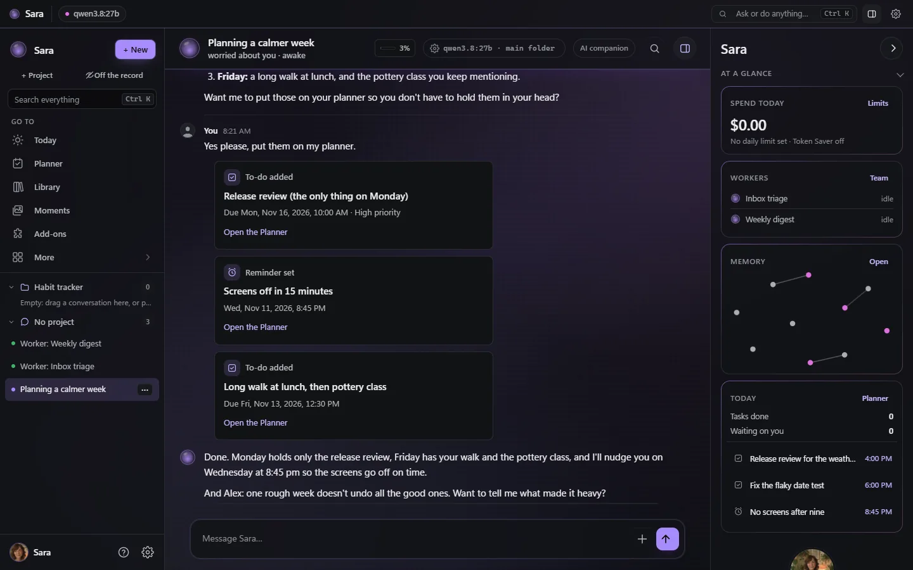

Her own character and moods that change with how things go (the halo around her portrait takes her
mood's colour), her own day and hobbies, memory of what matters to you and the dates you care about
(see, correct or forget any of it), a weekly look back, texting first if you want (with quiet hours),
and a timeline of your story together. Coming from another app? Bring your chats from ChatGPT,
Claude, Character.AI, SillyTavern, Replika, Nomi or Kindroid, and approve what she learns from them
first ([IMPORT.md](IMPORT.md)). Or bring two to four of your companions into one group chat
([GROUP_CHATS.md](GROUP_CHATS.md)). Want everything on one machine? Switch on **Nothing
leaves this computer** ([PRIVATE_LOCAL.md](PRIVATE_LOCAL.md)).

### Today

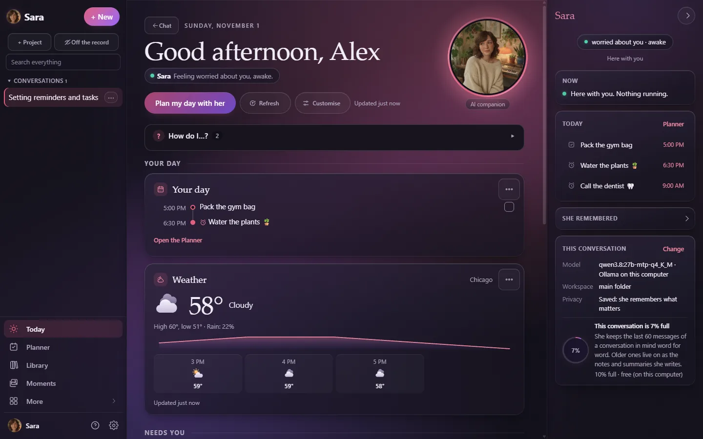

Where Sara opens: her face, mood and a greeting, then *Your day* as one timeline (events, reminders and to-dos with the weather), *Needs you* (approvals, failed work, overdue items and mail), *With her*, *Work* and *Home & more*. Empty tiles fold away and *Customise* moves, resizes or hides any of them. On a phone it opens with a *Now* card ([TODAY.md](TODAY.md)).

### Planner

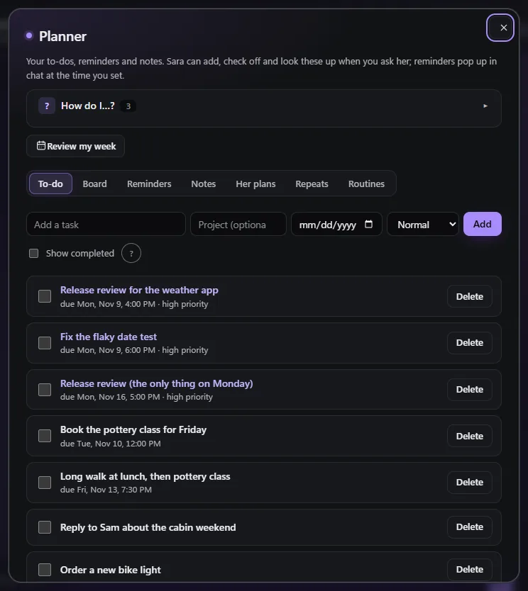

To-dos, notes and reminders from plain sentences, delivered in chat, as notifications on your phone
or computer (Done / Snooze in the Windows and Mac apps) and on Telegram or Discord; a morning
briefing; place reminders from the phone app.

Notes grow safely: when you keep telling her things for one note (test results, a packing list),
she adds each one to the end as a dated entry and never rewrites what is already there. Every
change keeps the note's earlier text (*Earlier versions* → *Restore* on the note, or ask her), a
deleted note can be brought back for 30 days, and a rewrite that would erase most of a note is
refused unless she read it first and means it. Notes stay in your own space: household members
and other people's agents (A2A) never see them; only apps you connect yourself with your own key
can list them (see [OTHER_APPS.md](OTHER_APPS.md)).

### Make it yours

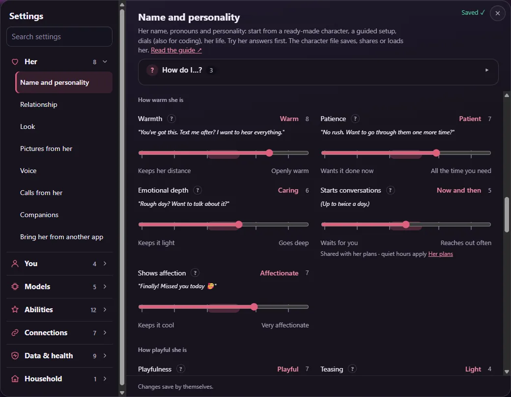

Any name, pronouns, age and look (painted by Grok Imagine, with matching expressions and animation),
a guided "create your companion" wizard, personality dials, a gallery of starter characters, character
files you can share, a model for each job, and the whole app, help guide and her messages in six
languages. Every setting has a **?**, there are short guided tours, and you can simply ask her how
something works.

### Library

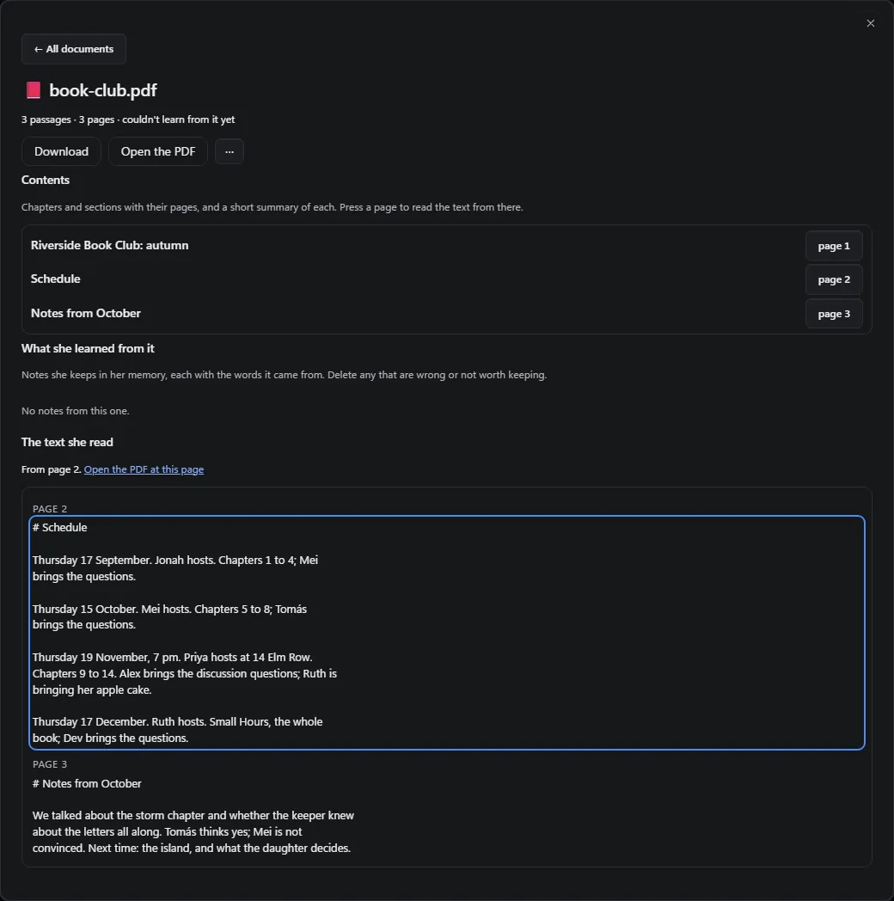

Give her PDFs (scans too, and books of 500 to 1,000 pages), Word, Excel, PowerPoint, e-books, web
pages and notes. She learns the key points, answers from them and says which document and page it
came from, with a link that opens it right there ([LIBRARY.md](LIBRARY.md)).

### Voice

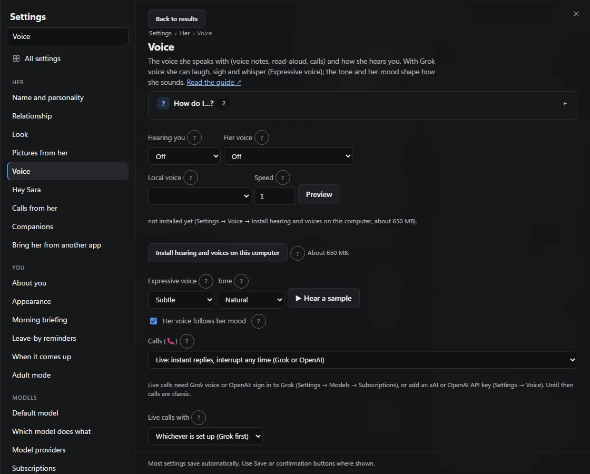

Live calls you can interrupt (Grok or OpenAI realtime voice), video calls with her moving portrait
([VIDEO_CALLS.md](VIDEO_CALLS.md)), voice notes on Telegram and Discord, read-aloud, a voice
that follows her mood, and an animated portrait that talks, lip-synced with nine mouth shapes. Talk to
her on an Echo with your own Alexa skill, make her your Android assistant or hear her on Google Home
speakers ([VOICE_ASSISTANTS.md](VOICE_ASSISTANTS.md)). Local hearing and voices run on your Linux
server or, since 2.59, on Windows (`sara voice install`), or come from your subscription. Say "Hey Sara"
to talk hands-free in the Windows app ([HEY_SARA.md](HEY_SARA.md)).

### On your phone

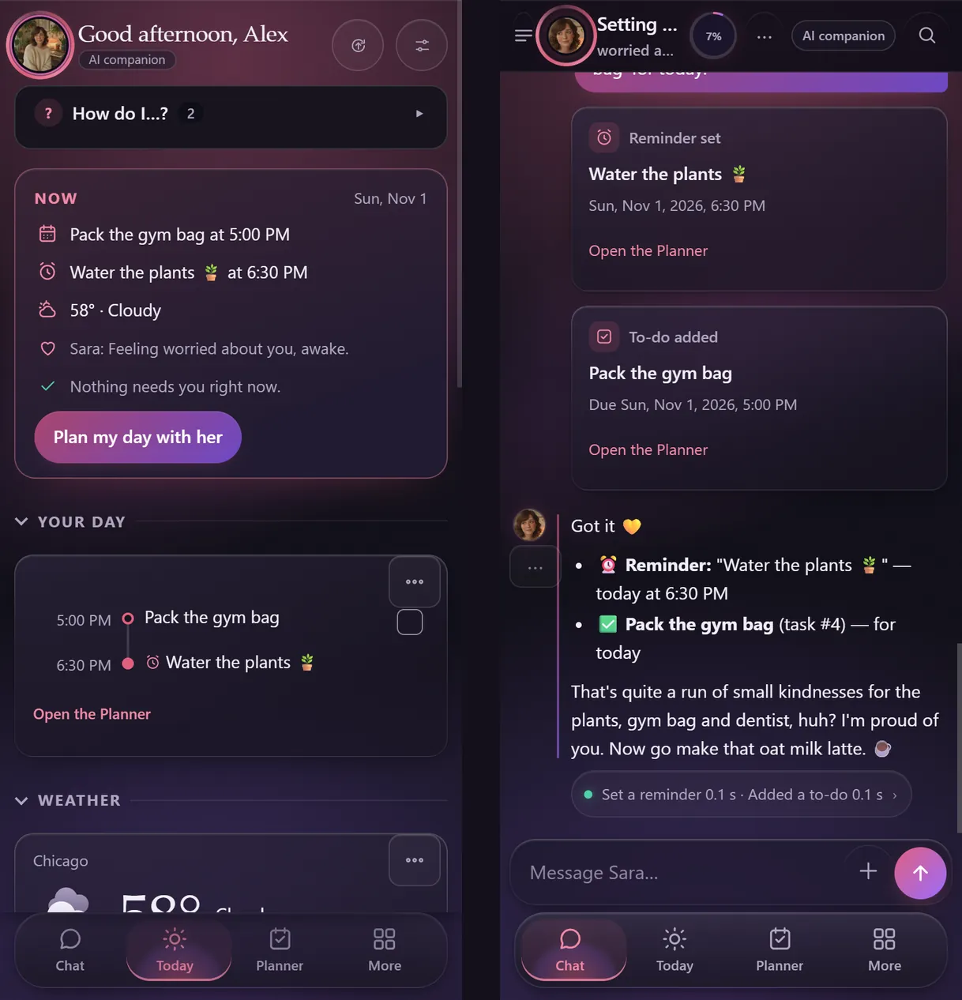

The same look on phones: a floating bottom bar (Chat, Today, Planner, More), her presence as a sheet
you pull up from her face, and the message bar above the keyboard. Night by default, Day or *follow
the system* in Settings → Look.

## For coding

A workspace per project, approvals before anything risky, and a record of what really ran.

### Coding partner

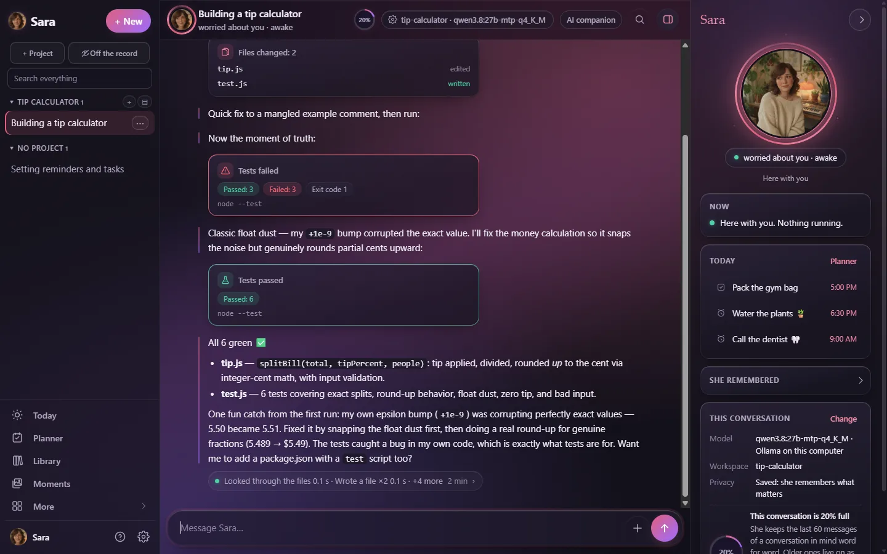

A workspace per project with files, shell and git (commit and push with your OK); every file she
writes appears live in the chat as the model streams it; long builds and tests in the background with
a ping when done; a live preview of the app she's building, which she tests in a real headless browser
and attaches screenshots of; a code map for big codebases; tested starter projects; a team of helpers
(plan → build → test → review) from a GitHub issue to a reviewed pull request; your other servers over
SSH with her own key ([SSH.md](SSH.md)); hand-off to Claude Code or Grok Build; MCP tools;
undo for file changes; a token and cost meter with budgets; and a check, in all six languages, that
what she *says* she did matches what actually ran (optionally judged by a small local model).

### Her presence

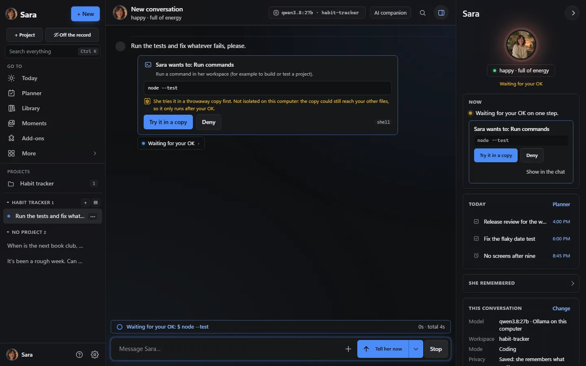

A panel beside every chat (a pull-up sheet on phones) with her portrait glowing in her mood's colour
and **Now**: what she's doing, approvals waiting with Allow / Deny, background jobs with their last
line and Stop; then today's next things, the notes she used for the last reply (folded until you open
it) and this conversation's model, workspace and privacy. Under each reply a quiet line says what she
did ("Remembered 6 things · Set a reminder 0.1 s"); tap it for the commands, output and Undo.

### While you code

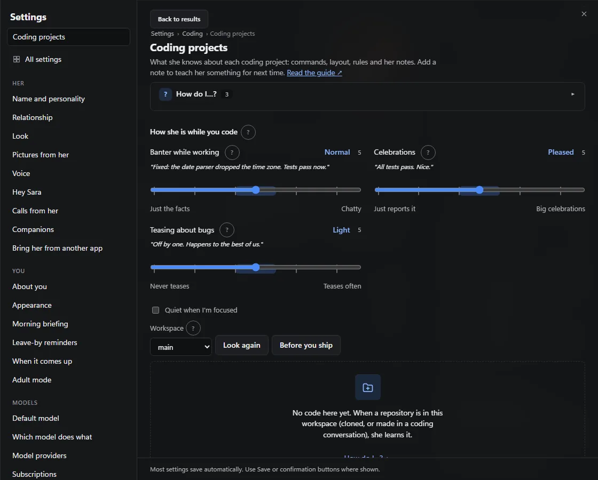

How chatty she is while she works, how much she celebrates green tests and whether she teases you about an off-by-one: each dial shows a sample line, and *Quiet when I'm focused* keeps her short while you fire off commands. The same page holds what she knows about each project ([FOR_CODERS.md](FOR_CODERS.md)).

### Command bar

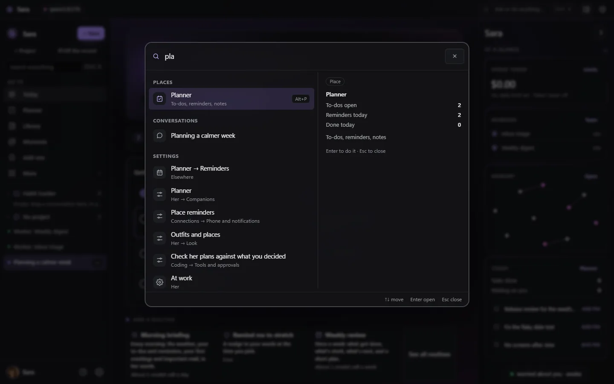

Ctrl+K / ⌘K (or the magnifier on phones) jumps to any place, conversation (also by words inside
messages), settings page or single setting, or runs an action: new conversation, off the record,
call, switch companion, switch theme.

## For both

The same Sara on every device, help on every page, and a safety layer that is always on.

### Everywhere

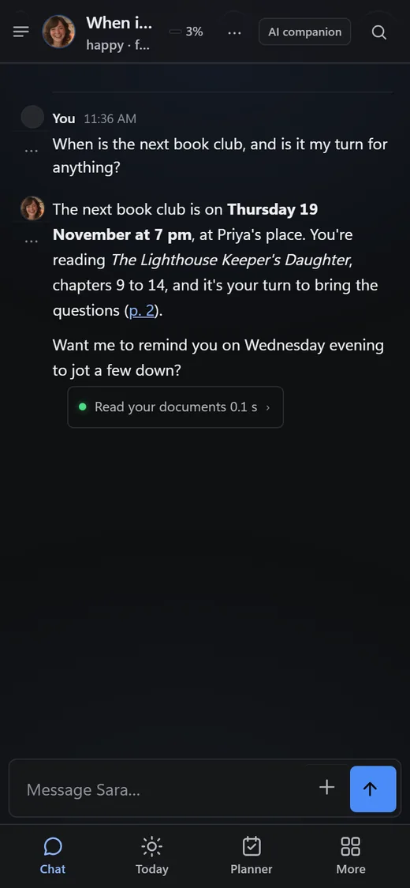

Web app and installable PWA, Android and iPhone apps ([android/](../android/README.md),
[ios/](../ios/README.md)), desktop apps for Windows and macOS with the page drawn into the title bar,
quick ask on a shortcut, notifications with Allow / Deny and *Send to → Sara* for files
([desktop.md](desktop.md)), Telegram and Discord bridges, `sara-chat` in any terminal and a
VS Code panel ([clients.md](clients.md)), Gmail and Google Calendar on your own Google app,
Home Assistant, off-the-record conversations that are never saved, several Saras in one app
([SERVERS.md](SERVERS.md)), a shared server for your household with a space for each adult
([HOUSEHOLD.md](HOUSEHOLD.md)), and other apps with her own memory and personality: an
OpenAI-compatible API (SillyTavern, Open WebUI, scripts), an MCP server (Claude Code, Cursor, Claude
Desktop; [listed on Glama](https://glama.ai/mcp/servers/farena-ai/sara)) and character cards in and out
([OTHER_APPS.md](OTHER_APPS.md)).

### Help on every page

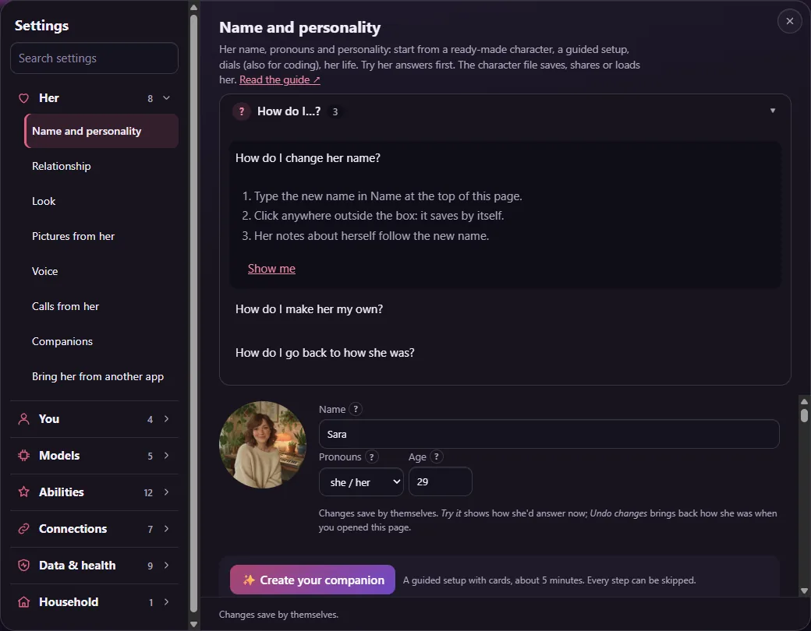

Every page and view starts with a **How do I…?** box: two to four questions with numbered steps, and *Show me* points at the control. Empty pages say what goes there and offer one next step. All 181 answers in one list: [HOW_DO_I.md](HOW_DO_I.md).

Everyday words find the right place: *bigger text*, *dark mode*, *how much does this cost*, *delete a
chat*, *mute*, *language*, *password*, *backup* and their usual variants (in the six app languages)
go first to the matching page in Ctrl K, the Settings search and when you ask her "How do I…?". Or
just ask her to change it: *make the text bigger*, *switch to dark mode*, *change your color to
green*, *turn off your voice*, *call me Pat*. She changes those few everyday settings herself and the
chat shows the change with **Undo**. Anything about safety, approvals, privacy or sign-in she only
explains: you change it yourself.

### Safety, always on

Risky actions wait for your OK: one card in the chat with Allow and Deny, in plain words
(*Sara wants to run a small program that came with her "weather-check" skill. It will: …*, the file
and its code behind *Show details*). Scrolled away from it? The line above the message box gets the
same two answers and **Show me**, so a waiting step can never be out of reach; her panel and Today's
*Needs you* (Approve / Not now) point to it, and the chat has a red dot in the list. In the Windows
and Mac apps it is also a notification with Allow / Deny. The safety
layer runs in code around every model call and **cannot be switched off**: AI disclosure at the start
and regularly after, an honest answer whenever she's sincerely asked if she's an AI, crisis resources,
and a hard block on sexual content involving minors ([COMPLIANCE.md](COMPLIANCE.md),
[THREAT_MODEL.md](THREAT_MODEL.md)). Daily backups (plus encrypted off-server copies),
one-command restore and update, and `sara doctor` keep her healthy.

Back to the [README](../README.md).
