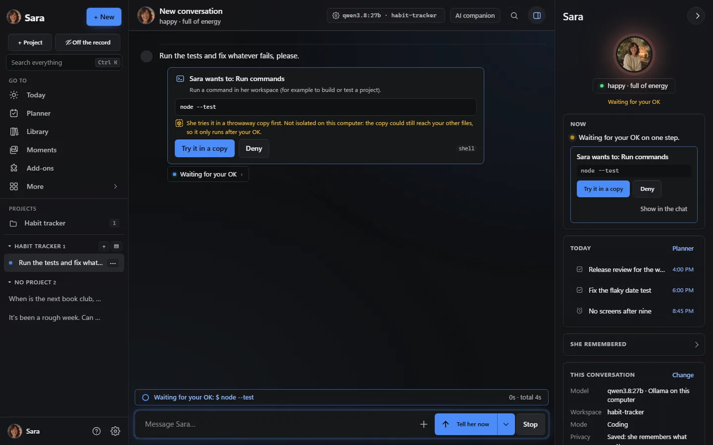
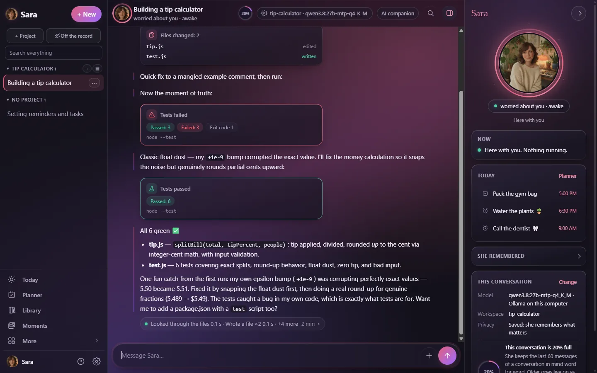
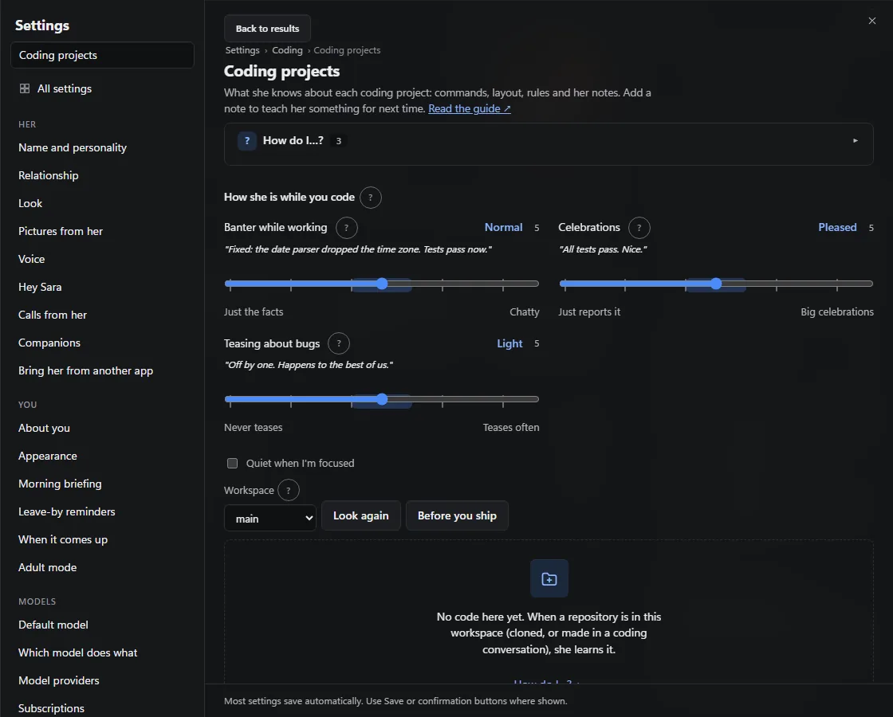

# For coders: Sara as your coding partner

Sara writes, runs and tests code in a workspace per project, asks before anything risky, and shows
what actually ran. This page gets you from install to a first green test run, then to the parts coders
use most. New to Sara altogether? [Start here](START_HERE.md) covers the same first steps in more detail.

<p align="center"><a href="https://www.youtube.com/watch?v=7i48NiAq-jw&list=PLGtrs9BqXtM8&index=4"></a><br><sub>Prefer to watch? <a href="https://www.youtube.com/watch?v=7i48NiAq-jw&list=PLGtrs9BqXtM8&index=4">Coding with Sara</a>.</sub></p>

## The short version

```sh
git clone https://github.com/farena-ai/sara && cd sara
npm ci
npm start          # http://127.0.0.1:7860; the token is in the output
```

Node 24+, zero runtime dependencies, no build step. Other ways to install: [docs/INSTALL.md](INSTALL.md).

1. **Pick *Coding*** in step 1 of the setup. Step 3 suggests a model that is good at code (a **Good for
   coding** chip; it prefers a capable model on your own computer) and puts *My subscription* (Claude
   Code, Codex or Grok Build) first when you are already signed in.
2. **Open a project:** *+ Project* in the sidebar, with a workspace folder. Start a conversation in it
   (or tap *Look at my project*, *Fix a failing test* or *Start a new project* on the last setup step).
3. **Choose how she runs code** in *Settings → Abilities → Tools and approvals*: she asks first, and
   risky commands can run in a throwaway sandbox copy first.
4. **Ask for something real**, and watch the cards: files changed, tests passed or failed, and every
   command waiting for your **Allow**.
5. **Connect GitHub** (*Settings → Abilities → GitHub*) for issues and pull requests.
6. **Use her from your editor or terminal:** `sara-chat`, the VS Code panel, MCP for Claude Code and
   Cursor, or the OpenAI-compatible address ([clients](clients.md), [other apps](OTHER_APPS.md)).
7. **Set a budget** (*Settings → Abilities → Budgets*) so a long task stops where you want.

## What a coding turn looks like



She explains the plan, writes the files (they grow live in the chat while the model streams them), and
stops on an approval card before running a command. The same Allow / Deny sits in her panel and, in the
Windows and Mac apps, in a notification.



A real run on a local model (qwen3.8 27B on Ollama): the first test run caught a rounding bug in her own
code; she fixed it and all six tests passed. The line under each reply (*Looked through the files ·
Wrote a file ×2 · +4 more*) opens to every command and its output.

## While you code



*Settings → Abilities → Coding projects* sets how chatty she is while working (with a sample line for
each step), *Quiet when I'm focused*, and what she knows about each project.

## Checks after her edits, and @-references (2.53.0)

After she changes a file, your project's own `tsc`, pyright, mypy, `cargo check`, `go vet` or ESLint
looks at it and she reads the new errors in the same reply (each project asks once; nothing is
installed). Type `@` to hand her a file or a few lines, your changes (`@diff`), the branch, the current
problems or a web page. Full guide: [CHECKS.md](CHECKS.md).

## The harness, in one list

| | Where | More |
|---|---|---|
| Workspace per project: files, shell, git, background jobs, live previews she tests in a headless browser | the chat chip (workspace · model · mode) | guide: *Coding help* |
| Asks before risky steps; commands tried in a sandbox copy first | *Tools and approvals* | guide: *Commands tried in a sandbox first* |
| Checks her plans against your rules ("never push to main") | automatic | guide: *She checks her plans…* |
| A team of helpers: plan → build → test → review, from an issue to a reviewed pull request | *Team* | guide: *Sara leads a team* |
| Security pass, threat model and red-team mode, each with a fix branch | *Findings* | [results](RESULTS.md) |
| Run snapshots, branch from any step, evals on your own tasks | *Show the run* under a reply, *Evals* | guide: *Show the run* |
| Budgets she keeps (tokens, steps, dollars) | *Budgets* | guide: *Budgets for her replies* |
| Skills, plugins, MCP servers, webhooks | *Abilities*, *Connections* | [skills](SKILLS.md), [plugins](PLUGINS.md), [webhooks](WEBHOOKS.md) |
| Your other servers over SSH, with her own key | *Servers over SSH* | [SSH](SSH.md) |
| Hand-off to Claude Code, Codex or Grok Build | *Subscriptions* | [choosing a model](CHOOSING_A_MODEL.md) |

Every page in the app has a **How do I…?** box; the coding ones are in the list at
[How do I…?](HOW_DO_I.md) under *Settings → Abilities*. Benchmarks, with the honest reading:
[RESULTS.md](RESULTS.md). The code itself: [ARCHITECTURE.md](ARCHITECTURE.md) and
[EXTENDING.md](EXTENDING.md).
