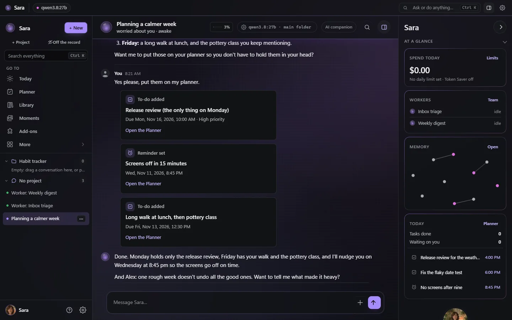
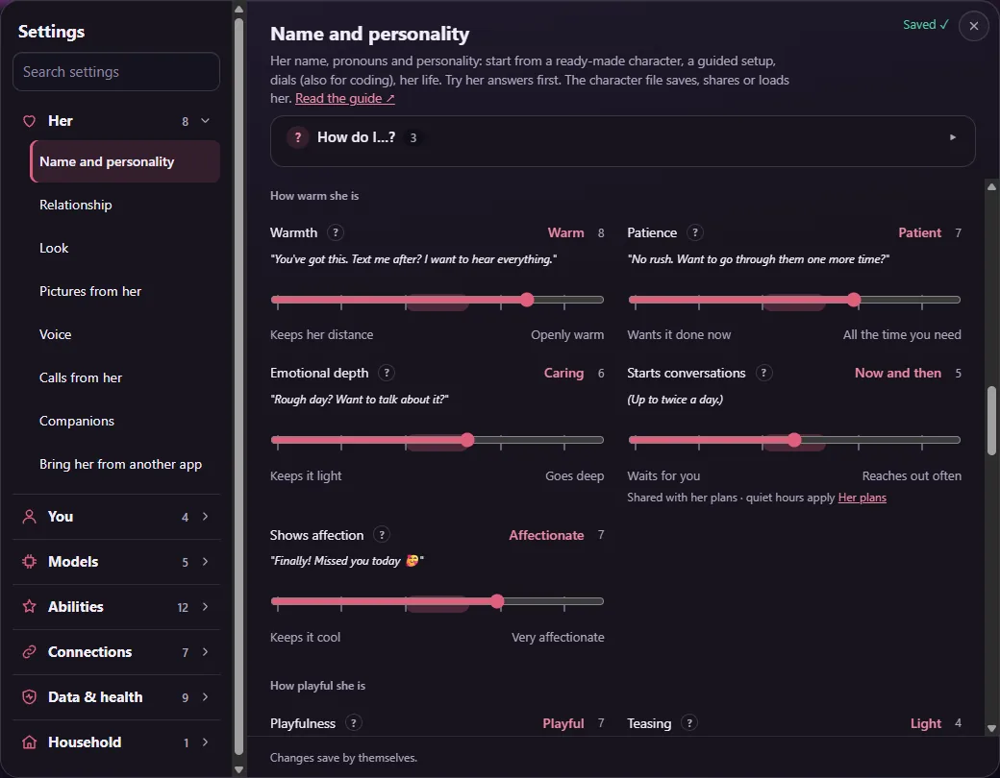
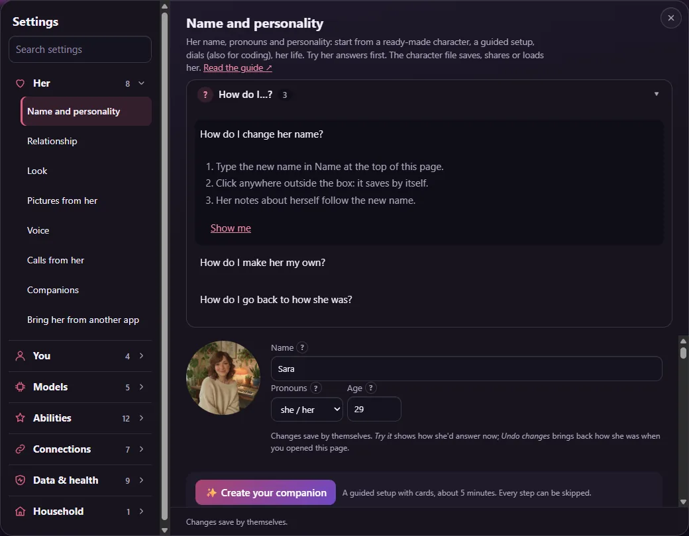

# Start here: I just installed it, now what?

Seven small steps, about ten minutes, from the first sign-in to a Sara that feels like yours. Nothing
here needs a terminal after the install. Coming to write code with her? Read [For coders](FOR_CODERS.md)
instead (the first three steps are the same).

> Not installed yet? [Install Sara](INSTALL.md) first (Linux, Docker, Windows, macOS or a NAS), and
> check [what computer you need](REQUIREMENTS.md).

 Prefer to watch? <a href="https://www.youtube.com/watch?v=DTAIW75y7i4&list=PLGtrs9BqXtM8&index=1">Set up Sara</a> in one minute.

## 1. Sign in

Open the address the installer printed. A new server asks for the short **setup code** from her log
(the terminal, the desktop app, or `docker compose logs sara`); she then shows your owner token once, so
put it in your password manager. Read the short note about what Sara is, and press *I understand*.

## 2. Tell her your name, and what you're here for

She asks **what you will mostly do with her**: *Company* (talk, plan your day, remember things),
*Coding* or *Both*. It only changes what she shows you first; every feature stays available, and you can
change it later in *Settings → You → About you*.

## 3. Keep Sara, or make your own

Keep Sara as she is, pick a ready-made character, or choose *Make my own* for a guided five-minute
*Create your companion* right after setup. All of it can be changed later in *Settings → Her*.

## 4. Connect a brain

The "brain" is the AI model she thinks with. She looks for one on this computer (Ollama), suggests a
model and checks that it answers: **Connected ✓**. No graphics card? *My subscription* uses a plan you
already pay for (ChatGPT, Claude, SuperGrok), or add a cloud key. Help choosing:
[Choosing a model](CHOOSING_A_MODEL.md) and [what it costs](COSTS.md).

## 5. Say hello

The last setup step has three starters (*Tell me about yourself*, *Plan my day with me*, *What can you
do?*), or just type. After her first reply she offers a short six-stop tour.

Ask for things in plain words ("remind me at 9 to call the dentist"): they come back as cards, and the
line under her reply says what she did.

## 6. Make her yours

*Settings → Her → Name and personality*: every dial shows where it sits and a line in her voice that
changes as you move it, so you hear the difference before you chat. Every step of every dial is in
the app's guide (Help → *Shaping your companion*).

## 7. Finish *Getting started* on Today

*Today* is where she opens. Its **Getting started** list ticks itself off as you go: her voice, Sara on
your phone ([Your phone](PHONE.md)), a morning briefing and a backup off this server. Each card opens the
right page with its answer ready.

## When you're stuck

- Every page has a **How do I…?** box at the top, with numbered steps and a **Show me** button. All 123
  answers in one list: [How do I…?](HOW_DO_I.md).
- Every setting has a **?** with an example; or simply ask her how something works.
- [Questions and answers](FAQ.md), the [how-to videos](VIDEOS.md), and
  [report a problem from inside Sara](SUPPORT.md).
